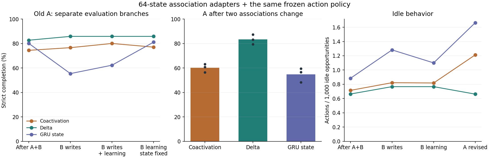
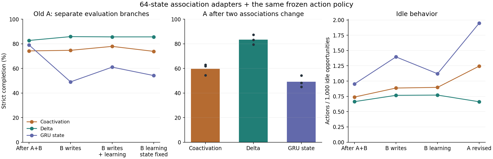

# 前向关联状态：保持旧内容与修订旧答案

2026 年 11 月 7 日。接续 [MemT 代码核验](memt-research-2026-11-07.md)，比较共激活外积累加、关联误差修正（delta）和普通递归状态。**在独立地址与共享地址两版中，delta 都更好地保留和修订了关联，并提高实际完成；共享地址版还测到 M 数值不变时，读法变化导致旧内容难以使用。** 实际动作仍由原来已经训练的 GRU 执行器决定。本轮是监督符号适配器的机制验证，没有实现原生自主绑定、完整 MemT 或端到端持续学习。

[第一版方案](../experiments/associative_state/analysis-plan.md) · [共享地址后续方案](../experiments/associative_state/shared-plan.md) · [代码入口](../experiments/associative_state/README.md) · [第一版逐种子数据](evidence/associative-state-2026-11-07/results.json)

## 怎样让它必须使用新的经历

每个 actor 在测试开始时获得新随机 A/B 映射，同一个 raw 在两种情境下有两个一致答案、两个冲突答案。其具体分配独立于预训练样本，不是把旧的固定 A/B 表再次拿来测。映射属于环境私有配置，不送入模型。

前 1,536 tick A、后 1,536 tick B 由原世界的中点教师实际行动。下一 tick 的公开成功 FINISH 回执给出成功载荷；绑定器将它与之前公开的 raw、context、version 关联。模型只从这种公开证据写记忆，不直接读取 oracle 标签或私有目标。绑定与写入时机由程序提供，不能称为模型自行学会识别重要经历。

适配器在新 cue 处预测目标符号，再经过原规则的逆置换转换成执行器熟悉的 raw；context、其余输入、版本及回执保留。开始、等待、结束仍全部取原十一动作头的 argmax，没有用记忆读出直接生成 FINISH。

本轮建立独立新世界，初始 h 和 M 为零，只加载旧执行器权重；不是把前一轮完整个体终点继续向前运行。在各条新世界流内，h、M、绑定缓存、世界、时钟与回执持续保留。clear 消融在教学终点清 M；no_write 是另一个从教学起点禁写、重建自己 h 的控制，详见下段。

## 容量、训练与信用范围

| 部件 | 累加 / delta | 普通递归参照 |
|---|---:|---:|
| 原执行器参数，始终冻结 | 148,246 | 148,246 |
| 原执行器 h | 192 个 FP32 | 192 个 FP32 |
| 新增快状态 | 16×4，即 64 个 FP32 | 64 个 FP32 |
| 第一版新增训练参数 | 130 | 16,641 |
| 手写绑定缓存 | 每 actor 八个标量，50 bytes | 相同 |

累加与 delta 具有完全相同的初始参数、样本、优化器和预算，只改变更新方程。递归参照仅快状态容量相同，参数和 FLOPs 不相同。没有把“h 加 M”与原 h 直接相减后当作结构收益。

每模型 384 次 Adam 更新，每次 64 条独立随机映射样本、48 次写入/查询。监督查询的是最近**已经公开示范**的值，隐藏规则改变但尚未重新示范时，不偷用新答案。梯度可经过这 48 次写入，但不会跨独立样本；在线长流不做这种完整反传。这里训练的是内容查询，不是通过未来行动损失端到端训练。

三种子、三种结构先全部训练完并冻结，再评分，未选择最好检查点。第一版的训练样本哈希和 add/delta 初始参数逐位一致。[训练冻结记录](evidence/associative-state-2026-11-07/training-freeze.json)

## 八个固定分支

除 no_write 外，各分支从同一个 A/B 教学终点派生，不串行挑选最好的结果：立即自主测试；再经历 4,096 tick B 教学后测试；相同 B 教学同时更新适配器参数；相同参数学习但固定 M；清 M；禁读；以及修改 A 的两个答案、再给予 1,536 tick A 示范。no_write 则将 M、h、绑定器置于独立教学起点，重读完全相同的实际 A/B 教师观察，全程禁写，以形成自己的 h；随后接入同一教师终点世界。它没有借用正常写入组的 h。

后续参数学习使用成功回执上的写入前预测误差。M 已分离计算图，在线有梯度的只有地址生成参数和读出尺度；写入率与递归写入器没有在线梯度。原执行器始终冻结，不能据此解释原 GRU 共享参数遗忘已解决。

每个分支自主评分 2,048 tick，期间参数和 M 只读，h 与世界继续运行。分母包括所有评分段内新发、外部合格且在结束前成熟的请求，包括从未 BEGIN、从未 FINISH 的失败；左边界继承和末尾截尾单列。空闲误动按实际空闲机会计算。

## 第一版：残差修正更能应对干扰和改写

下面是三种子等权平均的严格完成率；严格指成功 FINISH 前，活跃请求期间没有被拒绝动作。成功结束后的空闲误动不撤销该次严格完成，另计 idle。

| 第一版独立地址 | A/B 示范后旧 A 冲突 | 大量 B 后旧 A 冲突 | 修改后 A 全部请求 | 大量 B 后空闲误动 / 千机会 |
|---|---:|---:|---:|---:|
| 共激活累加 | 74.5% | 76.6% | 60.2% | 0.82 |
| delta | 82.7% | 85.9% | 83.4% | 0.77 |
| 普通递归状态 | 80.1% | 55.4% | 54.8% | 1.28 |

大量 B 后的 A 冲突严格计数分别为 **358、401、259 / 467**；修改后的 A 为 **603、839、551 / 1,005**。各列对应不同时间的请求，不能把“立即”与“延后”的百分比相减当成同一批请求的因果干预；同一列的三种结构使用相同外生请求。

大量 B 后，delta 的 B 冲突严格率为 85.3%，累加为 85.7%，递归为 85.3%。旧 A 优势没有伴随同量级的 B 完成损失。修改旧 A 后，delta 的 B 为 88.1%，累加为 88.2%。这只约束当前有限任务和预算。

清 M 或禁读后，三种结构的总体严格率均约 23.3%；从第一个示范之前禁写约 23.4%。禁读固定回退到符号 0，清 M 后全零 logits 的 argmax 也为符号 0，两者具有相同回退，不能当成两项独立机制证据。结合从起点禁写的控制，这说明该配置的行为收益依赖存储和读取，而不是原执行器已经知道每 actor 的新分配。

图的横轴为独立分支，不是同一个体连续通过四次测试。原任务时长仍为 8–16，没有检验更长单任务等待；4,096 tick B 插入检验的是旧情境缺席和新内容干扰。这里的 M 只在回执写入时变化，因此不构成物理连续时间动力学。

## 为什么追加共享地址版本

第一版每个地址有独立的可训练向量。只学 B 时，A 向量没有梯度；公共正尺度不会改变 A 的 argmax。因此固定 M 的 theta_only 分支不能检验真正的共享表示漂移。这一限制在第一版评估完成后的代码分析中识别，第一版完整保留，不作事后替换。

后续将固定随机码经过所有地址共用的 16×16 可训练矩阵。初始矩阵为单位阵，因此初始地址与第一版一致；B 的梯度现在可以改变 A 的读取地址。新增参数为累加/delta 各 258、递归 16,769，另有 128 个全局固定随机码标量；每 actor 动态状态预算不变。后续沿用相同训练样本、更新数、测试世界和八分支，但不宣称两版等参数。[单独固定的后续方案](../experiments/associative_state/shared-plan.md)

| 共享地址版 | 大量 B 后旧 A 冲突 | 同时学地址并写 M 后旧 A 冲突 | 只学地址、M 固定后旧 A 冲突 | 修改后 A 全部请求 |
|---|---:|---:|---:|---:|
| 共激活累加 | 74.7% | 77.9% | 73.9% | 59.7% |
| delta | 85.9% | 85.7% | 85.7% | 83.4% |
| 普通递归状态 | 49.1% | 61.1% | 54.2% | 49.1% |

大量 B 后的旧 A 冲突严格计数为 **349、401、229 / 467**；改写后 A 为 **599、839、496 / 1,005**。大量 B 后的空闲误动分别为 **0.89、0.77、1.40 / 千机会**，改写后为 **1.24、0.66、1.95 / 千机会**。delta 的保持和修订收益没有伴随平均空闲误动上升。[全部三种子、八分支与精确分母](evidence/associative-state-2026-11-07/shared-v2/results.json)

事后按预先固定的改写符号 raw 2/3 拆分同一账本，真正改变答案的 A 请求严格率为累加 **37.3%（183/493）**、delta **84.4%（417/493）**、递归 **15.8%（78/493）**；未改变答案的部分分别为 **81.2%、82.3%、81.5%**。这项描述性拆分表明，改写条件的差距主要集中在需要替换旧值的部分，不是所有 A 请求一起变差。括号为合并计数，百分比仍按种子等权。

### 数值保存完好，读法仍会失效

为区别记忆数值变化和读取变化，事后直接用各检查点原生读出查询所有八个地址，没有训练额外探针。共享地址递归组在 **M 完全不变** 的 theta_only 分支中，旧 A 正确读出从 **370/384（96.4%）降至 301/384（78.4%）**，B 则从 **354/384 升至 384/384**。这里比较同一批地址和同一份 M；改变的是共享地址矩阵及正读出尺度，后者单独不会改变 argmax。

因此本配置确实出现了“存储没有被覆盖，但训练新读取方式后，旧内容难以取回”的现象。实际行为的 h 和请求历史也会受翻译影响，不能把它们的全部成绩变化都归于这个直接读取差值。delta 同一诊断从旧 A **384/384 降至 383/384**，也不是数学上的永不遗忘保证。该诊断保留在汇总的 `posthoc_direct_address_diagnostic` 中，未用于选模。

## 结论范围与未完成部分

第一版支持将“按旧预测修正关联”作为下一步候选，而不是继续只按重复共激活累加。重复次数本身不能决定是否应加强旧值：遇到同地址改答案，累加会保留很多旧票；delta 根据已有预测修正，这是其结构性假设。

两版都完成后，下一步应集中在还由程序承担的绑定与写入选择：让模型从公开事件、回执和自身状态生成读写地址，用实际行动损失训练，并继续检查“状态丢失”和“读取方式改变”两个来源。不据本轮直接扩大模型或添加一套巩固约束。

这还不是模型自主形成记忆系统。当前只有八个地址、四种答案、两个情境；公开证据来自教师成功回执，绑定器和翻译接口是手写的，执行器冻结。各模型接受同量符号预训练，但没有加入未训练同构记忆的完整行为对照，不能把所有收益归给学出的参数。递归参照也是本轮指定的更新器和线性关联读法，未搜索其最佳架构或预算，不能据此判定 GRU 的一般能力上限。也未测试自由生长拓扑、无界容量或慢参数自动巩固。

教学时长固定，不按覆盖情况延长，部分 actor 的个别关联没有成功示范；覆盖计数完整保留。事后直接读取全部八个地址用于检查已存内容，既包含已示范也包含未示范地址，不作为主要行为指标或模型选择依据。

## 运行与核验

小矩阵开发计时采用同样 FP32：六次更新 CPU 约 0.36 秒、CUDA 约 1.53 秒（含各自首步开销）。正式任务采用九个独立 CPU 工作进程、每进程一个数值线程，没有降低精度或训练预算。

第一版 72 份行为报告的计数全部独立复算；审计脚本固定选取九个分支，分别完整重放 2,048 tick，观察、动作、私有评价字段与终状态逐位一致。这九个回放案例不是原训练协议中的模型选择条件，也不等于全部 72 条轨迹都完整回放。三种 B 后缀教师历史和覆盖相同，theta_only 的 M 数值不变，执行器未更新。[审计记录](evidence/associative-state-2026-11-07/audit.json)

共享版也完成相同的 72 份计数核验和九条完整重放；合计 18 个训练终点、144 份行为报告、18 条完整原生重放。模型、桥接、运行边界与共享地址共 44 项测试通过，审计另有独立临时夹具的损坏检测。两版各核对 270 个工件。[共享版审计](evidence/associative-state-2026-11-07/shared-v2/audit.json)

这类核验支持实现与计数一致，不代替模型能力结论。完整状态、逐 tick 数组、回执与优化器在本机 `data/associative-state/`；可携带汇总在本报告的证据目录。
