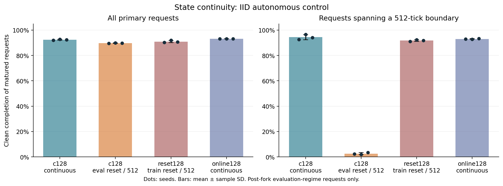
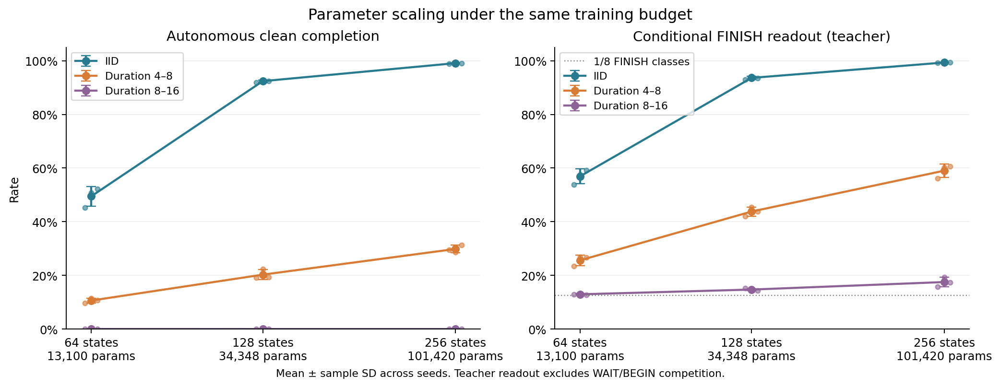
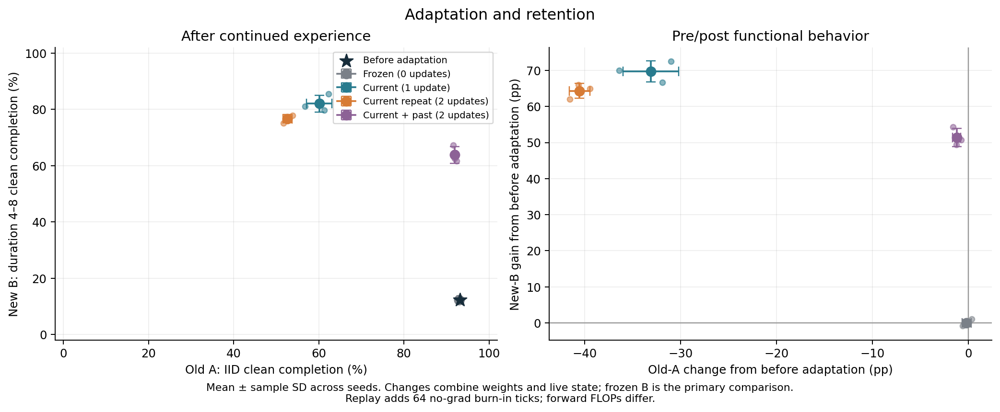

# 完整连续状态、长等待与经验重放

日期：2026-10-27。代码与复现命令：[continuity](../experiments/continuity/README.md)。本报告对应独立的新实验；上一轮 [dynamics](dynamics-experiment-2026-10-26.md) 的代码、检查点和证据保持原样。

三种子、33 组训练已完成。**完整连续状态保护了跨边界任务，但没有自动解决长等待外推。** 在相同连续系统中，继续学习把新等待条件提高到 82.09%，旧条件降到 60.09%；有限旧经历重放则保持旧条件 91.97%、新条件达到 63.82%。这是有监督条件下的有限能力积累和取舍，尚未形成可靠的长时间自主控制。

## 要检验什么

用户提出，长等待失败可能与系统没有保持完整、一致的连续状态有关。这个假说包含两个可区分的问题：清空状态是否破坏仍在进行的任务；消除这些人为边界后，模型是否更能处理训练范围以外的等待。第二项不由第一项自动推出。

上一版训练每 512 tick 开始一条新流，并清空隐藏状态。更关键的是，旧生成器会删除不能在流结束前完成的请求。因此，只把旧模型的隐藏状态接到下一条新生成的流上，既不能保留完整世界，也不能测到真正跨边界的任务。本轮重写在线环境，让命令日程、未完成请求、动作回执、时钟、随机状态和模型隐藏状态一起延续。

网络仍使用简单的连续循环：`dx/dt = -x + W tanh(x)`，事件到来时注入一次编码；没有添加待办表、计时模块、重要性打分或永久保护连接。训练、巩固和容量作为实验变量分别比较。

## 连续性的实际边界

64 条并行轨迹各有自己的世界和隐藏状态，共享一组模型参数；轨迹不会重新配对或打乱。一个阶段内世界没有 episode 结束，也没有为了测量而清空待办。只有明确命名的重置对照每 512 tick 清空隐藏状态，其世界、回执、时钟和优化器继续运行。

每 64 tick 截断反向传播，保留隐藏状态的数值。正式训练 `dt=0.25`，所以单段梯度覆盖 16 个环境时间单位；数值状态持续并不意味着梯度能无限追溯。参数更新后，实时状态直接继续演化，不重新计算整段过去。

完整检查点保存模型、Adam、隐藏状态、全部世界状态、待发生事件、随机数状态、有限经历库及学习进度。保存发生在完整更新边界；恢复后延续同一模拟时刻。程序关闭期间模拟时间暂停，这不等于断电期间仍在进行物理计算，也不是硬件异步实现。

除单元测试外，还用已完成 2,048 次更新的真实 online128 CUDA 检查点验证：连续训练两次，与训练一次、完整保存恢复、再训练一次，所有语义状态逐项一致；包括参数、Adam、隐藏状态、世界、随机数、经历库及轨迹统计。原检查点未改变。这两条验证分支不参加正式比较，记录见 [恢复证据](evidence/continuity-2026-10-27/resume-proof.json)。

## 环境与评分

四条并发任务通道反复收到一次性 NEW、REPLACE、CANCEL 命令。每个请求带公开版本、四选一内容、处理时长和合法完成窗口。模型需要 BEGIN，再在合法时刻 FINISH 正确版本与内容；输入没有剩余时间、READY、持续待办提示或合法动作掩码。动作的接受或拒绝回执只出现一次。

外部事件使用独立于模型动作的连续日程；世界时间累加实际 `dt`，改变未来环境条件不会改写已经到达的请求。状态保存包含日程与随机数状态。相同种子下，模型即使采取不同动作，也经历相同外部事件。

主指标是**无错误尝试的请求完成率**。普通完成率、提前/非法尝试和 FINISH 精确率另行保存。分母只包括完成窗口已经结束、最终可完成的请求；评估结束时仍在等待的请求单列，不算作失败。

评估从训练末尾的完整状态分叉，冻结权重，继续同一个世界。主分母只计分叉后按测试分布新生成且已经到期的请求；训练末继承的请求、旧日程下的后续改版、尚未到期请求分别统计。每个条件都是完整分叉，不把任意新世界塞进旧隐藏状态。

重置对照额外统计“发布时刻 < 重置时刻 < 发布时刻 + 声明时长”的最终可完成请求。这个群体由外部事件决定，与模型有没有成功 BEGIN 无关。配对运行核对事件和请求指纹，避免只比较不同策略幸存下来的任务。

## 冻结的实验协议

[主协议](evidence/continuity-2026-10-27/main-study-v1.json)在正式训练与测试前写入。种子 0、1、2；使用最终检查点，不按测试成绩选择训练步数或模型。

### A：状态连续性、容量和闭环学习

每组 2,048 次更新，每次 64 tick、64 条并行轨迹，总计每条轨迹连续 131,072 tick。固定 `dt=0.25`，Adam 学习率 0.001。固定时钟避免把 512 tick 的状态重置与时钟切换混为同一个干预。

连续运行长度不等于单条信息的保持长度：A 中的声明等待只有 1–4，测试最长为 8–16。四条通道会反复产生新请求；本轮没有要求任意旧事实在整个 131,072 tick 之后仍可被检索。

| 组别 | 状态宽度 | 总参数 / 可训练参数 | 训练时实际执行的动作 |
|---|---:|---:|---|
| c64 | 64 | 13,100 / 13,100 | 教师 |
| c128 | 128 | 34,348 / 34,348 | 教师 |
| c256 | 256 | 101,420 / 101,420 | 教师 |
| reset128 | 128 | 34,348 / 34,348 | 教师；每 512 tick 清空隐藏状态 |
| reservoir128 | 128 | 34,348 / 17,964 | 教师；循环矩阵冻结，编码和读出仍训练 |
| gru128 | 128 | 117,420 / 117,420 | 教师；收到实际时间增量 |
| online128 | 128 | 34,348 / 34,348 | 模型自己的动作 |

教师在请求到达后 BEGIN，在实际就绪和截止之间的中点 FINISH。online128 在自身造成的当前世界状态上获得因果教师标签，执行自己的预测；它仍是监督学习，不是仅靠奖励学习，也没有可微环境。

自主控制评估由模型实际行动，另做教师内容读出诊断，每个分叉未来继续 2,048 tick。条件分别为：原分布等待 1–4、长等待 4–8、更长等待 8–16、命令稀疏，以及更密集的取消与替换。IID 另外进行隐藏状态周期性清空的配对测试。原 FINISH 读出层的条件内容准确率通过独立教师轨迹诊断，不能把教师替模型完成任务的成功率算作模型成功率。

### B：继续学习与旧经历巩固

从每个种子的 online128 最终完整检查点分出四条轨迹，模型、优化器、实时状态、世界、随机数和旧经历库均相同。后续新请求的等待改为 4–8，已有请求保持原合同；每条轨迹再运行 1,024 个 64 tick 分段，始终执行模型自己的动作。

A 与 B 使用相同任务规则，改变的是等待时长分布；本轮的适应与遗忘不能等同于学习两套互相矛盾的规则。流中的替换和取消仍负责检验当前请求的更新。

| 组别 | 每段梯度更新 | 学习经历 |
|---|---:|---|
| frozen | 0 | 权重冻结，状态继续演化 |
| current | 1 | 当前 64 tick |
| current_repeat | 2 | 当前 64 tick 学两遍 |
| replay | 2 | 当前 64 tick，加一段旧 A 经历 |

所有 A 模型都收集相同容量的有限经历库：均匀蓄水池抽样保留 32 个 128 tick 历史块，含实际观察、标签、时间增量与历史起始隐藏状态。B 的重放只读取该 A 库，不加入测试或 B 经历。重放从保存的历史状态出发，前 64 tick 无梯度预热，后 64 tick 学习；重放分支的状态不会覆盖实时状态。

每块包含全部 64 条轨迹，因此库中有 262,144 个观察时间步，而不只是 32 条单独经验。128 宽度检查点的经历库张量共 **105 MiB**（观察 96 MiB、标签 8 MiB、历史起始状态 1 MiB；元数据另计）。参数量表不包含这笔存储，不能据 34,348 个参数就把整个重放系统称为同等大小的模型。

current_repeat 与 replay 的梯度次数及有损失的时间步相同，后者多 64 tick 前向预热，不能称作等 FLOPs。历史起始状态可能随权重变化而过时，有限预热也不保证完全重建。这里测的是朴素有限重放，不是已经学会的重要性选择、摘要或生物 REM。

B 结束后完整分叉回测 1–4、4–8、8–16 等待，分别观察旧能力保持、新条件适应和进一步外推。训练世界的累计计数包含 A 和 B，不能拿它冒充 B 阶段成绩。

这些分叉测的是权重与运行状态共同支持的行为。A 前与 B 后位于不同生命时刻，前后差值不是纯权重知识测量，因此必须同时看 B 的冻结对照。A 检查点的长等待评估与随后 B 训练可能共享未来外部事件前缀；该评估不更新模型，也不用于调参，但不能把所有分叉都称为互相独立的新世界。B 末评估使用其训练末尾之后的未来事件。

## 结果与证据

共完成 21 个 A 训练和 12 个 B 延续训练，评估 315 个冻结分叉，其中 174 个由模型实际行动，141 个是另行执行的教师内容读出诊断。下表为三种子的均值 ± 样本标准差，单位为百分比；每个种子是一个统计样本，不把成千上万条请求冒充独立训练重复。预实验不并入正式结果。

### 连续状态确实有用，但作用范围要分清

对同一个 c128 检查点，连续测试的跨边界请求完成率为 **94.44 ± 1.99%**，每 512 tick 清空隐藏状态后为 **2.59 ± 0.84%**；全流主指标则只从 **92.40 ± 0.44%** 变为 **89.74 ± 0.16%**。全流平均掩盖了小群体的严重损失。

另一项对照比较训练过程中是否清空：c128 与 reset128 都在连续测试中运行，IID 为 **92.40 / 90.97%**，等待 4–8 为 **20.27 / 19.81%**。这三个种子没有显示去掉训练重置能大幅改善未见时长。512 tick 对应 128 个时间单位，远长于单次 1–4 的训练等待；周期性重置主要伤害少量跨边界请求，不能据此解释全部长等待失败。

图中 reset128 指训练每 512 tick 清空、测试继续保留状态；c128 的 eval reset 是对同一训练检查点实施的测试干预，二者回答不同问题。

### 容量改善了任务能力，时间外推仍失败

| 模型 | 等待 1–4 | 等待 4–8 | 等待 8–16 | 稀疏命令 | 密集取消/替换 |
|---|---:|---:|---:|---:|---:|
| c64 | 49.48 ± 3.70 | 10.61 ± 0.88 | 0.02 ± 0.02 | 45.92 ± 5.83 | 42.35 ± 1.92 |
| c128 | 92.40 ± 0.44 | 20.27 ± 1.84 | 0.01 ± 0.02 | 88.73 ± 2.28 | 82.33 ± 0.96 |
| c256 | 99.11 ± 0.14 | 29.84 ± 1.42 | 0.01 ± 0.01 | 97.37 ± 1.08 | 97.23 ± 0.36 |
| reset128 | 90.97 ± 0.85 | 19.81 ± 1.53 | 0.03 ± 0.02 | 88.36 ± 2.36 | 80.65 ± 1.79 |
| reservoir128 | 81.35 ± 0.79 | 12.39 ± 1.05 | 0.08 ± 0.07 | 62.73 ± 3.88 | 70.48 ± 0.97 |
| gru128 | 11.04 ± 0.16 | 6.80 ± 0.38 | 0.01 ± 0.01 | 8.46 ± 0.94 | 12.12 ± 0.30 |
| online128 | 93.20 ± 0.05 | 12.36 ± 1.12 | 0.00 ± 0.00 | 82.81 ± 2.17 | 83.77 ± 0.10 |

这轮四通道任务中，增大连续循环容量确实提高了表现；但 8–16 等待的无错误完成率仍接近零，不能把扩容认作时间泛化的解决办法。自身动作训练也没有在所有条件上胜过教师轨迹：online128 的 IID 略高，长等待和稀疏条件更低。

GRU 在这套训练预算和超参数下学得很差。本轮没有对其专门调参或验证收敛上限，不能把 11.04% 解释为 GRU 的一般能力上限，更不能据此宣称连续循环取得通用参数效率优势。上一轮与本轮的任务通道数、生成器和训练日程均不同，跨轮分数也不是连续性的单变量对照。

### 持续学习与旧经历重放

以下四组都经过相同长度的 B 外部事件流，在同一个生命时刻冻结评估；frozen 仍保留完整运行状态，只不更新权重。

| B 学习方式 | 旧等待 1–4 | 新等待 4–8 | 进一步外推 8–16 |
|---|---:|---:|---:|
| frozen：不更新 | 92.99 ± 0.43 | 12.32 ± 0.15 | 0.01 ± 0.01 |
| current：当前经历学一次 | 60.09 ± 2.95 | 82.09 ± 2.98 | 3.66 ± 1.20 |
| current_repeat：当前经历学两次 | 52.65 ± 1.08 | 76.70 ± 1.43 | 3.41 ± 0.31 |
| replay：当前经历 + 旧经历 | 91.97 ± 0.37 | 63.82 ± 2.97 | 1.11 ± 0.40 |

相对冻结分支，重放在基本保住旧条件的同时，提高了新条件的能力；相对只学新经历，它的适应程度较低。连续状态没有自动阻止学习干扰，旧经历继续参与更新有实际作用。

等待 8–16 时，current、current_repeat、replay 的普通完成率仍有 **64.81 / 62.70 / 56.79%**，但无错误完成率只有表中的 **3.66 / 3.41 / 1.11%**。多数成功伴随了先前的错误尝试；这里失败的是可靠控制，不能把严格指标接近零改写成所有请求都完全做不成。

与同样两次梯度更新的 current_repeat 相比，replay 旧条件高 **39.32 个百分点**，新条件低 **12.88 个百分点**。把当前经历再学一遍没有带来同样的保持效果，本设置下两项甚至都低于 current；不能把更新更多本身当成收益。重放也不是免费提升，它使用额外前向预热和前述 105 MiB 经历库。

### 两个总分容易掩盖的问题

**读得出内容，不等于能正确控制。** c256 的教师轨迹条件内容读出从 IID 的 **99.35%** 降到等待 4–8 的 **59.02%**、8–16 的 **17.51%**（八分类均匀猜测为 12.5%）。这说明已有读出不能可靠访问相同类型的内容，但仍不能断言隐藏状态里所有相关信息都消失了。

B 后的新等待条件中，current 和 replay 的教师轨迹内容读出都较高，分别为 **91.21 / 92.57%**，自主严格完成率却为 **82.09 / 63.82%**。两者不是同一条动作轨迹；教师替模型行动也改变了回执和后续状态。应继续拆分真实闭环中的计时、内容读取与错误动作引起的状态变化，不能仅凭这个诊断把失败归为遗忘或纯计时。

**完成了请求，也可能在没有有效任务时乱动作。** 稀疏命令下，c256 虽然有 **97.37%** 的严格请求完成率，FINISH 精确率却只有 **29.61%**；online128 分别为 **82.81 / 9.04%**。每 1,000 个总通道时间步中，两者在该通道没有有效任务时分别动作 **37.86 / 156.69** 次，涵盖完成、取消、超时等之后的无任务状态。它不是以空闲时间为分母的比例，也不只统计 FINISH。

严格请求完成率不惩罚任务已经结束之后的错误，因此不能单独代表完整控制可靠性。一个持续系统不仅需要保住有效信息，也需要在任务结束后正确改变状态、等待新事件；全局定期清空会破坏其他仍在进行的任务，不能拿来掩盖这一失败。

### 可追溯证据

- [完整机器可读汇总](evidence/continuity-2026-10-27/aggregate/summary.json)保存每个种子、每类请求的计数、指纹、配置和来源；[可读全表](evidence/continuity-2026-10-27/aggregate/summary.md)包含完整控制指标和条件读出。配对条件复用了外部事件，315 次分叉不能被称作 315 个互相独立的数据世界。
- [汇总审计](evidence/continuity-2026-10-27/aggregate/audit.json)为 **0 错误、0 警告**；[执行审计](evidence/continuity-2026-10-27/execution-audit.json)核对 33 个最终检查点与所有评估，[分叉审计](evidence/continuity-2026-10-27/fork-audit.json)核对完整起点和冻结分支的参数、优化器与随机状态。
- 55 项连续环境、模型、训练和评估测试通过；汇总器额外用 12 种故意破坏的来源、预算、分布或配对数据验证拒绝路径。真实 CUDA 检查点的中断恢复证据见前文，三张正式图已检查显示。
- 原始运行在 `data/continuity/main-20261027-v1/`、`adapt-20261027-v1/`、`evaluation-A/`、`evaluation-B/`。最终检查点和每 512 次更新的完整检查点都保留，未根据测试成绩延长训练、选择较好检查点或修改冻结运行源码。

## 解释范围

同宽 GRU 参数更多；不同容量、可训练参数、前向成本、梯度更新和外界经历数需要分别读。并行训练共享同一 GPU，所记耗时不能用作独占硬件速度或能耗基准。主实验保持较简单的任务与监督，不能由这里的分数推出通用推理、终身学习或意识。

## 下一步收窄的问题

这轮已经支持保留完整连续状态作为后续主线的执行方式；它本身还不是长记忆或泛化机制。下一轮优先测两个可定位的问题：

1. **跟着模型自己的轨迹测内容与时间。** 在相同命令和干扰的配对分叉中逐步延长等待，记录原有内容读出、首次合法完成机会、提前动作和无任务动作。读出诊断只旁观，不替模型行动，避免教师回执改变被测状态；另用只读探针区分信息不可读与简单读出不适配。
2. **比较训练的时间覆盖与梯度长度。** 保持简单循环结构，比较重复短等待、覆盖多种等待时长，以及更长反向传播片段，单列经历数和计算量。当前连续数值状态可以跨越很久，梯度却只有 64 tick，必须检查这个训练边界是否限制了可学到的等待规律。

巩固比较继续保留 current、current_repeat、replay 和冻结分支，并同时报告空闲误动作。现有结果尚不要求增加永久保护连接、复杂记忆分区或自评分模块；先确定失败发生在保持、读取、时间推进还是任务结束后的状态更新，再决定结构需要改变什么。
