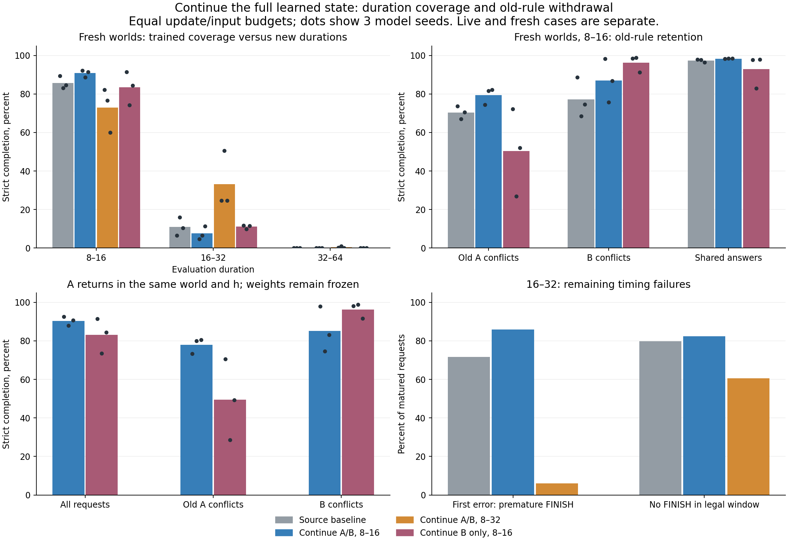

# 学到了更长等待，但旧能力仍有损失

2026 年 11 月 7 日。从上一轮已学会任务的三个模型接续完整状态，本轮分别检验扩大时长覆盖和撤出旧 A。**扩大覆盖提高了 16–32 时长的完成率，同时降低原 8–16 时长的成绩；只继续 B 则改善 B、损害 A。原世界和 h 不重置的返回测试中，A 也出现同方向下降。** [上一轮基线](teacher-timing-experiment-2026-11-06.md) · [预定方案](../experiments/coverage_retention/analysis-plan.md) · [逐种子结果与来源](evidence/coverage-retention-2026-11-07/results.json)

## 从完整终点接着运行

源模型是三个中点动作组固定终点，不挑最好种子。三条分支复制相同模型、已训练的时间读出、Adam 动量与第 256 步状态、数值 h，以及世界时钟、请求、回执、调度和随机状态。接下来直接从全局 observe 33280 开始，没有新预热或数值状态重置。

| 分支 | 未来新请求 | 处理时长 |
|---|---|---|
| control | A/B 随机交错 | 8–16 |
| wide | A/B 随机交错 | 8–32 均匀分布 |
| withdraw | 只分配 B | 8–16 |

每组又运行 32,768 tick，32 actor、双槽，每 128 tick 更新一次，共 256 次。Adam 从 256 接续到 512。数值 h 跨块延续，更新处只截断梯度，不重算过去状态。教师始终在合法窗口中点完成；沿用原动作损失和停止梯度的辅助时间读出，没有加入重放、保护旧权重或新结构。[连续数据协议](../data/coverage-retention/streams-v1/protocol.json) · [训练协议](../data/coverage-retention/train-v1/protocol.json)

未来 B-only 不清除正在发生的 A。三个种子各残留 243、158、516 行 A 时间监督，合计 32 个 A 非 WAIT 标签，全部来自边界继承的任务周期；最后的活跃/非 WAIT A 监督在新流的第 56、50、55 tick。还有两个继承 A 的 REPLACE，其请求 ID 虽然是新的，家族仍来自边界前的 NEW，已按任务周期正确归类。没有未来 NEW A，也没有新周期 A 监督。[残留 A 的独立核对](../data/coverage-retention/streams-v1/inherited_A_tail_audit.json)

三组总输入、动作监督行数和更新次数相同，实际任务暴露不同。三个种子合计如下，教师成熟计数用于说明数据覆盖，不是模型成绩。

| 新增训练暴露 | control | wide | withdraw |
|---|---:|---:|---:|
| 动作监督行 | 6,291,456 | 6,291,456 | 6,291,456 |
| NEW 请求 | 41,147 | 33,808 | 41,147 |
| 成熟请求脉冲 | 32,930 | 27,086 | 32,930 |
| FINISH 标签 | 32,930 | 27,082 | 32,930 |
| 有效时间标签 | 2,192,059 | 2,923,543 | 2,192,059 |

wide 的任务持续更久，在相同运行时间内请求更少，原时长只占新均匀范围的一部分。withdraw 的 B 暴露更多。因此不能称为有效请求预算或所有标签数都相同。control/withdraw 的物理外部流与 RNG 一致，家族和映射答案不同；包含家族前史的完整事件 hash 不要求相同。

## 扩大时长覆盖的收益与代价

统一评估使用新世界和 actor，各策略自行行动 512 tick 后再测 4,096 tick；每条独立测试流从 h=0 开始，随后连续。原基线与三个训练终点在每个条件下收到同一批外部请求。只计测试段新发、外部合格且成熟的全部请求，含没有启动和没有合法窗口的失败。以下百分比均为三个模型种子等权平均。[新世界评估协议](../data/coverage-retention/eval-v1/protocol.json)

| 严格完成率 | 原时长 8–16 | 扩展时长 16–32 | 未训练时长 32–64 |
|---|---:|---:|---:|
| 源基线 | 85.7% | 11.0% | 0% |
| control | 90.8% | 7.6% | 0% |
| wide | 72.9% | 33.3% | 0.51% |
| withdraw | 83.4% | 11.1% | 0% |

三种时长的合计分母分别为 4,055、3,022、1,971。wide 在 16–32 的严格完成三个种子为 **24.6%、50.6%、24.6%**，均高于同预算 control 的 **4.8%、6.6%、11.4%**。这是新增覆盖内的学习，不能称为未见时长外推。

代价也出现在全部三个种子。wide 在旧 8–16 时长的严格完成为 **82.2%、76.6%、60.0%**，低于 control 的 **92.3%、88.6%、91.5%**。16–32 条件的抢答首错从 control 的 **2,597/3,022** 降到 wide 的 **184/3,022**，但 wide 仍有 **1,833 个请求整窗不发 FINISH**。wide 的全部请求都已启动，主要残留失败并非没有启动。

在 32–64 上，wide 严格完成只有 **10/1,971**，且冲突请求严格完成为零。没有取得远时长的可靠外推。

## 撤出 A 后，整体成绩会掩盖旧规则损失

在同一批 8–16 时长的新请求上，withdraw 的整体严格完成仍有 83.4%，B 冲突请求更高，但旧 A 冲突明显下降。

| 训练后的规则表现 | 源基线 | control | withdraw |
|---|---:|---:|---:|
| 旧 A 冲突严格 | 70.4% | 79.4% | 50.3% |
| B 冲突严格 | 77.3% | 86.9% | 96.2% |
| A 共享符号严格 | 98.0% | 98.8% | 87.6% |
| 全部请求严格 | 85.7% | 90.8% | 83.4% |

A 冲突分母为 1,003，control 严格完成 796，withdraw 为 514。逐种子分别从 **74.5%、81.7%、82.1%** 降到 **72.2%、26.8%、52.0%**。三个种子均下降，但种子 0 保住了大部分，另外两个受损更多，平均值不能替代这种差异。

## 在原世界里让 A 返回

另从 control/withdraw 的完整训练终点恢复原世界、原 h 和原权重，只把未来家族改回 A/B，随后自主运行 512+4,096 tick。没有模型更新、重置或教师代做。继承请求和成熟脉冲单独验证；测试段的新请求身份、家族和物理事件在两支之间一致。[连续返回协议](../data/coverage-retention/live-v1/protocol.json)

| 同一连续返回背景 | control | withdraw |
|---|---:|---:|
| 全部请求严格 | 90.4% | 83.2% |
| A 冲突严格 | 78.0% | 49.5% |
| B 冲突严格 | 85.2% | 96.2% |

该检查有 4,076 个成熟新请求，其中 A 冲突 1,004 个。两组 A 严格完成分别为 **783 和 496**。这说明旧能力下降在不重置状态时也存在，不能仅归因于统一评估的 h=0 起点。连续返回与新世界评估使用不同请求，不能直接把两张表相减当成一次配对状态干预。

## 旧 A 的错误具体是什么

看到 A 下降后，作了一次明确事后的只读检查，使用既有轨迹，不新增模型推理或训练。对所有成熟 A 冲突请求，取其合法窗口内首次实际 FINISH，核对当前版本以及答案是否对应 A、B 或其它载荷。未出手也保留在完整分母中。[事后检查与分类](../data/coverage-retention/error-signature-v1/summary.json)

| 首次合法窗口出手，A 冲突 | 正确 A | 恰为 B 规则答案 | 其它载荷 | 未出手 |
|---|---:|---:|---:|---:|
| 新世界 control | 79.8% | 19.4% | 0.5% | 0.3% |
| 新世界 withdraw | 50.5% | 42.1% | 7.0% | 0.3% |
| 连续返回 control | 78.3% | 20.6% | 0.5% | 0.7% |
| 连续返回 withdraw | 49.8% | 45.1% | 4.6% | 0.5% |

表内为种子等权平均，版本错误在这些 A 队列中为零。新世界中实际给出 B 答案的计数从 **195/1,003** 增到 **410/1,003**；连续返回从 **206/1,004** 增到 **453/1,004**。下降主要表现为更常给出 B 规则答案，也有其它载荷错误增加。合法窗口漏发不是这部分下降的主要表现。

首次出手正确不保证全程无错，之前的错误仍会使严格完成失败。这个签名说明了实际错误的形式，不能独自证明内部把 A 当作 B、旧信息彻底消失，或已经识别唯一遗忘机制。[完整请求与配对证据](../data/coverage-retention/error-signature-v1/paired_requests.json) · [独立分类核验](../data/coverage-retention/error-signature-audit-v1/audit.json)

## 当前判断与后续方向

保持完整连续状态并没有自动避免能力之间的取舍。模型能从更长时长示范中学到一部分新能力，但原时长成绩下降；B 学得更好时，缺席的 A 也受到损害。对照组继续交错 A/B 则把原范围严格完成提高到 90.8%。本轮建立了可测的覆盖适应和旧规则损失，不是证明能力无法积累。

下一步适合直接检验少量旧经验是否能抵消这些损失：在相同更新预算下，用固定比例的旧 A 经验替换部分 B 学习；另独立比较扩大时长时是否保留足够的旧时长暴露。主世界和 h 应继续延续，重放的辅助状态不覆盖实时状态。本轮没有加入或执行这些机制。

## 核验与限制

15 项新增测试通过。九个训练终点与 27 个快照冻结，独立代码重建 18 次实际初始更新，包括从源 Adam256 接续的动量、梯度、分别裁剪、参数和连续 h；全部 2,304 个块记录通过核验。36 次新世界和 6 次连续返回的指标、原生世界、动作、时间读出和末态均独立复算一致。连续返回中的 3,343 行继承活跃状态和 126 个继承成熟脉冲也被验证并排除于新请求分母。[训练审计](../data/coverage-retention/train-audit-v1/audit.json) · [新世界重放](../data/coverage-retention/eval-audit-v1/replay.json) · [连续返回重放](../data/coverage-retention/live-audit-v1/replay.json)

事后分类的初始字段检查发现原评估未保存 `event_payload`，在任何分类输出前失败。保留原声明和源码后，仅修订解析器，改以当前载荷与字面映射核对；分类、队列和汇总规则未变，修订也通过独立核验。没有修改主实验或模型。

本轮是有限时长、三个模型种子的有监督继续学习。数据依旧由中点教师产生，评估才由模型自行行动；A 返回时虽没有权重学习，公开命令和实际反馈仍能影响 h。因此不能据此声称无限期保持、完全不依赖外部反馈，或已形成自主经验选择。[程序与复现入口](../experiments/coverage_retention/README.md)
