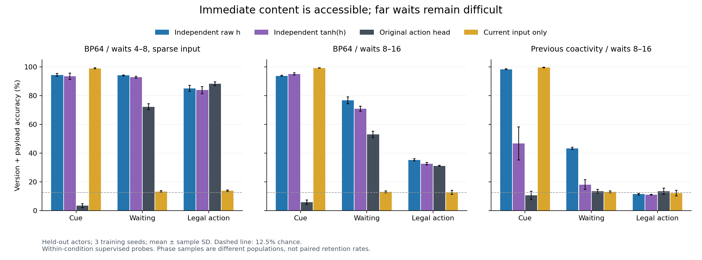
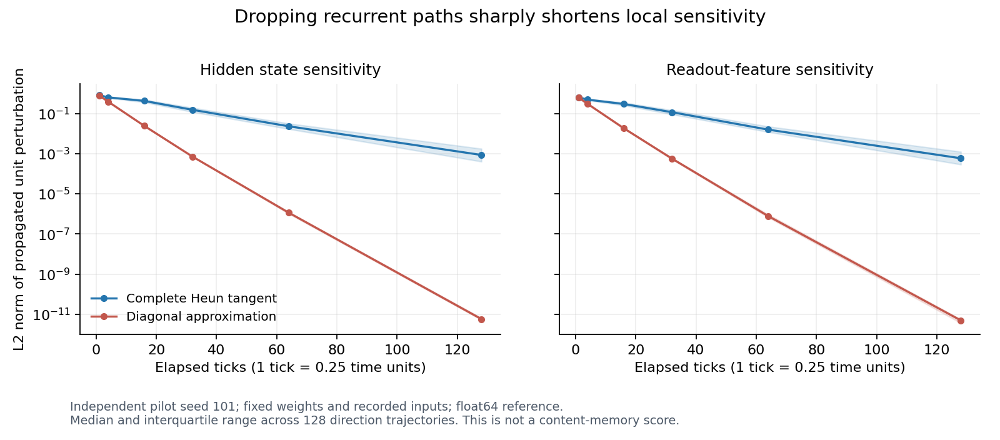
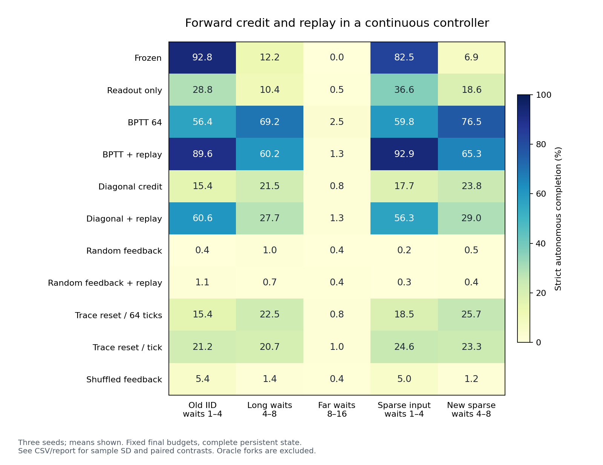
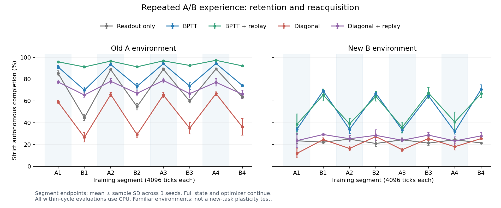

# 连续状态中的内容读出、前向信用分配与旧经验重放

日期：2026-10-27。接续 [上一轮连续状态与重放实验](integration-experiment-2026-10-27.md)。

**完成：33 组主比较、15 个连续复访分支、75 条冻结轨迹的独立读出诊断；最终统一 CPU 评估与完整存档审计均已通过。**

本轮不改变模型结构，不添加巩固开关、连接保护规则或新的记忆模块。128 维状态、34,348 个参数、4 个并行任务槽保持不变。问题是：内容是否仍可读取；过去的活动怎样参与参数更新；重放的作用是否依赖反向传播。

## 1. 原动作头读错，不等于状态没有内容

对上一轮的 frozen、bp64、replay64、bp128、coact_mix，各取 3 个训练种子、5 种环境、每种 1,024 tick。共 75 条冻结自主轨迹。世界、时间、隐藏状态和回执从各自最终 B 状态完整继承；读出器不参与行动。

线性读出器分别使用原始 h、模型实际 float32 tanh(h)、当步公开输入。它不能接收阶段、年龄、请求编号或私有世界状态。40/12/12 个完整 actor 分作训练、验证、测试；不同任务和同一请求的多次采样不能跨划分。正则只按验证集选取。继承但没有观察到内容的旧请求不生成内容标签。

下表是版本与内容的联合 8 分类，随机水平 12.5%。这里“原动作头”仅指八种 FINISH 候选内部的 argmax；自主控制仍在全部 11 个动作中选择，收到 cue 时正确选择 WAIT/BEGIN 并不要求此条件读出正确。数值为 3 个训练种子的均值 ± 样本标准差，单位 %。

|模型与环境阶段|独立读出原始 h|独立读出实际 tanh(h)|原动作头|
|---|---:|---:|---:|
|bp64，8–16 等待，刚收到内容|93.86 ± 0.34|95.17 ± 0.69|5.88 ± 1.51|
|bp64，8–16 等待，合法行动阶段|35.30 ± 0.79|32.64 ± 0.91|31.18 ± 0.36|
|replay64，4–8 等待且输入稀疏，合法行动阶段|90.13 ± 1.88|88.96 ± 1.35|89.01 ± 1.99|
|coact_mix，8–16 等待，刚收到内容|98.36 ± 0.34|46.83 ± 11.57|10.60 ± 2.93|

刚收到输入后，独立线性读出与原动作头的表现差别很大，说明不能从原 FINISH 头的即时低分推断编码已经丢失。cue 的公开输入对照本身也接近 99%，所以这一刻的高读出率包含直接输入注入的作用，不能当作长时保持证据。上一轮共激活组的原始 h 与实际 tanh(h) 的线性可读性也明显不同，与高饱和、压缩的观察相符；这些探针没有估计各因素的因果份额。原控制器实际接收的是 tanh(h)，不能把 raw h 的高分当作它已经能利用这些信息。

更长等待并没有因此解决。即使专门用 8–16 条件训练独立读出器，bp64 的合法阶段也只有约 35%；replay64 为 40.19 ± 4.50%。仅用 1–8 条件训练后迁移过去，分别为 31.50% 和 35.56%。表征迁移确实有影响，但本次线性探针没有找到一个接近完美、只是被原动作头漏用的长等待读出。

公开输入对照在长等待合法阶段约为 12.6%。排除当步带公开 payload token 的样本后，bp64/replay64 的原始 h 对 payload 的读出仍为 61.08 ± 1.71% / 64.91 ± 3.03%，输入对照约为 25%。这一切片混合多个阶段，不能当作仅在合法阶段的成绩。随机请求标签、打乱特征等负对照，在各组/条件/特征视图的总体联合内容精度均值为 11.76%–13.47%；不能把这个总体范围套到小样本阶段。

任务状态也不是完全不可读：4–8 稀疏输入下，bp64/replay64 的 active 标志平衡准确率分别为 98.07 ± 0.90% / 98.20 ± 0.30%，当步输入仅约 51.6%–51.8%。这不代表精确计时已正确，也不能把“状态里有信息”当成“控制器会正确使用”。

这些是有采样上限的阶段边际统计，测试 actor 为 12 个；不是同一批请求从 cue 到合法时刻的保留率，也不是上一轮全 actor、窗口成熟请求的首次合法时刻指标。线性失败仍不能证明所有信息已消失。

## 2. 前向训练不只有共激活

项目以前已实际测试过：固定特征分类器的解析误差 × 输入更新、带即时奖励的局部策略梯度，以及仅调节输出频率的偏置更新。前两者用过任务反馈，最后一种没有。它们不等同于持续循环网络中的长期信用分配。

|方法|从过去保留什么|什么决定更新方向|本轮处理|
|---|---|---|---|
|活动频率 / 共激活|活动数量或相关统计|局部规则，有时另接调制信号|保留旧实验，不把失败推广到所有局部学习|
|RFLO / e-prop 一类资格迹|连接对状态影响的局部导数近似|神经元层面的误差信号或反馈|据实际积分器推导一个明确的近似对照|
|前向模式梯度|参数方向上的敏感度|目标函数的方向导数|文献比较；没有冒充已实现|
|神经元扰动|扰动与后续结果的关联|奖励或目标变化|需定义噪声和回报，未加入本轮主比较|
|Forward-Forward|正、负样本各层活动|各层 goodness 目标|目标和负样本构造不同，未混称为共激活|
|在线最小二乘 / RLS|活动相关和活动—目标统计|明确的拟合误差|做固定表征的统计等价验证|

[LSM](https://doi.org/10.1162/089976602760407955) 提供可供读取的动态时序表征；它本身不决定哪条循环连接应为哪次错误负责。[RFLO](https://elifesciences.org/articles/43299) 和 [e-prop](https://www.nature.com/articles/s41467-020-17236-y) 更直接面对后一个问题。其“资格迹 × 学习信号”也不等于活动 EMA。

近期的 [Cascading Eligibility Traces，ICLR 2026](https://proceedings.iclr.cc/paper_files/paper/2026/hash/e647dad9086b5a4cc136e1d1926cc172-Abstract-Conference.html) 用状态空间 / 级联迹改善延迟信用的时间定位。这与“用动态系统更准确地区分过去的时刻”接近，但仍需要学习信号，而且增加迹的状态数。本轮没有直接堆入级联模块。具体细节核对了[作者预印本](https://arxiv.org/pdf/2506.14598)；最终 PDF 的浏览访问受验证阻挡，预印本的实验限制不冒称为最终版本的全部设置。

[前向模式随机梯度](https://arxiv.org/abs/2202.08587) 仍然使用导数，只是不走反向模式；单方向估计在高维可能方差很大。[Forward-Forward](https://arxiv.org/abs/2212.13345) 则改变了学习目标。这些路线值得分开验证，不宜只因都有“前向”两个字就合成同一种机制。

## 3. 本轮的局部规则与严格对照

实际模型先用 Heun 法积分 `dh/dt = -h + W tanh(h)`，然后注入一次编码器输入，最后以 `head(tanh(h))` 生成动作。本轮对每个 Heun 子步骤计算前向敏感度：E 记录循环连接对其目标神经元的影响，F 记录编码器连接的影响。

为控制开销，每个积分阶段只保留本神经元的状态导数，丢弃跨神经元传播路径。误差信号来自解析交叉熵残差，经读出权重转置或固定随机反馈传回。规则不含 Oja 项、频率目标、权重硬夹取或自适应迹归一化。

因此它是 **Heun 阶段内的对角前向敏感度近似**，不是完整 RTRL，也不是 RFLO/e-prop 的原样复现。资格迹跨参数更新持续携带，还存在陈旧敏感度问题；[SnAp 的推导与讨论](https://arxiv.org/html/2006.07232v1) 区分了这两类近似。小规模固定参数验证中，完整前向敏感度与 BPTT 相符；对角近似在一个 4 维稠密例子里已有约 7.93% 的循环权重梯度相对误差、13.97% 的编码器误差。这不是任务规模下的误差上界。

主比较为 11 组 × 3 种子，每组从同一个种子的完整 A 存档继续 65,536 tick：

|组|更新方式|旧经验|
|---|---|---|
|frozen|不更新|无|
|readout_only|只更新原读出层|无|
|bp64|64 tick BPTT|无|
|bp_replay|BPTT|固定 A 库|
|diag_sym / diag_sym_replay|对角前向迹，读出权重传回误差|无 / 固定 A 库|
|diag_random / diag_random_replay|对角前向迹，固定随机反馈|无 / 固定 A 库|
|diag_reset64|每 64 tick 清空 E/F|无|
|diag_instant|每 tick 清空 E/F|无|
|diag_shuffle|打乱 actor 间的内部学习信号|无|

任何组都不清空活跃 h、世界、任务回执和时钟。新引入的 E/F 在 A 存档分叉时初始化一次为零，此后持续携带；A 阶段没有记录这种迹，不能声称恢复了它过去不存在的历史。清空资格迹的两组仅是新增学习状态的消融。打乱组和随机反馈组仍保留正确的解析读出梯度。readout_only 冻结的是已训练的循环网络和编码器，并不是重新随机初始化的脉冲 LSM。

所有学习组每 64 tick 只做一次继承的 Adam 更新。重放使用同一组更新前参数，旧序列长 128 tick、前 64 tick 不直接计损失，后 64 tick 计损失；BPTT 保留整段 128 tick 的图，局部组则从零旧迹演化完整 128 tick。新旧梯度各自归一化后各占一半，统一裁剪、更新一次。

旧分支从不覆盖活跃 h/E/F。旧 h 是历史权重产生的快照，重新运行不能保证精确恢复当前权重本应形成的历史。重放也增加了样本量、计算量和旧分支的反向跨度；所以它的效果不能被解释成一个纯粹的、等算力的“内容重复”因果效应。新 bp_replay 与上一轮 replay64 的图跨度不同，旧成绩不能直接代替新组。

这些前向组继承的是 **BPTT 预训练模型及其 Adam 动量**。无反向图的说法只适用于新阶段更新，不能称为从零全程前向训练。任务标签仍由外部因果教师给出，没有实现模型自评。

另用独立种子 101 做了[固定输入轨迹的切向敏感度审计](evidence/credit-2026-10-27/tangent-audit-v1.json)：4 段旧输入、每段 4 个 actor、每个 actor 8 个小扰动方向，共 128 条方向轨迹，在 6 个时间跨度测量。64 tick 后，完整 Heun 敏感度范数的中位数为 0.0229，对角近似仅为 `1.14e-6`；128 tick 后分别为 `8.55e-4` 和 `5.76e-12`。持续保存对角迹，仍然丢掉了能够传播较久的跨神经元路径。

这项审计冻结输入、权重，以 float64 作数值参考；扰动的是起始 h 的单位方向，不让扰动改变自主行动或后续回执。这些范数既不是参数资格迹范数，也不是完整 Jacobian 的算子范数，更不是内容记忆量。即使完整局部敏感度衰减，不同吸引域之间仍可能保留有限、离散的记忆；因此上述数字不能被称为“遗忘率”。

正式主比较已完成全部 33 个分支、165 条自主评估及 60 条额外诊断。主成绩仅使用自主行动分支，分母为评估开始后新环境产生且完整窗口已经成熟的最终可完成请求；普通完成、继承合同和右删失另列。下表为严格无错误完成率，%（3 种子均值 ± 样本标准差）。

|组|旧 IID|等待 4–8|等待 8–16|短任务稀疏|长任务稀疏|
|---|---:|---:|---:|---:|---:|
|frozen|92.82 ± 0.13|12.23 ± 0.10|0.00 ± 0.00|82.50 ± 1.43|6.88 ± 1.43|
|readout_only|28.82 ± 2.83|10.40 ± 2.21|0.50 ± 0.12|36.64 ± 2.34|18.64 ± 0.54|
|bp64|56.39 ± 3.24|69.19 ± 1.52|2.49 ± 0.67|59.76 ± 1.68|76.49 ± 1.98|
|bp_replay|89.55 ± 2.11|60.16 ± 1.88|1.27 ± 0.57|92.85 ± 1.52|65.32 ± 0.06|
|diag_sym|15.36 ± 2.50|21.46 ± 0.82|0.84 ± 0.18|17.75 ± 5.43|23.79 ± 0.69|
|diag_sym_replay|60.62 ± 3.14|27.69 ± 2.61|1.34 ± 0.34|56.31 ± 3.85|29.02 ± 2.88|
|diag_random|0.37 ± 0.48|1.00 ± 0.73|0.37 ± 0.24|0.19 ± 0.26|0.52 ± 0.43|
|diag_random_replay|1.08 ± 0.18|0.71 ± 0.11|0.40 ± 0.07|0.31 ± 0.14|0.42 ± 0.28|
|diag_reset64|15.36 ± 2.81|22.54 ± 1.28|0.82 ± 0.22|18.50 ± 4.28|25.69 ± 1.42|
|diag_instant|21.18 ± 3.16|20.69 ± 1.74|0.96 ± 0.09|24.60 ± 3.53|23.26 ± 1.28|
|diag_shuffle|5.42 ± 2.82|1.38 ± 0.20|0.40 ± 0.13|4.96 ± 2.74|1.24 ± 0.42|

对称局部规则在新长任务稀疏条件比只训练读出高 **5.15 ± 1.23 个百分点**，但比同结构 BPTT 低 **52.69 ± 1.47 个百分点**。更新内部网络带来了一点收益，当前近似仍然丢失了大量有用的学习能力。这些前向组继承 BPTT 初始化、使用相同的继承 Adam 和公共学习率；没有对每个局部算法分别调参，不能把当前成绩称为其收敛上限。

持续资格迹减去 reset64 为 **−1.90 ± 2.11 个百分点**，三个种子均为负；减去每 tick 清空为 **+0.53 ± 1.62 个百分点**。本轮没有显示持续保存这种迹的优势。另一方面，打乱 actor 学习信号后只有 **1.24 ± 0.42%**；正确的反馈对应关系很重要，活动曾经出现过本身还不够。

重放的作用依赖更新规则。BPTT 重放使旧 IID 提高 **33.16 ± 1.64 个百分点**，新长任务稀疏下降 **11.17 ± 2.05 个百分点**。对称局部规则加重放，旧 IID 提高 **45.26 ± 3.61 个百分点**，新条件也提高 **5.23 ± 3.19 个百分点**。随机反馈组加入旧经历后仍接近零严格完成。旧经历可参与前向更新并提供保持收益，但不能使任意局部误差信号自动有效。

终点和更新记录也没有支持一个简单的“局部规则几乎没改参数”解释：对称局部组每次实际循环矩阵变化范数约 0.0324，BPTT 约 0.0347；但这不表示更新方向同样正确，也不排除学习率、优化状态等因素。按平均对数增益外推，局部齐次对角部分的 64 tick 衰减因子约为 `2.4–2.6e-7`；它忽略新源项和跨神经元传播，不是每条实际资格迹的范数。当前 h 仍可能承载旧经历并通过活动参与更新，不能据此说旧信息完全没有影响。随机反馈组终点约一半活动饱和，反馈/当前头全局余弦约 0.06–0.07；这些是伴随观察，尚未测得因果份额。详见[独立规则复核](evidence/credit-2026-10-27/forward-review-v1.json)。

诊断干预说明阶段和内容都仍有问题。例如，对称局部重放组新条件自主为 29.02%，强制因果调度后为约 72.87%，仅纠正 FINISH 内容后约 36.72%。干预会改变后续回执、隐藏状态及行动轨迹，差值不能相加，也不能当成互斥的故障占比；这些更高分数均不计入自主成绩。等待 8–16 时所有主组仍低于 2.5%，没有出现解决长等待外推的证据。

## 4. 反复回来学习同一种环境

预先选择 readout_only、bp64、bp_replay、diag_sym、diag_sym_replay，各 3 种子。完成 B 阶段后，继续 A/B 交替 8 段，每段 4,096 tick；A 为等待 1–4、间隔 0.5–2，B 为等待 4–8、间隔 4–12。

每段的 1,024 和 4,096 tick 保存完整学习状态，各运行两种冻结自主评估，合计 480 条评估分支。跨环境保留世界、h、E/F、Adam 和随机状态。重放库在复访期间仍固定为 A 经历，B 经历没有额外入库；它是有方向的旧能力锚定，不是自动生长的中立经验库。这里只检验熟悉环境的再学习和保留，不把它当作 Nature 可塑性论文中的新任务学习能力复现。

正式主评估与最终复访评估统一在 CPU 执行，学习过程仍在 CUDA。[测量修订 v2](evidence/credit-2026-10-27/cycle-measurement-revision-v2.json)单独记录后端变更，保持原训练协议、时长和评分规则。原来 14 个已完成复访分支的 224 个保存点及 448 条 CUDA 评估全部保留；新测量复用其不可变完整检查点，并重新在 CPU 评估所有保存点，原 CUDA 分叉仅作附加来源与后端对照。适配器验证了训练状态、世界、Adam、E/F 和 RNG 的完整语义一致性。两阶段虽然后端一致，未来请求与评估跨度仍有不同，不能将不同保存点的裸差值当作完全配对的任务结果。

全部 15 个连续复访分支、240 个保存点、480 条统一 CPU 自主评估已完成。第四次 B 学习结束后的结果如下，%（3 种子均值 ± 样本标准差）。

|组|熟悉 A 能力|熟悉 B 能力|
|---|---:|---:|
|readout_only|63.62 ± 1.45|21.54 ± 0.75|
|bp64|74.23 ± 1.17|70.69 ± 4.12|
|bp_replay|92.21 ± 0.58|66.69 ± 3.52|
|diag_sym|36.21 ± 7.63|25.52 ± 0.84|
|diag_sym_replay|66.17 ± 3.65|28.01 ± 3.25|

部分 A 保持有所积累，但 B 大多在平台附近波动。BPTT 每次 B 段结束后的 A 成绩从第一次 69.94 ± 2.81% 到第四次 74.23 ± 1.17%；对应 B 从 69.25 ± 1.39% 到 70.69 ± 4.12%，中间并非单调提升。BPTT 重放的 A 始终较高，但 B 从 65.49 ± 5.52% 到 66.69 ± 3.52%，仍没有同时全面掌握两种时间分布。

按种子配对，第四次 B 终点减第一次 B 终点的 B 成绩：BPTT 为 **+1.44 ± 2.78 个百分点**，BPTT 重放 **+1.20 ± 3.94**，对称局部 **+0.95 ± 1.63**，局部重放 **−1.24 ± 3.45**。这些结果体现保持、干扰和恢复；没有形成普遍持续增长的证据。

更高的 A 早期成绩也不能直接称为“重学更快”：扣除前一 B 终点的 A 基线后，第 4 次减第 2 次的 1,024 tick 净增益，BPTT 为 **−0.73 ± 0.73 个百分点**，BPTT 重放 **−0.86 ± 1.74**。起点本身在变化，而本轮只测了 1,024 与 4,096 两个进度，不能确定完整学习速度曲线。

第四次 B 段对 A 的配对损失，BPTT 为 **20.15 ± 0.99 个百分点**，旧经验重放为 **5.07 ± 0.37**。这支持旧经验锚定的保持作用，同时保留 A 库偏置这一解释边界。另未设置复访之外的“额外相同预算始终只学 B”对照，跨复访改善不能单独归于交替顺序。详情及全部配对分母见[独立复访复核](evidence/credit-2026-10-27/cycle-review-v2.json)。

## 5. 什么情况下相关统计能替代逐条重放

[FORCE / RLS](https://pmc.ncbi.nlm.nih.gov/articles/PMC2756108/) 提供一个具体启发：固定表征、线性平方损失下，累计 `XᵀX` 和 `XᵀY`，就能求出与保留全部样本相同的岭回归解。活动统计之外，还保留了活动与目标的对应关系。

本轮用冻结探针数据作数值核验：4 个任务槽，每槽约 29,600–29,900 个训练样本，约 8,850–9,060 个测试样本。统一使用训练 actor 计算标准化，再按完整请求分块累计统计。累计解与一次性批量解的最大系数差不超过 `3.12e-15`，测试预测一致率 100%。这不是两种方法各自挑参后碰巧同分，而是同一目标的数值等价检查。

每槽保留的相关统计、目标统计、标准化参数和计数为 143,440 字节；相应 float32 训练特征约 15.2 MB，标签约 0.24 MB。该核验是先固定标准化再分块的两遍离线验证，包含缓存；不能拿它冒充已经实现的单遍在线控制器。

另一个反例保持 `XᵀX`、甚至标签频率相同，仅改变状态与目标的配对，便得到相反的预测。单独活动相关性并不确定这个监督学习目标。这不是上轮时间共激活规则的数学等价模型，也不否定无监督表征学习；它解释了为什么“压缩了活动”还不足以保证保留了应学的经验。

因此，你说的“共激活与 replay 有关联”可以具体化为：**某些学习目标所需的旧经验，可以压缩成充分统计量；但并非任意共激活统计都足够。** 表征和目标持续变化、顺序本身有作用时，这个固定线性特例的等价性通常不再成立。

## 6. 成本、证据与可复查入口

模型参数仍为 34,348；readout_only 实际更新 5,676 个参数。64 个 actor、128 维状态下，E/F 每分支占 7 MiB，重放局部组两分支占 14 MiB，另有误差累计、增益观察量、Adam 和约 105 MiB 的旧经验库。不能仅按参数数目声称整个持续学习系统同样小。

局部观察器为了不修改冻结模型接口，会额外重算自主积分的中间状态；这部分计算已计数。正式训练统一 CUDA，初始并行 6 个进程；CPU 处理独立读出和完成分支的评估。独立种子 101 的预检只检查计算资源、数值和恢复一致性，没有用主测试成绩选规则或学习率。

[224 项联合回归测试](evidence/credit-2026-10-27/tests-final.xml)全部通过。主比较和复访存档级汇总共完成 **6,845,000 项程序性核验，零错误、零警告**，包括参数、Adam、隐藏状态、世界、随机状态、旧经验库、资格迹和评估来源的链接。这是检查次数，独立模型重复仍为三个种子。

三种子中，frozen 与 bp64 共六个控制分支的最终模型、h、Adam、行动及数据哈希，精确复现了上一轮对应控制；它们是移植一致性证据，不能算额外独立实验。每个种子三种重放方法的全部 1,024 个旧样本序列及最终采样 RNG 也匹配。

中途保留了两类执行记录：[Windows 状态文件占用后的恢复](evidence/credit-2026-10-27/execution-recovery-v1.json)和[执行会话退出但状态文件未回写的记录](evidence/credit-2026-10-27/session-recovery-v2/incident.json)。后者起初被误判为 GPU 争用，核对操作系统进程后已纠正；日志未确认原退出原因。恢复从完整原子检查点接续，快照后的未提交计算可能重做；h、世界、Adam 和 E/F 没有设零。后端修订独立记录，原 CUDA 测量保留。因并发、恢复和重测开销，本轮总墙钟耗时不用于严格算法效率排名。

完整[最终汇总与来源清单](evidence/credit-2026-10-27/aggregate/summary.json)、[审计结果](evidence/credit-2026-10-27/aggregate/audit.json)、[完成清单](evidence/credit-2026-10-27/completion.json)、逐种子 CSV 和配对变化表均已保存。四张研究图附有 SVG 与所用数据单元；图像布局已逐一检查。

- [主协议及源码、输入哈希](evidence/credit-2026-10-27/study-protocol-v1.json)
- [独立读出协议](evidence/credit-2026-10-27/probe-protocol-v1.json)与[选定单元汇总](evidence/credit-2026-10-27/probe-aggregate-v1/summary.json)；全量汇总保存在 `data/credit/probe-aggregate-v1/`，紧凑视图附有原始文件清单和哈希
- [实现入口与方法说明](../experiments/credit/README.md)
- [主训练代码](../experiments/credit/run.py)、[前向敏感度](../experiments/credit/local.py)、[统计等价验证](../experiments/credit/statistics.py)
- [预检审计](evidence/credit-2026-10-27/preflight-local-audit.json)

原始数据保存在 `data/credit/`；旧 continuity/integration 源码、协议和结果保持冻结。训练种子才是独立模型重复，actor、请求和评估分支不被冒充为更多独立训练样本。

## 7. 单层循环与连接拓扑的限制

用户提出，当前模型只有一层循环状态，结构可能也限制了能力。这是一个应独立检验的问题。当前稠密 W 已包含大量有向反馈回路；单层不意味着只有一条回路。它的限制更具体：每次向量场计算内部的非线性变换很浅，也没有显式的层级状态或结构演化。单纯把同一张 W 切成几块、给节点换名，并不会增加计算深度。

[深循环网络研究](https://arxiv.org/abs/1312.6026)区分状态转移内部深度、堆叠循环层和沿时间展开的深度。[2024 年动态计算研究](https://www.nature.com/articles/s41593-024-01668-6)则表明，单个循环网也可以学出复用的动态计算模式，其实验使用持续规则输入和 BPTT 等设置。[2025 年模块化研究](https://www.nature.com/articles/s41467-024-55188-9)在受控小任务中发现，结构分块并不自动产生功能分工。因此当前长等待失败，尚不能归因于缺少层级或模块。

已形成[三组最小后续设计](evidence/credit-2026-10-27/topology-design-v1.json)，**目前仅为方案，尚未训练**：

|结构|反馈变换，省略共同泄漏项|持续状态|循环参数|
|---|---|---:|---:|
|当前稠密结构|`W tanh(h)`|128|16,384|
|分解后的浅结构|`Wout Win tanh(h)`|128|16,384|
|分解后的深结构|`Wout tanh(Win tanh(h))`|128|16,384|

后两组的中间宽度为 64，使用同一组初始矩阵、相同的两次矩阵乘法，只改变中间是否加入非线性。三组总参数均为 34,348，主要乘加数量相同，实际计算延迟、非线性与求导成本仍需测量。分解结构的反馈空间至多为 64 维，因而需要浅分解对照，不能只拿深结构和原稠密结构比较后便把差异归于“更深”。

各结构要先形成自己的完整 A 学习历史，再连续进入 B；不能随意把原模型的 h 和 Adam 塞给新结构。第一轮统一用正确计算图的 BPTT；目前只适配一张循环矩阵的资格迹公式不能直接沿用。之后再考虑等连接数的随机连接与模块化连接对照，输入与输出不预先按功能分区。

当前任务主要是四个并行合同的内容、阶段和计时。更复杂计算能力需要另加可组合依赖任务的证据；拓扑变复杂或当前任务分数上升，都不足以直接声称智能/参数比有突破。

下一步优先检验第 7 节的三组等参数结构，统一使用 BPTT 判断状态转移内部深度是否改善当前任务，再与能够保留跨神经元影响的前向近似比较。这样可以分别测到结构表达、时间信用和经验保留的作用。

压缩经验的另一条可检验路线是从固定表征的充分统计量出发，逐步测试表征变化后还保留了哪些目标关联。此次线性等价验证提供了一个明确起点；动态循环网络中如何既改变表征又保留旧经验，仍需独立实验。
