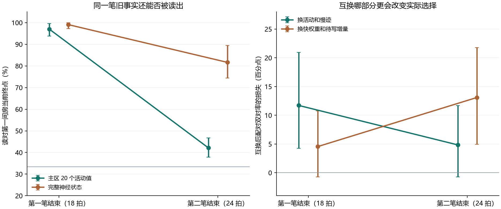

# 两次局部更新后，第一笔经历还在哪里

同一张 40 节点图在第一间房里看到的改道，经过第二间房以后仍有信息可以读出，且能因果影响实际行动。困难出在按当前查询重新用上它。增加终点身份教学确实让主区报对了更多终点，但没有使同一个体在两个需要相反选门的历史里更常双双选对。[上轮单复查的结果](reroute-2026-11-20.md)

## 让最后一笔观察无法决定答案

身体照常真实走过两扇门、两间房、三个终点，在生命内连续保留状态。随后从房间内进行两次复查，最后才公布目标并回到起点作第一次真实选择。关键配对的旧图、走门顺序、被查两房、末笔复查、目标和动作随机数完全相同。只有首笔遇到的出口不同。

例如旧图为蓝房通甲、黄房通乙。先复查黄房，两个世界分别看到甲或丙。再复查蓝房，两边都看到乙。如果目标对甲、乙、丙依次给 −1、0、+1，第一份生命应去蓝房，第二份应去黄房。只依赖最后一次所见的策略在共用抽签时无法同时选对。正式穷举还覆盖两次查同房、两次更新反序、同一前史更换目标和两门同归。每个出生有 2,592 个未进入训练的完整任务条件，其中有 144 个这样的成对任务。三种房到旧出口的排列在训练中整图留出；当前终图和单个局部转移可以重叠。[世界、传感器重建和覆盖](evidence/double-visit-20261120/world.md)

两组六个出生均继承相同的上轮旧图留出模型，使用同样的动作和世界随机带继续训练 1,792 步 × 64 条生命。两者都学“下一房”和“最终收益”，只给身份教学组多一个损失：从原有主区三个节点预测本人试的路线实际到了甲、乙、丙中的哪一个。学习信用贯穿两次复查；只有确实走了自己所试门的生命才用这次到账、房间和终点校准其预报。共审计 1,376,256 条本轮实际路线。副区不收独立标签，节点数未增加。[训练、继承与账本审计](evidence/double-visit-20261120/fit-results.md)

## 报出终点与选对路线

| 严格留出，主区自然试探 | 原教学 | 增加终点身份教学 |
|---|---:|---:|
| 自然选择试的门，预报终点正确 | 33.13% | 70.88% |
| 对原先没有试的门另开内部支路，预报终点正确 | 33.11% | 55.59% |
| 两门收益预测把实际优门排在前面 | 64.02% | 56.66% |
| 关键配对两条生命的首次动作都正确 | 27.06% | 19.99% |
| 同一配对的两份动作都错误 | 4.22% | 4.30% |
| 换成只在最后一次观察上不同的配对，两份都正确 | 34.59% | 26.90% |

原教学的三个终点报告单元可以记录，但没有专门的身份解释监督。上面预测率以每个测试条件中的真实尝试或冻结后离线另试的支路分别计分。配对行动列是共享试探和马达随机数下的精确期望；六个独立出生是置信区间的重采样单位。终点身份教学相对原教学的关键双对差为 **−7.06 [−17.67, +2.76] 个百分点**。本体在试探时实际收到原生回流，相对等钟空试只多 **0.49 [−0.33, +1.40] 点**。等时省略第一笔感觉后，两份历史在网内完全相同，共用抽签的双对和双错都精确归零。身份组双对仍比双错多 15.70 [6.67, 26.06] 点，因此第一笔内容确实有方向性的作用。单条路线从首房结果好或坏的两种生命分别去看，首次选对率为 57.92% / 57.78%。这和要求两条生命都选对的 19.99% 是不同分母。[主评估、独立抽签对照及分层结果](evidence/double-visit-20261120/eval-results.md)

## 内容尚存，行为对各部分的依赖随时间改变

在目标公布前，用独立旧图校准线性读数，对冻结的未见旧图状态读出每间房的真实出口。第一笔刚结束，两组都可从主区 20 个活动值读对首房约 97%。又复查另一房后，加入身份教学的个体从主区活动读首房为 **42.1%**、末房为 **98.4%**，从完整状态读首房为 **81.6%**、末房为 **99.8%**。原教学从完整状态读首房为 **84.3%**。完整状态包括活动、慢迹、已有连接的快权重及待提交局部增量。连续两次查同房时，身份组的完整状态读到该房最新出口为 98.5%。这些读数属于冻结分析，不是身体自带的外部记忆查询。[读数与逐出生原始档](evidence/double-visit-20261120/memory.md)

再交换两个配对世界里的状态，保持之后的感觉和抽签完全相同。第一笔刚结束时，交换活动与慢迹使身份组的双对率下降 11.71 点，交换生内快权重与待写增量下降 4.56 点。第二笔结束时，对应损失变成 4.85 和 13.09 点。交换后身体的行动向状态供体的优门移动；全交换逐位复现供体马达，在受体的真实地图结算。相比活动组，快权重组在前后两时点的相对影响上升 **15.40 [7.73, 23.07] 点**，六个出生同方向；原教学的相应值为 20.86 [4.45, 39.56] 点。相隔仅六拍，且权重与待写增量作为一组交换，不能据此声称永久巩固或将作用独归于某条连接。[因果交换、时点交互及其边界](evidence/double-visit-20261120/trace-swap-results.md)

## 绕开门到房之后

同一冻结身体直接接收正确房间的感觉线索，也未救回它对首房出口的原生报告：关键配对中，从门内部试起的首房出口正确率为 40.9%，改为外部给出房间只有 35.6%；末房对应 65.2% / 57.1%。直接房是新查询格式，所以该干预显示绕开门→房步骤未能改善读出，不能推断房→出口的记忆已消失。把首间房对应门固定为试探门时，两条生命的收益方向其实都报对的比例为 52.43%，两份真动作都符合目标为 19.85%。交换第 5 拍的收益读数会损害部分选择，交换三个终点读数的行为效应不稳定。独立的正确/错误天然报告模板对照也只检测到有限帮助。[直接询房、终点阳性对照与行动](evidence/double-visit-20261120/localization.md)

因此本轮没有达到“教终点并让副区试探，就能更好地同时使用前后两笔更新”这一验收条件。证据把后续问题缩到从已有参数与活动痕迹按需取回首房事实、再把读到的事实用于比较门的后果；仅继续提高终点标签准确率并不等价于解决这两个问题。[复算入口](evidence/double-visit-20261120/README.md)
