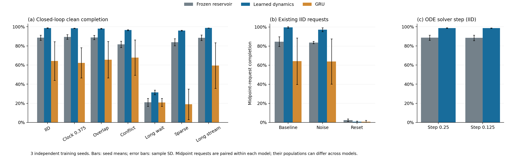

# 持续动力学：近期研究与双任务时间控制实验

日期：2026-10-26。代码：[experiments/dynamics](../experiments/dynamics/README.md)。

三种子正式实测：可学习连续循环的严格完成率 **98.66 ± 0.20%**，冻结循环 **88.56 ± 2.72%**，时间感知 GRU **64.17 ± 20.18%**。前者对小扰动和数值步长变化较稳健，但超出训练范围的长等待降至 **31.42 ± 2.40%**。结果支持本任务中训练内部动力学的作用，尚未证明长期知识积累或通用架构优势。

## 问题从哪里来

维持内部活动和持续状态本来就是项目的主线，不是本轮新提出的方向。旧 LIF 实现已经保存膜电位、脉冲和迹，但大部分衰减按 `step()` 调用计数；改变调用频率会同时改变动力学语义。上一轮[规划实验](planning-experiment-2026-10-26.md)又特意在每个动作前清空隐藏状态，它测的是内部计算深度，不能用来判断持续主体是否有效。

本轮进一步问：**训练能否改变内部动力学，使过去任务的信息保持到需要时，同时允许新命令更新它，并让状态中的时间信息真正影响行动？** 平均活动正常或网络长时间不停止，都不足以回答这个问题。

用户提供的网页 AI 材料正确区分了连续时间、异步执行、实时响应和学习。其 LIF 说明可作为背景，但本项目当前先测任务能力；单凭时间状态或脉冲机制，不能推断参数效率、复杂推理或智能优势。

## 近期研究及采用范围

| 研究 | 已核实的结果 | 本项目如何使用 |
|---|---|---|
| Asabuki & Clopath，2025-07-23，[Predictive alignment](https://www.nature.com/articles/s41467-025-61309-9) | 固定随机循环骨架加可塑循环项；局部更新学出静态/动态吸引子。三个独立记忆位演示脉冲设置、空白期保持、小扰动恢复和新输入切换。 | 最直接支持“学习有用的内部动力学”这个研究问题。本轮先用 BPTT 检验循环连接是否需要学习，**没有实现或复现 PA 更新规则**。论文也没有证明开放环境终身学习。 |
| Wagner 等，期刊版 2026-07-09，[Balancing stability and flow](https://doi.org/10.1098/rstb.2025.0260)，[作者稿](https://papers.cnl.salk.edu/PDFs/Balancing%20Stability%20and%20Flow%20in%20Hippocampal%20Networks%20via%20Inductive%20Bias%20and%20Learned%20Symmetry%20Breaking%202026-4687.pdf) | 训练后的循环网络中，对称成分支持表征稳定，有结构的反对称成分支持沿表征流形的运动。 | 内容可以稳定而活动仍然变化。不能将“稳态”限定成每个神经元不再变化；也不能把任意随机反对称项视为有益。本轮不额外硬编码对称分解。 |
| Pilzak 等，2026-03-19，[iTDS](https://www.nature.com/articles/s41467-026-70920-3) | 输出的慢跟踪量调节学习，主 reservoir 实验训练读出。 | 主要解决更新稳定性。正文更新符号与[作者代码](https://doi.org/10.6084/m9.figshare.31146457)存在差异，时间常数与 EMA 速率记法也不同，本轮不直接移植。若内部已失去历史区别，只改读出无法恢复该信息，这是本项目的推论。 |
| Srinivasan 等，2025-11-20，[Adaptive E–I balance](https://www.nature.com/articles/s41467-025-64978-8) | 局部抑制调节及异质活动目标改善 reservoir 的记忆/非线性权衡。 | 与项目已有活动稳态路线很接近；说明全局均值正常不代表每个单元都有效，不能据此认定已学会保存具体内容。 |
| Kong 等，2024-06-06，[Reservoir associative memory](https://www.nature.com/articles/s41467-024-49190-4) | 训练读出并闭环反馈，可长期重现并切换学到的动态吸引子。 | 动态模式重现与任意经历积累不同；作者仍将避免遗忘的顺序学习列为开放问题。 |
| Siegelmann 等，2026-06-05，[无全局时钟的图灵通用网络](https://www.nature.com/articles/s41467-026-73830-6) | 理论构造中每次随机更新一个神经元，仍可实现通用计算；依赖精度或随计算增长的存储条件。 | 支持异步计算的可行性，不证明可训练性、实测节能或持续学习。不要把论文讨论中的可能应用当成已完成实验。 |

这些结果没有确立一个可直接拼起来的“新大脑架构”。最小可检验的变化是：让维持内容和推动任务进度的循环连接本身接受任务训练，并测试状态能否被正确更新，而不是继续增加活动目标或冻结规则。

PA 仍是之后值得单独验证的局部学习候选：其循环更新使用网络实际读出的反馈 `Qz`，不能替换成目标反馈 `Qf`；反馈只影响更新，不直接注入运行状态。本次进一步检查了[官方代码固定版本](https://github.com/TAsabuki/PredictiveAlignment/blob/b4227a21341ff1aecbc42912501113b8ebd3c8ad/PA_code.py)和补充材料，代码只提供单输出周期生成例子，三比特专用输入权重、通道调度与学习率未完整披露。因此没有为“复现”自行补上这些值，也没有将当前 BPTT 结果归功于 PA。

## 环境、模型与判定

两条并发订单流中，命令只出现一次。每条命令有公开版本、四选一内容、处理时长及完成窗口；输出需要 BEGIN 后等到处理完成，再 FINISH(版本、内容)。其他订单、替换和取消会在处理期间发生。完成截止时间从命令到达算起，不能靠无限推迟 BEGIN 顺延。输入不包含待办表、进度、READY 或动作掩码；过去动作的接受/拒绝回执只呈现一次。

循环状态只有一组连续值向量：

\[
\frac{dx}{dt}=-x+W\tanh(x),\qquad x(t^+)=x(t^-)+Bu_t.
\]

时间常数为一个任务时间单位。Heun 求解器积分两次观察之间的时长；事件只注入一次。冻结 reservoir 与可学习循环使用相同初始 W、编码器及读出，区别仅为 W 是否训练；GRU 收到相同事件和真实 elapsed time。全部使用有监督教师轨迹训练、模型自己的动作闭环测试。

这里的“原生时间”指模型方程使用环境时间增量，不能等同于墙上时钟、硬件异步或神经元逐个自主调度。相同状态宽度不等于相同参数或 FLOPs，需单列成本。训练流之间允许重置，流内梯度截断不得清空状态。测试冻结权重，因此不能将成功称为测试时经验学习。

除普通完成率外，主报告列出**无错误尝试的请求完成率**和 FINISH 精确率。提前尝试、错内容后再试等行为会使请求失去无错误资格。双版本存在 ABA 混淆：跨两次改版的极旧版本可能别名，不能声称任意历史版本都可识别。

机制对照包括小扰动、一次状态清空、求解器步长减半和错误时间增量。扰动重点观察当时已经开始、内容没有重新出现在输入中的请求；全流平均另列。事件表与动作机会固定，求解器多做内部步骤不得多获得事件或行动机会。

## 实测记录

### 预实验与训练目标修订

预实验只查看验证集，均未开启测试集。种子 101 的 256 次更新后，三组学会立即 BEGIN，却几乎不会 FINISH。种子 102 增至 2,048 次更新后：

| 模型 | 跟随教师输入时的 FINISH 动作准确率 | 自主闭环无错误完成率 | 闭环提前提交次数 |
|---|---:|---:|---:|
| 冻结循环 | 87.77% | 20.03% | 882 |
| 学习循环 | 94.54% | 35.39% | 741 |
| 时间感知 GRU | 92.97% | 40.76% | 653 |

该版本示范在最早合法时刻提交，等待动作在损失中权重 0.1，提前一点的预测容易变成错误提交；教师输入又很少包含拒绝回执。这个结果同时暴露边界计时和教师/自主输入分布的差距，不能据教师准确率认定控制已成功。

正式 v2 只调整示范的动作选择：BEGIN 立即执行，FINISH 选在实际就绪与截止时间的中点，向下一个观察时刻取整。这个示范仍然因果、合法；环境合法窗口、评分和模型输入没有放宽。三组模型收到同一示范策略，继续用它们自己的动作闭环测试。该改动没有在网络中加计时器或安全余量模块。

v1 与正式 v2 的种子和数据也不同，因此不能将两个版本的差别单独归因于示范修改。原始配置、验证指标及训练曲线保存在 [pilots.json](evidence/dynamics-2026-10-26/pilots.json)；各运行目录还保留当时源码和检查点。

### 正式协议

[冻结协议](evidence/dynamics-2026-10-26/main-study-v2.json)在正式训练和测试之前写入。三个种子 0/1/2，每个种子训练三种模型：状态宽度 128，独立训练流 512 tick，每流 128 条并行样本；TBPTT 64 tick，2,048 次 AdamW 更新，学习率 0.001，梯度裁剪 1.0。每个模型共接收 16,777,216 条样本时间步、33,554,432 个动作标签；同一种子的初始化和外部流按模型配对。每个流内一直保留状态，梯度截断只 `detach`。训练时间间隔按独立流循环取 0.125、0.25、0.5。使用最终检查点，不按验证集择优。

| 模型 | 总参数 | 可训练参数 | 持续状态标量 |
|---|---:|---:|---:|
| 冻结连续循环 | 25,366 | 8,982 | 128 |
| 可学习连续循环 | 25,366 | 25,366 | 128 |
| 时间感知 GRU | 108,438 | 108,438 | 128 |

冻结组仍训练输入编码和读出；其完整参数和状态容量与可学习循环相同，可训练参数不同。GRU 使用同宽输入编码再接 GRUCell，拥有更多参数，不是等参数/FLOPs 比较。三个种子同时使用同一 RTX 4060 Ti，记录的耗时包含并行争用及环境/统计开销，不能充当独占硬件速度或功耗基准。

每个条件、每个种子测试 128 条独立流。正常条件为 512 tick（127.75 个时间单位），长流为 2,048 tick（511.75 个时间单位）；各模型读相同事件表。长流测试的是持续运行，不表示一条事实需要保持整个流长。

| 测试条件 | 与训练的区别 |
|---|---|
| IID | 独立事件与样本，观察间隔 0.25 |
| Clock 0.375 | 未训练过的观察间隔，任务时间单位不变 |
| Overlap | 更密的到达，增加并发 |
| Conflict | 取消概率 0.30、替换概率 0.55 |
| Long gap | 单项处理时长从训练的 1–4 增至 4–8 |
| Sparse | 到达间隔增至 4–12 |
| Long stream | 原分布连续运行四倍 tick |

Clock 0.375 是独立分布测试，并非与 IID 保持相同事件顺序的配对世界。`clock_half`/`clock_double` 则明确保持同一世界不变，只故意让模型读错时间增量，是时钟校准消融。

### 正式结果

正式九组训练及测试已完成。共 2,688 条独立测试流、135,123 个可完成请求；相同测试流被各模型和干预复用，不重复计作新样本。教师参照在全部条件无错误完成率为 100%。下表为三个训练种子的均值 ± 样本标准差，单位为百分比。

| 条件 | 冻结循环 | 学习循环 | 时间感知 GRU |
|---|---:|---:|---:|
| IID | 88.56 ± 2.72 | **98.66 ± 0.20** | 64.17 ± 20.18 |
| 未见时钟 0.375 | 89.31 ± 2.45 | **98.35 ± 0.23** | 62.27 ± 15.84 |
| 更多并发 | 88.79 ± 2.26 | **98.05 ± 0.34** | 65.50 ± 18.99 |
| 更多取消/替换 | 81.59 ± 3.28 | **96.49 ± 0.44** | 67.74 ± 18.41 |
| 处理时长 4–8 | 21.00 ± 4.15 | **31.42 ± 2.40** | 20.94 ± 4.22 |
| 更稀疏到达 | 83.79 ± 3.65 | **95.91 ± 0.37** | 18.93 ± 16.03 |
| 四倍长流 | 88.43 ± 2.87 | **98.67 ± 0.16** | 59.39 ± 23.79 |



允许循环连接学习，在这个任务及预算下比冻结循环改善了约 10.10 个百分点。学习循环的三个种子均优于其余两组，且使用较少参数。但 GRU 在三个种子间波动大，训练末期仍在改善；**这些结果不是 GRU 充分训练后的能力上限，也没有建立通用的智能/参数比优势**。这里比较的是指定实现、相同外部训练经历和更新次数下的效果。

IID 的 FINISH 精确率，冻结循环/学习循环/GRU 分别为 **85.88 / 98.67 / 65.67%**。相应每千次行动机会的空闲错误动作约 **1.640 / 0.135 / 4.275**；取消后保持安静的比例为 **97.51 / 99.39 / 99.71%**。请求完成率因此不是唯一依据，重试、空闲乱动及取消遵从均单列。

### 保持的是任务信息，还是仅仅活动

在 IID 中点，选择已经开始、尚未就绪、该 tick 没有重新给出命令内容的请求。三个种子每组恰有 258 个目标请求；基线、扰动和清空之间逐一核对请求身份。下表合并实际请求计数，不是上一表的种子均值。

| 模型 | 无干预 | 单次 10% 状态 RMS 噪声 | 单次清空状态 |
|---|---:|---:|---:|
| 冻结循环 | 219/258（84.88%） | 216/258（83.72%） | 6/258（2.33%） |
| 学习循环 | **257/258（99.61%）** | **251/258（97.29%）** | **2/258（0.78%）** |
| GRU | 169/258（65.50%） | 168/258（65.12%） | 2/258（0.78%） |

这支持状态中保存着任务所需的信息，学习循环对这档小扰动也较稳健。一次清空后，学习循环的全流严格完成率仍有 95.75%，因为新命令会重新提供内容；若只看全流平均，会严重低估当时记忆的损失。噪声下继续完成任务不等于已经证明轨迹回到同一个吸引子，后者还需要专门的状态轨迹和扰动方向分析。模型间目标人群一般也可能不同，因果比较限于模型内部配对。

将积分最大步长从 0.25 减到 0.125，学习循环的 IID 严格完成率为 **98.65%**，与基线 98.66% 接近；冻结组为 88.37%，基线为 88.56%。没有增加输入或行动机会。反过来，仅把模型读到的时间缩成一半或扩大一倍，学习循环降至 **1.73 / 6.12%**。这说明本任务结果依赖时间校准，而非只取决于命令顺序；仍不能推出硬件异步或一般推理优势。

### 长等待失败的事后诊断

看到长等待退化后，新增只读分析，不再训练或调参。复用同一测试轨迹和冻结检查点，在教师选定的 FINISH 时刻，只在八个 FINISH(版本、内容) logits 中取最大值，暂时排除 WAIT/BEGIN 的竞争。它测的是**现有读出中可取得的内容/版本信息**，不赋予自主控制器完成时刻，也没有新训练一个解码器。

| 模型 | IID 条件下内容/版本可读准确率 | 长等待条件下内容/版本可读准确率 |
|---|---:|---:|
| 冻结循环 | 95.54 ± 0.27% | 57.67 ± 1.73% |
| 学习循环 | **99.07 ± 0.26%** | **69.84 ± 9.89%** |
| GRU | 80.21 ± 11.41% | 61.61 ± 14.05% |

长等待下，学习循环自主严格完成率只有 31.42%；在教师轨迹与指定时刻下，现有读出仍能取回约 69.84% 的内容/版本，但比 IID 的 99.07% 明显下降。闭环还记录到 4,420 次提前 FINISH、1,156 次错误内容尝试，错误类别可以重叠。**既不能把失败全归成遗忘，也不能说内容完全保持、只是计时出了问题。** 该分析是看过测试后的诊断，不是新的确认性实验；“现有读出不可读”也不等于证明所有隐藏信息已经消失。

Long gap 同时增加了输入中的时长数值和信息需保持的时间，尚未独立分离时间外推、表征变化、内容保持及自身错误回执的影响。附带的 FINISH 动作一致率也只是对中点教师策略的模仿：合法的提早/稍晚完成可以与教师标签不同，而且闭环标签分母依赖模型之前的行动，不能把该一致率当成请求完成率。

## 结论与下一步问题

本轮支持：一个只有共享连续状态、事件脉冲和可学习循环连接的系统，可以学会在持续输入中保留两件任务、接纳取消/替换，并在没有新提示时自行推进。学习内部连接改善了这个受控任务，未依赖预设记忆槽、活动率目标、保护名单或连接生删机制。

关键缺口也更具体了：**训练范围外的长等待使内容可读性和时机选择一起退化。** 接下来应先用保持相同事件内容、独立改变等待长度的对照拆开这两个因素，再考虑 PA 一类局部更新是否能学出更稳定的内容状态。GRU 也需要更充分训练的预算曲线，才能谈结构效率。直接扩大模型、增加稳态指标或硬保护记忆连接，都不是当前证据必然要求的结论。

本实验是有监督习得、测试时冻结权重的有限双任务控制；队列和计时器程序就能全解。它尚未验证测试中持续积累新知识、开放式任务生成、长链逻辑推理、LIF、真正异步执行或功耗收益。

## 证据与复现

- [机器可读汇总](evidence/dynamics-2026-10-26/summary.json)：每种子结果、配对指纹、统计定义、参数及成本、干预、事后只读分析和检查点回放校验。
- [主协议](evidence/dynamics-2026-10-26/main-study-v2.json)与[预实验](evidence/dynamics-2026-10-26/pilots.json)。完整训练配置、源码快照和最终权重位于 `data/dynamics/main-seed{0,1,2}-v2/`，该可重建运行目录被 Git 忽略。
- [总览 SVG](evidence/dynamics-2026-10-26/overview.svg)，[动作模仿诊断图](evidence/dynamics-2026-10-26/finish-agreement.png)（仅作上述限定下的辅助诊断）。

52 项新测试通过，覆盖因果观察、物理时间、取消边界、请求评分、TBPTT 状态保留、源代码兼容和干预。汇总审计了 279 条评估记录、63 组测试事件指纹和 126 组扰动目标配对；重新加载九个最终检查点，IID 自主动作哈希、环境计数及中点请求身份全部复现。只读内容诊断另核对了 18 条教师轨迹的完整预测哈希。回放使用原模拟器，不能当作第二套独立环境实现。

```powershell
# 在仓库根目录运行；输出目录需尚不存在。分别将 seed 换成 0、1、2。
.\.venv\Scripts\python.exe -m experiments.dynamics.run --output data/dynamics/reproduce-seed0-v2 --seed 0 --steps 512 --updates 2048 --batch 128 --width 128 --tbptt 64 --train-dts .125 .25 .5 --eval-steps 512 --eval-batch 128 --device cuda
.\.venv\Scripts\python.exe -m pytest experiments/dynamics -q
.\.venv\Scripts\python.exe -m experiments.dynamics.report --runs data/dynamics/main-seed0-v2 data/dynamics/main-seed1-v2 data/dynamics/main-seed2-v2 --output docs/evidence/dynamics-2026-10-26 --content-probe --verify-checkpoints
```
