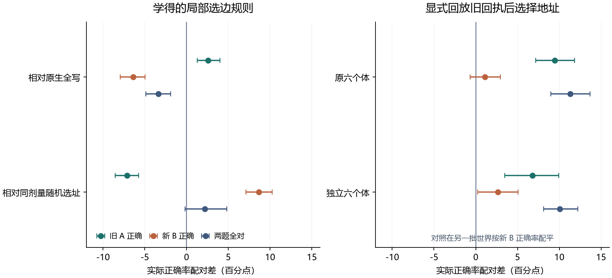

# 同一笔反馈应该改哪条连接

原有 20 节点图能从真实味觉提出带方向的权重更新。我们在同一笔更新上改变落点，检查它能否一次学会新对象 B，同时保住刚学过的 A。两种信息配置给出了不同答案。只把边的历史交给共享规则、用实际行动结果训练，旧 A 与新 B 之间仍有明显取舍。额外保留一次旧 A 的真实回执，用临时图比较候选地址，能在同样的写入量下提高两题都答对的概率。[前一轮的写入时机与干扰](active-review-2026-11-20.md)

## 单条连接能做到多少

先在两批各六个个体上完整学习 A，再让它们自己接触 B。保留 B 的同一份味觉、写前活动和时间，试遍 B 原生提议中每条可改的已有边，并测试事先列出的小组。事后选择器可读私有答案，用两种摆向的条件正确率挑落点；最终动作由另一套随机数抽样。随机对照把相同符号和幅度的改动移到别的同向边。诊断主组中 B 的偏置和接线保持在写前，报告另外给出完整原生提交。[逐项诊断](evidence/edge-site-20261120/diagnostic-results.md)

在外观只差 15°、奖惩相反的最难条件，按条件联合正确率选一条边，比同剂量随机落点的实际两题全对率高 0.84 / 0.61 个百分点；从所测的四边组合里挑，则高 7.77 / 6.63 点。如果要求旧 A 的条件正确率每生至多下降 2 个百分点，选四边相对不写，新 B 的实际增益在 15° 只剩 1.82 / 2.05 点，30° 为 10.68 / 9.51 点，90° 为 38.83 / 33.59 点。这里的四边只占 15° 全部已有边写量的约 5–6%。这是对有限写入和既有候选的检验。

## 只走一条真实路线来训练选址

在每条生命内先实际学习 A，再实际接触 B。把 B 对已有边的提议按符号、幅度相邻的四条分组。每组延期同一带符号的份额，模型选择延期落在哪条边；实际写入继续带着本次原生偏置与结构变化。一同训练的两种规则都能读当前局部信号。完整规则还可读上次各边的真实改变量和动作前两端的活动，共用 18 个系数。控制组只读当前的 8 项。每次选择执行一条路线，按实际 A 正确得 1、B 正确得 2、两题都正确再得 1 来更新系数。每种规则从两个种子各训练 1,024 步，总计 3,145,728 条训练路线。[训练方案和计数](evidence/edge-site-20261120/training-protocol.json) · [数值与账本复核](evidence/edge-site-20261120/training-numerical-audit.json)

6 个未参与训练的身体和 256 个新几何根，等权汇总 15°、30° 的冲突条件。学习 A、B 各一次，等 4 拍，依次真的回答 A 和 B。

| B 的写入方式 | 旧 A 正确 | 新 B 正确 | 两题都对 |
|---|---:|---:|---:|
| 全部执行原生写入 | 68.33% | 64.83% | 41.46% |
| 相同剂量，随机挑延期地址 | 78.03% | 49.76% | 35.87% |
| 训练所得的共享选边规则 | 70.91% | 58.43% | 38.07% |

相对原生全写，训练规则的旧 A 高 2.59 [1.29, 4.02] 点，新 B 低 6.40 [−7.94, −4.97] 点，双对低 3.39 [−4.88, −1.90] 点。它比随机位置多学进了 B，但联合差 +2.20 [−0.18, +4.81] 点仍不确定。与同预算只看当前活动的规则相比，增加旧痕迹后的联合差为 +0.16 [−1.86, +2.52] 点。反复学习 B 三次，30° 下两组 B 都约 97.6%，旧 A 却从原生全写的 35.5% 降至 29.9%。同写量的各组选中相同数目的边，实际总绝对写量最大误差 6.48×10⁻⁷。[主终点、训练曲线和重复学习](evidence/edge-site-20261120/evaluation-results.md)

## 给它一份旧回执，再看地址是否可辨

在另两套未见世界，只额外保存旧 A 曾经呈现的三维菜单和由本人选侧、实际味觉得到的目标方向。在临时副本试不同的延期地址，重演已尝过的 A 和眼前 B，读原生运动倾向，最后只把选定的改动写进实际身体。正式回答的顺序随机，两次都由身体自己发出。回放与搜索由实验提供，它们使用确定且仍然有效的一份旧回执。主搜索每组要看四个候选，随后还要重新检验组合效果；最多一条生命有 57 组，算力和缓存都有代价。[初次评估和只读 B、错配旧味觉等对照](evidence/edge-site-20261120/replay.md)

另用原组六个体的首套世界确定对照策略：74.23% 的生命只优化 B，其余采用随机地址，全都用相同组数和延期份额。固定这个概率后，在 256 个新几何根上实际执行，比较 A 是否还能保住。下表是使用本人 A、B 回执相对这组对照的配对百分点差。

| 独立的新世界检验 | 旧 A | 新 B | 两题都对 |
|---|---:|---:|---:|
| 原六个体 | +9.46 [7.16, 11.84] | +1.09 [−0.67, 2.95] | +11.33 [8.98, 13.67] |
| 独立六个体 | +6.79 [3.48, 9.94] | +2.64 [0.24, 5.05] | +10.07 [8.14, 12.19] |

原组 B 差的整个区间落在预定的 ±5 点内；独立组上界为 +5.05，略超等效界线，方向是 B 更好。两批均未以降低新 B 来换取旧 A。新的独立六个体中，A/B 双对的绝对成绩为回放 49.17%、对照 39.10%、原生全写 41.02%。把搜索压到八个随机完整方案，独立组较同剂量随机多 5.84 [4.75, 7.01] 点双对，但相对原生全写为 −0.11 [−2.54, 2.32] 点。较小的搜索还没有保住完整回放的优势。[事前配平方案](evidence/edge-site-20261120/matched-b-plan.md) · [留出与搜索预算](evidence/edge-site-20261120/matched-b-results.json)

这组结果支持在已有 20 节点图里继续研究地址选择。当前训练规则能利用局部信号改变新旧取舍，但还不能稳定辨认一笔更新对旧行为的后果。保留一次真实旧经历并实际试算该后果，在相同原生写入提议、相同剂量下确实能找到更好的地址组合。是否可用很少的原生计算，学到对这种后果的预测，仍是开放问题。这里的保持覆盖同一生命里的两个确定性对象。
