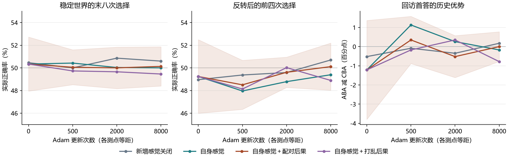

# 自编辑的内部感觉、后果归因与训练长度

六个独立出生全部跑完 8,000 次 Adam 更新。图能写入自己，部分写入的后果能延续 24 次接触。增加感觉和配对后果后，仍未观察到可以重复的新任务学习或旧任务保持。

| 第 8,000 步，实际选择 | 关闭新增感觉 | 自身感觉 | 自身感觉＋正确配对 | 自身感觉＋打乱配对 |
|---|---:|---:|---:|---:|
| 稳定带噪任务，最后八次正确率 | 50.60% | 50.00% | 50.13% | 49.46% |
| 反转后最初四次正确率 | 50.69% | 49.39% | 50.11% | 48.89% |
| 回访首答，A/B/A 减 C/B/A，百分点 | +0.17 | −0.17 | 0.00 | −0.78 |

正确配对相对打乱配对，稳定末段的差为 +0.67 个百分点，六个配对出生的 95% 区间为 [−1.24, +2.58]。同一正确配对组，第 500、2,000、8,000 步分别达到 50.05%、50.00%、50.13%；第 8,000 步相对第 500 步为 +0.08 [−0.94, +1.09] 点。反转前四次从 48.50% 上升至 50.11%，配对差为 +1.61 [+0.69, +2.52] 点，反转末八次为 49.86%。这些区间均为逐项区间。[完整逐出生数据与区间](evidence/edit-receipt-2026-11-19/results.json)



线条为六个出生的等权均值，浅色区域为正确配对组各测点的 95% 区间。

### 反馈足够解题，图还没学会这种用法

训练同分布的全新八次接触生命中，正确配对组后四次答对 49.20%，关闭生内写入为 49.39%。一个手写对照只记住自己闻过的气味对、接触侧和实际尝到的味觉，在完全相同的短题上达到 75.00%。在长稳定任务末段，累积所有经历的对照达到 99.83%；每种气味只保留最近三次的对照在反转末段达到 89.28%。这些对照为每种见过的气味显式分配记忆，可以判断感官信息是否够用。[短程选择与公开感觉对照](../data/edit-receipt-20261119/reference/summary.json)

正确配对组在 A/B/A 和 C/B/A 回访首答均为 49.91%，两段历史的配对差为 0.00 [−0.77, +0.77] 点。只做 B 后的首答为 50.78%。将两组经历后的写入节点参数分别移入冷身体，首答差为 +0.09 [−0.85, +1.03] 点。手写累积对照的 A/B/A 回访首答为 95.75%，C/B/A 为 3.47%。[逐阶段动作和移植](../data/edit-receipt-20261119/evaluation/summary.json)

### 后果在哪里丢失

1. **参数确实在变。** 正确配对组在稳定留出生命中，每百次接触平均发生 21.51 次改偏置、0.77 次修改已有边权、5.72 次生边、2.04 次退边。同一训练好的图开启和关闭写入，稳定末段正确率相差 +0.11 [−0.52, +0.73] 点。
2. **三次接触会漏掉大部分后发的行为变化。** 在另一个 24 接触的归因测试里，1,075 笔能实际执行的写入中，前三次已有 25 笔改变过动作，到第 24 次累计 279 笔。126 笔提高正确总数，136 笔降低，余下持平。固定提交后的活动、只交换图参数，有 274 笔引起行为分歧；固定参数、只交换活动，有 21 笔。两类干预在非线性图上有交互，计数不可相加。
3. **当前的收益标签容易把接受概率压回一半。** 在训练同分布的独立分叉中，3,562 个可执行提案只有 117 个改变了后三次获得正味觉的总数，62 个提高、55 个降低。原生收益预测在这 117 个中判对 54 个方向。各出生等权平均有 99.16% 的可执行提案获配 45%–55% 的接受概率。按预测排序选前一半，单笔相对等量随机接受的实际正味觉率增益为 +0.07 [−0.03, +0.16] 点。这项事后单笔排序诊断不评估整条生命策略。
4. **次要预测损失的梯度不总是帮到行为。** 在最终检查点另外抽取的 96 个新小批次中，能使用分叉标签的批次有 78.49% 全部标签为零。未来收益预测梯度和通用行为梯度同时非零的 93 个批次中，62.37% 的点积为负，平均余弦为 −0.048。这个测量仅涉及同一批样本、当下参数和 Adam 处理前的梯度，不能直接解释整条训练轨迹。[原始梯度与定义](evidence/edit-receipt-2026-11-19/gradient-alignment.json)

下一步优先检验提名与归因。保持自由寻址和完整写权限，先用一个稳定气味，让图提出两笔候选，按下一次重遇该气味时的实际结果训练排序，保留平局并记录等待时长。同时让接受概率的刻度可学习。以新气味上的一次反馈收益和冷身体移植作为通过条件，再加回多气味和 A/B 冲突。

## 模型在一次编辑中能看到什么

一条生命使用同一张 20 节点有向循环图。其中 8 个节点参与写入。模型每次先看两侧的气味、选择一侧，再收到这一次接触的正味觉或负味觉。它可以改变全部 20 个偏置和 400 个有向连接地址，包括自环、写入节点的连接和偏置。生边时同时写入权重，退边会抹去该权重。执行器保护强连通，数值没有人为限幅。[参数定义](graph-parameter-terms.md)

原版选择地址时已经用到接触和品尝后的全图激活。新版本在地址和操作已经提出、尚可放弃时，额外读出所选地址的发送与接收节点活动，也能读出对应的连接在位状态、当前值和接收端偏置。图内节点先预测局部活动、数值与接线如何变化，再输出对未来三次接触收益的预测。收益预测决定这次尝试的接受概率。所有组都使用这个门控。[写入器](../experiments/pulse_game/edit_receipt_graph.py)

实际执行后，模型收到执行成功、拒绝、主动放弃或无动作回执，以及真实的局部激活变化、数值变化和接线变化。成功编辑还会给对应端点一个脉冲，随后与其他图内活动一起演化。它的持续时间由图决定。这里的激活变化来自连续的两次读取，即使参数没动，激活也可以变化。图没有专门保存每个地址的历史账本。

## 外部启蒙和独立生活

四组分别关闭新增的局部感觉、打开自身感觉、打开感觉并把编辑和后果正确配对、打开感觉并打乱后果。关闭新增感觉的组仍能读到原版提供的结构和接触活动。四组都有共同的行为训练和局部后果预测任务，也共享每个出生对应的环境和采样随机数。打乱组在同一出生、同一次更新内交换可执行提案的标签；正确配对组使用同样的入选条件。不同策略逐渐选择了不同的地址，所以后期实际产生的训练样本会有差异。[训练代码](../experiments/pulse_game/edit_receipt_train.py)

每条训练生命有 8 次接触。程序选一个时点，复制同一个提案与提交前的完整状态，一份尝试执行，一份跳过。两份在相同的后续气味、味觉噪声和随机数下继续三次，各自发出动作与新提案。训练标签是这三次实际获得正味觉的比例差。世界真实偏好仅供诊断。训练中当前动作的即时信号可由已选一侧和真实味觉还原；离散动作和写入命令也能从后来的实际味觉获得策略梯度。连续写入沿后续图的计算路径反传。[冻结协议](evidence/edit-receipt-2026-11-19/protocol.json)

六个独立出生各跑四组，每次 Adam 更新看 12 条新生命，取第 0、500、2,000、8,000 步。同一出生和训练组的四个时点属于同一次优化。每个完整拟合接触 96,000 条主线生命，共 768,000 次主线接触和 576,000 次成对分支接触。独立评估使用三个气味、长生命、带噪和反转任务。A/B/A 与 C/B/A 首段使用同样的气味、相反的偏好，B 段和最后的 A 段逐项相同。回访首答发生在获得任何新的 A 味觉之前。另将 B 结束后的写入节点入边、对应权重和偏置移到相同的冷身体，重新测试。评估全程只用图自身的前向计算和自发编辑。[评估代码](../experiments/pulse_game/edit_receipt_eval.py)

单笔归因另观察 24 次后续接触。在执行或跳过产生两个真实后继后，另构造两份交叉状态，交换提交后的活动，保留原来的图参数。比较这四种后继，可以看出后续分歧通过哪部分状态传递。这里的“活动”既包含回执输入，也包含新参数在提交后两拍内已经造成的活动变化。[交叉干预代码](../experiments/pulse_game/edit_receipt_channels.py)

## 归因管线的正控

在单独的已知回路上，人为指定一条气味到运动节点的权重应该往哪个方向改。在 4,096 个新世界里，执行与跳过导致 1,201 次不同选择，629 次改善、572 次恶化。一个只读取带噪味觉线索和候选编辑符号的外部四格预测器，在这些改变选择的样本上有 85.01% 的正确方向判断。预测未来正味觉收益的均方误差为 0.2724，恒报零为 0.2932。这里的地址和候选由实验者构造，成绩仅用于检查归因信号和计分管线。[正控记录](evidence/edit-receipt-2026-11-19/positive-control.json)

## 复算

本机 `data/edit-receipt-20261119` 保存每个出生和训练组的检查点、逐步训练统计、实际动作、配对的未来味觉与干预轨迹。以下命令在仓库根目录激活项目虚拟环境后运行。

```powershell
python -m experiments.pulse_game.edit_receipt_train --births 421 422 423 424 425 426 --workers 6 --group-size 3
python -m experiments.pulse_game.edit_receipt_eval --worlds 192 --holdout-worlds 192 --workers 4
python -m experiments.pulse_game.edit_receipt_channels --run data/edit-receipt-20261119 --births 421 422 423 424 425 426 --arms baseline sensing --step 0
python -m experiments.pulse_game.edit_receipt_channels --run data/edit-receipt-20261119 --births 421 422 423 424 425 426 --arms baseline sensing causal shuffled --step 8000
python -m experiments.pulse_game.edit_receipt_gradient_alignment --samples 16
python -m experiments.pulse_game.edit_receipt_reference
python -m experiments.pulse_game.edit_receipt_report --run data/edit-receipt-20261119 --eval data/edit-receipt-20261119/evaluation --out docs/evidence/edit-receipt-2026-11-19/results.json
```
