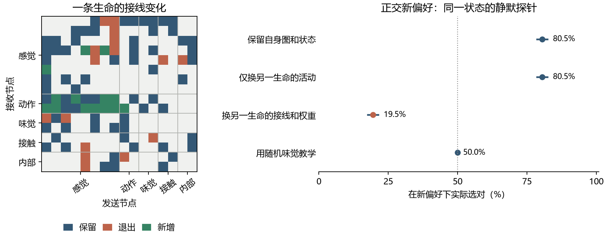

# 无端图怎样从自己的行动中学会新偏好

这轮把主要问题放在一张完整的内部图上。16 个节点共同演化，8 个接两侧食物的化学感觉，2 个接正负味觉，2 个接身体的实际接触，2 个节点的活动差直接控制左右动作，另有 2 个内部节点。动作节点同样向图内发送信号。每次实际尝到食物，所有已有边都可以独立调权，也可以新增或退出边。每次退出后检查整张图仍然强连通。这里给了图接收味觉后的更新方式；测试覆盖的是这套机制能在生命内形成哪些能力。

## 学到了新偏好，经验能随突触图转移

出生时随机生成图和边权。学习中身体自己走向食物，只有接触才尝到带噪味觉。正式测验提供新食物并拿走味觉。8 个出生、12 个新世界里，稳定规律下联合学习选对 **83.81%**，只调权为 **73.85%**；原规律暗中反转后分别为 **82.36%** 和 **72.59%**。在另外一批世界中，让对照在同一时刻增退同样多的边，只随机改变位置，稳定、反转两种情境分别少了 **6.10 和 7.96 个百分点**。这说明选边位置在该任务中对身体行动有实际贡献。模型的动作和味觉信号确实能传到其他节点，训练完成后只在静默窗口截断这些端口的外发信号，尚未测出成绩损失。[图结构、物理评分与选边对照](evidence/open-graph-learning-2026-11-19/ports/README.md)

为了检验重学是否只靠翻转原来的判断，又给相同前史的两个个体一对全新偏好。两张新偏好都与旧偏好正交，彼此的正确行动恰好相反。8 个新出生、16 个新世界里，自己学完后在静默新食物上有 **80.48%** 的机会选对。保留当前节点活动，把另一生命学到的**接线和权重一起**换过来，成绩变成 **19.53%**；按另一生命的偏好评分则有 **80.47%**。换图后 **99.96%** 的首次接触侧与供体原先相同。换图的个体仍然每次都能碰到食物。单独换一次活动快照，64 个探针上的平均成绩为 **80.47%**。这把持续影响选择的经验定位到了学成的突触图，图的接线和数值在这次移植中一起变化。[孪生体、静默分叉与核验](evidence/open-graph-learning-2026-11-19/orthogonal/README.md)

## 只在两路气味同时出现时才有意义

更难的游戏让单个化学分量的边际信息为零，只有两个分量的组合能预测味觉。每个世界的组合偏好独立生成，最终用未出现过的连续混合物静默测试。原生 `tanh` 图稳定与反转后分别为 50.26%、49.73%；给节点加固定平方响应也只有 50.62%、49.89%。把这些图自己实际收集的感觉、接触侧和味觉交给能表达二次项的诊断模型，走向同批静默食物可达到 92.16%–92.88%。这表明接触经历里已经包含足够的信息。[平方节点对照与同回执诊断](evidence/open-graph-learning-2026-11-19/interactions/README.md)

随后改变图内节点整合信号的方式。若两条活跃边从 `j`、`k` 指向同一节点 `i`，节点可以学习一个系数，对两路**上一拍节点活动的乘积**赋予权重。系数从零开始，实际味觉到达后和普通边权一起改变；食物原始输入口仍然只给单个化学分量。控制组采用相同的加密出生图、相同宽度和身体。加法对照分配同样多的系数槽位，但仅能线性组合已有输入。这轮出生图有 152–168 条普通边，每图可用的配对系数为 **677–818 个**。节点数相同不意味着表示能力或有效参数数相同。

| 未见食物上的实际选择 | 普通节点，同一出生图 | 两路相加的对照 | **两路相乘，可学习系数** | 乘积版本收到随机味觉 |
|---|---:|---:|---:|---:|
| 稳定偏好 | 50.55% | 49.53% | **75.04%** | 50.61% |
| 隐藏反转后的偏好 | 50.12% | 48.90% | **73.68%** | 49.36% |

在额外的 128 道新食物上，复制相同的成熟图，两组都从零节点活动起步，只有一组把配对系数置零。稳定条件从 74.51% 降到 50.91%，反转从 74.33% 降到 50.24%。两组仍几乎总能走到食物。这项检验定位了**已经学成的图在用什么**。并入两路输入的乘积是本轮提供的结构先验，图在一生中学的是每种组合应给多少权重。它在这类非线性环境中有效，尚不能由此推出任意复杂规则都能习得。[预登记、配对结果与成熟图干预](evidence/open-graph-learning-2026-11-19/dendrites/README.md)

在后续另一批 128 道新食物上，每个接收节点只保留绝对值最大的四分之一配对系数。每张成熟图的非零配对系数从平均约 **820 个降至 211 个**。稳定测试为 75.35%（完整图 75.13%），反转为 74.74%（完整图 74.44%）；逐节点随机保留同样数量则为 63.83% 和 63.65%。保留强项相对完整图的同时 95% 区间下界分别为 −0.43 和 −0.34 个百分点，均满足事先设定的最多下降 2 点界限。这个稀疏化发生在学习完成之后，尚未测量从出生起只允许这么多交互时能否学成。[评估口径](evidence/open-graph-learning-2026-11-19/dendrites/quarter-protocol.json) · [原始分支与效果量](evidence/open-graph-learning-2026-11-19/dendrites/quarter-summary.json)

## 旧的符号任务也能改善，所用机制有差别

另一条路线保留 32 节点的连续闭合多环和全部生内可塑性，增加快速动作校正，以及依据两枚公开脉冲引起的神经活动匹配近期真实回执的记忆，最多 48 条。稳定、反转、返回旧规律的末段正确率从同新世界上的 **68.82%、36.79%、59.67%** 提高到 **88.53%、86.60%、70.91%**。只保留快速动作校正已能把完全反转做到 81.75%，所以单看反转会高估它按内容学习的能力。一次从未参与调参的测试让每个生命独立改变 20 个组合中的 10 个，并用互补规则配对。第三次遇到同一组合时，完整版本为 **71.58%**，仅保留快速动作系数为 **47.83%**，上一轮联合模型为 **52.72%**。回到 A 的头 20 个请求则由标量版的 **79.19%** 降为 **70.42%**。目前这项按内容改判的收益用到了额外的经历匹配记忆。[完整优化与收益代价](evidence/open-graph-learning-2026-11-19/learner/README.md) · [逐组合改判、返回与控制](evidence/open-graph-learning-2026-11-19/remap/README.md)

## 哪些新连接值得保留

在 32 节点图上，用长边之后实际发生的回执来估计每条连接的作用。评分通过在同一段真实经历上临时屏蔽一条边、比较回执预测损失取得。再用尚未参加评分的下一笔回执验证。延迟退边在稳定环境中比即时退边高 **4.87 点**，反转末段几乎相同。按未来回执评估时，新生边的保留评分在三个环境里的相关系数都接近零。它实际改变了哪些边被保留，仍未可靠预告哪些新边将继续有用。[延迟退边、时间对照与复跑](evidence/open-graph-learning-2026-11-19/edges/README.md)

16 节点图的原始确认资料已归档，包括感觉端口试验、同次数随机选边、学习局部交互以及成熟图干预。[统一端口图的逐生命记录](evidence/open-graph-learning-2026-11-19/ports/physical-records.zip) · [局部交互的逐生命记录](evidence/open-graph-learning-2026-11-19/dendrites/physical-records.zip)
