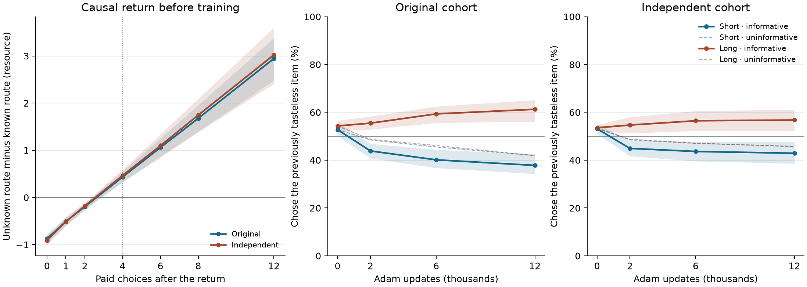

# 剩下多少机会会改变该回到哪里

身体先实际接触两个气味。其中一个按所选一侧送出可靠的正负味，另一个实际送出零味。随后身体通过原生运动端口选一条路线，只能回到一个气味，再做一次有真正得失的选侧。短局只给这次得失。长局在同一身体上续做四个正式选侧，每个气味恰好问两次，顺序与哪项曾无味独立。各选择的回显逐次进入身体，后四次资源在局末交割。这样当场回报与长局总回报用同一单位，身体仍有机会从回访味觉学到以后用得上的东西。[校准方案](horizon-calibration.md) · [正式冻结方案](horizon-plan.json)

## 在同一状态执行两条路线

先用未追加训练的配对教学图，在两个全新几何组对比两条实际执行的路线。回到无味项相对回到已尝项的短局收益为负。两次后续选择仍难弥补，四次后续选择时两批都反转，按预定规则取最短的四次。各对动作使用相同的环境随机数，回访前只改变固定强度的感觉脉冲。

| 回无味减回已尝的累计资源 | 原六出生 | 独立六出生 |
| --- | ---: | ---: |
| 短局，只有回访本身 | −0.873 [−0.965, −0.772] | −0.909 [−1.007, −0.803] |
| 长 cue，回访后续两次 | −0.196 [−0.271, −0.126] | −0.178 [−0.246, −0.114] |
| 长局，回访后续四次 | +0.435 [+0.319, +0.553] | +0.466 [+0.334, +0.592] |

两种 cue 均为左右相同、强度相同的气味脉冲，长度三拍。两组经历相同数量的长短局及两种感觉输入。信息训练组的脉冲表示真实剩余机会，无信息训练组在每对长短局中随机对调两种脉冲。候选左右位置随机，哪个候选缺味也在同一几何下反转。原冻结图在两种脉冲下回无味的概率都接近 0.53。[原六出生校准](horizon-calibration-original.json) · [独立六出生校准](horizon-calibration-independent.json)

两次旧接触各占 21 拍。模式脉冲、长度脉冲和候选选侧依次占 2、3、5 拍。回访路线回显和随后的正式采集共占 24 拍。长局每次后续选侧及回显 8 拍，短局在原位中性推进四个 8 拍时槽。两局决策都在第 52 拍发生，总时钟均为 108 拍。[物理回放](../../../experiments/pulse_game/noon_horizon.py)

## 两批都根据剩余机会改变实际路线

四组全部到达预先登记的 12,000 步。身体在新几何里直接发出一次原生动作。在同一个旧接触历史、同一个候选菜单和同一个运动随机数上，信息组在短局多数回到已尝项，在长局多数回到无味项。两组出生内分别做差，再对比训练信号有无信息。

| 实际回到先前无味项的比例 | 原六出生 | 独立六出生 |
| --- | ---: | ---: |
| 信息训练，短局 | 37.83% | 42.90% |
| 信息训练，长局 | 61.27% | 56.79% |
| 信息训练，长减短 | +23.45 [+13.55, +30.76] 点 | +13.89 [+4.73, +22.38] 点 |
| 同分布无信息训练，长减短 | −0.07 [−0.77, +0.67] 点 | +0.09 [−0.60, +0.78] 点 |
| 信息训练减无信息训练的长短差 | +23.51 [+13.53, +30.99] 点 | +13.80 [+4.70, +22.40] 点 |

终点也保留了最初的路线收益反向。两批信息图若强制回无味项，短局分别少 0.760 和 0.618 单位，长局分别多 0.313 和 0.248 单位，四个区间均支持各自方向。[原六出生终点](horizon-result-original-12000.json) · [独立六出生终点](horizon-result-independent-12000.json)

## 动作本身提高了资源，改权也影响了采集能力

保留真实气味信号后的身体状态、真实期限和随机带，只把即将执行的路线替换成另一气味下发出的原生动作。正常动作在短局平均多得 0.224 [0.134, 0.296] 和 0.131 [0.043, 0.219] 单位，在长局多得 0.148 [0.068, 0.220] 和 0.084 [0.027, 0.146] 单位。两局等权的增加是 **0.186 [0.107, 0.254] 和 0.108 [0.036, 0.180]** 单位。固定路线只调换感觉脉冲时，短局差为 −0.001 / −0.002，长局差为 +0.008 / +0.005，四个区间都跨零。

在长局和同身体的固定回已尝项比较，原生策略回访当场分别少得 0.492 和 0.375 单位，后四题实际正确率高 8.96 [+5.32, +11.76] 和 6.70 [+2.86, +10.32] 个百分点。因此长局累计多得 **0.225 [0.109, 0.336] 和 0.161 [0.056, 0.266]** 单位。短局与长局各占一半时，整体相对均匀选路增加 0.093 [0.050, 0.131] 和 0.049 [0.015, 0.086]。相对始终回已尝项的总体差为 −0.019 [−0.064, +0.022] 和 −0.043 [−0.097, +0.002]。

整个训练后身体相较起点冻结图，长短等权的累积资源变化为 −0.136 [−0.655, +0.158] 和 −0.503 [−1.159, +0.062]。把配对的新路线送回起点冻结图的同几何反事实分支，路线本身分别带来 +0.099 [0.071, 0.125] 和 +0.075 [0.040, 0.111]。固定由起点图生成的路线，把它迁入新身体，身体变化分别为 −0.226 [−0.708, +0.048] 和 −0.563 [−1.205, −0.026]。配对信用给路线动作分配梯度，同一套图参数也负责回访和后续采集，二者的变化需分别检验。[原出生身体与路线交叉](horizon-body-route-original-12000.json) · [独立出生身体与路线交叉](horizon-body-route-independent-12000.json)

## 分母与复现

两批各六个出生，正式留出每出生各 384 个公共几何。每个几何交叉四个早期历史，包括两个互补私有值和两种缺味身份。两种感觉输入各自回放两条真实路线，部署统计只读实际选中的路线。各策略在公共几何内先作差，再按几何与出生交叉重抽样 4,000 次。两组使用各自独立于校准和训练的留出种子，0、2,000、6,000 和 12,000 步使用同组配对几何。[封存清单](horizon-seal.json) · [训练](../../../experiments/pulse_game/noon_horizon_train.py) · [留出回放](../../../experiments/pulse_game/noon_horizon_eval.py) · [身体和路线交叉复算](../../../experiments/pulse_game/noon_horizon_compare.py)
