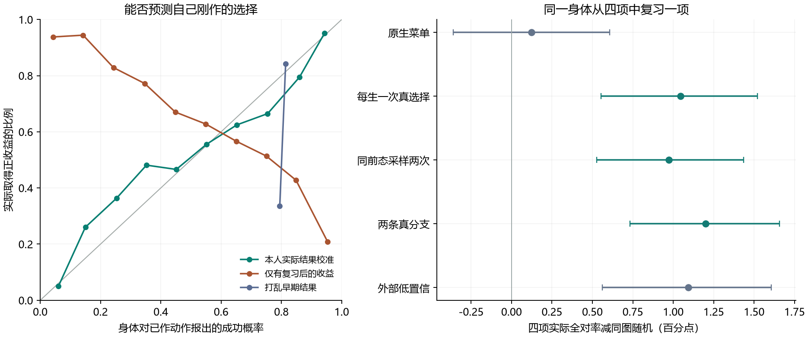

# 从自己的运动反应中学习复习与预测

两个问题分别计分。一个观察是它是否能估计自己已经作出的动作会不会取得资源，另一个是它利用这种读数选择复习后，未来的实际动作有没有改善。这里显式接通了候选与运动读数，原生图的普通采集和生内写入照常工作。

## 同一条实际经验能不能教会一个小选择器

依次给两个候选各看两种摆向，各 5 拍。身体和活动痕迹连续推进，期间没有味觉和参数提交。同一个四隐单元读出把每个候选的两次原生运动 logit 映为一个分数，再由右减左的差与原菜单 drive 一起决定实际去向，共 17 个通过收益学习的系数及四个瞬时运动读数。三种训练均在原有六个身体上各进行三次独立搜索，测试时在另外六个身体上直接使用。每次更新每个训练身体都执行 64 条真正结束的复习轨迹。

| 训练时取得的实际收益 | 原组四项全对减同图随机，百分点 | 独立组同项，百分点 | 独立组自己的选择减同场景异经历捐赠，百分点 |
|---|---:|---:|---:|
| 每条生命按当前策略选择一次 | +1.06 [+0.57, +1.55] | +1.05 [+0.55, +1.52] | +0.89 [+0.51, +1.29] |
| 同一前态采样两个当前策略动作 | +1.04 [+0.55, +1.51] | +0.97 [+0.53, +1.43] | +0.83 [+0.44, +1.20] |
| 同一前态实际走完两个相反动作 | +1.06 [+0.52, +1.59] | +1.20 [+0.73, +1.66] | +1.03 [+0.63, +1.42] |
| 原生采集运动输出 | -0.09 [-0.54, +0.32] | +0.12 [-0.36, +0.61] | +0.12 [-0.30, +0.55] |
| 固定选择运动半差绝对值小的一项 | +1.15 [+0.62, +1.68] | +1.09 [+0.56, +1.61] | +0.97 [+0.48, +1.45] |

随机复习列对同一状态两个真实分支取平均。每次部署只去一次；所有方法花同样的预览时间。四物体中仅有两个可供选择。早先一次 768 几何、每个几何共用一次随机选侧的单侧离线拟合没有成功；改用充分的新鲜世界与各条生命自己的选择后，普通单路线收益已足以产生一个可转移的小优势。[首轮固定数据](readback-test-independent-uniform-4.json) · [新世界单路线](online-independent-uniform-4-4000.json) · [修复身体的转移](online-independent-repair-4-4000.json)

## 旧回报、当前回报与信号分量

| 独立身体上的单路线读出 | 四项全对差（百分点） | 当场取得正味的差（百分点） | 当场与一次实际后测的总资源差（每生） | 真写减同味觉禁写的四项全对差（百分点） |
|---|---:|---:|---:|---:|
| 均匀回访专家 | +1.05 [+0.57, +1.54] | -5.38 [-6.15, -4.56] | -0.05 [-0.06, -0.04] | +0.22 [-0.66, +1.10] |
| 短长信用修复图 | +0.71 [+0.26, +1.20] | -3.95 [-5.31, -2.25] | -0.03 [-0.05, -0.02] | -2.11 [-3.50, -0.78] |

将学得的打分函数分解为同时反转两个运动 logit 后不变的部分和随之变号的部分。只保留不变部分时，四项实际收益接近完整读出；只保留变号部分，收益大幅减小。这是对新增小读出的功能分解。[实际分叉与计费](readout-cause-independent-uniform.json)

## 能预测自己的已作动作，是否就能更好地选复习

第二项试验只加五个系数。两次摆向后身体对该对象作出一次真正的普通方向选择，并接收自己的动作反馈。环境在生命结束时为其中一个已作动作结算；该结果在做复习选择时不可见。三个系数估计这个选侧的成功率，另两个系数把两项的估计差与原生菜单信号变成复习动作。

| 独立六出生，四对象 | 实际成功率 | 平均自报概率 | Brier（越低越好） | 复习四项全对减随机，百分点 |
|---|---:|---:|---:|---:|
| 用本人已作动作校准 | 81.98% | 82.66% | 0.110 | +0.87 [+0.39, +1.34] |
| 只有复习后的真实收益 | 81.98% | 26.63% | 0.614 | +0.87 [+0.37, +1.38] |
| 早期收益跨世界打乱 | 81.98% | 81.32% | 0.146 | +0.06 [-0.36, +0.44] |

把全部预测系数取反会把概率 p 变为 1−p，再把选择对估计差的斜率取反，最后两个动作的相对倾向完全相同。对两批留出逐个验证，选侧无一改变，而预测的误差明显变化。单靠最终复习行为不能确定内部标量是否具有“我有多可能正确”的含义。正确配对的本人行动后果使它获得可验证的局部概率解释；两种训练并未因此拉开四项回访成绩。[等价变换与校准分箱](self-report-symmetry.json) · [逐评估项](self-assess-independent-uniform-4.json)

