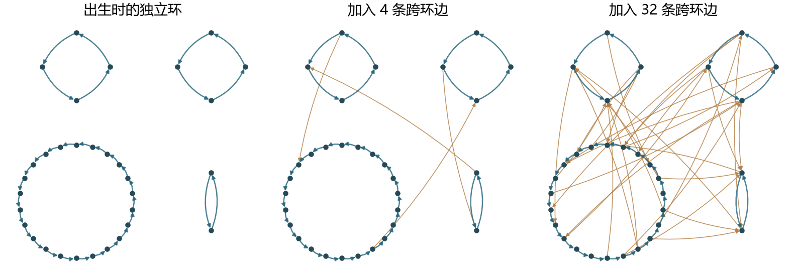

# 多个一入一出环的固定接线试验

先从 32 节点的随机排列中选取没有自身固定点、且至少分成两个循环的排列，按其后继接线。每个节点仅属于一个出生环，恰有一条环内入边、一条环内出边。实现没有指定环数，也没有指定环的长度。16 个出生组的 32 个重启中，环数分布为 2 个环 9 次、3 个环 12 次、4 个环 5 次、5 个环 3 次、6 个环 2 次、7 个环 1 次。最短环 2 节点，最长环 30 节点。[生成器](../../../../experiments/pulse_game/module_graphs.py)



左图是登记中首个出生的 4、4、22、2 节点内部环。中图选一个随机环序，在每个环上各选一处发出、在下一个环上各选一处接入，4 条跨环边就能让四个环互相通达。右图从所有跨不同环的有向节点对中均匀无放回地选取 32 条，接受条件为每个环都有跨环入边与跨环出边。没有给节点的入度或出度设上限。32 个出生中，右图方案的节点入度为 1–9、出度为 1–14；每个环各有 1–22 条跨环入边和 1–22 条出边，32 张图实测全局均强连通。一般的“每个环有进有出”只保证环层面没有源和汇，不能单独保证全图强连通。

每次训练同一个出生组的五种接法。64 边组比较单主环加 32 条自由额外边、分环加 32 条跨环边，以及没有预设骨架的自由强连通图。最少桥组比较分环加 K 条跨环边与单主环加 K 条随机额外边，其中 K 是匹配出生的环数；总边数逐出生完全相同，这批为 34–39 条。所有模型都是 449 个可训练参数、每个接收节点一个增益并按实际入度平方根归一。训练、独立校准及标准／长时序确认用不同的物理世界根。每条规则和每种预算分别在两次重启中择优，平分取首个。所有候选和校准选择锁定后才评估固定接线的确认集。[实验程序](../../../../experiments/pulse_game/module_graph_study.py)

## 固定接线成绩

标准时序、1,200 次训练更新的留出实际选择如下。每个世界的二十种有序输入全部计入，超时也计错。

| 规则 | 单主环＋32 条自由边 | 分环＋32 条跨环边 | 64 边全自由图 | 单主环＋K 条额外边 | 分环＋K 条跨环边 |
|---|---:|---:|---:|---:|---:|
| 环序 | 58.52% | 62.71% | 58.58% | 55.44% | 55.19% |
| 邻接 | 96.46% | 95.82% | 97.05% | 96.07% | 94.35% |
| 混合查表 | 97.14% | 94.39% | 97.08% | 91.17% | 84.57% |

64 边分环图相对同边数单主环，三条规则差值依次为 +4.19 [−7.11, 17.98]、−0.64 [−7.83, 7.95]、−2.75 [−13.28, 3.46] 个百分点。相对无预设骨架的自由图则为 +4.13 [−6.10, 16.59]、−1.23 [−7.09, 3.10]、−2.70 [−11.60, 2.06] 点。最少桥组相对同边数单主环，混合查表低 6.60 点，区间 [−21.36, 6.90]。预登记九项同时区间全部包含零。[完整统计及全二十格通过率](summary.json)

补做的密度比较中，分环模型从每环一入一出增加至全图 32 条跨环边，混合查表增加 9.82 点。单主环从 K 条增加至 32 条额外边时也增加 5.96 点。两个增益之差 3.85 点，普通配对 95% 区间为 [−7.19, 15.32]。这提示当前任务可能受益于更多远距离连接，现有结果还不能把这项增益专门归因于环状分区。[事后密度对照](bridge-density.json)

## 原始数据与重放

在仓库根目录执行。已有本机原始目录时，`confirm` 和 `report` 可以复核封存的权重及评分。重新拟合可在干净的结果目录启动。训练数据是同一物理身体实际接触侧和可见签名味觉，各臂共用相同样本和批次。以下命令使用 CPU，每个工作进程内部使用一个 PyTorch 线程。

```powershell
$env:OPENBLAS_NUM_THREADS = '1'
$env:OMP_NUM_THREADS = '1'
python -m experiments.pulse_game.module_graph_study all --workers 4
python -m experiments.pulse_game.module_graph_verify
```

原始包内含每个出生的接线、登记、选点、两个预算的全部权重和逐请求动作。已核对 2,457,600 次物理评分，首个出生组的 153,600 次评分覆盖两个预算和两种时序，逐项重放一致。先按环、再按神经元复查了全部出生图的度数和强连通性。[原始材料](raw.zip) · [复核记录](verification.json)
