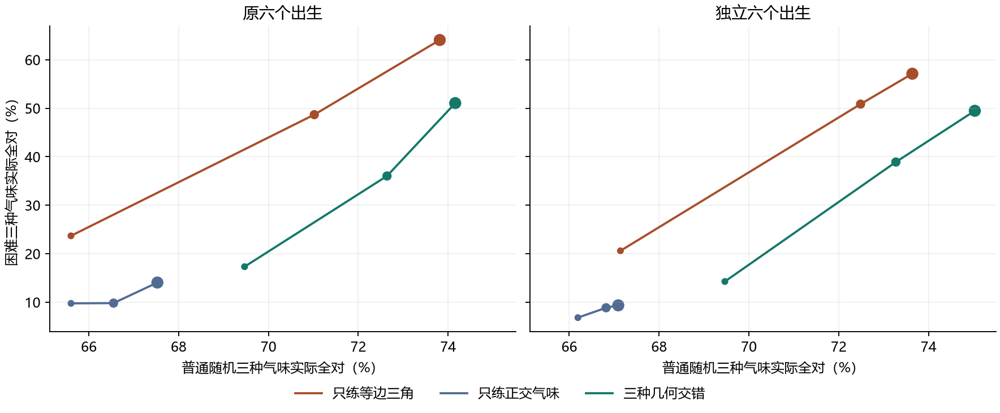

# 同一张图在两种课程中的表现

## 跨几何的学习

每组先学习三个对象，末题由实际选侧获得资源。三组使用相同出生、布局随机数、味觉规律、优化器和 64,000 次更新，改变气味间的几何关系。交错组一半为等边三角，四分之一为正交气味，四分之一为随机独立方向。下表使用既有留出库，每个出生 128 个世界。普通三项和困难三项都按真实采样动作计分。严格通过率另要求两个相反困难历史的三个反对称余量都大于 0.05。

| 出生 | 64k 课程 | 困难两张表严格通过 | 困难三项实际全对 | 普通随机三项全对 | 普通五项全对 |
|---|---|---:|---:|---:|---:|
| 原六个出生 | 只练等边三角 | 67.60% | 64.07% | 73.81% | 31.61% |
| 原六个出生 | 只练正交气味 | 0.04% | 14.05% | 67.53% | 27.21% |
| 原六个出生 | 三种几何交错 | 45.38% | 51.05% | 74.16% | 33.14% |
| 独立六个出生 | 只练等边三角 | 58.53% | 57.12% | 73.64% | 38.57% |
| 独立六个出生 | 只练正交气味 | 0.00% | 9.35% | 67.09% | 32.91% |
| 独立六个出生 | 三种几何交错 | 45.40% | 49.47% | 75.03% | 39.19% |

点从小到大依次为 8k、32k、64k 次更新。两组坐标刻度一致。

| 出生 | 64k 配对差，百分点 | 困难三项实际全对 | 随机三项实际全对 | 普通五项全对 |
|---|---|---:|---:|---:|
| 原六个出生 | 交错减只练等边三角 | -13.02 [-20.08, -5.79] | +0.34 [-1.70, +2.29] | +1.53 [-1.24, +4.33] |
| 原六个出生 | 交错减只练正交气味 | +37.00 [+29.76, +44.45] | +6.63 [+4.13, +9.12] | +5.92 [+3.29, +8.46] |
| 独立六个出生 | 交错减只练等边三角 | -7.64 [-10.66, -4.35] | +1.39 [-0.35, +3.00] | +0.62 [-2.93, +4.10] |
| 独立六个出生 | 交错减只练正交气味 | +40.12 [+27.22, +51.59] | +7.94 [+4.55, +11.52] | +6.28 [+2.51, +10.29] |

交错 64k 与只练等边三角 32k 的困难训练次数都是 32k。使用全局更新编号生成训练世界，两组的困难样本不逐一对应，交错组有额外的 32k 次其他几何更新。逐项区间和这个额外预算对照见[原组](geometry-comparison-original-64000.json)与[独立组](geometry-comparison-independent-64000.json)。

## 一条连续生命中的六项记忆

三组从同一批 64k 等边三角模型继续训练，每组使用完全相同的 4,000 次原有三角任务更新和 4,000 次新场景、气味及给料器更新，只改变这两类生命在出生前训练中的次序。下表另外列出继续训练前的亲本。部署时同一张图经历七次接触，再从相同末状态分别采样六个无反馈动作。两个给料器示范的两侧标记相同，其他五次体验由选侧决定味觉；七次接触均可更新活动和图。

| 出生 | 继续训练方式 | 全部映射的六项全对 | 场景冲突时三角三项 | 场景冲突时 A/B/标记三项 | 场景冲突时六项 | 困难三角且场景冲突时六项 |
|---|---|---:|---:|---:|---:|---:|
| 原六个出生 | 继续训练前 | 11.02% | 57.96% | 10.04% | 5.52% | 2.81% |
| 原六个出生 | 先旧后新 | 9.19% | 31.64% | 14.34% | 4.39% | 0.98% |
| 原六个出生 | 先新后旧 | 11.50% | 58.05% | 10.42% | 5.66% | 2.84% |
| 原六个出生 | 逐对交错 | 14.93% | 52.21% | 15.62% | 7.64% | 3.52% |
| 独立六个出生 | 继续训练前 | 11.23% | 57.69% | 9.93% | 5.68% | 2.63% |
| 独立六个出生 | 先旧后新 | 5.77% | 23.69% | 12.46% | 3.09% | 0.95% |
| 独立六个出生 | 先新后旧 | 11.81% | 59.05% | 10.18% | 5.81% | 2.65% |
| 独立六个出生 | 逐对交错 | 14.63% | 53.30% | 13.80% | 6.89% | 2.81% |

每个出生 96 个世界，三个预习顺序等权。每世界 64 个完整私有赋值，其中 32 个场景冲突，同时满足困难三角与场景冲突的有 8 个。各项差在配对后按训练出生和共享世界重采样。

| 出生 | 场景冲突下的配对差，百分点 | 三角三项 | A/B/标记三项 | 六项 |
|---|---|---:|---:|---:|
| 原六个出生 | 交错减先旧后新 | +20.57 [+14.42, +27.37] | +1.28 [-0.71, +3.25] | +3.25 [+1.80, +4.88] |
| 原六个出生 | 交错减先新后旧 | -5.84 [-7.70, -4.22] | +5.19 [+3.44, +7.03] | +1.97 [+1.11, +2.90] |
| 原六个出生 | 交错减继续训练前 | -5.76 [-7.47, -3.96] | +5.58 [+3.97, +7.05] | +2.11 [+1.12, +3.01] |
| 独立六个出生 | 交错减先旧后新 | +29.61 [+20.52, +36.84] | +1.34 [-0.60, +3.52] | +3.79 [+2.48, +5.05] |
| 独立六个出生 | 交错减先新后旧 | -5.75 [-8.97, -1.26] | +3.63 [+1.80, +5.27] | +1.08 [+0.22, +1.91] |
| 独立六个出生 | 交错减继续训练前 | -4.38 [-8.92, +1.38] | +3.88 [+1.80, +5.80] | +1.21 [+0.46, +2.01] |

原六个出生的交错组在场景冲突时，关闭生内参数写入后三项气味与场景合计六项全对为 1.56%，使用同一运动随机数均匀选侧为 1.76%。独立六个出生的交错组在场景冲突时，关闭生内参数写入后三项气味与场景合计六项全对为 1.37%，使用同一运动随机数均匀选侧为 1.63%。

一生六项测验与[独立物理运动验证](mixed-results.md)使用不同的身体时钟。出生前练习的先后顺序、部署后七次实际接触的先后顺序也分别记录。[原组完整证据](cross-skill-original-8000.json) · [独立组完整证据](cross-skill-independent-8000.json)
