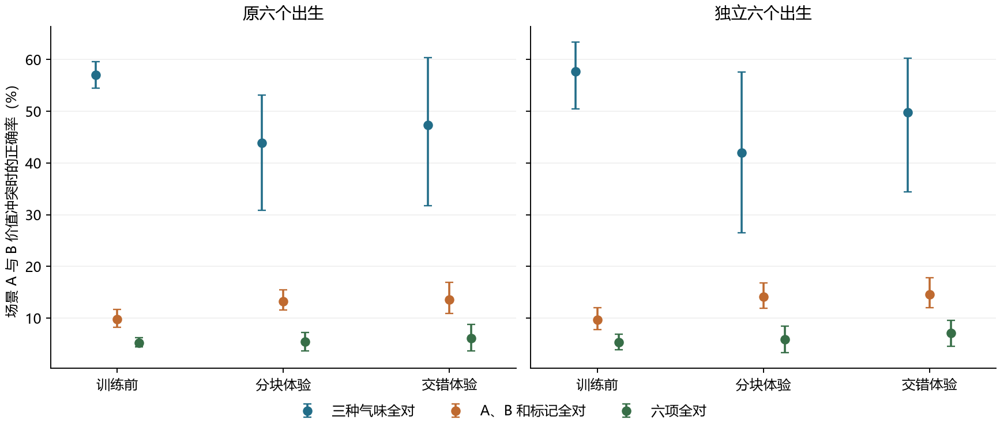

# 一条生命同时学习六项私有规律

两种训练日程均从相同的 64k 三角形模型出发。七次接触学习三种气味、同一气味的 A/B 场景价值，以及一种给料器标记。每条生命末尾从两域各抽一题，题序随机，两次实际行动都成功才取得外层训练回报。第一道终局题接触后没有正负味觉输入，图仍根据感觉和选侧正常运行并可写入，然后进行第二次选择。两组均训练 8,000 步，部署时没有外层优化器。

分块组随机决定哪一域在前。交错组在四次场景或给料器接触之间插入三个气味，按这套时序以场景或标记起止。两组各对象的随机数和总训练时钟相同，各个对象距末次行动的间隔随顺序而变，实际选侧与味觉也能不同。

## 新留出世界上的实际行动

表中的串答列记录同一生命中先后作出的两个动作。六项全对列在另一套世界，从同一末状态分别探测六个答案。每出生、每组 96 个世界，每个世界交叉 64 种私有赋值，其中 32 种场景冲突，8 种同时属于困难三角和场景冲突。串答每世界固定一对题及题序，未穷举 18 种可能。百分比是六个出生的平均。

| 出生 | 训练日程 | 串答两项均获益，全映射 | 串答两项均获益，场景冲突 | 六项全对，全映射 | 六项全对，场景冲突 | 六项全对，困难三角且场景冲突 |
|---|---|---:|---:|---:|---:|---:|
| 原六个出生 | 训练前 | 48.83% | 42.53% | 10.94% | 5.24% | 2.79% |
| 原六个出生 | 分块体验 | 48.23% | 42.90% | 11.06% | 5.44% | 2.14% |
| 原六个出生 | 交错体验 | 49.22% | 43.86% | 12.15% | 6.12% | 2.92% |
| 独立六个出生 | 训练前 | 48.46% | 41.87% | 10.59% | 5.37% | 2.71% |
| 独立六个出生 | 分块体验 | 45.57% | 41.45% | 11.21% | 5.85% | 2.65% |
| 独立六个出生 | 交错体验 | 50.72% | 45.42% | 13.88% | 7.12% | 2.89% |

| 出生 | 世界 | 训练日程对比 | 连续双答全获益 | 三种气味全对 | A/B/标记全对 | 六项全对 |
|---|---|---|---:|---:|---:|---:|
| 原六个出生 | 新世界 | 分块减亲本 | +0.37 [-6.48, +6.55] | -13.10 [-26.56, -3.26] | +3.52 [+2.08, +4.99] | +0.20 [-1.40, +1.75] |
| 原六个出生 | 新世界 | 交错减亲本 | +1.33 [-6.77, +8.14] | -9.70 [-26.27, +4.39] | +3.83 [+1.81, +5.85] | +0.88 [-1.24, +2.88] |
| 原六个出生 | 新世界 | 交错减分块 | +0.97 [-7.41, +8.64] | +3.40 [-11.89, +15.27] | +0.31 [-2.09, +2.92] | +0.68 [-1.28, +2.79] |
| 原六个出生 | 共同留出库 | 分块减亲本 | +1.26 [-6.44, +7.59] | -14.48 [-28.18, -4.62] | +3.43 [+2.05, +4.86] | -0.07 [-1.75, +1.42] |
| 原六个出生 | 共同留出库 | 交错减亲本 | +2.67 [-5.28, +9.77] | -11.24 [-27.88, +1.99] | +3.59 [+1.60, +5.80] | +0.58 [-1.86, +2.89] |
| 原六个出生 | 共同留出库 | 交错减分块 | +1.41 [-7.27, +9.11] | +3.24 [-12.00, +15.44] | +0.16 [-1.98, +2.82] | +0.65 [-1.51, +3.00] |
| 独立六个出生 | 新世界 | 分块减亲本 | -0.42 [-7.55, +5.99] | -15.72 [-28.87, -4.70] | +4.43 [+2.91, +5.85] | +0.48 [-1.25, +2.03] |
| 独立六个出生 | 新世界 | 交错减亲本 | +3.55 [-4.87, +10.06] | -7.88 [-23.40, +3.19] | +4.90 [+3.36, +6.54] | +1.75 [-0.22, +3.41] |
| 独立六个出生 | 新世界 | 交错减分块 | +3.97 [-0.28, +10.61] | +7.84 [-0.94, +20.96] | +0.47 [-1.01, +1.99] | +1.27 [+0.00, +2.89] |
| 独立六个出生 | 共同留出库 | 分块减亲本 | +0.24 [-7.94, +7.52] | -16.49 [-29.17, -6.40] | +4.30 [+2.40, +6.07] | +0.28 [-1.55, +1.88] |
| 独立六个出生 | 共同留出库 | 交错减亲本 | +4.99 [-4.23, +12.10] | -8.21 [-23.81, +3.53] | +4.95 [+3.37, +6.75] | +1.51 [-0.51, +3.26] |
| 独立六个出生 | 共同留出库 | 交错减分块 | +4.75 [+0.14, +12.77] | +8.28 [+0.02, +21.20] | +0.64 [-0.86, +2.16] | +1.23 [+0.10, +2.81] |

以上均为场景价值冲突子集的配对差，单位为百分点。区间同时重采样训练出生及其共享测试几何，保留同一世界的配对规律。

原六个出生分块体验，接触全程禁写后，场景冲突的六项全对为 1.17%，同随机数均匀选侧为 1.53%。
原六个出生交错体验，接触全程禁写后，场景冲突的六项全对为 1.43%，同随机数均匀选侧为 1.53%。
独立六个出生分块体验，接触全程禁写后，场景冲突的六项全对为 1.30%，同随机数均匀选侧为 1.73%。
独立六个出生交错体验，接触全程禁写后，场景冲突的六项全对为 1.48%，同随机数均匀选侧为 1.73%。

## 另外的新生命还能完成哪些任务

| 出生 | 训练日程 | 等边三角困难赋值三项实际全对 | 两个普通对象全对 | 五个普通对象全对 | 隐藏线性规律的新对象首次答对 |
|---|---|---:|---:|---:|---:|
| 原六个出生 | 训练前 | 64.07% | 91.08% | 31.61% | 82.55% |
| 原六个出生 | 分块体验 | 23.23% | 62.08% | 19.30% | 75.33% |
| 原六个出生 | 交错体验 | 33.59% | 63.48% | 21.03% | 76.11% |
| 独立六个出生 | 训练前 | 57.12% | 92.55% | 38.57% | 80.86% |
| 独立六个出生 | 分块体验 | 32.63% | 61.78% | 22.66% | 71.03% |
| 独立六个出生 | 交错体验 | 28.16% | 72.04% | 27.67% | 76.50% |

这些单项测试分别从相同的继承模型开始，各自保留内部连续状态。新世界的两动作及六项测验来自原生感觉和选侧时钟。此前报告的真实身体逐拍落地有自己的分母和对照。[原组新世界](one-life-original-disjoint-8000.json) · [独立组新世界](one-life-independent-disjoint-8000.json) · [原组共同留出库](one-life-original-shared-8000.json) · [独立组共同留出库](one-life-independent-shared-8000.json)
