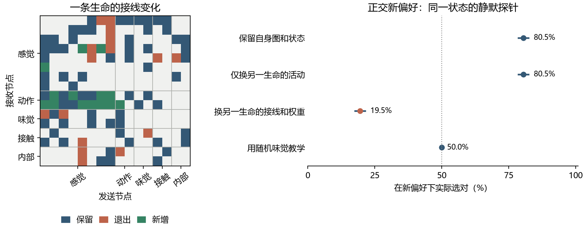

# 正交偏好与两个个体之间的经验交换

同一张出生图和同一条生活前史分成两个个体。A 中，两侧食物都由四种化学成分混合，哪个更好取决于该世界私有的偏好方向。B 中取一个与 A 正交的新方向，让两个个体分别面对正、负两个版本。两者见到完全相同的气味、位置和风，一方喜欢的选择正是另一方应避免的。随后两者都回到 A。模型感觉口、味觉、接触和动作端口都在一张图里，身体直接比较两个动作节点的状态。模型参数和更新配方取自之前的开发选择。[图的学习规则](../ports/README.md) · [预登记](protocol.json)

使用 8 个全新出生和 16 个全新世界根，每个配对单位内有两条味觉互补的生命。每段提供 192 次教学机会。评估从实际教学结束时的状态另行分叉，在 64 次新食物机会中隐藏味觉并关闭探索电流，超时留在分母。评估分支的活动不会进入下一段教学。因此回 A 的结果包含 192 次重新接触旧规律的机会。开发代码曾尝试把安静测验接到下一段，正式复跑前按登记改为对状态副本测验，配方和世界均沿用原登记。[世界生成和物理评分](../../../../experiments/pulse_game/open_graph_orthogonal.py)

| B 教学完成后的安静分支 | 按本生命的 B 偏好选对 |
|---|---:|
| 自己学成的图和自己的活动 | **80.48%** |
| 只交换两个个体此刻的节点活动 | 80.47% |
| 只交换学成的接线和边权 | **19.53%** |
| 用独立随机味觉教学 | 50.00% |

换图后，身体仍然 100% 走到端点，按供体的偏好评分为 **80.47%**。在 16,384 次 B 测验中，其接触侧有 **99.96%** 与供体原先的动作相同。保留自身图相对换图，实际正确率相差 **60.96 个百分点**，按三个主要比较校正的 95% 区间为 **[56.48, 65.62]**。这说明本次从经验中学到的新选择方向可以随突触图一并转移。图的接线和相应权重一同交换，单靠该分叉无法估计二者各自的贡献。活动交换是在教学末做一次，报告 64 次机会的均值，短暂影响可能在该窗口内衰减。[逐阶段统计](summary.json) · [供体对齐与重放](checks.json)

左图显示登记中的首个出生、首个世界和正向 B 个体。比较出生和完成 B 教学两个时刻的边地址，颜色标注两个时刻都存在、仅出生时存在、仅 B 结束时存在的连接。地址曾经退出又长回时，该图按两端快照归类。

A 首段的安静正确率为 76.86%，回到 A 并重新教学后为 80.18%。同一对个体在互为相反的 B 世界中两边都选对的比例为 67.86%，随机味觉组为零。每段真实教学后都核验了非零权重支持的强连通性。实际接触、静默分叉和节点状态在归档里按出生和世界保留。核对了 425,984 条分支物理记录，并对首个出生的全部阶段和干预逐项重放。[原始行为与两张互补图](physical.zip) · [独立核验](../../../../experiments/pulse_game/open_graph_orthogonal_check.py)
