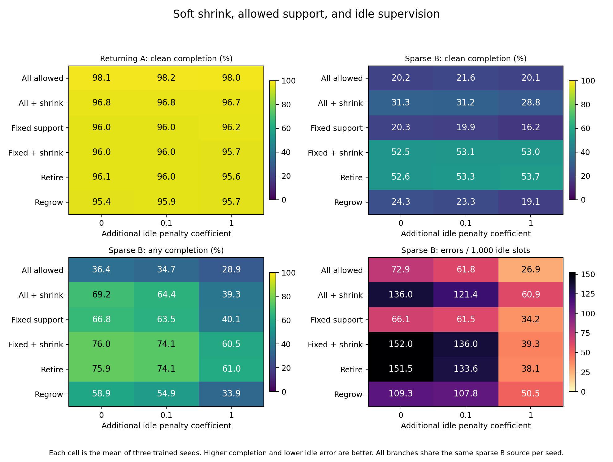
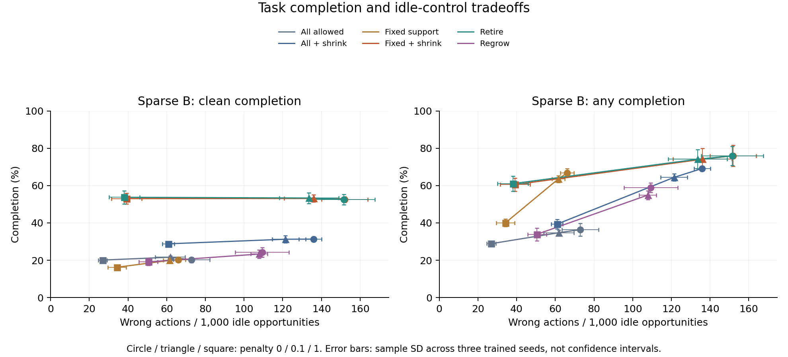
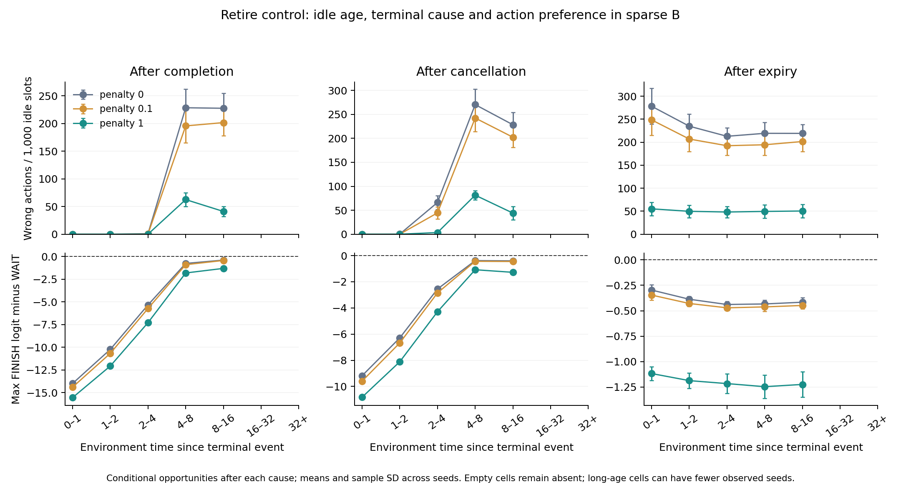

# 稀疏 B 状态后的收缩、连接资格、退出与空闲损失对照

日期：2026-10-29。接续[连接渐进退出与再生长实验](rewiring-experiment-2026-10-28.md)。**54 组继续学习、285 个冻结评估分叉已完成，8,809,499 项一致性检查通过。**

在这批共同起点的对照中，固定稀疏允许集合与软收缩的配合解释了主要的长任务保持收益，永久退出没有带来可辨认的额外保持收益。额外空闲惩罚可把误动作减少约四分之三，严格完成率基本保持；但普通完成率下降约 15 个百分点，合法机会出现后仍未完成的请求增多。这是一项明确的控制取舍，尚未解决整体可靠性。

本轮从三个已经学过 B 的稀疏个体分别分出六种结构条件，再交叉三个空闲损失系数，共 54 组继续学习。目标是区分软收缩、允许的稀疏支撑、永久退出和重新生长，并检查加强空闲 WAIT 监督是否改善控制，同时损害必要动作。

正式[协议](evidence/factors-2026-10-29/study-protocol-v1.json)的 SHA256 为 `88635f7943b69798dd048a9f4322133dfb1e03d21f65a7e7d23c412dc05033ef`。协议在结果评估前绑定来源检查点、源码、54 个分支及全部评估条件。三个损失强度全部报告，不按结果选择最佳强度。

## 1. 共同来源与完整状态继承

每个种子使用旧实验 `retire_high/checkpoint_B.pt`，来源位置为 `data/rewiring/main-v1/training/seed_SSS/retire_high/`。同一种子的 18 个新分支从完全相同的 B 边界开始，直接返回 A2 条件继续学习。

| 训练种子 | B 来源的 W 精确非零数 | 原 Adam 步号 | 旧结构更新数 | 结构窗口位置 | 失活影子生命周期最大计数 |
|---|---:|---:|---:|---:|---:|
| 0 | 3,791 | 3,072 | 1,024 | 0 | 1,023 |
| 1 | 3,798 | 3,072 | 1,024 | 0 | 1,023 |
| 2 | 3,733 | 3,072 | 1,024 | 0 | 1,023 |

来源均为宽度 128 的原循环模型，W 有 16,384 个可能坐标，模型结构、编码器与 11 类动作头保持原定义。来源的全局时钟为 196,608 tick，B 阶段已运行 65,536 tick；存档时尚未执行 A2 返回切换。因而 `dense` 分支也从同一个稀疏函数开始，允许原本为零的坐标参与后续学习；它不是从头训练的稠密网络。

附加新算子时保留模型、h、世界、当前合同、待发生事件、回执、时钟、原 Adam 状态、随机数状态，以及旧结构算子的影子一阶矩、二阶矩、生命周期年龄、窗口累加器、私有 RNG 和绝对生灭计数。没有重新随机初始化、先补齐权重或重新开始 Adam。A2 分布切换只改变未来 NEW 的合同，已有请求继续履行原合同。

结构算子的绝对更新数和旧初始边生存历史继续保留，并另记本轮起点与新增更新数。旧累计出生、退出不能直接标为本轮事件数；本轮事件数使用端点与 B 来源之差。新分支的起始支撑另存，避免把旧实验最初的全连接掩码误用为固定稀疏条件的允许位置。

## 2. 六种结构条件

实现见 [structure.py](../experiments/factors/structure.py)。令 `allowed` 表示允许接受活 Adam 更新的位置，`support` 表示当前实际 `W!=0` 的位置。两者分别保存和报告。

| 模式 | 允许的位置 | 每次活 Adam 后的收缩 | 变成精确零之后 |
|---|---|---:|---|
| `dense` | 全部 16,384 个坐标 | 0 | 仍然允许，普通 Adam 可以使其非零 |
| `dense_shrink` | 全部坐标 | `2e-4` | 仍然允许，不清空活 Adam 矩 |
| `fixed` | 本种子 B 来源的非零支撑 | 0 | 来源允许的位置继续允许 |
| `fixed_shrink` | 同一份 B 来源支撑 | `2e-4` | 来源允许的位置继续允许，不清空其活 Adam 矩 |
| `retire` | 旧算子的动态活跃位置 | `2e-4` | 按旧规则退出，不执行出生 |
| `grow` | 旧算子的动态活跃位置 | `2e-4` | 按旧规则退出，允许旧影子提案触发出生 |

固定条件的掩码在本轮开始时确定，不随当前非零数缩小。一个允许的连接即使恰好为零，也能接收普通梯度，保留自身动量并重新非零。只有始终不允许的位置被强制保持 W=0、活 Adam 矩为零。因此 `fixed_shrink` 和 `retire` 的差别不只在表面上的零权重数量，还包括零位置能否继续更新及其优化器状态。

`retire`、`grow` 直接调用原 [RewireOperator](../experiments/rewiring/plasticity.py)，分别使用 `retire`、`learned` 配置。收缩为 `sign(W)*max(abs(W)-2e-4,0)`；只有达到精确零才退出，不按排名硬删非零边。更新开始时已失活的位置用本块普通 BPTT 潜在梯度和实际联合裁剪系数继续更新原影子 Adam。每 8 次更新检查带符号累加提案，扣除该位置在本窗口实际观察次数对应的收缩成本；刚退出的位置不能在同一次更新立即出生。生命周期矩和年龄跨窗口保留，出生与退出均沿用旧实现的清理规则。

`dense`、`fixed` 两类条件不使用影子提案。它们完整保留来源的影子缓冲与私有 RNG，但这些缓冲在本轮不继续积累证据。所有模式仍记录实际支撑的出生与退出，包括稠密条件中零坐标被普通 Adam 更新为非零的自然出生。允许数、实际非零数与累计事件数分别报告，不将允许数当作实际边数。

收缩仍是“Adam 后做欧氏软收缩”的明确启发式，不宣称它等价于同一 L1 目标下的精确 Adam 近端算法。所有分支仍使用稠密张量、稠密前向与反向，较少非零边不能直接解释为同比例计算或存储节省。

## 3. 新增空闲监督的定义

实现见 [run.py](../experiments/factors/run.py)。原目标已经是带权交叉熵，WAIT 类权重为 `.1`，其他类为 1；空闲位置原本就有训练信号。新目标是在原损失上增加一项，不把原 WAIT 权重直接替换为新系数。

对一个 64 tick 的训练块，设教师标签为 y、预测概率为 p、原类别权重为 w：

~~~text
L_base = sum(w[y] * -log p[y]) / sum(w[y])
I = enabled AND NOT active
L_idle = mean(-log p[WAIT] over I)
L = L_base + lambda * L_idle
lambda in {0, 0.1, 1}
~~~

没有空闲机会时，新增项为零。`lambda=0` 直接使用原损失张量与原梯度路径。新增项按本块空闲机会数独立归一化，因此其强度不能简单理解为某个固定的新 WAIT 类权重。

空闲掩码在 `observe` 和教师查询之后、模型执行本次动作之前复制：只包含启用且当前没有活跃合同的槽。使用行动后的状态会把刚被 FINISH 清空的活跃请求误记为空闲，因此本轮明确避免这一口径。

掩码与教师标签属于私有训练监督和诊断数据，不进入观察、h 或动作头。模型依然在全部 11 类动作上直接执行 argmax；评估时没有用空闲掩码过滤 BEGIN/FINISH，也没有教师动作门控。这仍是一套带因果教师监督的学习实验，不能称为只靠环境稀疏奖励的自主学习。

训练诊断将行动前位置分成 `idle`、`active_wait`、`legal_begin`、`legal_finish`、`disabled`，分别保留机会数、类别权重质量、NLL、实际非 WAIT 次数、概率和 logit margin。这些名称中的 `legal_begin`、`legal_finish` 指 **midpoint 教师在该时刻给出的标签类别**，不是对全部合法动作的枚举。例如，环境已经允许 FINISH，但尚未到教师选择的窗口中点时，教师仍可能给出 WAIT。`1-p[教师标签]` 也不能直接当作采取非法动作的概率。

基础 CE 的分母是类别权重质量，新增空闲项的分母是空闲机会数。跨块诊断保留原始分子与分母；总体 NLL/总体机会数是机会加权诊断量，不冒充逐块目标的同一种平均。

## 4. 训练与评估预算

54 组均继续 A2 65,536 tick，即各新增 1,024 次完整更新，总计 3,538,944 个新增训练 tick。每块 64 tick，`dt=.25`，对应 16 个环境时间单位；块边界只截断反向计算图，保留 h 数值。8 次更新的结构窗口不恢复已经截断的跨块导数。

A2 的未来 NEW 等待范围为 1–4，最终合同截止至下次 NEW 的空档范围为 0.5–2；没有在本轮主实验中加入 A+B 混合训练。普通 Adam 学习率 `.001`、beta=`(.9,.999)`、epsilon=`1e-8`、无权重衰减，沿用来源设置。原有学习规则、BPTT 长度、裁剪顺序和 Adam 全局年龄保留。

每个来源和最终端点均复制完整状态、冻结权重，在 CPU 上评估五种条件，各运行 2,048 tick、`dt=.25`：

| 条件 | 未来 NEW 等待 | 空档 |
|---|---|---|
| `iid` | 1–4 | 0.5–2 |
| `long_wait` | 4–8 | 0.5–2 |
| `longer` | 8–16 | 0.5–2 |
| `sparse` | 1–4 | 4–12 |
| `long_sparse` | 4–8 | 4–12 |

共享 B 来源有 `3×5=15` 个基线分叉，54 个最终端点有 `54×5=270` 个分叉，合计 **285 个冻结评估分叉**。命令清单将每份检查点的五种条件合成一个评估作业，故清单为 3 个基线作业、54 个端点评估作业，不能把分叉数误称为进程作业数。相应清单见[训练](evidence/factors-2026-10-29/training-commands-v1.json)、[基线](evidence/factors-2026-10-29/baseline-commands-v1.json)、[端点评估](evidence/factors-2026-10-29/evaluation-commands-v1.json)。

## 5. 预定比较与行为分母

全部结构比较均在同种子、同空闲系数、同评估条件下配对：`dense_shrink−dense`、`fixed_shrink−fixed`、`fixed−dense`、`fixed_shrink−dense_shrink`、`retire−fixed_shrink`、`grow−retire`。每种结构另比较 `.1`、`1` 相对 `0` 的空闲系数变化；来源到端点的变化单独报告。

这些比较分别约束收缩、允许支撑与永久退出的解释，但 `grow−retire` 同时改变活跃容量、出生幅度、优化器接续以及后续经验轨迹，不能单独归为纯拓扑或纯周转效应。全部组共享的是各自种子已经形成的稀疏 B 历史，结果不能外推为从头训练的架构优劣。来源与端点也具有不同 h 和世界历史，其差值不等于排除状态影响的纯权重知识变化。

固定与全位置允许的比较也改变了进入联合梯度裁剪的坐标集合，可能间接改变编码器和动作头的实际步长。因此它测量这套允许集合策略的整体影响，没有单独隔离纯图位置效应。空闲惩罚是作用于真实空闲训练时刻的可微 WAIT 负对数概率；它不只在已经执行误动作时才出现。

主行为指标沿用成熟、最终有效请求的无错误完成率，分开列出分叉后评估分布产生的请求、继承请求、继续履行旧合同的请求及右删失。普通完成、漏做、阶段错误、必要 BEGIN/FINISH 与空闲误动作同时报告，检查加强 WAIT 是否只是整体压低动作。

空闲错误同时按空闲机会和全部启用槽机会归一化，并按 completion、cancellation、expiry 等终止来源以及距终止时间分桶。完成率的分母是成熟请求，空闲错误率的分母是相应机会数，两者不能直接相减或互相替代。旧内容读出的机会由模型自己的状态和行动产生，其正确率也不等于全部隐藏内容的可读性。

统计重复单位为三个训练种子。先逐种子计算率与配对差值，再汇总均值和样本标准差；actor、请求、时间点与五个评估条件不增加训练重复数。零分母保留为未定义并报告数量。

## 6. 附件机制判断的核验范围

用户提供的评议附件已绑定 SHA256。可复查的[数值机制记录](evidence/factors-2026-10-29/attachment-mechanism-check-v1.json)区分了实际代码事实和条件性解释。

一项条件性检查将活 Adam 矩置零、保留全局步号 3,072，再施加非零梯度。下一步位移绝对值约为学习率的 `3.0883462` 倍，说明零矩与继承偏差修正年龄的组合可能影响新生边的最初更新。这是指定数值条件下的结果，不是本轮全部出生的实测均值，也没有证明此前任务表现的失败原因。

另一项检查从全新的失活影子状态开始，对一个完整 8 更新窗口输入恒定梯度。在学习率 `.001`、收缩 `2e-4` 下，梯度为 1 和 `.001` 时，出生值均约为 `-.0064`；在 `1e-10` 时提案被收缩至零。它验证候选归一化和阈值的数值行为。实际 B 来源的影子生命周期已经很长，本轮保留这些历史，不把这项 fresh-shadow 例子当作真实来源的全部候选分布。

主 54 组没有修复新生边的 Adam 年龄，也没有新增 A+B 混合训练、深层模型或分解后的转移参数。这些机制假设需要另立匹配实验，不能把局部公式核验写成已经获得的因果证据。

## 7. 队列、恢复与发布条件

调度入口见 [study.py](../experiments/factors/study.py) 与 [queue.py](../experiments/factors/queue.py)。正式运行的并发配置为 GPU 训练上限 10、CPU 基线/评估合计上限 12、三类任务共享进程上限 14，并设可用内存下限。10 与 12 不是可同时占满的两套独立配额。限制支持动态调整，每次观测到的配置及时间写入执行记录；因此并发下的阶段秒数不作为独占速度比较。

每个分支的开始绑定、完成标记、检查点字节指纹与语义指纹均对应唯一协议和来源。恢复加载模型、Adam、h、世界、调度状态、回执、全部 RNG、原影子状态和窗口位置；旧事件计数不清零。本轮进度另按新增 tick 与新增更新数验证。若中断发生在最近检查点之后，未保存的短片段从完整边界重算，不将临时进度重复计入保留轨迹。

已有机械检查覆盖附加时不改变 W/Adam/RNG、固定允许零位置恢复、禁止位置清零、真实生灭记账、全部 18 个结构与损失组合的完整恢复，以及 `retire, lambda=0` 与旧路径的连续更新一致性。机械烟测见[记录](evidence/factors-2026-10-29/mechanical-smoke-v1.json)，它用于实现验证，不是正式任务结果。

严格汇总已重新读取全部三份来源、54 份完整端点和 285 个冻结评估分叉，核对源码、检查点、世界时钟、无隐藏状态重置、更新预算、掩码资格、实际支撑、生灭恒等式、损失分母与评估谱系。三个 `retire, lambda=0` 端点的核心状态、原始世界、RNG、动作/数据、旧结构缓冲及 1,024 个延续更新的旧轨迹字段均精确复现历史 A2。新增诊断与实验封装元数据不宣称与旧文件相同。

## 8. 分开的结构因素

先看额外空闲系数为 0 的六组。B 保持指 `long_sparse`：等待 4–8、空档 4–12。所有表格均为三个种子的均值 ± 样本标准差；独立重复数为 3。普通完成允许请求途中出现错误后仍最终合法完成；严格完成要求无错误完成。

| 结构 | B 严格完成 % | B 普通完成 % | B 空闲错误/千机会 | 允许位置均值 | 实际非零均值 |
|---|---:|---:|---:|---:|---:|
| 全位置允许 | 20.18 ± 1.40 | 36.37 ± 3.40 | 72.90 ± 9.39 | 16,384.0 | 16,384.0 |
| 全位置允许＋收缩 | 31.30 ± 1.34 | 69.16 ± 0.95 | 135.96 ± 4.21 | 16,384.0 | 9,393.0 |
| 固定稀疏允许集合 | 20.26 ± 0.70 | 66.84 ± 2.31 | 66.10 ± 3.59 | 3,774.0 | 3,774.0 |
| 固定集合＋收缩 | 52.47 ± 1.47 | 76.00 ± 5.60 | 152.00 ± 11.93 | 3,774.0 | 2,128.0 |
| 收缩＋永久退出 | 52.56 ± 2.71 | 75.93 ± 5.18 | 151.52 ± 16.08 | 1,453.7 | 1,453.7 |
| 收缩＋候选再生长 | 24.29 ± 2.60 | 58.88 ± 2.47 | 109.34 ± 13.89 | 12,762.0 | 12,762.0 |

这些差异的配对统计给出了更明确的定位：

- 只固定稀疏允许集合相对全位置允许，B 严格完成差为 **+0.08 ± 0.70 个百分点**，没有观察到明显保持收益。
- 在全位置允许条件下加收缩，提高 **11.12 ± 1.42 个百分点**；在固定稀疏允许集合内加相同收缩，提高 **32.20 ± 2.03 个百分点**。
- 固定集合＋收缩相对全位置＋收缩，高 **21.17 ± 2.77 个百分点**。收缩与允许更新的位置存在明显的组合效果。
- 永久退出相对固定集合＋收缩仅 **+0.10 ± 1.63 个百分点**。二者最终实际边数约 1,454 与 2,128，允许位置约 1,454 与 3,774，但 B 严格完成接近。当前预算下，无需把“永久禁止回来”视为该保持收益的必要条件。
- 候选再生长相对永久退出低 **28.27 ± 3.89 个百分点**。本轮从相同稀疏 B 起点出发，仍没有看到这套候选规则的保持优势。

这支持继续研究受限可塑位置与软收缩的配合。它没有证明某个固定稀疏图普遍最优，也没有把联合梯度裁剪、后续自行动作轨迹和权重演化从结构策略的总体效果中剥离。

## 9. 空闲惩罚有效，但必须同时看普通完成

原 WAIT 类权重一直是 0.1。下表的 λ 是另外增加的空闲均值 NLL 系数，不是把原 WAIT 权重改成 λ。

| 结构 | 额外 λ | A 严格完成 % | B 严格完成 % | B 普通完成 % | B 空闲错误/千机会 |
|---|---:|---:|---:|---:|---:|
| 全位置允许 | 0 | 98.10 ± 0.16 | 20.18 ± 1.40 | 36.37 ± 3.40 | 72.90 ± 9.39 |
| 全位置允许 | 0.1 | 98.19 ± 0.16 | 21.60 ± 0.73 | 34.74 ± 1.50 | 61.81 ± 7.74 |
| 全位置允许 | 1 | 97.98 ± 0.18 | 20.08 ± 1.02 | 28.87 ± 1.15 | 26.92 ± 2.36 |
| 全位置允许＋收缩 | 0 | 96.75 ± 0.18 | 31.30 ± 1.34 | 69.16 ± 0.95 | 135.96 ± 4.21 |
| 全位置允许＋收缩 | 0.1 | 96.81 ± 0.24 | 31.24 ± 1.87 | 64.38 ± 1.92 | 121.38 ± 6.88 |
| 全位置允许＋收缩 | 1 | 96.67 ± 0.19 | 28.79 ± 0.16 | 39.33 ± 2.55 | 60.89 ± 3.06 |
| 固定稀疏允许集合 | 0 | 96.03 ± 0.38 | 20.26 ± 0.70 | 66.84 ± 2.31 | 66.10 ± 3.59 |
| 固定稀疏允许集合 | 0.1 | 96.05 ± 0.35 | 19.90 ± 1.06 | 63.51 ± 1.84 | 61.53 ± 3.29 |
| 固定稀疏允许集合 | 1 | 96.17 ± 0.22 | 16.22 ± 0.38 | 40.05 ± 1.98 | 34.25 ± 4.75 |
| 固定集合＋收缩 | 0 | 96.00 ± 0.14 | 52.47 ± 1.47 | 76.00 ± 5.60 | 152.00 ± 11.93 |
| 固定集合＋收缩 | 0.1 | 96.00 ± 0.19 | 53.09 ± 1.95 | 74.10 ± 5.84 | 135.99 ± 15.20 |
| 固定集合＋收缩 | 1 | 95.66 ± 0.05 | 53.01 ± 2.86 | 60.53 ± 3.52 | 39.25 ± 7.81 |
| 收缩＋永久退出 | 0 | 96.06 ± 0.39 | 52.56 ± 2.71 | 75.93 ± 5.18 | 151.52 ± 16.08 |
| 收缩＋永久退出 | 0.1 | 96.02 ± 0.30 | 53.32 ± 2.91 | 74.11 ± 5.08 | 133.59 ± 15.28 |
| 收缩＋永久退出 | 1 | 95.58 ± 0.35 | 53.73 ± 3.46 | 61.03 ± 4.13 | 38.11 ± 7.93 |
| 收缩＋候选再生长 | 0 | 95.38 ± 0.61 | 24.29 ± 2.60 | 58.88 ± 2.47 | 109.34 ± 13.89 |
| 收缩＋候选再生长 | 0.1 | 95.95 ± 0.55 | 23.31 ± 2.20 | 54.90 ± 2.34 | 107.81 ± 4.36 |
| 收缩＋候选再生长 | 1 | 95.67 ± 0.12 | 19.11 ± 1.86 | 33.89 ± 3.43 | 50.51 ± 4.87 |

固定集合＋收缩从 λ0 到 λ1，B 空闲错误由 **152.00** 降到 **39.25/千机会**，减少约 **74.2%**；B 严格完成由 **52.47%** 到 **53.01%**，配对差 **+0.54 ± 2.45 个百分点**。永久退出对应的空闲错误从 **151.51** 降到 **38.11**，约少 **74.9%**；B 严格完成由 **52.56%** 到 **53.73%**。旧 A 严格完成分别下降 **0.34 ± 0.16 / 0.48 ± 0.22 个百分点**。

**普通完成率的代价不能省略。** 固定集合＋收缩的 B 普通完成由 **76.00%** 降到 **60.53%**，配对差 **−15.47 ± 3.93 个百分点**；永久退出从 **75.93%** 降到 **61.03%**，差 **−14.89 ± 4.16 个百分点**。总体上，“出过错但最终完成”的请求份额缩小，有合法机会仍未完成的份额扩大。固定集合＋收缩的后一比例从 **24.00%** 到 **39.47%**，永久退出从 **24.07%** 到 **38.97%**。

未开始请求的比例在这些 B 条件中仍接近零，模型也继续严格完成约一半 B 请求，因此不是整体变成始终 WAIT；但它确实更容易在已出现合法机会后仍未完成。不能把“严格完成没有下降”概括成“必要行动完全没有受损”。

罚项效果还依赖结构。候选再生长从 λ0 到 λ1，空闲错误下降约 58.83/千机会，但 B 严格完成从 **24.29%** 降到 **19.11%**，普通完成从 **58.88%** 降到 **33.89%**。λ0.1 通常改动较小；没有证据表明 λ 越大越好，本轮也没有寻找全局最优强度。

## 10. 为什么会完成更多，却在空闲时乱动

首先，两类分母测量不同事情。一次请求可以在有效窗口中无错完成，随后无任务期间却继续输出 FINISH；后面的错误不会回头改写已经完成请求的严格计数。必须把请求结果和空闲机会上的控制分别测量。

其次，旧模型并非从未学过 WAIT。原监督已经包含空闲 WAIT，只是与活跃等待共享同一类权重；本轮额外按真实空闲状态增加目标后，误动作明显下降，说明训练目标的条件化优先级能改变这个问题。它不单独证明原数字 0.1 是唯一原因。

进一步按“为何空闲”条件化，永久退出组的错误率如下。每个种子先合并同一原因下的年龄桶，再计算率，最后做三个种子的等权均值；这与把所有种子计数直接相除的 pooled 率不同。

| 空闲来源 | λ0 错误/千机会 | λ1 错误/千机会 |
|---|---:|---:|
| 成功完成后 | 132.50 ± 18.08 | 32.29 ± 6.60 |
| 取消后 | 147.42 ± 17.88 | 37.10 ± 5.81 |
| 过期后 | 227.06 ± 23.93 | 50.03 ± 13.81 |

未额外处罚的永久退出组，在成功完成后 0–1 个时间单位内没有观察到误动作；到 4–8 的空闲年龄桶则约为 **228.49/千机会**。对应的平均“最高 FINISH logit − WAIT logit”从约 **−13.99** 接近到 **−0.77**；虽然均值仍为负，已有一部分状态选择 FINISH。λ1 把 4–8 桶的错误降到约 **62.53/千机会**，平均间隔移至 **−1.82**。这支持较长空闲演化中停止偏好减弱的描述，不证明所有轨迹都以同一种内部机制失效。

完成后的 λ0 误 FINISH 中，精确匹配旧合同内容的比例约 **24.4%**（按种子等权）。因此不能把全部乱动都解释成“正确记忆保留得太牢”。跨流干扰、回执和内部动力学仍可能参与，当前输出统计没有定位到特定神经元或回路。

过期与成功完成的观察条件也不同：[world.observe](../experiments/continuity/world.py) 会清除已过期的 active，但并不加入单独的到期通知特征；公开输入仍是外生命令与此前动作回执。模型需要从此前时长、窗口和经历推断期限。过期后立即较高的错误率与这一难度相容，但本轮没有改变到期通知的对照，不能把全部差异归因于它。

最后，返回 A 训练的空档仍是 0.5–2，B 稀疏评估空档是 4–12。成功完成、取消后短空闲控制较好而较长空闲更差，与训练覆盖不足相容。罚项没有添加 B 的长空闲经历，故 λ1 后仍有错误。新增 loss 的因果对照确认了目标的作用；时间覆盖、停止状态表征和特定动力学失效的贡献尚未完全分开。

## 11. 全部五种环境与剩余限制

| 结构 | λ | A IID 严格 % | 长任务密集严格 % | 更远等待严格 % | A 时长长空档严格 % | B 稀疏严格 % |
|---|---:|---:|---:|---:|---:|---:|
| 全位置允许 | 0 | 98.10 ± 0.16 | 22.59 ± 1.86 | 0.02 ± 0.02 | 98.09 ± 0.30 | 20.18 ± 1.40 |
| 全位置允许 | 0.1 | 98.19 ± 0.16 | 23.65 ± 0.66 | 0.04 ± 0.04 | 98.16 ± 0.37 | 21.60 ± 0.73 |
| 全位置允许 | 1 | 97.98 ± 0.18 | 23.05 ± 0.62 | 0.04 ± 0.01 | 98.30 ± 0.15 | 20.08 ± 1.02 |
| 全位置允许＋收缩 | 0 | 96.75 ± 0.18 | 32.66 ± 0.69 | 0.06 ± 0.05 | 96.73 ± 0.37 | 31.30 ± 1.34 |
| 全位置允许＋收缩 | 0.1 | 96.81 ± 0.24 | 33.15 ± 1.14 | 0.05 ± 0.02 | 96.97 ± 0.51 | 31.24 ± 1.87 |
| 全位置允许＋收缩 | 1 | 96.67 ± 0.19 | 32.39 ± 0.58 | 0.08 ± 0.03 | 97.61 ± 0.20 | 28.79 ± 0.16 |
| 固定稀疏允许集合 | 0 | 96.03 ± 0.38 | 24.24 ± 1.02 | 0.02 ± 0.03 | 95.74 ± 0.24 | 20.26 ± 0.70 |
| 固定稀疏允许集合 | 0.1 | 96.05 ± 0.35 | 24.06 ± 1.29 | 0.04 ± 0.04 | 95.80 ± 0.38 | 19.90 ± 1.06 |
| 固定稀疏允许集合 | 1 | 96.17 ± 0.22 | 20.90 ± 0.96 | 0.03 ± 0.00 | 95.93 ± 0.41 | 16.22 ± 0.38 |
| 固定集合＋收缩 | 0 | 96.00 ± 0.14 | 43.51 ± 2.41 | 0.29 ± 0.21 | 94.95 ± 0.40 | 52.47 ± 1.47 |
| 固定集合＋收缩 | 0.1 | 96.00 ± 0.19 | 43.85 ± 2.47 | 0.26 ± 0.13 | 95.32 ± 0.41 | 53.09 ± 1.95 |
| 固定集合＋收缩 | 1 | 95.66 ± 0.05 | 47.87 ± 3.72 | 0.74 ± 0.22 | 96.47 ± 0.42 | 53.01 ± 2.86 |
| 收缩＋永久退出 | 0 | 96.06 ± 0.39 | 44.05 ± 1.90 | 0.30 ± 0.15 | 94.59 ± 0.75 | 52.56 ± 2.71 |
| 收缩＋永久退出 | 0.1 | 96.02 ± 0.30 | 44.42 ± 2.18 | 0.40 ± 0.24 | 95.07 ± 0.64 | 53.32 ± 2.91 |
| 收缩＋永久退出 | 1 | 95.58 ± 0.35 | 48.39 ± 3.65 | 0.77 ± 0.21 | 96.50 ± 0.13 | 53.73 ± 3.46 |
| 收缩＋候选再生长 | 0 | 95.38 ± 0.61 | 25.94 ± 3.52 | 0.05 ± 0.03 | 96.35 ± 0.38 | 24.29 ± 2.60 |
| 收缩＋候选再生长 | 0.1 | 95.95 ± 0.55 | 25.22 ± 3.75 | 0.08 ± 0.09 | 96.34 ± 0.15 | 23.31 ± 2.20 |
| 收缩＋候选再生长 | 1 | 95.67 ± 0.12 | 24.22 ± 2.08 | 0.11 ± 0.03 | 96.73 ± 0.10 | 19.11 ± 1.86 |

`sparse` 保留 A 的短任务时长，仅拉长输入空档；它不是 B 保持。B 保持对应 `long_sparse`，同时包含长任务和长空档。更远等待仍很差，不能把停止改善作为完整长时记忆问题已解决的证据。

当前最简单的后续候选是固定稀疏允许集合＋软收缩＋可调的空闲目标，但本轮结果不足以选定通用系数。下一步应针对代价做验证：如何降低空闲误动作，同时保住合法窗口内的完成；并单独检查长空闲训练覆盖。新生边的 Adam 交接、候选评分、混合 A+B 或更深转移结构仍需各自的对照，不能把附件中的建议当成已经跑过的结果。

全量数据见[汇总 JSON](evidence/factors-2026-10-29/aggregate-v1/report.json)、[十八组主表](evidence/factors-2026-10-29/aggregate-v1/main_summary.csv)、[结构配对](evidence/factors-2026-10-29/aggregate-v1/paired_structural_contrasts.csv)、[罚项配对](evidence/factors-2026-10-29/aggregate-v1/paired_idle_penalty_effects.csv)和[空闲原因/年龄](evidence/factors-2026-10-29/aggregate-v1/idle_by_history_summary.csv)。原始完整端点与轨迹位于 `data/factors/main-v1/`。

**598 项联合测试通过**；报告代码最终修订后，其 40 项分析测试与 1 项定向回归另行重跑通过，重复执行不增加独立测试数。汇总为 **8,809,499 项一致性检查、零错误**，三个 Rλ0 复现旧 A2 的核心状态、结构缓冲和旧轨迹字段。数百万检查证明记账和执行一致性，独立训练重复仍为三个来源种子。[完成清单](evidence/factors-2026-10-29/completion.json)保存最终指纹。
