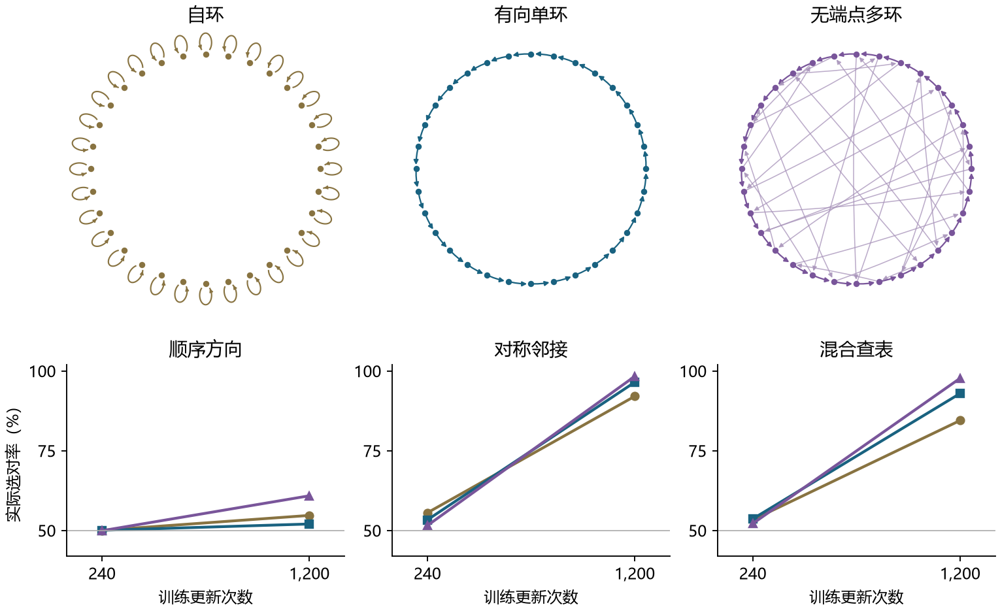

# 何时借用旧经验，哪些逻辑适合闭合网络

## 旧经验与当前遭遇是否相容

同一生命先在 A 学规律，再进入 B。新版本根据真实接触时获得的气味变化、先前预测和签名味觉，决定这一次写入借用多少 A 的更新方向。只训练控制这个比例的 9 个系数，保留原有感觉图、动作器、地址与生内更新规则。开发只见反射，留出 B 为 90° 旋转；六个冻结出生在 256 个独立留出世界里做成对比较。

前 2、4 次 B 教学的平均学习增益中，相关前史使用学习门比始终局部写入高 **5.81** 个百分点，和始终共享只差 **−0.005** 点。无关前史使用学习门比始终共享高 **1.88** 点，和始终局部写入相差 **−0.41** 点。两种前史等权时，学习门比开发集选中的固定比例高 **0.96 点 [0.54, 1.35]**；交换同一世界两种前史实际产生的门值后，平均损失 **2.56 点 [2.00, 3.11]**。一个手写的几何兼容性公式也取得相近成绩。学 B 后首次回到 A，相关和无关前史分别为 82.99% 和 82.49%。旧规则有独立写入位置，这是它能保住的结构条件。[主试验、对照和原始数据](evidence/adaptive-trust-2026-11-19/README.md)

另取 128 个世界，逐级改变 A、B 变化方向的重合程度，保持每一道 B 题不变。两者夹角为 0°、30°、60°、90° 时，第一对实际回执后的平均共享系数依次为 **1.000、0.965、0.001、0.000**。只把味觉正负相反、其他经历相同的生命的门值移过来，四种角度的早期选择率变化都小于 0.13 点。这批结果说明个体会利用接触时已经能够观察到的几何兼容性。遇到感觉证据相同、只有奖励历史才能区分旧经验是否值得借用的场景，还需要另测。[部分重合与味觉正负的分叉试验](evidence/adaptive-trust-2026-11-19/overlap.md)

## 有相同参数的三个网络能学会哪些逻辑

项目更早已运行过度数不受 2 入 2 出限制的闭合多环。10 月 28 日的九份 128 节点存档都是完整有向状态图，含自连接和长度 2–128 的简单环。[旧存档拓扑审计](loops-experiment-2026-10-28.md) 10 月 30 日的统一端口模型还把输入、输出放进同一张持续演化的图，输出节点也往回传信号。[统一端口设计](undirected-experiment-2026-10-30.md) 11 月两份冠军出生图按开启且权重非零的边复核：80 节点的 `g1023-i02-c0469` 有 534 条无向边，节点度 4–20，全图连通且无桥；96 节点的 `g2047-i01-c0910` 有 1,218 条有向边，入度 4–22，出度 5–20，全部节点同属一个强连通分量。[80 节点冠军](../data/undirected/2026-11-16-plasticity-island-crossover-v1/champion.pt) · [96 节点冠军](../data/undirected/2026-11-17-plasticity-directed-reward-v1/champion.pt) 本轮新增的是在同一套逻辑题和参数预算下比较三种接线。下文的 2 入 2 出只描述这一次的多环对照。

这里用三个具体接法描述“无端点”。自环单元从上一拍的自己取值。有向单环从前一个节点取值。多环的每个内部节点有两个输入、两个输出，主环和跨节点的边提供多条返回路径。三组都有同样的自身状态保留项、感觉输入和动作读出。图只画受测的状态连接。示例多环的每个节点都能沿主环回到自己，最快返回路径随位置为 3–6 拍。其余出生使用各自事先抽取的弦边。

每个网络有 32 个节点、449 个可训练参数。五种气味构成 20 种有序输入，两枚气味之间插入干扰。每组从同样的两次初始化中按校准世界择优，16 组配对出生在独立世界逐项测完整真值表。标准间隔、1,200 次训练更新后的平均实际选择正确率如下。图中的两个预算分别在校准世界选点。

| 二值规则 | 自环 | 有向单环 | 无端点多环 |
|---|---:|---:|---:|
| 顺序方向，交换两项后答案反转 | 54.72% | 52.03% | 60.87% |
| 对称邻接，交换两项后答案保持 | 92.05% | 96.46% | 98.31% |
| 混合查表，部分组合对顺序敏感 | 84.47% | 92.94% | 97.71% |

混合查表中，多环比单环高 **4.77 点 [1.01, 9.05]**，比自环高 **13.23 点 [8.96, 17.88]**，这里使用九项比较的同时区间。在一个新物理场景把 20 种输入全答对，所占比例分别为自环 4.35%、单环 35.25%、多环 68.21%。顺序方向题的三个同时区间均包含零，且多环有个别训练起点能做到 97% 以上；平均得分低不能单独证明表达能力不足。[训练、全真值表和预算对照](evidence/ring-logic-2026-11-19/README.md)

若把问题缩小到**固定输入与输出节点，只允许传播一拍**，可以直接构造三类区别。自环能在原节点反转自己的位；单环能独立复制前驱的位；带弦边的多环能从跳接节点一步取值。这里多环的两条进边共用增益，若前驱位和弦边位正负相反，两种排列会落到相同的和。这项限制来自权重绑定。释放边权或允许额外传播拍数即改变问题。这给“容易训成”和“能表达什么”各自一个可复查的判据。[固定端口的布尔真值表与局部响应证明](evidence/ring-logic-2026-11-19/witness.md)

又用八组新出生单独检验了多环的入边限制。第一种保留两条进边的相同强度，第二种用相同的 449 个参数学习两条边的相对权重，第三种让两条边独立学习，共 481 个参数。三者出生时的接线、有效权重和输出一致。混合查表分别为 91.97%、95.07%、93.29%，顺序方向分别为 55.48%、56.24%、55.63%。六个配对比较的同时区间均包含零，其中一些区间较宽。这次有限预算的训练没有显示解除权重绑定可以稳定提高这三种逻辑的得分。[边权分配与独立权重对照](evidence/ring-logic-2026-11-19/routing.md)
