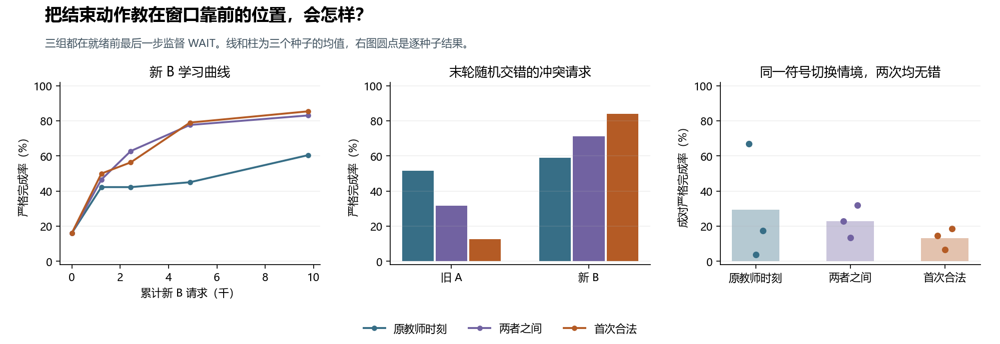

# 保留末步 WAIT，首次合法时就教 FINISH 会怎样

2026 年 11 月 3 日。上一轮把旧 A 的 WAIT 监督放在就绪前最后一步，旧 A 冲突请求的抢答首错从 106/118 减到 9/118，但新 B 到了合法窗口仍没尝试结束的请求从 8/117 增到 33/117。本轮保留末步 WAIT，单独改变**旧 A 复习**里正确 FINISH 的时间。B 的演示和所有 B 动作标签完全相同，从而能检验这项改动对新任务的间接影响。[上轮结果](reports/actions/wait-position-experiment-2026-11-03.md) · [本轮判断口径](../experiments/finish_position/analysis-plan.md)

**新 B 的漏发可以降到零，但旧 A 的抢答随之回来。** 三个种子中，提前旧 A 正例都使旧 A 冲突请求的严格完成率下降。事后只补测了一个中间位置，它在新 B 上保留了大部分收益，但达不到原方案的无错切换次数。实验在 11 月 3 日启动，最终核验在 11 月 4 日完成。[全部组的分子分母与来源哈希](evidence/finish-position-2026-11-03/counts.json)

## 两个时刻都是合法的

每个种子仍用原先的 256 条旧 A 请求，三种子共 768 条。每次复习只监督目标槽的三个位置：正确 BEGIN、就绪前最后一步的 WAIT，以及含正确版本和载荷的 FINISH。第一组在旧教师首次要求 FINISH 时给正例，通常位于合法窗口中点；第二组把同一个正例移到世界首次允许成功结束的 tick。原教师在新位置的 768 个标签都是 WAIT。第二组在复习损失中把这个位置明确赋值为正确 FINISH，并取消原位置的正例监督。原输入、回执和示范实际执行的动作保持可核对，模型没有看到私有的就绪时间。

所有正例都提前了 3–5 tick，中位数为 4，即 1 个环境时间单位。新 FINISH 与末步 WAIT 在所有请求中相邻。在两个 FINISH 位置之间，旧轨迹共包含 3,048 个目标槽时刻，实际动作为 2,901 次 WAIT 与 147 次被拒 FINISH。改变监督时刻也改变了监督所处的真实回执背景。两种位置的正确 FINISH 均由原世界重新执行验证。[旧请求身份、时刻与真实回执](../data/finish-position/bank-v1/report.md)

每个种子、每组均有 2,048 次更新，1,792 次用于新 B、256 次复习旧 A。选中的请求身份与顺序相同，每次复习 64 条、每条 3 行，全程共 49,152 行 A 监督。两个分支都执行相同的候选扫描，权重、优化器、初始隐藏态和完整世界从相同存档出发。重放旧请求的状态不覆盖正在运行的 B 状态。[冻结训练方案](../data/finish-position/train-v1/protocol.json)

## 怎样看结果

自由评估在训练外的同一批长请求上运行，模型的十一选一动作真实执行，成熟新请求才进入完成率分母。A/B 随机交错测试保留取消、替换、双槽干扰和模型自己的回执；其中三个种子分别有 36/38/44 个旧 A 冲突请求、45/36/36 个新 B 冲突请求。窗口漏发仅计已经启动并真的走到合法时刻、在该窗口内完全没有尝试 FINISH 的请求。抢答指请求仍活跃、已经启动但未就绪时发出的 FINISH，不要求版本或内容也正确。[独立评估方案](../data/finish-position/eval-v1/protocol.json)

同槽测试另用 16 个训练外 actor，先自行行动 512 tick，再测 4,096 tick。同一槽的相邻两次请求共享原始符号，AA、AB、BA、BB 在测试流程内打散，模型看不到配对标记。只计两次都在测试段新发且成熟的请求对。这项对照保留其他槽的干扰，没有取消或替换。对 AB/BA 且答案必须改变的请求对，三个种子分母分别为 109、105、103。[同槽配对方案](../data/finish-position/pairs-v1/protocol.json)

## 两个端点的结果

提前结束正例确实让 B 更常在窗口里行动。117 个新 B 冲突请求原来有 **33 个整窗未发 FINISH**，提前后为 **0**。但是旧 A 重新开始抢答，首个主动错误为提前 FINISH 的请求从 **9/118 升为 84/118**。三个种子的旧 A 严格完成从 22/36、15/38、24/44 降到 4/36、4/38、7/44。两组的这些新旧请求都成功启动并到过合法时刻，因此这里的漏发变化不来自启动覆盖率。

| 随机交错中真实发生的行为 | 原教师时刻 | 首次合法时刻 |
|---|---:|---:|
| 旧 A，首错为过早 FINISH | 9/118 | 84/118 |
| 旧 A，合法窗口内首次出手正确 / 错 / 整窗未出手 | 69 / 47 / 2 | 46 / 58 / 14 |
| 新 B，首错为过早 FINISH | 3/117 | 4/117 |
| 新 B，合法窗口内首次出手正确 / 错 / 整窗未出手 | 73 / 11 / 33 | 102 / 15 / 0 |
| 旧 A，普通完成 / 严格完成 | 112 / 61 | 73 / 15 |
| 新 B，普通完成 / 严格完成 | 80 / 72 | 110 / 99 |

早期独立 B 的严格完成率也有变化。在第 0、1、2、4 轮末按实际新增 B 请求量积分，三种子等权平均从 **39.68% 提到 55.42%**。末轮独立 B 从 60.5% 提到 85.4%。按种子看，早期曲线分别为 58.1%→54.1%、30.1%→60.5%、30.9%→51.7%，收益并非每种子都出现。随机混合流的空闲误动作从每千实际空闲机会 7.41 降到 0.28。旧 A 复习正例的时刻对新 B 行动有间接影响，此处没有改变 B 示范，不能据此推断直接提前 B 教师会有相同效果。[逐种子、按请求身份的原始统计](../data/finish-position/eval-v1/summary.json)

成对测试中，提前正例使**两次最终都完成**的数量从 **176/317 升到 203/317**，但**两次全程不犯错**从 **95/317 降到 42/317**。后者分种子是 73→16、4→7、18→19。合计下降主要由种子 0 驱动，与三个种子的旧 A 单项严格率均下降是两层不同证据。[实际动作和回执复算](../data/finish-position/pairs-v1/summary.json)

## 单个中间位置的补测

首尾结果已知后，固定一个折中位置，对首次合法 tick 与原教师结束 tick 的索引取算术平均并向下取整，只测试这一种补充。新正例在首次合法后 1–2 tick，仍晚于该条旧请求唯一的 WAIT 监督。对每个请求重新在原生世界检验了该动作可被接受，重复使用主线的预算、选样和外部流。[独立补测方案](../data/finish-position/interior-v1/protocol.json) · [补测自由行动和分母](../data/finish-position/eval-interior-v1/report.md)

| FINISH 正例 | 早期 B 严格 | 独立 B 最终严格 | 交错时旧 A / 新 B 冲突严格 | 混合空闲误动 / 千机会 | 换情境两次普通 / 两次严格（317 对） |
|---|---:|---:|---:|---:|---:|
| 原教师时刻 | 39.7% | 60.5% | 51.7% / 58.9% | 7.41 | 176 / 95 |
| 两者之间 | 56.6% | 83.1% | 31.7% / 71.1% | 0.67 | 245 / 72 |
| 首次合法 | 55.4% | 85.4% | 12.5% / 84.1% | 0.28 | 203 / 42 |

中间位置将新 B 的合法窗口漏发降到 **2/117**。中间组的旧 A 抢答首错为 **37/118**，其中三个种子的旧 A 严格完成分别为 **10/36、10/38、18/44**，介于或等于各自两个端点。它做成的无错切换对逐种子为 **25/109、14/105、33/103**。对总共 317 对中的 245 对，它最终能把两件事都做完，但只有 72 对没有依靠任何错误或重试。中间位置可作为折中工作点；三个独立种子和这三个采样时刻不足以确定通用最优时刻。

## 教了末步 WAIT，为什么还会提前

先回到实际用于拟合的旧 A 复习片段。在 384 个冲突窗口里，末步首选 WAIT 从 379 个下降到 163 个，首次合法能直接选对具体 FINISH 从 24 个升至 322 个。但既在末步 WAIT、又在下一步正确 FINISH 的只有 138 个，低于单看 322 个结束正确所暗示的表现。提前训练正例也改变了它之前一个 tick 的打分。这里的回执来自旧经历，模型的候选动作未送回世界。[拟合库的三个时刻与独立核验](../data/finish-position/bank-check-v1/report.md)

在训练外另生成相同的 A/B 混合轨迹，真实中点教师执行启动和结束，两个模型都只读取这一组公开观察和回执。在完整的 261 个旧 A 冲突请求中，处理中有过 FINISH 意向的从 **8 个升到 197 个**；末步 WAIT 且首合法时刻能正确结束的从 **8 个升到 25 个**。这说明模型在更早位置练会了一部分正确结束选择，同时也在本应等候的位置增加了结束倾向。自然自由行为才决定它实际上能否完成请求。[相同公开经历的诊断方案](../data/finish-position/boundary-v1/protocol.json) · [两类轨迹的计数比较](../data/finish-position/bank-check-v1/comparison.md)

在同一份教师轨迹上，中间组对 261 个旧 A 请求中的 78 个有过抢答意向，32 个在末步等候且首合法时答对。改变时间位置会移动整段行动倾向，不能只看单个正例上的准确率。主评估和补测分别核验 84、21 个分叉绑定，另用实际回执重建了同槽请求对。主线报告层曾把逐种子轮换的 raw 编号错误要求为全部三种子均出现，按实际出现种子数修正了 raw 子项汇总；整体冲突分母和逐步行为未变。[主线完成记录](../data/finish-position/eval-v1/completion.json) · [补测完成记录](../data/finish-position/eval-interior-v1/completion.json)

下一步更值得区分的是，模型能不能真的分辨截止边界附近的两步。可先保持同一批请求与固定动作回执，分别读出“还差多久就绪”和“结束内容是什么”，再看就绪前后的状态是否足以区分两步、而动作头只学到了更早或更晚的整体偏好。这样能决定应该改善计时表征，还是调整现有动作头对状态的利用。
