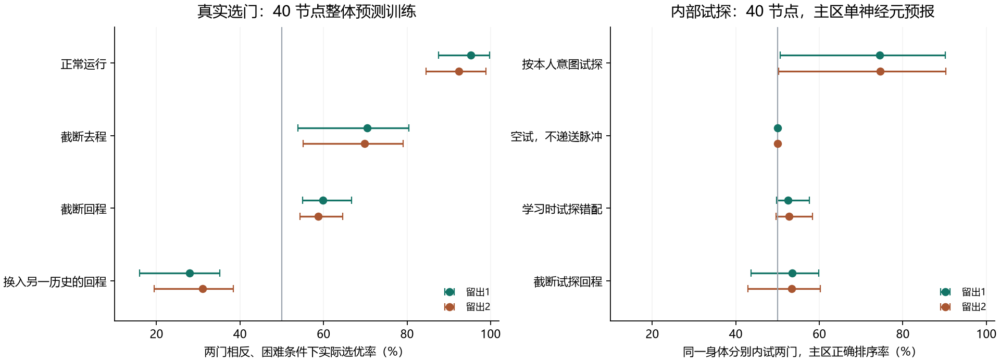

# 让整个个体学会利用克隆区预测

学习目标由主区承担。它可以向克隆区发送神经电流，用返回的信号形成自己的判断，再自行选门。外部只教整个个体如何根据亲自经历的得失改善判断和行动；副区没有单独的预测目标、正确答案或复述旧经历的标签。[逐拍神经图与任务](../experiments/pulse_game/fork_lesson_world.py)

## 延迟兑现的双门游戏

身体先经引导轨道实际接触两个随机物体，取得各自独立的正或负味觉。两门随后各显示一个已接触物体和一个公开的正负乘数，左右和物体对应每生重新分配。例如物体原先给负味，门上的负乘数可以使这条路线最后得正收益。知道旧味觉但没有当前菜单，或看见菜单但不知道旧味觉，均不足以判断好门。在这个任务中规则由实验明确给出，三维物体也来自容易区分类别的相反角帽。进任何门当拍都得 0，之后经过相同等待才收到所走路线的 ±1。两物都负、两门都无法拿到正收益等情况均照样保留。主区在全零输入窗口第四拍用 12、13 号原生神经元报两门预期收益，再经过两拍，10、11 号神经元发出真实行动。[环境、时钟和互换检验](evidence/fork-lesson-20261120/world.md)

三个初始个体分别接受六种匹配训练：仅实际奖励，奖励与主区预测误差同时教全图，同样的预测误差由错配回报提供，预测梯度仅教双向桥和主区预测端的少数参数，以及从开发期开始分别关闭普通去程或回程的对照。每种训练每出生 1,536 步 × 64 条真实生命，共 1,769,472 条。每次只走一条路，训练过程完全没有取得未选门的收益；加入一定的动作探索，记录每次选择倾向。[协议](evidence/fork-lesson-20261120/fit-protocol.json) · [训练核验](evidence/fork-lesson-20261120/fit-audit.json)

## 整体预测、使用返程与最终动作

在两套新几何上，整体预测组对自然未走门最后会得正还是负的判断正确率分别为 **95.99% / 96.01%**。在冻结后才从同一状态真的走另一门核对。未走门均方误差为 0.1544 / 0.1532，错配训练为 1.2337 / 1.2364，仅按实际奖励训练的两个未校准单元为 1.3412 / 1.3390。所有场景实际拿到正收益为 72.97% / 73.00%，该分布上限 75%。

| 相互冲突、夹角 55–85° 的留出条件 | 世界一实际选优率 | 世界二实际选优率 |
|---|---:|---:|
| 正常完整个体 | 95.23% | 92.45% |
| 决策期切断主区→副区的普通电流 | 70.40% | 69.79% |
| 切断副区→主区的普通电流 | 59.90% | 58.77% |
| 只换入另一份相反旧经历的回流 | 27.95% | 31.03% |
| 只交换主区两个预测单元的活动，再正常运行到选择 | 81.34% | 78.91% |

向原身体重新注入自己的电流，状态和正式选择均逐位复现。评分交换的行为效应在三个出生中同向，但大小差别明显。截断只影响普通电流，副区与本体的参数共享、候选与采用等通路继续工作。单向普通桥在训练时就关闭的组也能学会排序，不能说这道题非用双向桥才能解决。这里定位的是已经训练完成的这个身体实际上怎样行动。[正式评估、未选分支的真实结算和区间](evidence/fork-lesson-20261120/eval.md)

固定受体的全部旧经历与菜单，再让一段真实去程电流指定其中一门的公开乘数，让产生回流的身体带着不同的真实旧价值。对「被问门减另一门」的主区预告，乘数和历史私值的四格交互为 +0.108 [0.076, 0.155] / +0.104 [0.064, 0.155]，两次都优于错问另一门和等能量乱序电流。对实际走向，四格交互约 +3.2 / +3.0 个百分点，第二次相对等能量控制的区间跨零。这项干预显示去程信号可以指定一个对象，回流能把与该对象有关的历史差别送回本体。四格由评估程序合成，不能把它直接当作个体在自然状态下按顺序试过两个动作的记录。[询问与克隆区可用历史的交叉干预](evidence/fork-lesson-20261120/dialogue-results.md)

## 只训练本体怎样发问

进一步只解冻 80 条确实从主区送往克隆区的慢轴突。原副区递归、主区预测端、真实运动端和其它慢参数全部冻结；两区原有生内可塑性照常运行。训练目标是同一主区报出的已走门预测对不对。只把预测梯度反传至最后静默窗，再把改过的参数用于整个生命，严重破坏了原先的预测。让同一误差沿着整段真实经历传回同一批轴突，效果不同。

整体教学母体的两门等权均方误差从续训前 0.087 / 0.085 降至 **0.057 / 0.056**，仅静默期给信用为 0.819 / 0.832。原先训练时关闭去程、部署时重开的母体，误差从 0.455 / 0.463 降至 **0.140 / 0.137**，实际选优率提高 **7.14 / 6.23 个百分点**。固定前史只在决策的六拍换入学后发送轴突，曾关闭去程的个体仍多选对 1.41–2.77 点。较大一部分效果来自前史（包含取得旧味觉与看门线索），不能将全部增益归入临行动前的试算。[只改发送轴突、信用范围与分阶段互换](evidence/fork-lesson-20261120/sender-credit.md)

## 本体主动选一次尚未执行的动作来试

上面的 40 节点网络每次同时对两门报分。为了检验一个更严格的能力，在已经接受整体训练的身体上加一个有清晰因果入口的试探：主区从自身活动选一次左或右，只有副区同源运动端收到试探脉冲；外界没有发生运动或给奖。主区只用自身活动报一个数「若按刚才所试的行动，会得什么」，预测没有试探编号或左右选头的捷径。训练中只在实际路线与试探相符时，才有那次亲历的到账可供校准。这个接口组冻结原图全部旧参数，学习试探发送、回传及主区读出；其中预测读出含 16 个瞬时隐单元，共 458 个新增可训练系数。试探接口和时点由实验开放，个体选择试哪边。[试探接口与训练审计](evidence/fork-lesson-20261120/whatif-fit-audit.json)

在同样的身体状态只改变给副区的内部试探，随后主区同一个标量把两种真实动作后果排对的比例为 **93.19% / 92.89%**。若开发期收到的试探动作与本体所问错配，等预算只有 **48.03% / 47.66%**。冻结绑定组只切断试探回流，降到 40.55% / 40.61%。只改变名义上的试探记录、而使副区物理上收到相同脉冲时，预测和真实动作完全不变。在这个新增接口中，整个个体确实学会了根据试探给出不同的预测，且自己的试探相对同带随机试探，随后实际选优多 0.80 / 0.64 点。两默认训练策略的自然选优率都已接近上限。[完整四格检验与真实收益](evidence/fork-lesson-20261120/whatif.md)

### 仅用原来的 40 个节点，再做一次

在这组复现中，原主区 10、11 号运动节点自己决定试哪边；一拍脉冲只进入副区的 30、31 号同源运动节点。原主区 **14 号单神经元** 直接报告这次试探的预计收益，原运动端再决定实走哪边。没有额外读出层，除了原图参数，只增加两条试探脉冲的幅度。两个条件的真实后果梯度都教整个 40 节点个体，副区收到什么脉冲由绑定或错配控制。

| 从同一状态分别试左及右，主区单神经元把后果排对 | 留出一 | 留出二 |
|---|---:|---:|
| 开发期把本体选的试探送给副区 | **74.51%** | **74.57%** |
| 开发期将副区收到的试探跨生命错配 | 52.55% | 52.77% |
| 绑定组取消这次试探脉冲 | 50.00% | 50.00% |
| 绑定组切断试探期间副区回传的普通电流 | 53.53% | 53.33% |

两组差为 +21.96 [0.60, 33.29] / +21.80 [0.31, 33.57] 个百分点。三个出生分别排对约 83%、90%、50%。绑定组对未真正走的路线预测绝对收益的均方误差为 1.080 / 1.075，高于报零的误差 1。它学到的是有信息、但还不稳定且没有良好校准的相对估计。正常选优率 95.14% / 96.16%，取消试探时为 95.23% / 96.14%，关掉整个普通回流则约 80%。普通回程参与了真实行动；本次额外试探独立改善了条件预测，它没有稳定提高已有的行动成绩。较大的读出接口与单神经元组的开发方法也不同，其成绩差不能全归因于读出的大小。[严格 40 节点复现](evidence/fork-lesson-20261120/native-request.md)

上述带额外读出的接口实验另设侧别对照，保留每条生命的平均回流与对比能量，只把试左与试右的差量换成跨私值学得的通用方向。即便如此仍有约 91.5% / 91.6% 的排序率，提示“知道本体试的是哪边”本身就能解释很大一部分结果。另用独立校准的实物触觉读数去识别门菜单未显示的旧接触轨道。训练后静默窗口的目标相对非目标方向差为 +0.005 / +0.008，两个区间均跨零。检测到对未执行动作的条件预测，与检测到一段过去经历被完整重演，是两个不同的实验结论。[隐藏旧触觉细节的重现检验](evidence/fork-lesson-20261120/reinstatement-results.md)

在更严格的替代检验中，副区的活动、慢迹和接收快权逐拍固定为同一身体**没有收到任何试探**时的轨迹。主区除原有空试回流之外，只得到在另一套校准世界固定下来的左、右两条电流模板。它们关于本次试探只携带一位侧别，不含这条生命的实际答案。两套留出中的原生试探、固定侧别、空试排序率分别为 93.00% / 93.08%、85.68% / 85.56%、50% / 50%。原生回流对数值预测误差还有增益（MSE 约 0.26 对 0.48），但三者的真实选优率均接近 98%，未形成稳定差距。该成绩允许主区已从旧经历和菜单中计算两门价值，再用回流作索引这一解释；尚不能定位为副区已学出一个独立结算两条未来路线的世界模型。[纯侧别替代方案与独立新世界](evidence/fork-lesson-20261120/bit-relay.md)

把完全相同的侧别替代方法应用在**无附加读出层的 40 节点组**，结果不同。在另两套各 96 根的留出世界，真正的副区回复使主区单神经元将两次试探排对 74.94% / 75.20%；固定模板只到 51.49% / 51.39%，空试均为 50%。原生相对模板的排序差约 23–24 点，但三个出生中一个反向，所以两套配对区间都跨零。两门整体均方误差在两套世界均低约 0.20，三个出生同向，区间均排除零。真实选优率在三种方式间十分接近。已有证据支持整个个体能学会向克隆发一次试动作、利用返回的活动形成条件预测；限定到严格 40 节点，带有本次状态的回复有助于数值预测。副区是在独立演算未来、还是在转换信息供本体计算，以及这次试探能否带来可复现的额外实际收益，仍应保留为开放问题。[严格 40 节点的侧别回声与三个出生](evidence/fork-lesson-20261120/native-relay.md)
