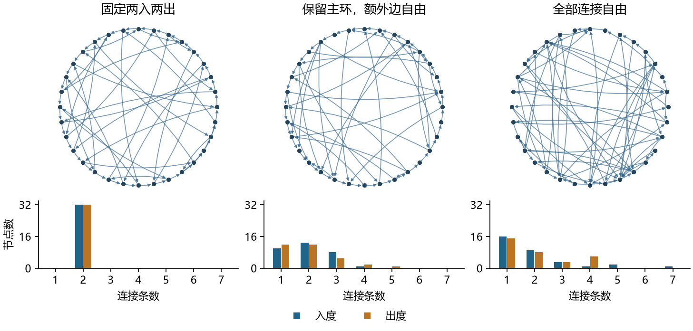
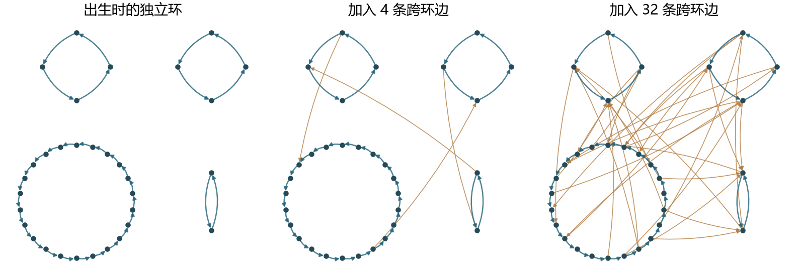

# 自由接线、环间连接与结构学习

本轮把此前固定的“每节点两入两出”改成可检验的实验因素。使用同一套五气味、三条逻辑规则的物理任务，分别检验出生时的接线、训练中修改图、生命中按回执修改图。确认时按实际首次接触计分，每个世界根包含同一前缀下二十种有序气味组合。留出的主要是世界、干扰、时刻与地形；三条被训练的真值表保持相同。

## 先比较三种 64 边的出生图

32 个状态节点和 449 个可训练参数相同。原组使用规则主环加置换弦；第二组保留主环，把 32 条额外边从所有合法端点中随机抽取；第三组从全部固定 64 弧的强连通图中均匀抽样，连主环也不预设。32 个实测出生中，三组节点入度和出度范围分别为 2、1–6、1–7。图为登记中的第一个出生，节点位置在三个面板里相同。[逐节点与逐边记录](evidence/free-graph-2026-11-19/main/graphs.json)

| 标准时序，1,200 次更新 | 规则多环 | 主环加自由边 | 无预设骨架的自由图 |
|---|---:|---:|---:|
| 环序 | 61.45% | 58.60% | 56.46% |
| 邻接 | 98.24% | 97.48% | 97.46% |
| 混合查表 | 97.03% | 97.77% | 96.91% |

16 组配对出生各有两个重启，通过独立校准集选点。九项预登记主要准确率差的同时区间均包含零。一个自由图重启在邻接任务通过全部 2,560 次物理机会。对自由图切掉最高出度节点的外发消息，邻接由 97.74% 降到 83.78%；切掉同一批接收节点上同数、同强度的随机入边，也降到 86.53%。目前能确认用到了反馈连接，尚不能把主要功能归给出度最高的节点。[等参数及独立边权实验](evidence/free-graph-2026-11-19/main/README.md) · [枢纽干预](evidence/free-graph-2026-11-19/hubs.md)

## 先让每个节点进入一个环，再把环连起来

对 32 个节点随机抽取一个不含固定点的排列，并要求它至少含两个环。每个节点在这一步都恰有一个前驱和一个后继。实际 32 个出生有 2–7 个环，长度为 2–30。第一张图的环长为 4、4、22、2，同一出生在下图的三个面板里使用相同的位置和内部边。

- **32 条跨环边。** 从所有跨不同环的有向节点对中随机抽 32 条，要求每个环至少有一条跨环入边和一条出边。大环有更多可抽到的端点。实测每个环有 1–22 条入边和 1–22 条出边，各神经元没有固定度数。仅凭这个逐环条件，在数学上有可能出现两个互不相通的环群，所以另做全图检查。这次 32 张出生图全部强连通。
- **最少跨环边。** 若出生时有 K 个环，随机排列这 K 个环，再在相邻环之间随机挑发送节点和接收节点，形成跨环大环。恰加 K 条桥，每个环一入一出，整图保证强连通。本批每图共 34–39 条边。另训相同边数的单主环接线作对照。

在独立校准后选择的 16 组出生中，分环加 32 条跨环边的环序、邻接、混合查表正确率分别为 **62.71%、95.82%、94.39%**。同数据、同参数、同边数的单主环加自由边分别为 **58.52%、96.46%、97.14%**。分环有利于环序或不利于混合查表，目前都只是观察到的方向，九个预设同时区间均包含零。把跨环边减至最低数量时，分环图的查表成绩为 84.57%，同边数单主环为 91.17%。[分环实验完整结果、密度对照与重放](evidence/free-graph-2026-11-19/modules/README.md)

## 接线开放新增和退出后

训练中的结构对照先用同一出生接线做 120 次权重更新，再允许从任意两个不同节点之间新增或退出连接。备选位置按训练世界里探索身体实际收到的味觉来评价，保留、增长和退出各自竞争。冻结组和同步随机增退组使用同样的出生和梯度更新预算。分环引导组接受 410/432 次修改，其中生长 214 次、退出 196 次，过程中有 51–74 条边。48 份引导终图累计保留了 165 个出生环中的 91 个完整环；原本的环内边和跨环边都可以退出。所有终图仍然强连通。

分环组的邻接正确率从冻结组的 81.22% 到引导组的 87.25%，配对差 +6.03 个百分点，同时 95% 区间 [−0.77, 20.30]。混合查表变化 −0.15 点 [−3.92, 3.12]。自由图和分环图两项实验均观察到实际改线，作用于留出成绩的同时区间均包含零。训练期的备选接线选择和个体一生内的在线编辑分别评估。[分环出生的生长与退出](evidence/free-graph-2026-11-19/modules-plastic/README.md) · [自由出生的相同对照](evidence/free-graph-2026-11-19/plastic/README.md)

## 个体一生内能否靠自己的改线学会新规律

这一节是固定数值权重的结构消融。完整更新的结果见下节“让新生边取得自己的权重”。

从固定接线试验的分环模型复制出相同个体，冻结原有权重，让感觉状态和接线跨越 120 道物理请求。个体实际接触端点后，按自己的活动、接触侧、味觉和预测误差估计候选边的效用。生长、退出分别按收到的回执数获得尝试机会，只接受本规则估计有正收益的修改。正式开放版取消人为边数上下限，保留强连通检查。更新公式、尝试时机的候选和连通检查由研究者给定。原来设过边数界限的一轮另行保存，以下成绩来自开放版在新世界的确认。

| 最后 20 道的实际选择 | 冻结接线 | 按真实反馈改线 | 同时同量随机改线 | 味觉换成独立随机符号后改线 |
|---|---:|---:|---:|---:|
| 规律一直稳定 | 87.58% | 68.89% | 66.12% | 64.78% |
| 中途悄然反转 | 12.36% | 34.97% | 33.85% | 35.17% |

八个未参与试调的出生组，分别在三个规则、16 个新世界中连续生活，每个条件每臂共 384 个生命。规律反转后，按真实反馈改线比冻结高 22.62 个百分点 [16.53, 28.46]，比同时同量随机改线仅高 1.12 点 [−1.88, 4.00]，与独立随机符号组相近。稳定规律上，真实反馈组较冻结低 18.68 点 [−24.30, −13.54]。允许模型改线可以打破已经形成的动作偏好，但这轮没有可靠证据表明改线位置让它学会了反转后的正确规律。按预先设定的开发目标把“保持冻结”也列为选项时，选中的是冻结。[完整生命周期、回执与接线重放](evidence/free-graph-2026-11-19/live/README.md)

## 让新生边取得自己的权重

完整模型在同一生命内调整感觉与门控的输入权重、偏置、每条活跃循环边的独立权重和动作读出，同时允许生长与退出。新边可以从接收节点的出生增益起步，从下一次真实回执起独立调权。另一版本直接计算尚未接通的候选边对本次回执损失的方向导数，选中连接的同一笔更新即写入带符号的第一个权重。该版本加边时保留其他边原有效系数。两种版本都保留完整的前向状态，跨输入和实际接触分配本次请求内的学习信用。

联合组在稳定、反转、返回旧规律的末段，实际正确率分别为 68.70%、36.21%、58.93%；仅调权组为 85.31%、32.14%、72.47%。仅改线组为 68.46%、35.33%、64.86%。反转条件中，联合组相对仅调权提高 4.08 个百分点，同时 95% 区间 [−0.66, 9.40]；相对仅改线提高 0.89 点 [−3.94, 7.58]。稳定条件下，开放结构编辑相对仅调权损失 16.61 点。选取共同学习率的主要开发试验按联合组实际行为评分，确定学习率后再比较各臂；此前在仅调权臂选共同学习率的试验单独封存。

该联合组在反转条件下长出了 4,992 条边，4,991 条获得了后续回执，每条都实际改过自己的数值。反转后对新探针恢复内部感觉和循环权重，已共同学习的个体从 43.62% 降到 36.99%。只恢复存活新生边的系数，另一批新探针从 43.46% 到 43.37%。这些结果把“内部权重整体已参与学习”和“新生边特有的数值调整已产生显著行为收益”分开了。在从零生长的补充试验中，新边的带符号初始化在约 99% 的生长事件中降低了产生它的那次损失，相对随机首笔符号，近期实际选择率尚无可靠改善。[完整联合学习](evidence/free-graph-2026-11-19/joint/README.md) · [出生即调权的对照](evidence/free-graph-2026-11-19/coupled/README.md) · [逐边回滚](evidence/free-graph-2026-11-19/joint-edges/README.md) · [内部与动作读出分叉](evidence/free-graph-2026-11-19/joint-components/README.md)

## 旧冠军的自由接线能否迁移

另外直接读取 11 月 17 日冠军的 96 节点、1,218 边出生图，用新任务从头训练权重和动作读出。控制组随机重连，逐个节点的入度和出度完全相同，两臂均为 2,467 个可训练参数。标准时序下，归档接线相对随机换边的环序、邻接、查表成绩分别相差 −6.69、+3.61、+8.74 个百分点。两个预算、两个时序的全部十二项同时区间跨零。这个实验检验旧接线是否提供了超出度数分布的优势，未能确定这项优势；它没有把旧符号任务学到的权重移用到新游戏。[历史冠军复测、物理回放与原始数据](evidence/free-graph-2026-11-19/archive/README.md)
