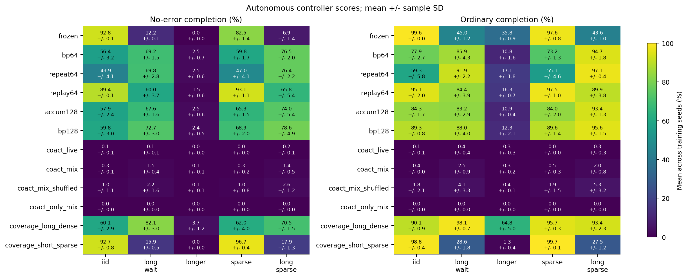
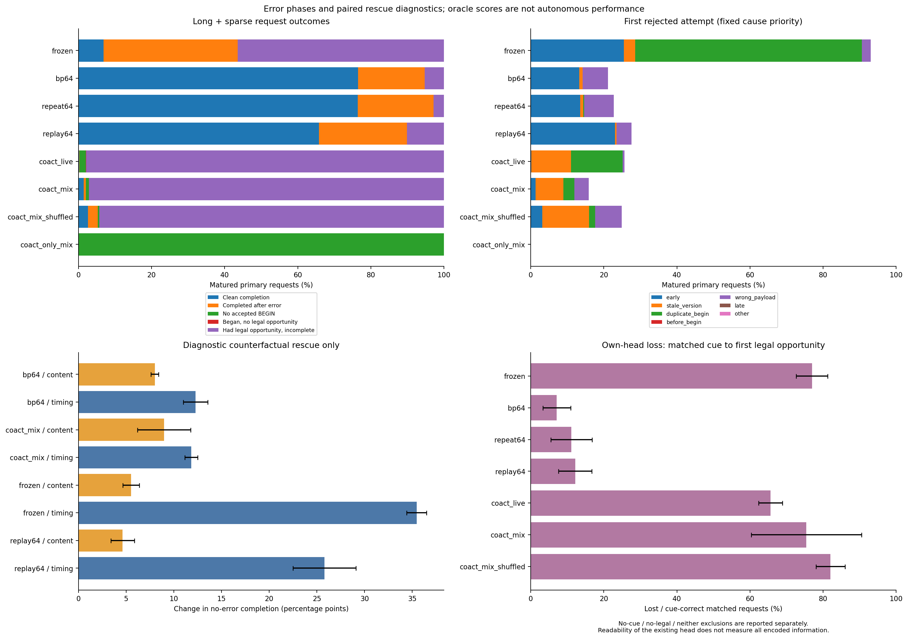
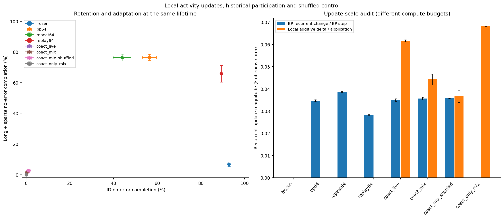

# 连续状态中的内容、时间与局部共激活

日期：2026-10-27。延续[上一轮完整连续状态实验](continuity-experiment-2026-10-27.md)，原有代码、数据和检查点保持原样。新实现位于 `experiments/integration/`。

## 问题与区分

本轮先把长等待和任务结束后的误动作分解，再比较旧经历重放、较长梯度以及局部共激活学习。保持模型、世界、待办、时钟、回执、优化器和随机数状态连续；训练块与任务变化都不清空隐藏状态。

64 tick 的反向传播不是“只准使用最近 64 tick 的记忆”：更早的信息仍可能保存在隐藏状态和权重里，并参与当前计算。截断限制的是损失沿计算图追溯过去的路径。更长活动迹则保留统计关联，它既可能反映有用联系，也可能关联无关并发事件或强化重复误动作。因此，活动相关性和新旧能力共同提高需要分别测量。

旧经历已经可以参与反向训练：上一轮的 replay 就重新读取真实旧经历、计算旧任务损失。这一轮进一步比较旧经历经前向激活产生的局部更新，不能把“反向”与“无法利用旧记忆”画等号。

## 旁观真实轨迹的诊断

每项评估从完整检查点分叉，冻结参数，保持世界和内部状态一起运行。主成绩由模型自身动作产生，诊断读出不改变它收到的信息或执行的动作。

- **内容读出：**在模型自己的轨迹上，仅比较原有八个 FINISH 内容/版本分数，按请求年龄、尚未开始、处理中和合法完成机会分别记录。进一步配对同一个成熟请求在命令到来时和首次合法完成机会的读出，分别计两次都对、由对变错、由错变对和两次都错；没有合法机会的请求另列。这样避免把不同年龄的不同幸存请求直接当成遗忘曲线。原有读出无法读到信息，也不证明状态中完全没有该信息。
- **时间与阶段：**记录开始是否成功、合法机会是否出现、首次错误及其同时存在的错误组合。重复 BEGIN、开始前 FINISH、过早 FINISH、错版本和错内容分别统计。优先错误类别按公开顺序分类，组合计数保留，避免同一个请求重复累加成多个独立失败。
- **任务结束：**分别跟踪完成、取消、超时和无法还原的继承空闲状态，记录无任务时动作、是否重复最近已结束请求的内容，以及保留旧内容却正确 WAIT 的情形。以空闲机会和全部机会为分母的比例分开报告；记住旧任务本身不算错误。

另做仅用于诊断的成对干预：在干预分支的每一步，只纠正模型已选择 FINISH 的活跃请求之版本和内容，不直接改变该步 BEGIN/WAIT 的选择；采用合法行动日程、保留模型的 BEGIN 版本及 FINISH 内容选择；或者只移除一次已完成 FINISH 的回执、只移除 CANCEL 命令。内容纠正也适用于后来被取消或替换的活跃请求。它们改变后续回执和状态，后续尝试时刻可能随之改变；这些干预不成为正常控制器的一部分，救回的任务数也不能直接解释成某个独立模块的“纯贡献”。

主分母延续上一轮：只计分叉后按本条件新生成、最终有效且窗口已结束的请求；继承请求、旧合同替换和未成熟请求另列。过程中的活跃/合法机会依赖模型行动，其群体不能当成同一个固定因果分母。

## 最小局部学习规则

保留原来的连续循环 `dh/dt = -h + W tanh(h)` 和一次事件脉冲。记步前活动为 `r_pre=tanh(h_before)`，步后活动为 `r_post=tanh(h_after)`，维护持续的活动迹：

`q ← exp(-dt/τ) q + (1-exp(-dt/τ)) r_pre`。

按实际时间加权收集 `C=mean(r_post ⊗ q)`、`s=mean(r_post²)`，每个 64 tick 块做一次不经过自动微分的循环权重更新：

`ΔW = η [C − diag(s) W]`。

这里使用 **τ=16 个环境时间单位、η=0.001**。η 是每次应用的系数，不能当成每单位时间的可塑性速率。活动相关项与 Oja 风格的权重衰减共同构成被测规则，没有加目标活动率、任务保护连接、记忆槽或硬性状态清空。

[Oja 1982](https://link.springer.com/article/10.1007/BF00275687)分析的是线性神经元、平稳输入和特定规则；本轮时序活动迹与非线性循环的变体不继承其主成分或收敛保证。[e-prop](https://www.nature.com/articles/s41467-020-17236-y)还使用导数资格迹和神经元特异的学习信号。当前 q 只是活动 EMA，没有任务信用分配，不是 e-prop，也不是 Forward-Forward。

在混合组中，先做当前任务的 BP，再应用局部更新。当前活动来自实时前向；旧活动来自同一个有限 A 经历库的独立重放分支。混合组将两份各自归一化的 C、s 等权平均后只更新一次，避免把“旧经历也参与”混成“更新两次”。本轮分别记录 Adam 前后的实际权重差，以及局部规则算出的加法 ΔW 的 Frobenius 范数；后者与浮点加法后重新相减得到的差值可能略有不同。不能用学习率数值大小代替扰动量。

打乱对照每步随机循环移动不同轨迹的 q，与原 post 配对，保持该次活动样本的每个神经元边际分布及衰减项，破坏同轨迹配对。训练分支随后会产生不同动作和活动，因此不能宣称它们整个生命期的活动分布始终相同。

实时 q 在本轮引入时初始化一次，此后跨块、更新和保存恢复保留。旧检查点没有记录历史 q，旧分支从零 q 经 64 tick 前向预热恢复；τ=16、dt=0.25 时，单是未知初值的残留系数就有 `exp(-1)≈0.368`，历史 h 也会因参数变化而失配。这是近似旧轨迹重建，不是精确恢复历史神经活动。旧分支的 h、q 都不会覆盖实时状态。

## 训练对照与预算

每个种子都从上一轮 online128 的最终 A 完整检查点开始，保留原 Adam 和全部待办。三个种子 0/1/2，64 条并行连续轨迹、四条任务通道、隐藏宽度 128、总参数 34,348。每组继续 65,536 tick，dt=0.25。主学习环境的处理时长为 4–8、调度空隙 gap 为 4–12；gap 指一轮合同最终截止后至下一次 NEW 的间隔，取消周期则从 CANCEL 命令时刻起算，不是相邻 NEW 之间的总时间。这让较长处理和较长无任务间隔都进入实际经验。

| 组别 | 实时主流块长度 / 梯度长度 | 每次 Adam 更新 | 额外学习 |
|---|---|---:|---|
| frozen | 64 / 无 | 0 | 不改权重，完整状态继续 |
| bp64 | 64 / 64 | 1 | 当前经历 |
| repeat64 | 64 / 64 | 2 | 当前经历再学一次 |
| replay64 | 64 / 64 | 2 | 旧 A 经历的任务损失 |
| accum128 | 128 / 每段 64 | 1 | 中间只断梯度，两个片段共同计算一次损失 |
| bp128 | 128 / 128 | 1 | 完整 128 tick 梯度 |
| coact_live | 64 / 64 | 1 | 当前活动的局部更新 |
| coact_mix | 64 / 64 | 1 | 当前与旧活动共同局部更新 |
| coact_mix_shuffled | 64 / 64 | 1 | 打乱轨迹关联的同类局部更新 |
| coact_only_mix | 64 / 无 | 0 | 仅局部更新 W，预训练编码器和输出层固定 |
| coverage_long_dense | 64 / 64 | 1 | 处理 4–8、gap 0.5–2 |
| coverage_short_sparse | 64 / 64 | 1 | 处理 1–4、gap 4–12 |

bp128 与 accum128 的外界经历、参数更新频率、前向长度及损失样本数一致，主要改变梯度能否穿过中间边界。bp64 与它们的更新次数不同，不能将差异全部归于梯度长度。两组覆盖对照用于检查学过长等待和学过长空闲后的差异；相同 tick 数下，请求数、活跃比例和监督动作分布也会改变，不能解释为等请求预算下单独改变时间覆盖的效果。

四个局部组都额外执行同样的 128 tick 旧前向（前 64 tick 预热，后 64 tick 统计），coact_live 丢弃旧统计，其余按规定混合。它们每 64 tick 都只有一次局部写入。纯局部组在本轮不用任务标签更新，但继承了此前监督训练的模型，并仍收到环境动作回执；不能称作从零无监督学习或完全没有反馈。

旧经历库来自 A，训练和测试阶段都不向其中加入新样本，大小为约 105 MiB 张量。两个局部收集器再使用约 207,744 字节的活动迹、统计矩阵与私有随机状态，元数据另计。BP、额外前向、损失步数、局部写入和存储分别计数，不宣称各组等 FLOPs。

主评估包括原短等待、4–8、8–16、短任务稀疏、长任务稀疏五个条件，每个最终检查点、每个条件 2,048 tick。干预只在预先指定的 frozen、bp64、replay64、coact_mix 三种子分支上做；长等待测内容与日程纠正，稀疏任务测结束回执与取消命令的作用。所有自主成绩与干预成绩分开。

## 执行与结果

独立种子 101 用于数值预实验，不进入正式统计。四个 16,384 tick 试跑和真实 CUDA 完整保存恢复通过；局部系数 0.001 依据事先规定的有限数值检查采用，没有按任务成绩选择。[正式协议](evidence/integration-2026-10-27/main-study-v1.json)在训练及最终评估启动前冻结。已完成全部 36 组训练、180 个自主评估分支和 72 个额外诊断分支；另有 36 个重复基线用于核对配对一致性，物理执行共 288 个分支，不重复计入统计。

[汇总审计](evidence/integration-2026-10-27/aggregate/audit.json)通过 243,590 项计数、来源、预算和配对检查，无错误或缺失。所有种子主线十组的完整起点和外部事件日程相同；覆盖对照改变日程，单列比较。119 项 integration/continuity 联合测试和 12 项新增只读状态诊断测试通过。最终检查点、源码、冻结组模型/Adam、纯局部组编码器/输出层/Adam、旧经历库以及重放采样配对均通过检查。

`coverage_long_dense` 与上一轮 `B_current` 的模型、h、Adam、动作与数据指纹在三个种子上逐项相同；它是相同训练轨迹的控制复现，不增加独立证据。每个表格的统计单位始终是三个训练种子。

### 自主任务表现

下表为无错误尝试的严格完成率，单位 %，均值 ± 样本标准差。原短等待为 1–4、长等待为 4–8、更远等待为 8–16；稀疏条件使用 gap 4–12，其余 gap 0.5–2。各条件只改变未来 NEW，保留终点当时全部历史状态。

| 学习方式 | 原短等待 | 长等待 | 更远等待 | 短任务稀疏 | 长任务稀疏 |
|---|---:|---:|---:|---:|---:|
| frozen | 92.82 ± 0.13 | 12.23 ± 0.10 | 0.00 ± 0.00 | 82.50 ± 1.43 | 6.88 ± 1.43 |
| bp64 | 56.39 ± 3.24 | 69.19 ± 1.52 | 2.49 ± 0.67 | 59.76 ± 1.68 | 76.49 ± 1.98 |
| repeat64 | 43.89 ± 4.06 | 69.77 ± 2.78 | 2.48 ± 0.61 | 46.97 ± 4.10 | 76.39 ± 2.18 |
| replay64 | 89.39 ± 0.14 | 60.04 ± 3.67 | 1.53 ± 0.59 | 93.07 ± 1.12 | 65.82 ± 5.41 |
| accum128 | 57.87 ± 2.42 | 67.57 ± 1.63 | 2.45 ± 0.57 | 65.25 ± 1.55 | 73.98 ± 5.37 |
| bp128 | 59.78 ± 2.99 | 72.74 ± 2.98 | 2.40 ± 0.46 | 68.89 ± 2.02 | 78.56 ± 4.92 |
| coact_live | 0.06 ± 0.06 | 0.11 ± 0.09 | 0.00 ± 0.00 | 0.03 ± 0.03 | 0.16 ± 0.14 |
| coact_mix | 0.30 ± 0.07 | 1.55 ± 0.37 | 0.13 ± 0.10 | 0.30 ± 0.22 | 1.45 ± 0.48 |
| coact_mix_shuffled | 0.96 ± 1.07 | 2.22 ± 1.62 | 0.11 ± 0.08 | 1.04 ± 0.76 | 2.64 ± 1.18 |
| coact_only_mix | 0.00 ± 0.00 | 0.00 ± 0.00 | 0.00 ± 0.00 | 0.00 ± 0.00 | 0.00 ± 0.00 |
| coverage_long_dense | 60.09 ± 2.95 | 82.09 ± 2.98 | 3.66 ± 1.20 | 61.98 ± 3.96 | 70.52 ± 1.47 |
| coverage_short_sparse | 92.70 ± 0.80 | 15.86 ± 0.53 | 0.01 ± 0.01 | 96.67 ± 0.45 | 17.86 ± 1.30 |

旧经历通过真实标签重放，确实帮助保留旧能力。在同为每块两次 Adam 的比较中，replay64 相对 repeat64 的原条件收益为 **45.50 ± 3.93 个百分点**，长任务稀疏成绩则低 **10.57 ± 3.37 个百分点**。继续增加当前经历的更新次数不能代替旧经历。这是有监督的能力保持与适应取舍，尚不是自主语义整合。

### 更长梯度、内容与行动时机

匹配更新频率后，bp128 比 accum128 在长等待提高 **5.17 ± 3.65 个百分点**，三个种子的差值均为正；长任务稀疏提高 **4.58 ± 5.49 个百分点**，其中一个种子下降。更远 8–16 的差值为 **−0.06 ± 0.45 个百分点**。更长信用路径有局部收益，没有解决更远等待外推。

长任务稀疏下，bp64/replay64 的首次合法机会内容可读性为 **85.10/86.15%**，但严格完成为 **76.49/65.82%**。replay64 的首个错误更多是过早 FINISH：占全部成熟请求 **23.09%**，bp64 为 **13.25%**。其适应差距不能只用“内容记得更差”解释。

联合错误模式进一步区分了这点：首错“过早但内容正确”分别占 bp64/replay64 成熟请求的 **12.31/21.94%**，过早同时错内容仅 **0.94/1.15%**。更远等待则不同，过早同时错内容达到 **8.49/22.90%**；按优先顺序只看首错主因会低估内容问题。

| 条件与模型 | 自主严格完成 | 纠正当前 FINISH 内容 | 合法日程＋模型内容 |
|---|---:|---:|---:|
| 长任务稀疏，bp64 | 76.49 | 84.49 | 88.78 |
| 长任务稀疏，replay64 | 65.82 | 70.45 | 91.62 |
| 更远等待，bp64 | 2.49 | 5.65 | 31.82 |
| 更远等待，replay64 | 1.53 | 3.85 | 36.90 |

以上均为三种子均值 %；后两列是诊断干预，不是自主模型成绩。合法日程还会改变回执和内部轨迹，不能把它与内容纠正的差值直接当作独立模块贡献。

在更远等待上，frozen/bp64/replay64 的首次错误为重复 BEGIN 的请求分别占 **92.89/57.76/22.83%**；replay64 另有 **56.92%** 首错为过早 FINISH。这表明已经开始的任务是否仍处于处理中，也存在明显控制错误。与此同时，bp64/replay64 首次合法机会的内容可读性只有 **30.87/35.40%**，合法日程也不能救回全部任务。内容读出和阶段/计时两方面都有问题。

配对 cue→合法机会统计揭示了测量本身的限制：长任务稀疏下，bp64/replay64 在命令刚来时 FINISH 头读对仅 **2.81/1.98%**，随后合法机会却达到上述约 85–86%。因此，“最初读对后来丢失”的 **7.12/12.19%** 仅适用于很小的 cue-correct 子集，不能当成全部内容的遗忘率。当前原生 FINISH 头具有强烈阶段依赖，尚未充分分开初始编码失配、内容消退和读出失配。没有合法机会的请求另列；纯局部组因全程不开始任务，合法机会可读性为未定义，不能填成 0%。

### 任务结束后的行为

短任务稀疏下，各组严格完成率与空闲误动作需要一起看；仅减少动作可以靠始终 WAIT 达成。

| 学习方式 | 短任务稀疏严格完成 % | 短任务稀疏误动作 / 千次空闲机会 | 长任务稀疏误动作 / 千次空闲机会 |
|---|---:|---:|---:|
| frozen | 82.50 | 220.33 | 286.94 |
| bp64 | 59.76 | 96.18 | 1.10 |
| replay64 | 93.07 | 4.31 | 1.63 |
| coverage_long_dense | 61.98 | 291.79 | 214.42 |
| coverage_short_sparse | 96.67 | 0.08 | 1.33 |
| coact_only_mix | 0.00 | 0.00 | 0.00 |

稀疏训练确实改善无任务时的行为，但并不自动跨等待范围迁移：bp64 在新长任务的空闲段很好，在原短任务的空闲段仍有大量误动作。覆盖对照说明，“学过较长等待”和“学过较长空闲”各有作用；因为请求数和监督分布也改变，不能把它们解释成纯粹的单变量物理时间效果。

在短任务稀疏条件移除一次已完成 FINISH 回执后，bp64/replay64 每千次空闲机会的误动作分别增加 **150.53/159.06**，严格完成率分别下降 **5.33/7.32 个百分点**。移除 CANCEL 命令则分别增加 **44.23/32.33** 次误动作。模型确实使用这些结束信息；完整连续状态本身不保证能正确利用它们。

重放组在完成后的 FINISH 误动作中，**87.26%** 精确重复了刚结束请求的版本与内容，取消后为 **94.37%**。但相应空闲机会中，又有 **67.18/83.93%** 同时满足“旧内容仍可读、实际动作正确 WAIT”。因此需要改变的是执行义务，而不是一律抹掉旧内容。取消/完成后的占比、以全部机会为分母的比例及各时间段原始计数保存在 [inactive_history.csv](evidence/integration-2026-10-27/aggregate/inactive_history.csv)。

### 前向共激活的阴性结果

本次共激活规则没有改善已有控制器。混入旧活动比只用当前活动略好，但长任务稀疏仅 **1.45%**，打乱同轨迹关联组反而为 **2.64%**；不能据此声称关联本身带来了有用经验整合。纯局部组在全部 15 个自主评估条件中没有任何非 WAIT 动作，完成率为零。它没有学会可靠停止，而是失去执行任务的行为。

局部系数虽为 0.001，实际扰动并不小。coact_live 的每次局部加法 ΔW 范数平均约 **0.0617**，同期 BP 实际循环权重变化约 **0.0350**；coact_mix 约为 **0.0443/0.0356**。这说明仅通过“数值有限”的预实验不足以判定局部更新强度适合长期行为；正式结果保留，没有用最终测试成绩重选系数。

## 用户提供的可塑性研究

Dohare 等人的 [Loss of plasticity in deep continual learning](https://www.nature.com/articles/s41586-024-07711-7)（Nature，2024）区分了旧任务遗忘和新任务学习能力下降。Fig. 1 在难度分布保持相同的连续 ImageNet 二分类任务上观察后者。其 continual backpropagation 保留 BP，同时少量重新初始化低效用单元；这不是共激活替代反向传播的证据。

对本项目的推论是：记忆巩固还需要接受可塑性检验。保留旧能力、保持正在执行的内容、以及长期仍能迅速学新任务，是三个独立目标。当前实验只有一次分布转换，不能据此判定网络已经发生长期可塑性丧失；活动相关更强也不能证明经验整合得更好。

后续应先在持续状态中反复交替等难度任务，比较相同学习预算下的新任务进步曲线、旧任务保持和返回旧任务时的重学速度；活动多样性、tanh 饱和比例及权重变化可作辅助诊断。低活动或低输出贡献本身不能证明某个单元不保存稀有但重要的经验。是否采用单元替换需要单独对照，尤其要测替换时正在执行的请求是否受损。本轮冻结协议不加入这种新机制。

收到论文后另行记录了[事后状态观察方案](evidence/integration-2026-10-27/state-inspection-plan.json)，在读取最终状态前固定定义。它只从全部 36 个最终检查点读取 W 和 h，在 CPU 上测权重范数、`|tanh(h)|>0.95` 的比例、平均 tanh 导数，以及跨 actor 的中心化协方差谱，不执行前向、不更新参数或世界。其有效秩最高为 63，测的是一个生命时刻的 64 行状态样本，不是整个任务或时间过程的表征秩。并列的任务阶段占比用于暴露状态混合差异；这些描述性指标不加入主成绩，也不单独诊断可塑性丧失。

全部 36 个终点已检查，[结果及验证](evidence/integration-2026-10-27/state-inspection/validation.json)确认检查点、冻结源码、协议和 CPU 随机状态未改变。以下为三种子均值 ± 样本标准差；有效秩使用协方差特征值的谱熵指数，W 范数是最大奇异值，不是谱半径。

| 组别 | 饱和活动比例 % | 协方差谱熵有效秩 | W 谱范数 |
|---|---:|---:|---:|
| frozen | 2.92 ± 0.38 | 22.27 ± 0.46 | 2.93 ± 0.08 |
| bp64 | 3.56 ± 0.53 | 23.82 ± 1.45 | 2.59 ± 0.03 |
| replay64 | 4.27 ± 0.75 | 23.59 ± 1.05 | 2.74 ± 0.04 |
| coact_live | 95.57 ± 1.37 | 5.39 ± 1.11 | 50.41 ± 0.24 |
| coact_mix | 85.69 ± 3.70 | 9.37 ± 1.07 | 32.14 ± 2.34 |
| coact_mix_shuffled | 81.05 ± 2.34 | 10.67 ± 0.31 | 25.00 ± 3.05 |
| coact_only_mix | 100.00 ± 0.00 | 0.00 ± 0.00 | 69.07 ± 0.24 |

纯局部组的 tanh 活动在各 actor 间相同，终点中心化协方差为零；平均 tanh 导数也为零。混合共激活组则表现为高饱和、低区分度及较大的循环权重。它们并非全部恰好空闲：局部组终点平均约 132/256 个通道仍 active，bp64 约 114/256。世界标志已反映最后一次动作，而 h 尚未接收该动作的下一 tick 回执，因此占比仍只能提供背景。这些结果与回路进入强烈共同活动模式相符，不是已完成新任务学习速度实验的替代品。

还有一个可以直接检查的规则性质：若活动饱和成同一个向量 r，且每个分量为 ±1、q 已趋近 r，则 C=rrᵀ、s=1，局部更新变成 `ΔW=η(rrᵀ−W)`。其固定目标的谱范数为隐藏宽度 H=128，而非 1；打乱相同的跨 actor 活动也破坏不了这一共同模式。这是对规则的条件代数分析，不是对实际训练过程的完整因果证明，但说明此非线性变体的 Oja 风格衰减不提供小权重或活动多样性的保证。旧分支有限预热会改变统计尺度，不消除这个方向。

## 后续优先级

下一步首先应补充与动作阶段分开的诊断读出：在独立经历上学习读取冻结 h，并检验未见请求，才能进一步区分编码、保持和原输出头的阶段依赖。更远等待仍同时包含新的输入数值范围，需要配对处理这项变化。

局部学习应先检验它是否能在长期更新中保住活动区分度和已学行为。可以用单一变化的对照分别测更新强度、共同活动项和误差信号的作用；不能把本轮一个系数的失败扩大为所有局部学习无效，也不能只把系数调小后接近未修改 BP 当作机制成功。

待基本控制稳定后，再安排反复交替、等难度的新任务与旧任务返回，记录固定预算下的学习曲线、重学速度与旧能力保持。这才直接承接可塑性论文，也比单次从 A 适应到 B 更接近用户要求的持续经验积累。

## 解释边界

新旧记忆“交融”在这里首先用旧条件保持、新条件改善及对应代价来检验；共激活率变化本身不算成功。原始经历重放、活动统计、参数中已有知识和实时内容保持属于不同证据。即使局部更新有效，也需要打乱关联与纯局部对照才能判断它是否来自同轨迹关联，而非额外的衰减、扰动或更新计算。

具体地，混合组平均的是两份经历各自的关联矩阵，不包含把某条旧事实与某条新事实对齐后计算的交叉关联项。本轮的新旧条件主要改变等待时长与调度空隙分布，不能直接检验语义重合、部分一致或事实冲突的自动识别。它检验的是同一组参数能否兼顾不同阶段的经验；更强的“融会贯通”主张仍需要共享关系与真实修订任务。

该环境依然是有明确任务规则和监督信号的受控装置，尚不涉及开放世界语义、自主重要性选择或模型自评。单个失败不能排除全部局部学习规则，单个改善也不能证明神经活动关联自然等同于语义融合。

连续性指跨训练块、任务和保存恢复保留数值状态。运行仍使用固定 dt 的数字求解和分块权重更新，不是硬件异步计算，也不意味着参数与事件注入在数学上没有跳变。

命令仍按原协议包含未经缩放的时长数值。因此，更远等待同时改变了输入数值范围；失败可能发生在初始编码、持续保持、读出或行动控制。命令与首次合法机会的配对读出能缩小诊断范围，但只有输出头可读性，不能单独排除编码失配或证明隐藏内容已经消失。
