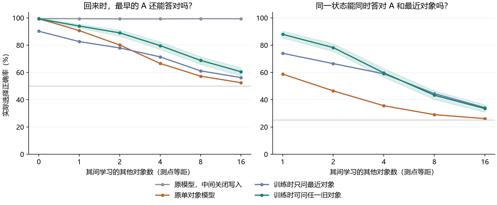
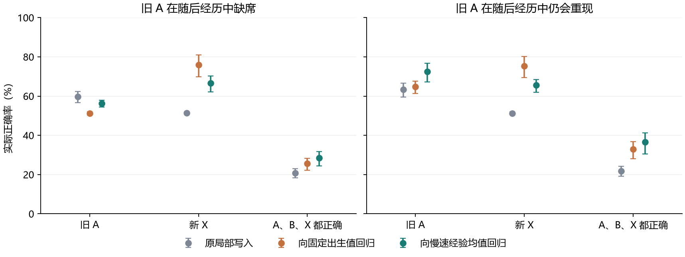
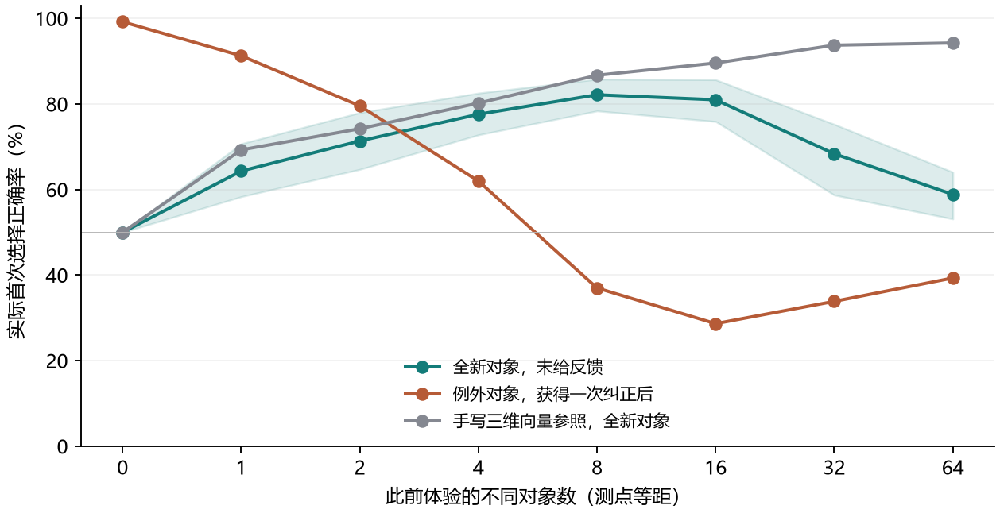
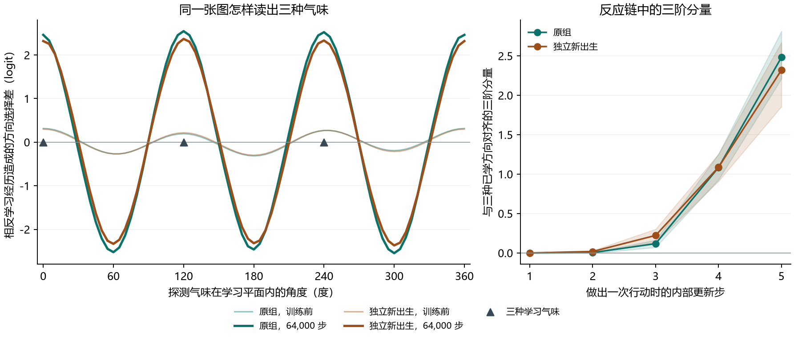

# 一张持续可写的图能同时学会几件事

**主要结果。** 同一具身体能从实际味觉形成新的气味与价值绑定，还能在相关经历后提高陌生对象的首次选择。一个只靠三维线性方向无法解开的任务，在 20 个节点和原生局部写入下形成了可回放的三峰运动反应。短生命内的这项记忆主要依赖已有边权。把普通记忆、场景冲突与标记学习同时放进一生后，交错训练改善了部分联合行为，也让旧的短任务能力大幅退步。用同样的接触预算把一半训练信用分给短任务的真实结果，能找回一部分旧能力，长任务仍有代价。下文的原组与独立组各有六个训练出生，给出的百分比均注明所测的实际行为或单独的模型诊断。[容量曲线](evidence/interleaved-learning-2026-11-20/capacity.png) · [具体个体的反应链](evidence/interleaved-learning-2026-11-20/triangle-lived-example-64000.md) · [六项联合行为](evidence/interleaved-learning-2026-11-20/one-life-results.md) · [长短任务信用修复](evidence/interleaved-learning-2026-11-20/one-life-repair.md)

这轮把单对象的一次反馈任务扩展到多个私有含义。核心问题是：在同一条生命中学完 A 和 B，回来时能否在尚未收到新答案前把两者都用对？如果一个物体的味道翻转，模型应该改变对它的选择；其他物体的答案应尽量保留。所有训练世界中都由图实际选择并获得资源。外部优化器使用实际收益，独立评估关闭梯度。确定性的二选一世界中，选侧加上这次的正负味觉就足以反推出该对象的答案，因此这里测的是绑定和保留这些经验的能力。图有 20 个节点，活动按带泄漏的 tanh 递归方程更新，带方向的循环接线允许在生命中生长和退出。中性等待期间，隐藏活动照常迭代，局部写入痕迹在原生实现中保持已有数值，下一次感官输入继续更新它们。各次真实接触之间，图的活动、痕迹和参数均延续。

本文把独立初始化并训练的一份图与规则称为一个“出生”。同一份出生模型可以开始多条生命，每条生命的私有答案重新分配。生内学习和出生前训练使用两个时间尺度。生内，感觉和味觉改变神经活动，接收端和发送端的局部痕迹驱动已有权重与偏置更新，每次接触也能各提出一次生边和退边。提案门会读取全图汇总量，具体位置使用端点统计量，破坏强连通的退边会被拒绝。出生前，多个独立生命的实际行动收益训练出生权重、偏置和局部规则的共享系数。部署时这些规则系数固定，图在这一生中自行改动其连接和数值。

## 先分开等待、接触与新写入

六个上轮冻结的气味模型先真实学习 A，然后经历 0、1、2、4、8、16 个新对象。从学习完 A 的同一个状态分叉：一份正常学习每个 B，一份看到 B、行动、品尝但关闭 B 的参数写入，还有一份只经过等长中性时钟。每次测试 A 和各个 B，都从同一终点独立取一个动作，不让先测试的对象影响随后测试的对象。每个独立世界交叉 A 的两种私有答案和 B 答案向量的正反两种版本，左右布局另外随机。[冻结协议和轨迹](evidence/interleaved-learning-2026-11-20/frozen-capacity.json)

原模型在 K=0 的 A 首答为 99.44%。正常学习 1、4、16 个其他对象后，A 分别降到 90.67%、66.58%、52.45%。K=16 时，经历相同对象但关闭中间写入仍为 99.35%，等时空等为 99.39%。新写入会导致遗忘。在这个阶段它也很难学近来的对象：K=16 时最新的 B 仅为 49.98%。

## 只改变最后可能问谁

两组从相同的六个一次学习专家出生。每条生命内先学习多个新对象，再做真实复习，写入和活动一直保留。两组的训练带完全匹配到最后一次请求。一个组的末题只问最近见过的对象，另一个组均匀抽一个见过的对象。两组都只用实际获得的末次资源训练，累计 8,000 次 Adam 更新。外层训练前半程学习两个对象，后半程随机学习二到四个。[训练和原始记录](../experiments/pulse_game/interleave_revisit_train.py)

| 六个初始出生，同一组留出世界 | 原单对象模型 | 末题只问最近对象 | 末题可问任一旧对象 |
|---|---:|---:|---:|
| 一次学习 A、B 后，同一状态两者都答对 | 58.77% | 74.02% | 87.93% |
| 学了五件事，五件全部答对 | 5.75% | 23.33% | 28.54% |
| 其间学了 16 件事，先前的 A 答对 | 52.45% | 56.21% | 60.53% |

在 A、B 都答对这一项，均匀末题组相对最近末题组的配对差为 +13.91 个百分点。以出生和共享的独立世界为两个重采样层、把同一世界内的规律及布局一起保留，逐项 95% 区间为 [+3.04, +33.53]。同六个出生换一套世界，差为 +13.93 [+2.95, +33.72] 点。五件事全对的配对差在两套世界分别为 +5.21 [+2.60, +8.14] 点和 +5.90 [+2.82, +9.66] 点。K=16 时多个对象仍然相互干扰。[从实际动作复算的区间](evidence/interleaved-learning-2026-11-20/capacity-crossed.json)



浅色区域是均匀末题组的逐项 95% 区间。右图的两次动作从相同的先前状态产生。中间关闭写入是干预对照；只看左图这一条曲线会漏掉 B 是否学会。

另六个独立出生和独立训练种子按同一协议从头复测，均匀末题组 A 与 B 都答对 87.93%，最近末题组为 73.91%。配对差 +14.02 [+3.12, +32.88] 点，六个差值全为正，中位数为 +4.69 点。其中一个出生贡献 +59.51 点，去掉它，其余五个的平均差为 +4.92 点。五件全部答对的差为 +4.73 [+2.19, +7.77] 点。[独立新出生的记录](evidence/interleaved-learning-2026-11-20/retention-objective-confirmation-summary.json)

两个队列各挑出差距最大的一个出生，与邻近出生交换整套训练世界的随机种子并重训，另留一个未动出生核对复现。在只问最近对象组，第 735 号的两题全对率换训练经历后仍为 25.0%，第 815 号则由 25.4% 回升到 59.1%。它们各自的邻居没有随交换一起坍塌。两个未动个体的两组出生参数与规则都逐位复现。出生身体和具体训练经历均值得检查；这是针对已知极端个体的诊断。[原出生交换](evidence/interleaved-learning-2026-11-20/training-stream-swap-original.json) · [新出生交换](evidence/interleaved-learning-2026-11-20/training-stream-swap-confirmation.json)

这个训练对比有一个重要细节：最近末题组总是考刚复习过的对象，而均匀末题组也会考只遇到过一次的对象。前述差值包含“考更早的对象”和“要求一次体验就会”两种压力。

另把四个对象在同一条六次接触历史中分成“早或晚、一次或两次”四类，独立控制末题是否允许问早先对象、是否允许问只见过一次的对象。原单对象专家出发的十二个出生里，两项主效应区间均跨零，两个六出生组的交互方向相反，且许多模型在这一较难训练中接近机会水平。以上 14 点的差距应归于整个末题分布的变化，不能拆成确定的两个增益。[独立控制复验](evidence/interleaved-learning-2026-11-20/retention-factorial-cross-cohort.json)

把这项四组对照从已经能同时处理多个对象的均匀回访身体重新开始，仍是同样的六次接触和 8,000 次更新。现在两批独立训练出现相同的交互。若末题只允许问晚出现的对象，由“仅问过两次的”改为“一次或两次皆可”，普通 A/B 一次学习后的两题全对率从 85.05% / 87.67% 降到 68.23% / 65.84%。若末题同时允许问早出现的对象，两组规则的对应成绩为 86.35% / 86.28% 和 84.35% / 84.44%。在允许考只见一次的对象时，开放早期对象回访尤其重要；在只考复习过的对象时，同一改动的效果很小。两个出生组的交互配对差为 +14.82 [+6.79, +22.92] 和 +19.99 [+10.03, +29.41] 点。这也解释了为何不能从原来的两组对照单独给“多复习一次”定一个固定收益。[原出生更换起点的完整析因](evidence/interleaved-learning-2026-11-20/factorial-retrained-original-sealed-008000.json) · [独立复验](evidence/interleaved-learning-2026-11-20/factorial-retrained-confirmation-sealed-008000.json)

把出生图和继承的局部修改规则分开移植，两组的出生接线逐位相同，改变的是出生权重、偏置和共享规则。原六个出生中，把最近末题组的写法放进均匀末题组的身体，两题同时正确率仍有 81.9%；反过来把均匀组的写法放进最近组身体为 72.4%；原配均匀图为 88.2%。换成未启蒙的随机身体，即使装入均匀组规则也只有 25.7%。独立六个出生同样得到 84.2%、75.7%、88.6% 和 25.7%。每个出生的移植评估使用 96 个世界几何，上面的容量主表使用 192 个。每次移植都保留整个生命的实际写入权限。这说明训练还形成了一个便于写入和读出的身体；独立移植写入公式不足以带走完整能力。[原出生交叉移植](evidence/interleaved-learning-2026-11-20/transplant-original.json) · [新出生复验](evidence/interleaved-learning-2026-11-20/transplant-independent.json)

### 把同一生的学习量增加到 17 或 33 件

从同一批均匀回访模型再训 8,000 步。三组在每一步收到同样数量的接触和等待。第一组遇到许多不同气味，末题均匀问其中一个。第二组遇到同样多种气味，末题只抽最近两个之一。第三组以相同接触次数反复遇到最多四个气味，末题可问任意一个。测试统一让每组都遇到 17 个新对象，每个只学习一次，然后从同一末状态分别回答 17 题。

两批出生各用两套测试世界，多种气味、均匀抽问组在 17 件里平均答对 10.08–10.20 件，少数气味反复练习组答对 10.39–10.51 件。前者比后者少 0.22–0.36 件，四个配对区间均低于零。两组同时答对最早和最新对象的差异区间均跨零。所有组中，17 件全对最高为 0.152%，33 件全对为零。答对的件数包含二选一机会命中的部分，17 题均匀随机选择的期望已经是 8.5 件。此次加大一生中的对象种类并没有提高实际容量。[训练预算、四套回放和逐出生原始指纹](evidence/interleaved-learning-2026-11-20/wide-capacity.json)

## 复习时，两个对象的成绩会朝不同方向走

仍从相同的 A→B 状态出发，增加一次 A 的真实复习，再与看到同一 A、收到同一味觉、保持相同时钟但停止这笔写入的分叉比较。均匀末题组复习后 A 提高 4.38 个百分点，B 低 3.69 个百分点，两者都对的变化仅 +0.20 [−0.85, +1.17] 点（按训练出生配对）。原单对象图的同一联合成绩反而下降 9.79 点。这个操作能修复一部分 A 的表现，也可能占用 B 所依赖的参数。[配对复习](evidence/interleaved-learning-2026-11-20/retention-objective-matched-008000.json)

如果只许真实复习一次，选谁也有区别。外部调度器先在只读分叉上检查所有对象，以正反两种摆向的运动 logit 半差绝对值衡量犹豫程度，再让图真实接触并写入一次。学过四个对象时，复习最犹豫的对象使四项全对由均匀选择的 43.40% 升到 50.69%，差 +7.29 [+4.51, +10.16] 点；另外六个独立出生从 48.50% 到 51.92%，差 +3.42 [+1.11, +5.57] 点。学过八个对象时两批联合增益区间都跨零。挑选动作依赖外部枚举，图的运动输出确实含有可用于安排复习的线索。[按实际选择复算的两批配对结果](evidence/interleaved-learning-2026-11-20/review-choice-paired.json)

## 年龄和当下的学习能力

测试固定历史之后再给全新的 X，一次亲身反馈后测试 X，区别于回到过去的 A。原单对象图正常学习 4、16 个其他对象以后，再学 X 的正确率分别为 53.30% 和 49.57%。在四个对象的历史后，把仍然存在的旧边权恢复到出生值，保留当前活动、偏置和拓扑，新学 X 回到 96.27%。到 128 个对象后，原生仍存的边权中约 86.6% 的绝对值达到或超过 1.15（容差 0.00001）；此时只恢复存活边权也仅为 50.69%，恢复整张出生图则为 97.40%。这些是诊断干预，会改变原先的记忆内容。[逐出生数据](evidence/interleaved-learning-2026-11-20/plasticity-prior-odor.json)

用全寿命关掉数值调节、但允许生退边的历史做对照，均匀回访模型在 256 次接触后仍能用一次正常写入学习新对象，读数约 96%；历史中保持全套写入时约 50%。全寿命只开已有边权与偏置时也会丧失新学能力。本轮主要退化首先发生在反复使用的数值通路中。把 A、B 放得接近时，这种干扰可以直接干预：两气味方向相差 15° 且价值冲突，均匀回访图学完 B 后，A/B 分别为 56.1%/62.4%；撤回与先前 A 改动方向相反的 B 写入，A 回到 97.4%，B 只剩 3.6%。夹角 90° 时，完整写入能同时答对两者 95.6%。[夹角与回退](evidence/interleaved-learning-2026-11-20/interference-objective-uniform-8000.json) · [长期分量对照](evidence/interleaved-learning-2026-11-20/structure-objective-uniform-8000.json)

数值到达限幅与失去新学能力同时发生，单纯放宽限幅没有救回这些已训练图。让同一张图重新经历相同输入，分别把权重与偏置的本地更新界限由 1.15 提高到 2.30、4.60 或完全移除。独立六出生经历 128 个新对象后，原界限与这三种放宽条件的新 X 实际正确率均为 50.35%。完全移除界限后，平均每条生命的最大绝对权值由 1.15 上升至 2.85，说明干预确实改变了图。另一个对照允许每条原有大权重重新回到其出生幅度，X 也只有 51.13%。各图的写入规律均在原界限下学得；这些数据回答的是部署时放宽限制有无作用。[限幅与出生可达范围的配对诊断](evidence/interleaved-learning-2026-11-20/native-write-range.json)

### 慢速摘要能保住什么

数值诊断中，每次正常自编辑之后，让持续存在的祖先边权和偏置以 12% 的比例向出生值恢复。这个外加机制保存了额外的 420 个数值及接线血统掩码。独立六出生中，长历史末端新对象一次学习明显改善，曾经的 A 长期缺席时则更容易失去。随后把同一份参考改为慢速数值副本，按实际表达出的快权重更新。0.02 的慢更新率由原六个出生选出，在另六个出生和新世界中固定验证。

| A、B 各真实预习四次；随后 A 缺席 | 学 X 后回 A | 新 X | A、B、X 全部答对 |
|---|---:|---:|---:|
| 原生局部写入 | 59.6% | 51.4% | 20.8% |
| 向固定出生值恢复 | 51.2% | 76.0% | 25.6% |
| 向慢速经验均值恢复 | 56.2% | 66.6% | 28.5% |

表中在 16、64、128 次介入接触处等权，再在出生与世界上平均。慢速相对固定参考的全对收益为 +2.88 [+1.00, +4.67] 点，A 提高 5.00 点，新 X 低 9.36 点。仅交换“过去 A 答案相反、B 与当前输入相同”的慢副本，以原副本减交换副本计，A 为 +5.90 [+4.22, +7.40] 点，新 X 为 −0.01 [−0.81, +0.75] 点。反复经历的具体旧内容确实进入了慢状态。每次吸收 2% 仍是一种外加的摘要规则，这组数据也显示了保存旧内容和保持可塑性之间的取舍。[复验与因果区间](evidence/interleaved-learning-2026-11-20/slow-reference-contrasts.json)

把慢副本吸收每笔写入的速度改为两个可选择的值，并根据这次改动与已有偏移是否同向来选。另六个出生里，相对全局统一慢速，三项全对从 28.43% 到 29.10%，差 +0.67 [−0.33, +1.69] 点。按每条连接的方向分配速度，尚未带来可靠的联合提升。[按位置选择慢更新率](evidence/interleaved-learning-2026-11-20/local-consolidation.json) · [逐轨迹配对区间](evidence/interleaved-learning-2026-11-20/stability-paired.json)



进一步把参考压缩到每个接收神经元一个出生时的入边范数，共 80 字节。不再储存每条边的原始大小。各方案的恢复力度先在原六个出生中确定。独立验证中，范数方案一生后段学习新 X 为 51.4%，和原生相差 +0.01 [−0.66, +0.77] 个百分点。把每条边的正负或缺失编码成 2 位，再加每行一个大小，共 185 字节，也只有 52.0%。同样按出生地址处理，保留每条边的原始大小就恢复到 76.0%。这说明这批图还需要各条边上更细的数值结构。它并未证明每条边都需要一份动态副本。压缩字节数计算的是参考本身，评估时还会展开成批处理张量。[校准与独立复验](evidence/interleaved-learning-2026-11-20/compact-reference.json)

为区分空间位置和数值精度，再让每个出生地址各自保留 2、3、4、6、8 位或 FP16 的参考值，部署主图仍用原精度计算并自由写入。每行单独保存一个 FP32 比例，实际打包后，4 位固定出生参考共 **290 字节**，完整 FP32 参考是 1,680 字节。与精确参考配对后，在两批新世界，旧 A 缺席后的新 X 分别差 −0.32 [−1.24, +0.58] 点与 −0.18 [−1.50, +1.09] 点；A、B、X 全对均仅差约 −0.09 点。两个主指标、两个队列的区间都落入预设 ±2 点内。3 位时 X 分别损失 4.02、3.32 点。在相同 290 字节下只保留最大的 40 条精确边权与全部偏置，结果明显落后。对这张图，许多地址上粗略但独立的参考值，比只精确保留几条大边更管用。[精度、实际打包字节和等效判定](evidence/interleaved-learning-2026-11-20/quantized-reference.json) · [同字节预算下的对照](evidence/interleaved-learning-2026-11-20/quantized-reference-same-byte.json)

固定参考达到了 4 位要求，**持续吸收经验的慢参考还要考虑每次写入有多小**。固定快恢复率 0.12 和慢吸收率 0.02，把同一慢副本改为 4 位最近舍入。两批出生每百万次合格边权更新只真正改码 0.26 和 0.05 次。在等待结束、学习 X 之前交换相反 A 经历的慢副本，之后的 A 行为差为零。改成无偏随机舍入，真正改码的比例为 1.86%/1.83%。保留原副本相对交换副本，学完 X 后对旧 A 的**实际选择**提高 1.25/1.17 个百分点，B 和 X 的区间均跨零。用慢副本直接算出来的 A 读数差约 20 点，那是单独的外部诊断。前文 5.90 点的干预发生在等待开始，测的是此后整段生命受不同慢记忆影响的总效应，两次实验的交换时刻不同。

4 位随机慢副本实际占 340 字节，含 80 字节行尺度和 50 字节存活掩码。共同值域下的 FP32 慢副本占 1,810 字节。A 缺席条件下，它们的原生三项全对分别为 25.72%/25.47% 和 27.30%/27.07%。4 位随机舍入能形成可干预的旧记忆，完整行为得分仍略低于同条件 FP32 慢副本。这里测量的是经验参考状态；主图、采样和实际行动一直按原精度执行。[动态低精度、真实改码频率与交换对照](evidence/interleaved-learning-2026-11-20/dynamic-quantized-reference.md)

再把稳定力度交给真实行动收益来选。一个外层搜索只学一个全局强度，另一个多学三个系数，让每个接收节点依自身活动、味觉引起的活动变化及当前参数偏离慢参考的程度决定强度。三个独立搜索都只看每条训练生命实际抽中的一道末题能否取得资源。另六个身体未经重训直接使用学到的规则。

四次预习、A 长期缺席的主条件中，一个共同强度就让 A、B、X 全对率从预设强度的 28.48% 升到 **30.69%**，差 +2.21 [+0.90, +3.54] 点。一次学 X 提高 6.30 点，学 X 后回 A 的差为 −0.91 [−2.07, +0.26] 点。按各节点状态选择力度得 **29.77%**，相对等预算全局强度为 −0.92 [−2.35, +0.21] 点。按位置打乱力度或在同一身体内取平均，也未显示清楚的定位收益。慢参考和门的输入由实验提供，本次确实从收益学到了整体稳定力度，局部控制的额外价值还没有体现。这个验证复用了先前慢参考的 128 个留出世界，与拟合数据分开。[三个搜索、六个部署身体和配对区间](evidence/interleaved-learning-2026-11-20/adaptive-reference.json)

把三次搜索得到的共同强度直接装到另一种训练出来的混合任务身体，仍用原来 .02 的慢更新率，在 64、128、256 次真实接触处等权。相对 .12 的预设强度，独立出生的新 X 一次学习提高 3.11 [+1.63, +4.77] 点，自然遇到的测题提高 1.76 [+0.63, +2.81] 点，冲突 A/B 加标记的三项联合收益区间跨零。不同身体可以沿用这一个数值改进普通行动，最困难的冲突行为还没有因此解决。[未经再拟合的长生命迁移](evidence/interleaved-learning-2026-11-20/adaptive-deployment.json)

## 过去的经验能不能帮到从未闻过的对象

此前对象的答案彼此独立。在这种世界中，再多旧经验也不能让全新对象的首次选择系统性地超过 50%。另外生成一类有结构的留出世界，每条生命随机选取一个看不见的三维方向。气味在该方向上的投影决定哪侧能带来资源。图能观察气味、自己的行动和吃到的味觉，无法读取这个方向。把刚才的均匀末题模型原封不动放进去，在任何关于新对象 X 的反馈之前计分。

| 经历的其他对象数量 | 0 | 1 | 2 | 4 | 8 | 16 | 32 | 64 |
|---|---:|---:|---:|---:|---:|---:|---:|---:|
| 早先六个出生，新对象首次答对 | 50.0% | 64.3% | 71.4% | 77.6% | 82.2% | 81.0% | 68.4% | 58.9% |

独立六个出生和另一套世界复现了八次经验后的效果，首次答对 **84.51% [82.23%, 86.65%]**；把相同感官时间表的早先价值换成独立值为 50.00%。这些模型在启蒙时学的是独立私有标签。这里测到的跨对象收益来自这条测试生命：有关联时有帮助，训练出来的规律能匹配任务的几何结构。一个只把“实际选中的气味方向 × 实际味觉”相加的三维公开参照也能完成相当一部分任务；新图的成绩不等于发现了任意复杂规律。[逐出生结果与区间](evidence/interleaved-learning-2026-11-20/induction-checked.json)



把 X 设成全局规律的一个真实例外，初次动作发生前它与一般对象完全相同。八次先前经验后，初始六个出生首次猜对例外仅 17.84%；实际吃到一次纠正后，升到 36.98%。独立出生分别为 15.49% 和 34.18%，纠正后又在另一个典型新对象上答对 78.97%。这是旧经验促进泛化、同时妨碍一次纠正的直接代价。另一个因果分叉固定八次历史中每一次选的**物理侧**及**实际味觉**，只对调曾经与味觉配对的气味。学习后的原图在新对象得 81.2%，同样动作和味觉配上镜像气味只得 17.8%；只换入镜像生命的图参数也降到 18.2%，只换活动和痕迹仍为 82.0%。[相同动作与收益下的内容交换](evidence/interleaved-learning-2026-11-20/transfer-binding-uniform.json)

### 图能否判断一次异乎寻常的反馈值不值得信

先看一个较简单的情形。对象的私有价值始终不变，每次味觉独立有 20% 概率报出相反信号。六个在噪声下训练的出生图，依据 1、4、8、16 次真实接触为该对象选侧，正确率约为 77.0%、87.8%、92.2%、92.6%。延长到 32 次则降至 80.6%。这些身体可以在相当长的一段历史中利用重复证据，过长的反复写入仍有代价。[带噪回执的实际行为](evidence/interleaved-learning-2026-11-20/receipts-trained-noisy.json)

在一种世界里，对象的价值稳定，味觉偶尔报错；另一种世界里，味觉可靠，对象价值会翻转。两种世界的一步符号变化率相同，较长的反馈顺序提供了区别。看过两个旧对象后，模型面对一个全新 X，在两种环境中都得到相同的三次证据，例如正、正、负。继续信前两次或改信最后一次，哪种做法更有用，取决于它从前两个对象中获得的经验。

每个旧对象有八次接触的独立读出测验中，用一套外部线性读出从当前图的状态辨认世界，两个训练方案在接触 X 前得 54.88% 和 55.76%，收到 X 的三次味觉后为 55.62% 和 55.83%。公开历史参照能辨类 83.01%。实际网络自己的末次获益却只有 50.11% [49.10%, 51.15%] 和 49.67% [48.81%, 50.58%]。没有前史或只经过同样时钟、没有旧味觉时，外部读出回到 50%。世界类别仅在事后训练外部读出时可见，原生策略始终得不到类别。由此可以把两件事分开：状态中留下了一些环境信息，这些信息还不足以让实际行动表现出可靠的“该不该相信这次反馈”。[两种训练方案、外部读出和实际行动](evidence/interleaved-learning-2026-11-20/meta-evidence-state-readout.md)

## 一张图在冲突场景里能否把三件事一起做对

同一出生图在整条生命中同时接收两个场景的气味和给料器标记。相同气味可以在 A 和 B 有相反价值。场景有可见的双侧感觉线索，私有答案随机；图没有任务编号或正确动作输入。源头冷启动、旧专家初始化和两阶段续训分别测试。在独立身体环境里，先实际经历 A 再实际经历 B，然后从同一个终点分别行动去取 A 的对象、B 的对象和正确标记，三项均未看新答案。

| 有冲突的真实留出世界，三项全部答对 | 原六个出生 | 独立六个出生 |
|---|---:|---:|
| 相同运动随机数的均匀选择 | 11.72% | 12.76% |
| 直接冷启动混合训练 | 16.28% | 17.19% |
| 先训场景冲突，再从短到长混合续训 | 31.38% | 26.82% |

熟悉气味条件下，每个出生有 96 个独立世界，每个世界有 4 条 A/B 冲突条件下的配对轨迹。两阶段图相对均匀行动的三项配对差分别为 +19.66 [+10.76, +28.08] 点、+14.06 [+8.12, +20.57] 点。在新出生中，三项相对同图禁止写入的差为 +14.24 [+7.34, +21.18] 点；从学习 A 改为学习无关 C，原/新出生分别低 18.23/15.02 点。改成不再互为相反向量的新气味，三项仍有 26.52%/28.1%。轮流学习三对气味、回访时从中抽一对，A 和 B 两项全对只有 22.31%/20.84%，与配对随机对照的差均跨零。能同时使用多种能力，和能在更多对象中稳定排除干扰，是不同的验收条件。[测试方法](evidence/interleaved-learning-2026-11-20/heldout-method.md) · [逐个体的联合行为](evidence/interleaved-learning-2026-11-20/heldout-joint-by-birth.md) · [新出生原始测量](evidence/interleaved-learning-2026-11-20/heldout-replication-cont-full-direct/summary-primary-aba.json)

无提示反转单独测试。两个世界在第一次收到新味觉前，所有身体输入完全一致，实际首个选侧逐条相同。在直接冷启动图的独立组中，新规律下的首答为 17.7%，收到 1、2、4 次真实纠正味觉后分别为 20.7%、25.3%、30.9%。在稳定世界对应时间仍有 82.3%、82.1%、82.3%、80.2%。短期内有少量纠正，一次意外还不足以覆盖原先长期有效的关联。[逐次实收反馈后的选择](evidence/interleaved-learning-2026-11-20/mixed-results.md)

在更长的混合生命里把上述快慢机制原样接到两阶段图上。64、128、256 次持续接触处等权，独立六出生中，向固定出生值恢复使自然遇到的考题正确率由 56.3% 提高到 70.9%，差 +14.64 [+11.62, +17.29] 点。改用慢速经验副本，旧对象在学完新题后又高 6.58 [+2.60, +10.55] 点，新对象一次学习的配对差为 −6.05 [−8.75, −3.28] 点。冲突场景 A、B、标记三项全对仅相差 +1.80 [−1.66, +5.73] 点。维持日常行动水平比较容易，同时保住两套冲突映射仍很难。[同一混合图的长生命复核](evidence/interleaved-learning-2026-11-20/stability-paired.json)

连续执行三道题也有单独的训练结果。支持阶段收到真实味觉，之后连续选择 A、B、标记，终末三次选择之间没有新味觉。以三项齐全才获得终局回报来续训，相对于按三项实际收益平均计分，原生连续测验的冲突三题全对率从 25.61% 升至 30.60%，独立组从 28.65% 升至 35.11%。但在让身体逐拍移动落地、三项从同一快照分别测的验证中，熟悉布局的差值分别为 +1.17 [−1.95, +4.60]、−1.61 [−5.56, +2.56] 点。原生连续测验使用预积分的运动终点及固定的神经接触时钟，两种成绩使用不同的行为分母。[完整物理行为、原生串答、无提示反转与逐组对照](evidence/interleaved-learning-2026-11-20/mixed-results.md)

## 相同节点数下能否学出更复杂的读出

把三个气味方向等间隔放在圆上，每个气味餐盘提供该方向与其反方向。这三个学习方向相加为零。如果一个身体只把气味乘上一根存储向量再选侧，三个点积相加也为零，不能全部严格为正。给三种气味都取正值和都取负值，并把显示方向各翻一次，可以直接检测这个限制。每条生命的实际经历只有三次，随后从同一末状态问三题。外层教学只随机问其中一题，依据图这一次真实选侧得到的食物训练。

从均匀回访身体出发，保留 20 个节点与全套写入权限。采用相同 Adam 状态连续训练到 64,000 步。对每个出生抽 128 个独立旋转，每个旋转检查六种学习顺序与八种私有赋值。原六个出生，对两张困难赋值表均过严格阈值的比例由 32k 的 42.19% 升到 64k 的 **67.60%**；独立六个从 48.74% 升到 **58.53%**。严格判据先计算“正向菜单选右的 logit 减反向菜单选右的 logit”，取半差再乘以对象私有符号；三个对象的值都大于 0.05，两段相反赋值的历史也都通过，才将这一个旋转与顺序计入。一个很大的固定选侧偏置可以在这项半差里相消。另按真实选侧计，在单段困难赋值历史、单一摆向上，从同一状态分别采样三题，64k 时三题实际全对率为 **64.07% / 57.12%**。同一旋转要求六种顺序、八种赋值全部过阈值，分别为 44.14% / 37.11%。固定 4 拍、随机 0–8 拍、全 16 拍、全 64 拍及仅最后等 64 拍的成绩很接近。这是真实的长等待复测。[原出生六序](evidence/interleaved-learning-2026-11-20/triangle-orders-long-original-64000.json) · [独立出生六序](evidence/interleaved-learning-2026-11-20/triangle-orders-long-independent-64000.json) · [等待对照](evidence/interleaved-learning-2026-11-20/triangle-wait-stress.md)

这个几何也有一个可以算清的手写参照。把每次真正选中的单位气味向量的三阶乘积乘上实际味觉并累加，只要 10 个独立数值。读出新方向时，每个旧方向的贡献正比于二者夹角余弦的三次方。本题两个其他方向的余弦都是 −1/2，单个干扰项最多 1/8，自己这一项为 1，最小有符号余量仍有 3/4。这一参照在全部八种赋值上都通过，普通三维线性累加在两种困难赋值上均无法通过。此处值得研究的是图能从实际回报中学到怎样的非线性和它能用到哪里。[同感觉、同味觉的解析对照](evidence/interleaved-learning-2026-11-20/public-kernels.json)

**读出来的回路。** 实际吃过三次后，沿同一平面每隔 5° 读一次运动输出，并将三种气味私有价值均为正和均为负的经历配对。每次实际吃到的味觉由选侧决定。训练后的反应曲线有三个峰，相隔约 120°。把圆上的反应按角频率分解，原组和独立组中，每圈三次的分量分别占三重对称响应能量的 98.1% 和 98.4%。这个百分比的分母只含在三种已学方向上同相叠加的成分。若用全部随经验反转的角度响应做分母，则分别是 64.2% 和 58.9%。在 5 拍感觉反应中，三峰信号主要在第 4 和第 5 拍出现。探测方向转开 20°，两批出生的困难三题实际全对从同一角度试验的 63.2%/57.2% 降到 31.7%/28.5%。[原组角度扫描](evidence/interleaved-learning-2026-11-20/triangle-angular-original.json) · [新出生复验](evidence/interleaved-learning-2026-11-20/triangle-angular-independent.json)



三次学习期间，如果继续修改已有权重、只在测试生命内关掉偏置和接线变化，原/新出生的严格通过率仍为 67.77%/58.94%。关闭已有权重和偏置更新、只允许增删边，两个队列均为零。全部开放时实际也发生了生退边，短生命的关键记录主要存入已有连接的权重。[写入分量原组](evidence/interleaved-learning-2026-11-20/triangle-components-original-64000.json) · [独立组](evidence/interleaved-learning-2026-11-20/triangle-components-independent-64000.json)

从相反口味的经历中取来一个接收节点的**整行入边权重、该节点偏置和入边掩码**给同一个体，保留接收者的活动和痕迹。先以独立校准世界选出最能改变行为的一行，再到新世界与其他改动量接近的一行比较。只保留两边均无接线变化且数值剂量相近的案例，原组困难三题实际全对下降 49.95 [42.03, 58.82] 点，独立组下降 33.95 [15.60, 50.93] 点，12 个出生方向一致。被选中的 12 行有 7 行连到运动节点，5 行连到感觉节点。这样的行能因果改变行为；每个接收节点仍有多条输入，这次定位没有将整段计算缩成唯一一条边或一条路径。[行级交换、剂量分母和图连通性](evidence/interleaved-learning-2026-11-20/triangle-row-graft.md)

用同一批 64k 图做与三角形无关的普通双对象记忆测试，原出生由训练前的 86.85% 变为 91.08%，独立出生由 87.92% 变为 92.55%，配对增益区间分别为 [+1.95, +6.80] 和 [+2.47, +7.06] 点。五个普通对象全对在第二组提高，第一组区间跨零。冲突场景连续三问的成绩在两组都没有明确改善。不同测验的最高值来自不同身体，逐组模型卡中的每一行都由同一张图完成。[原模型的跨任务变化](evidence/interleaved-learning-2026-11-20/triangle-transfer-original.json) · [独立模型的跨任务变化](evidence/interleaved-learning-2026-11-20/triangle-transfer-confirmation.json)

同一个体两次相反经历的每次实际动作、吃到的味觉和 5 拍运动节点读数，见[可重放的两个实例](evidence/interleaved-learning-2026-11-20/triangle-lived-example-64000.md)。实例按预先固定的第一个世界选取，保留了镜像摆向的一次实际失手。

### 给相同的预算，应该练什么难度

把三个气味分别放在正交方向时，任意一组私有价值都能用简单线性累加读出。等边三角的困难赋值则迫使系统形成更复杂的反应。另训练两个完整的 64k 对照，保持相同私有赋值、更新数、时钟、运动采样数和学习器，分别只练正交气味，或等量穿插困难三角与其他几何。下表每格为原出生 / 独立出生。

| 64k 训练日程 | 困难三角三项实际全对 | 新抽的随机方向三项实际全对 | 普通五个对象全部答对 |
|---|---:|---:|---:|
| 只练容易的正交组合 | 14.05% / 9.35% | 67.53% / 67.09% | 27.21% / 32.91% |
| 只练等边三角 | **64.07% / 57.12%** | 73.81% / 73.64% | 31.61% / 38.57% |
| 半数等边三角，四分之一正交，四分之一随机 | 51.05% / 49.47% | 74.16% / 75.03% | 33.14% / 39.19% |

在同类但从未见过的随机方向上，困难专训相对正交专训的三项实际全对提高约 6.3 和 6.6 个百分点。混合几何相对困难专训的普通三项增益只有 +0.34 [−1.70, +2.29] 和 +1.39 [−0.35, +3.00] 点，困难三角本身则明确退步。比较混合 64k 和困难专训 32k 时，两者恰有相同数量的困难更新；混合组另加了 32k 次其他训练，且两组按全局更新号抽取的困难实例并非逐条相同。[相同预算、相同困难次数及逐出生实测](evidence/interleaved-learning-2026-11-20/curricula-and-joint.md)

## 同一张图学习第二种技能后，第一种还能不能用

从相同的 64k 非线性气味图继续训练。三组看到完全相同的 4,000 次原气味任务和 4,000 次新场景、给料器任务，改动的是两类训练生命的次序。随后每个部署身体在一条从未经历的生命中学习六个私有值：三个等边三角气味、同一新气味在场景 A 和 B 中的两个价值，以及一个给料器标记。前三次气味体验、两次场景体验、两次给料器示范共七次接触。末端六次动作从同一状态各自取样，先测试的动作不会给后来测试的对象提供帮助。

| 训练日程 | 原组，场景冲突时六项全对 | 独立组，场景冲突时六项全对 |
|---|---:|---:|
| 继续训练前的同一批父图 | 5.52% | 5.68% |
| 先练旧任务，再学新任务 | 4.39% | 3.09% |
| 先学新任务，最后集中复习旧任务 | 5.66% | 5.81% |
| 每两次训练中两类任务各一次，随机先后 | **7.64%** | **6.89%** |

逐对交错相对先旧后新的配对收益为 +3.25 [+1.80, +4.88]、+3.79 [+2.48, +5.05] 点，相对先新后旧为 +1.97 [+1.11, +2.90]、+1.08 [+0.22, +1.91] 点。在独立出生里，先旧后新让原来的三个气味全对率掉到 23.69%，先新后旧能回到 59.05%，但新学的 A/B/标记三项只有 10.18%。交错组两项分别为 53.30% 和 13.80%。训练时两种任务来回出现，确实更容易留下共同可用的能力，整体六项仍然很难。这里的交错发生在出生前训练的不同生命之间；测试的七次接触在同一条生命中延续全部状态。[原组的组成成绩、亲本和配对差](evidence/interleaved-learning-2026-11-20/cross-skill-original-8000.json) · [独立组](evidence/interleaved-learning-2026-11-20/cross-skill-independent-8000.json)

### 直接用一条生命训练两种技能

再从相同的 64k 父图出发，用七次接触把两种技能放在同一条训练生命中。末尾从两类任务各抽一题，连续作出两个动作，两次都获得所需资源才给外层训练回报。第一道末题之后没有新味觉，图仍处理感觉与自身选侧并能更新参数，再作第二次选择。分块和交错两组使用同一组个体、世界、对象随机数以及七段等待总时长，均训练 8,000 步。两组改变了不同对象距提问的间隔，实际选择和所得味觉也可以随顺序改变。

| 完全重新生成的世界 | 亲本，原 / 新出生 | 分块训练，原 / 新出生 | 生内交错训练，原 / 新出生 |
|---|---:|---:|---:|
| 两个连续终局行动都获益，全部私有映射 | 48.83% / 48.46% | 48.23% / 45.57% | 49.22% / 50.72% |
| 从同一终点分叉，六项全对，全部私有映射 | 10.94% / 10.59% | 11.06% / 11.21% | 12.15% / 13.88% |
| A/B 场景价值相反，六项全对 | 5.24% / 5.37% | 5.44% / 5.85% | 6.12% / 7.12% |
| 困难三角与场景冲突同时出现，六项全对 | 2.79% / 2.71% | 2.14% / 2.65% | 2.92% / 2.89% |

每个世界交叉六个私有符号的 64 个组合；场景冲突占 32 个，困难三角且场景冲突占 8 个。串答每世界只抽一对题并固定顺序。六项测验另用独立探测从同一快照行动。生内交错相对亲本在冲突条件下让 A/B/标记三项全对提高 3.83 [+1.81, +5.85] 和 4.90 [+3.36, +6.54] 点，六项全对只提高 0.88 [−1.24, +2.88] 和 1.75 [−0.22, +3.41] 点。六项信号强于均匀选侧的 1.53% / 1.73%，这次继续训练所带来的额外增益仍不确定。

还必须算上原有本领的代价。在各自新的短生命中，两个普通气味全对从亲本的 91.08% / 92.55% 掉到生内交错组的 63.48% / 72.04%，困难三角的三项实际全对从 64.07% / 57.12% 掉到 33.59% / 28.16%。逐出生看，生内交错训练的 **12/12** 个体在新世界的冲突 A/B/标记三项都高于自己的亲本，同时 **12/12** 个体的普通双对象联合回访都低于自己的亲本。每条测试生命都重新分配私有答案，因此下降的是重新学习这类短问题的本领。这次权衡在每个受测身体上都能看到。连续生命内能从经验获取信息，如何让同一发育过程保住多种学习本领仍是这轮最明显的瓶颈。[新留出与共同留出上的配对区间、串答及普通能力](evidence/interleaved-learning-2026-11-20/one-life-results.md)

对短任务掉分做了单独的时钟检查。两次真实对象接触加末端等待共 38 拍。在新的 192 个几何上，交错续训图的普通双对象全对是 64.80% / 71.96%。在 A/B 前面或后面补五次接触的时间，使整条生命延长到 131–157 拍；纯空等或同内容禁写使结果只改变约一个百分点以内。若允许五次无关接触写入，相对同接触禁写，前置时两组分别再低 10.87 和 14.89 点，后置时再低 12.98 和 18.58 点。把 A、B 的实际选侧和味觉都锁定为短版的真实经历，前置无关写入的两题全对仍仅为 52.78% / 53.69%。在所测条件下，恢复较长的时钟或补足感官经历，均不能找回原本的短任务成绩。[同对象同反馈的时长与写入分叉](evidence/interleaved-learning-2026-11-20/one-life-padding.md)

为定位继续训练改了什么，再把父图与续训图在**出生时的身体**（权重、偏置、连接掩码）和**生内的写入规则**交叉移植。12 个出生在这段外层训练前后的连接掩码逐位相同，权重、偏置以及局部规则系数可不同。移植后，生内全套写入权限仍然开放。

| 身体 / 写法 | 普通两个新对象全对，原 / 独立出生 | 七次接触后的冲突 A/B/标记全对，原 / 独立出生 |
|---|---:|---:|
| 父身体 / 父写法 | 91.08% / 92.55% | 9.77% / 9.73% |
| 父身体 / 续训写法 | 85.87% / 88.64% | 9.63% / 10.05% |
| 续训身体 / 父写法 | 65.07% / 74.80% | 12.68% / 13.49% |
| 续训身体 / 续训写法 | 63.48% / 72.04% | 13.60% / 14.63% |

保留父写法、换成续训身体时，旧双对象降幅已达 26.01 和 17.74 点，同时新场景三项都提高。反过来，父身体装入新写法时，旧任务只降 5.21 和 3.91 点，新场景三项增益区间跨零。三项拆开后，标记的边际成绩提高最明显；冲突场景 A、B 各自的正确率仍约为 52–54%。在这次互换中，较大的短任务损失随出生权重与偏置转移。在续训身体上，换回与它一起学出来的写法，对六项全对另有约 1 点的收益，两个队列的配对区间都高于零。身体与写法存在共同适配，不能把两次移植的百分点直接相加归因。[双方两代身体与写法互换](evidence/interleaved-learning-2026-11-20/one-life-body-rule-swap.md)

### 让短任务的真实结果也参与训练

这是看到 12 个身体的短任务成绩都降低后追加的修复试验。起点固定为刚完成 8,000 步生内交错训练的 12 个模型。两组各追加 2,000 次 Adam 更新。每次都真正执行一批短生命和一批长生命，分别得到 32 个实际终局结果。长题组始终只用长生命的结果更新。混合组每两次更新随机安排一次短题、一次长题，所以恰好各 1,000 次。短训练在两个气味接触后各等 4 拍，普通能力评估只在第二个接触后等 4 拍。评价以真实选侧计算，部署时没有外层梯度。

| 既有留出库的实际选择 | 修复前，原 / 独立出生 | 只按长题收益更新 | 短、长题各占一半 |
|---|---:|---:|---:|
| 普通新对象 A、B 都答对 | 63.48% / 72.04% | 61.82% / 66.99% | **76.37% / 77.54%** |
| 冲突场景 A/B/标记三项全对 | 13.60% / 14.63% | 14.12% / 14.48% | 12.82% / 13.58% |
| 冲突场景六项从同一快照都答对 | 6.12% / 7.12% | 5.88% / 6.75% | 6.06% / 6.61% |
| 冲突场景连续两次行动都获益 | 43.86% / 45.42% | 43.09% / 46.01% | 44.12% / 44.05% |

混合组的普通双对象相对等预算长题组提高 **14.55 [+3.55, +31.51]** 和 **10.55 [+3.32, +20.09]** 个百分点，12 个配对身体中 11 个方向为正。相对修复前的同一身体，提高 12.89 和 5.50 点。相比最初 91.08% / 92.55% 的双对象成绩，只修回了一部分。长任务上的代价也能测到：混合组相对长题组，原六个出生的冲突三项差为 −1.30 [−2.34, −0.34] 点，另六个的冲突串答差为 −1.96 [−3.78, −0.42] 点。这些模型都经历了同样多的短任务。真正改变表现的是出生前训练是否把这些行动的后果也计入学习目标。[修复方案、逐个体与全部联合行为](evidence/interleaved-learning-2026-11-20/one-life-repair.md)

冻结这四组修复终点后，另锁定两套从未用于训练或此前评估的世界。每个出生重新抽 128 个普通几何与 96 个联合几何。普通 A/B 全对，只有长题信用的两批分别为 **61.69% / 67.19%**，长短各半为 **75.46% / 79.17%**，差为 +13.77 [+2.34, +29.88] 和 +11.98 [+4.65, +22.27] 点；**12/12** 个体均提高。相对未追加训练的原始交错终点，分别提高 12.21 和 5.83 点。冲突六项的混合减长题差仅为 −0.12 / +0.04 点。原六出生的冲突 A/B/标记三项低 2.04 点，两批的真正冲突串答差值区间均跨零。恢复短任务这一点复现了，复杂联合任务仍没有同步改善。[另一套新世界的原组结果](evidence/interleaved-learning-2026-11-20/one-life-repair-confirmation-original-2000.json) · [独立出生的新世界结果](evidence/interleaved-learning-2026-11-20/one-life-repair-confirmation-independent-2000.json)

## 哪部分可以等价提速

完整冻结三对象评估可以利用一个事实：尚未尝到某个对象前，只有其私有答案不同的两条生命经历完全相同。味觉第一次揭示这个区别时才复制状态，三次接触逐步展开成八条。原、独立出生在 32k 和 64k 的 24 份存档中，动作与运动 logit 逐位复现。24 组随机平衡、单线程配对测速中，完整冻结评估快 **1.50 倍 [1.44, 1.56]**。训练时重复路径梯度的加法顺序会改变，恢复两组真实 Adam 状态后分别在第 154 和 137 步出现动作分歧。因此这轮正式学习曲线全部使用原训练路径。[实现、逐步数值审计和端到端测速](evidence/interleaved-learning-2026-11-20/triangle-prefix-bench.md)

只读终末选择还能省掉不会被后续行动用到的痕迹计算。同样的六个纯读取动作快 5.14 倍；放回包含 16 次中间接触的完整生命，实际吞吐与原版接近。以上两个速度数字对应不同工作量。[32 组配对计时与梯度核验](evidence/interleaved-learning-2026-11-20/terminal-speed.json)

## 接下来值得检验的问题

运动输出已经透露哪项内容容易答错。外部读取这个信号来分配一次复习机会，在独立出生的四项联合记忆上有增益。下一步可以给身体一次有代价的主动复习机会，让它自己决定去看哪件事；短回访和长场景的实际收益都保留为训练目标。最有辨别力的读数是同一身体能否在相同接触预算下，同时保住普通双对象学习和冲突六项，两项均按预先确定的整批个体报告。现有结果只支持在这张有循环的图上形成了相应计算；循环拓扑本身对等参数能力的独立贡献仍待检验。

## 其他对照和复现入口

- [主混合生命训练](../experiments/pulse_game/interleave_train.py)维持完整状态，混合带公开场景线索的气味与实际给料器反馈。相同传感器时钟、预算和任务与独立反馈、旧控制器作对照。
- 另在出生前只优化同一身体的局部规则，比较随机对称扰动、完整回报梯度、截断连续导数的回报梯度。生内仍允许修改权重、偏置和接线。经过 128 个对象，再用一次味觉学习 X，原六出生分别为 51.82%、50.52%、49.74%。这些特定的外层优化方式都未恢复长寿命学习。[对称扰动](evidence/interleaved-learning-2026-11-20/adult-rule-search-directional-8000.json) · [完整回报梯度](evidence/interleaved-learning-2026-11-20/adult-rule-search-score_full-8000.json) · [截断连续导数](evidence/interleaved-learning-2026-11-20/adult-rule-search-score_short-8000.json)
- [等角度的干扰和单行物理回退](../experiments/pulse_game/interleave_row_credit.py)可检查一笔 B 的入边改动对 A 和 B 各有何影响。[按气味夹角、更新方向和剂量配对](../experiments/pulse_game/interleave_interference.py)
- [长生命测试](../experiments/pulse_game/interleave_stream.py)在 256 次真实接触中插入不反馈的独立测量，区分记得旧题和仍能学新题。
- [全部八种历史的解码检验](../experiments/pulse_game/interleave_code_probe.py)每次只翻转一个对象的既有价值，再比较各对象的选择。在随机旋转的零和三角形上，特定标签组合无法由一个三维向量的线性读出同时表示。
- [计划](evidence/interleaved-learning-2026-11-20/plan.json)、[后续试验的依据](evidence/interleaved-learning-2026-11-20/followups.json)与[独立复测计划](evidence/interleaved-learning-2026-11-20/confirmation-plan.json)记录数据划分、学习目标和主要分母。


## 可复用的个体和存档

固定示例使用原组第一个出生 731 和独立组第一个出生 811。每条生命从新抽的规律开始。已有[逐动作回放](evidence/interleaved-learning-2026-11-20/triangle-lived-example-64000.md)保留了成功和失手两种情况。在仓库根目录运行已有示例即可重新输出同样的运动概率和味觉轨迹。

```powershell
.\.venv\Scripts\python.exe -m experiments.pulse_game.interleave_triangle_example
```

短、长任务各获一半信用的修复图在本机 `data/interleaved-learning-20261120/one-life-repair`。例如原出生 731 的出生图与局部规则在 `original/birth_731/odor/mixed/checkpoint_2000.npz`，同组可接续的 Adam 状态在 `original/mixed/resume.pt`。独立组在 `independent`。沿用项目的标准图加载器即可继续部署，下面固定取第一份图，并未按留出成绩筛选。

```python
from pathlib import Path
from experiments.pulse_game import local_trace_graph, local_trace_train

family = Path("data/interleaved-learning-20261120/one-life-repair/original")
graph, write_rule = local_trace_train.load_checkpoint(family, "odor", "mixed", 731, 2000)
life = local_trace_graph.start(graph, 1)
```

[主要行为轨迹、加载副本与最终优化器对应关系](evidence/interleaved-learning-2026-11-20/final-audit.json)记录运行库版本、计算源码指纹与完整阶段预算。[阶段导出恢复测试](evidence/interleaved-learning-2026-11-20/checkpoint-recovery-test.json)使用一份真实的 64k 优化器档，在隔离副本中模拟三份出生图少一份，重建的三份图及写入规则均与原档逐值一致。
