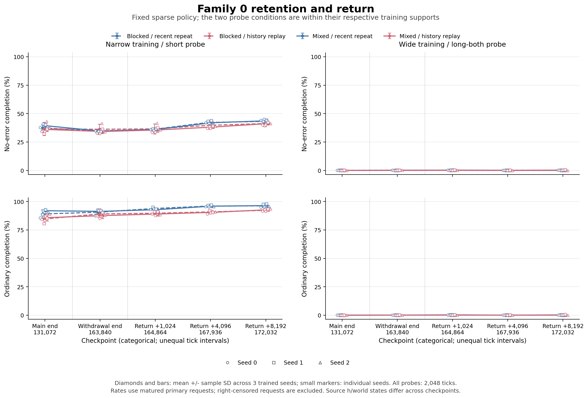
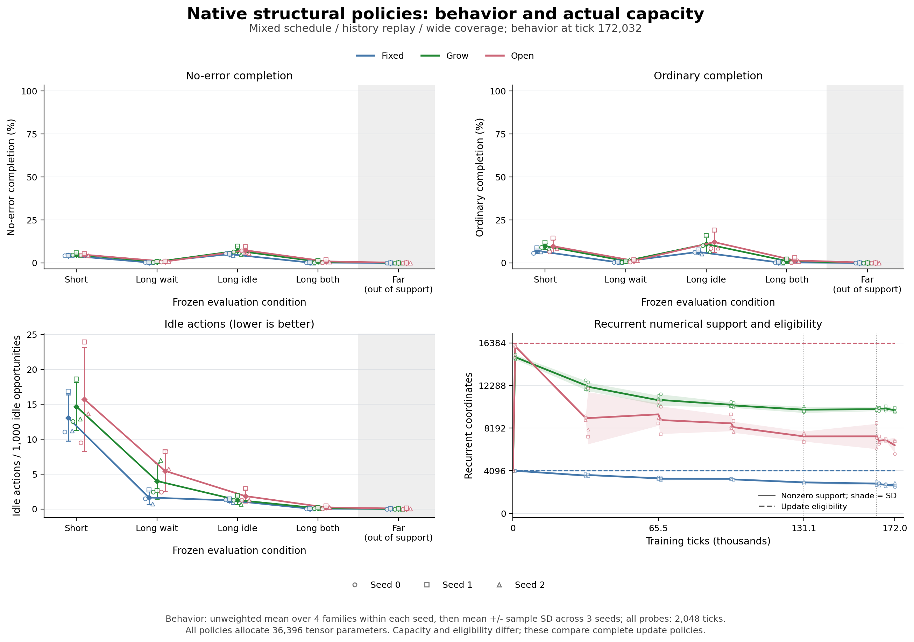
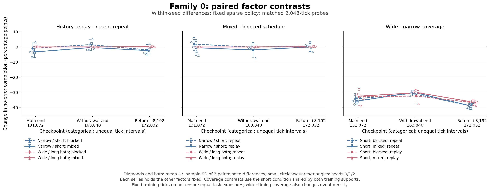

# 从随机出生开始的任务交错、历史复习与长间隔返回实验

协议及主训练日期：2026-10-29；补充测量与汇总：2026-10-30。接续[稀疏状态后的结构因素实验](factors-experiment-2026-10-29.md)。**已完成 30 组从随机出生开始的连续训练、390 个完整检查点和 1,860 个冻结评估分叉。独立训练种子仍为 3 个。**

本轮没有得到“交错＋历史复习＋原生生长就形成可靠长期记忆”的结果。窄范围内普通完成较高，但途中错误很多；历史复习减小了部分严格完成降幅，却没有稳定提高撤出后的绝对成绩。宽范围模型在撤出前就几乎没有学会长任务，主要瓶颈首先是能力获得。再生长很快扩展至接近全图，也未解决这一问题。下一步应先建立可靠的原生习得对照，再扩大缺席时长和拓扑比较。

本轮将用户优先提出的任务交错、历史复习、长时间缺席后返回，以及从出生就使用结构规则放进同一项实验。旧 A/B 条件主要改变等待与空档范围，本轮另外加入四套具有部分共同、部分冲突映射的任务规则。控制器仍是同一类连续循环模型，任务仍共享请求处理协议；复杂组合任务和层级拓扑尚未得到完整检验。

原始[主协议](evidence/lifelong-2026-10-29/study-protocol-v1.json) SHA256 为 `7cb8cb76eee72759bb12687242fe4221705387cf32280ed8e08d4b6cbbda86e8`；其后只增加冻结测量的[覆盖补充协议](evidence/lifelong-2026-10-29/coverage-probe-supplement-v1.json) SHA256 为 `140903657a65833567e397b8adde6e89ea25f7e88a76a402e01ed77854323a69`。两份协议保留独立来源绑定，原主协议不回写。补充协议声明于正式评估分数检查之前，当时部分训练分支已经完成；它没有改变训练、检查点或原定评估。

## 1. 真实任务规则与公开信息

实现见 [world.py](../experiments/lifelong/world.py)。每个 NEW 随机产生原始符号 `raw∈{0,1,2,3}`，同时指定一个 family；合法 FINISH 的目标符号由以下映射决定：

| family | raw=0 | raw=1 | raw=2 | raw=3 |
|---|---:|---:|---:|---:|
| 0：原样 | 0 | 1 | 2 | 3 |
| 1：交换 0、1 | 1 | 0 | 2 | 3 |
| 2：交换 2、3 | 0 | 1 | 3 | 2 |
| 3：循环前移 | 1 | 2 | 3 | 0 |

公开观察始终给出原始符号，不把映射后的答案放进 payload。每槽原有 24 项观察保留位置，追加 4 项 family one-hot，四槽共 112 项输入。family 提示仅随 NEW/REPLACE 指令出现一次；之后没有持续任务编号、内部计时器、准备完成标签或目标答案。版本号、CANCEL、上一动作和接受/拒绝回执沿用旧定义。控制器必须保留指令内容，并在需要时使用相应规则。

family 在 NEW 时确定。待发生的 REPLACE/CANCEL 继承这个 family，REPLACE 的公开 payload 仍是新的原始符号。切换训练课程只改变未来 NEW；当前合同、已抽取的修改事件与空档、回执和时钟均继续。基础调度器保留原始符号，只有私有评分状态使用映射目标。每个 actor/槽拥有独立的 context RNG；固定 family 与混合 family 都在每次 NEW 消耗一次 context 抽样，事件摘要包含真实 context。

这四套规则让同一原始符号在不同 context 下可能要求不同答案，超出了单纯 A/B 时间分布切换；它们仍不是四个互不相关的现实领域。特别是被撤出的 family 0 为原样映射：family 1 在符号 2/3、family 2 在符号 0/1 上仍提供相同对应关系，共享请求协议也持续练习。因此本轮保持包含情境规则及共同成分，不能等同于完全独立领域的专有知识保持。

## 2. 共同随机出生与三种结构规则

实现见 [run.py](../experiments/lifelong/run.py)，复用冻结的 [AgentModel](../experiments/continuity/model.py)、[FactorOperator](../experiments/factors/structure.py) 和[再生长算子](../experiments/rewiring/plasticity.py)。每个种子从随机参数出生，同种子的各分支具有相同编码器、动作头和初始循环函数。循环矩阵每行随机保留 32 个输入，宽度 128，保留权重乘以 `sqrt(128/32)=2`；初始循环非零数为 4,096。h 只在出生时置零，不接入旧 B 检查点。

| 结构条件 | 从出生即确定的允许集合 | 每次 Adam 后 | 精确零位置的后续资格 |
|---|---|---|---|
| `fixed_shrink` | 初始 4,096 个位置 | 软收缩 `2e-4` | 初始允许位置继续可更新；其余禁止 |
| `grow_shrink` | 原生动态允许集合 | 同样收缩 | 沿用退出及影子提案再生长规则 |
| `open_shrink` | 全部 16,384 个位置 | 同样收缩 | 所有位置允许普通 Adam 更新 |

三种策略从第一次优化更新开始执行，没有先训练共同 B 再附加结构算子。grow 沿用每 8 次更新检查影子提案、精确零退出及出生接续的既有实现；本轮没有额外修复影子年龄或新生边共享 Adam 年龄的问题。

所有模型宽度 128、输入 112、四槽各 11 类动作，共分配 **36,396 个参数**。必须区分分配的稠密张量参数数、循环允许位置数、实际 `W!=0` 数及累计出生/退出数。open/grow 的实际容量轨迹可能不同；其比较检验完整更新策略，不能单独解释为相同边数下的纯连接位置效果。较少非零数也不代表已经实现相同比例的实际计算或存储节省。

## 3. 课程、撤出与返回

[schedule.py](../experiments/lifelong/schedule.py)规定每分支连续运行 172,032 tick，`dt=.25`，32 个 actor、四个槽。阶段边界仅改变未来 NEW 的 family 抽样，不重置 h、世界、优化器或历史。

| 阶段 | tick 数 | 未来 NEW 的 family |
|---|---:|---|
| 主训练 | 131,072 | blocked 或 mixed |
| 撤出 family 0 | 32,768 | 从 1、2、3 中抽样 |
| family 0 返回 | 8,192 | 固定为 0 |

blocked 主训练有四个 32,768 tick 宏周期，每周期四个 8,192 tick family 块。各种子以私有 RNG 产生初始顺序，随后逐周期轮换顺序，使四个 family 在四个位置各出现一次。mixed 则在每次 NEW 从四个 family 中抽样。二者拥有相同名义训练 tick，不保证每个 family 有完全相同的实际请求数或最近一次曝光时间。课程差别仅在主训练；撤出和返回阶段使用同一规则。轮换平衡了每个块位置出现的次数，没有匹配主训练结束时的最近接触时间，因此比较的是完整课程策略，不能单独归因于纯交错频率。

撤出边界后，旧 family 0 合同及其待发生 REPLACE 仍可继续；历史复习也可以继续训练 family 0。因此 32,768 是预定的 future-NEW 撤出长度，不能直接写成“完全没有 family 0 信息的时长”。每份检查点分别保存：各 family 最近一次实际 NEW/REPLACE 的 tick 和环境时间、最近 live 监督位置的 tick、最近辅助 suffix 监督位置的更新边界，以及实际命令数和监督位置数。live 监督位置按该槽保留的 family 归属计数，包含对应槽的 WAIT；它与 NEW/REPLACE 数量不是同一分母。辅助记录还保留原历史块的时间范围与年龄。

## 4. 匹配的最近重复与全生涯历史复习

每 128 个 live tick 进行一次更新，TBPTT 长度 128，数值 h 跨块保留。live 轨迹始终执行模型在全部 11 类动作上的 argmax；midpoint 因果教师只提供训练标签，不替控制器选择动作。目标为带权 CE，WAIT 权重 `.1`，其他动作权重 1。

两种学习条件都在同一份更新前参数上计算 live128 梯度与辅助 suffix128 梯度，取两个各自归一化目标梯度的等权平均，再按允许集合处理循环梯度、联合裁剪至 1、执行一次 Adam，最后执行结构规则。Adam 学习率 `.001`，无权重衰减。每个 live 块均只有一次 Adam；辅助工作有明确计算成本。

`recent_repeat` 使用最近的连续 256 tick 真实历史：前 128 tick 以当前参数无梯度重构，后 128 tick 计算辅助梯度。`history_replay` 从当前 live 块之前的已保留历史中抽取同样长度的块，使用相同 warmup/suffix 口径。最初一次只有 128 tick，辅助也只有这个 suffix；第二次历史条件回退到最近 256 tick，避免使用尚未准入的未来历史。之后历史条件可以抽取完成且不与当前 live 块重叠的块。

[replay.py](../experiments/lifelong/replay.py)把完整生涯按不重叠 256 tick 块准入容量 32 的均匀 reservoir，准入/替换 RNG 与抽样 RNG 分开，课程切换不清空。准入发生在本次优化之后，保存真实观察、原因果标签、实际动作、间隔、起始 h、family 归属与摘要。辅助分支从保存的起始 h 重放观察；其 h 不覆盖 live h，不重新驱动 live 世界，也不生成新的闭环经验。保存的起始 h 来自旧参数，warmup 是有限重构，不能声称精确恢复无限历史。

## 5. 因素矩阵与时间覆盖

三个种子为 0、1、2。固定结构交叉课程、复习和覆盖：`3×2×2×2=24` 个分支。另在 mixed、history_replay、wide 条件下，加入 grow/open 各三个种子，共 6 个原生结构对照；合计 **30 个分支**。结构条件没有在全部课程与覆盖组合上交叉，不能据此推断尚未运行的结构交互。

| 训练覆盖 | NEW 处理时长 | 合同结束至下次 NEW 的空档 |
|---|---|---|
| narrow | 1–4 | 0.5–2 |
| wide | 1–16 | 0.5–32 |

覆盖范围独立于 family；同一 family 不绑定特定等待范围。窗口范围 1.5–2.5，取消概率 `.20`，替换概率 `.30`。固定 tick 下 wide 同时改变时间支撑与事件密度，实际 NEW、最终有效请求、每 family 监督与复习年龄可以不同。匹配的是 actor 数、live tick、TBPTT 与每块辅助计算口径，不能概括为全部训练预算和曝光都已匹配。处理时长和空档都有随机范围，但观察步长仍为 `.25`，主训练块长度、撤出长度和生长检查周期固定；本轮没有测不规则观察间隔或多个缺席长度。

## 6. 固定快照、冻结评估与补充测量

原主协议预定 13 个快照/分支，共 **390 份检查点**，包括出生参数检查点 0。评估时间由协议事先固定，覆盖早期、宏周期端点、撤出前后及返回过程；不根据分数选择最佳快照。**tick 0 没有行为评估**，出生时只验证共同参数绑定，不能写成已经测量了随机出生行为。

[evaluate.py](../experiments/lifelong/evaluate.py)从每份完整检查点复制模型、h、世界、待发生事件和 RNG，在 CPU 冻结参数后执行模型自己的 11 类 argmax。只改变分叉后未来 NEW 的 family 与时间范围，没有 oracle 输入、动作门控、隐藏状态重置或参数更新。严格完成、普通完成与空闲误动作均保留；成熟请求、继承请求、旧合同 carryover 和右删失分别记账。actor、请求及多个快照不增加训练种子重复数。

| 评估条件 | 处理时长 | 空档 |
|---|---|---|
| short | 1–4 | 0.5–2 |
| long_wait | 8–16 | 0.5–2 |
| long_idle | 1–4 | 16–32 |
| long_both | 8–16 | 16–32 |
| far | 16–32 | 32–64 |

主协议每分支 46 个冻结分叉，共 **1,380 个**。其中早期及部分宏周期/返回测量为 1,024 tick，撤出结束和最终测量为 2,048 tick；这些原始测量全部保留，不把不同 horizon 直接当作完全匹配的纵向比较。

补充协议增加每分支 16 个、共 **480 个**冻结分叉，均为 2,048 tick：在主训练结束 131,072、撤出结束 163,840、返回 +1,024/+4,096 的预定检查点补足 short 或 long_both；与原本已有的撤出结束 long_both 及最终 +8,192 测量共同形成同 horizon 比较。short 提供 narrow 支撑内纵向测量，避免只用 narrow 未覆盖的长间隔判断遗忘。family 0 保持及返回学习是主要问题，其他 family 为对照。总计划为 **1,860 个冻结分叉**；分叉数不等于评估进程作业数。

命令清单分别见[主训练](evidence/lifelong-2026-10-29/training-commands-v1.json)、[主基线](evidence/lifelong-2026-10-29/baseline-commands-v1.json)、[主评估](evidence/lifelong-2026-10-29/evaluation-commands-v1.json)，以及[补充训练依赖](evidence/lifelong-2026-10-29/coverage-training-commands-v1.json)、[补充基线](evidence/lifelong-2026-10-29/coverage-baseline-commands-v1.json)、[补充评估](evidence/lifelong-2026-10-29/coverage-evaluation-commands-v1.json)。补充训练清单承接既有训练依赖，不表示追加一轮参数训练。

## 7. 证据状态与解释边界

已保存的[初始机械测试记录](evidence/lifelong-2026-10-29/tests-initial.xml)为 110 项通过。[最终联合回归](evidence/lifelong-2026-10-29/tests-final.xml)共 **716 项全部通过**，包含旧 598 项与新增 118 项，无跳过；正式检查点、分叉、分母与谱系核验数量在下文报告。[机械烟测 v2](evidence/lifelong-2026-10-29/mechanical-smoke-v2.json)记录四种配置各 8,192 tick 的实现检查，以及 context 摘要修订前后的核心状态一致性；它没有替代正式结果，也不用于按验证分数选择设置。

首轮回归有两项报告测试失败：新增绘图和收尾脚本被临时协议的目录扫描收入，超出了冻结主协议的来源集合。修复只限定测试夹具按原有来源创建临时协议，没有修改正式来源校验、训练、世界或评估。原[失败记录](evidence/lifelong-2026-10-29/tests-regression-attempt-001.xml)、修复后的[28 项报告测试](evidence/lifelong-2026-10-29/tests-report-fixture-fix.xml)及[独立代码审查](evidence/lifelong-2026-10-29/independent-code-review.md)均保留。

用户提供的 AI 评议附件已由主协议绑定，SHA256 为 `803710ab4ed8b926c7321678f9964480df06e6f000d150110abce16fb18f7dfa`。其中的判断用于提出可检查问题，不能作为本轮已经观察到的机制或效果证据。

严格汇总完成 **15,338,593 项一致性检查**，无错误；它核对 390 份检查点、全部主/补充分叉、真实历史及原因果标签、来源 h、RNG 抽样、分母和文件摘要。完整输入绑定见[汇总 JSON](evidence/lifelong-2026-10-29/aggregate-v1/report.json)，执行及最终文件绑定见[完成清单](evidence/lifelong-2026-10-29/completion.json)。检查数量不是独立实验数。

以下百分比为三个种子的均值；`±` 为种子间样本标准差，配对差先在同一种子内相减。纵向比较固定为相同条件、2,048 tick 的冻结分叉；成熟请求为分母，右删失请求另计。严格完成要求最终正确且途中无错，普通完成允许先错后完成。空闲误动作另用真实空闲行动机会作分母。冻结的是参数，分叉中的 h、世界与正常回执仍演化；没有使用历史库更新参数。这评价完整状态策略的保持，不单独识别权重记忆。

## 8. 窄范围：部分能力保持，历史复习没有一致优势

先看已覆盖的 short 条件和被撤出的 family 0。表中为严格完成率（%），固定稀疏允许图＋收缩：

| 主训练课程／辅助学习 | 主训练结束 | 撤出结束、尚未返回训练 | 返回 8,192 tick 后 |
|---|---:|---:|---:|
| 分块／近期重复 | 37.43 ± 2.63 | 34.73 ± 1.40 | 43.15 ± 0.92 |
| 分块／历史复习 | 36.52 ± 5.87 | 36.22 ± 4.56 | 41.24 ± 2.70 |
| 交错／近期重复 | 39.32 ± 2.10 | 34.60 ± 0.69 | 43.67 ± 1.61 |
| 交错／历史复习 | 36.00 ± 1.67 | 34.24 ± 1.84 | 41.21 ± 0.95 |

撤出期间，近期重复组的严格完成变化为分块 `−2.70 ± 1.24`、交错 `−4.73 ± 2.71` 个百分点；历史复习为 `−0.31 ± 2.19`、`−1.76 ± 1.65`。历史组降幅较小，但其撤出前水平也较低。撤出结束时，历史减近期的绝对差仅为分块 `+1.49 ± 3.67`、交错 `−0.36 ± 2.25` 个百分点，不能据降幅单独宣称普遍更强的保持。

普通完成又呈现不同情况：分块近期 `89.12 → 90.64 → 96.27%`，分块历史 `84.61 → 89.14 → 92.30%`；交错近期 `91.94 → 91.39 → 96.45%`，交错历史 `85.83 → 87.70 → 92.80%`。撤出期间普通完成多数没有下降，主要变化涉及是否先犯错。因此“严格率下降”不等于相同比例的请求彻底不会完成。

进一步检查交错／历史／narrow 的最终 family 0：`51.59 ± 0.69` 个百分点的请求是出错后完成，首错为 wrong_payload 的请求占成熟请求 `53.29 ± 0.21%`，首错为过早完成仅 `2.03 ± 0.69%`。两项人群可以重叠，不能相加；前者按最终结果分组，后者按首错类别分组。当前短任务可靠性问题主要不能概括为“忘了等待”。可复算选择器、各种子分子分母和原始文件绑定见[诊断记录](evidence/lifelong-2026-10-29/diagnosis-v1.json)及[计算脚本](evidence/lifelong-2026-10-29/diagnosis_v1.py)。

交错相对分块也没有稳定的大幅优势：撤出结束时 family 0 的严格完成差，近期为 `−0.13 ± 0.73`，历史为 `−1.98 ± 4.82` 个百分点。课程本身已四轮重复，并且共享成分继续训练；本轮不支持仅靠更频繁交错即可大幅提高可靠性。

返回后四组均改善，但历史组没有更高的最终分数。这里没有匹配从零第一次学习 family 0 的实际曝光量，也没有冷启动速度对照，不能把返回曲线称为已证明的快速再学习或 savings。

图中横轴为类别检查点，实际间隔不等；空心点为种子、误差线为样本 SD。原始数据见[匹配纵向表](evidence/lifelong-2026-10-29/aggregate-v1/matched_memory_summary.csv)、[配对阶段变化](evidence/lifelong-2026-10-29/aggregate-v1/matched_temporal_contrasts.csv)。

## 9. 宽范围：首先是没学会，不能当作长间隔遗忘

wide 的 long_both 属于训练时间范围内。主训练结束时，family 0 的严格完成：四个固定结构组仅 `0.025–0.075%`，grow 为 `0.175%`，open 为 `0.100%`。因此撤出前没有形成可用于评价高水平保持的能力。wide 模型在 short 上也较差：相应六组 family 0 主训练末严格完成仅 `2.99–4.20%`，问题不限于更长测试范围。

最终 mixed／history_replay／wide 条件下，先在每个种子内平均四套任务，再跨三个种子汇总：

| 原生结构 | short 严格／普通（%） | long_both 严格／普通（%） | far 严格（%） | long_both 空闲误动作／千机会 |
|---|---:|---:|---:|---:|
| fixed_shrink | 4.25 ± 0.02／6.98 ± 1.62 | 0.19 ± 0.14／0.26 ± 0.23 | 0.01 ± 0.02 | 0.04 ± 0.04 |
| grow_shrink | 4.89 ± 0.85／9.81 ± 1.82 | 0.73 ± 0.67／1.10 ± 1.09 | 0.01 ± 0.02 | 0.11 ± 0.05 |
| open_shrink | 4.75 ± 0.67／9.69 ± 4.12 | 0.86 ± 0.76／1.42 ± 1.49 | 0.00 ± 0.00 | 0.24 ± 0.18 |

grow/open 比 fixed 的部分均值高，但绝对表现仍很低，grow 没有显示优于开放全部位置的清楚优势。不能沿用旧 B 后移植实验的好成绩，称这套收缩策略已经适用于从随机出生学习；旧实验与本轮还改变了输入、任务、批量及课程，不能跨研究只归因于“原生”。

空闲错误很少也不是成功。现有诊断表明这些组通常已经 BEGIN，但长任务在合法机会出现后仍未完成；此时低空闲错误与几乎不成功的控制可以同时出现。更强 WAIT 惩罚不是本轮已证实的解法。

同样选 fixed／交错／历史／wide、最终 family 0 的 long_both：所有成熟请求都已 BEGIN，`99.70 ± 0.30%` 有合法机会却未完成。在按种子汇总的合法完成时刻中，实际选择 FINISH 仅 `0.23 ± 0.16%`；限制在八个 FINISH 类内的内容＋版本读出正确率为 `13.98 ± 0.91%`，payload 和 version 分别为 `26.38 ± 1.32%`、`52.16 ± 2.19%`。这里的分母是 legal_finish 行动时刻，可包含未成熟/删失请求，不能与上述成熟请求率混用。结果同时显示行动选择和既有头的条件读出困难；条件头低分不证明整个 h 已无信息，也没有独立随机基线或单一原因干预。

完整五种条件和各任务见[原定主表](evidence/lifelong-2026-10-29/aggregate-v1/main_summary.csv)及[四任务平均](evidence/lifelong-2026-10-29/aggregate-v1/family_average_summary.csv)。不能把 narrow 在 long_both 的低分称为遗忘，也不能把 wide 的地板值差异称为长期记忆机制已改善。

## 10. 生长多，究竟说明了什么

同种子三结构从同一 4,096 边函数开始。仅第 8 次更新、tick 1,024，grow 的非零数已达 `14,844–15,282`，而 fixed 为 `4,089–4,095`。这是快速扩张，不是逐渐挑选少量新位置。最终 mixed／history／wide 的轨迹汇总如下；计数取三个种子的均值，初始化不计入出生事件：

| 数量 | fixed | grow | open |
|---|---:|---:|---:|
| 实际非零边 | 2,716 ± 220 | 9,914 ± 207 | 6,547 ± 731 |
| 允许更新的位置 | 4,096 | 9,914 ± 207 | 16,384 |
| 初始图以外曾首次启用的独立位置 | 0 | 12,288 | 12,288 |
| 最终仍非零的初始图外位置 | 0 | 6,986 ± 198 | 4,346 ± 595 |
| 累计数值出生事件 | 125,394 | 139,762 | 1,132,517 |
| 累计数值退出事件 | 126,774 | 133,943 | 1,130,066 |
| 其中再次启用旧位置的出生事件 | 125,394 | 127,474 | 1,120,229 |

grow 最终边数约为 fixed 的 3.65 倍，却没有建立可靠长任务能力。它和 open 都在运行中启用过全部 12,288 个初始空位；这不支持把当前规则描述为只找到了少数特别重要的新连接。表中“再次启用旧位置”＝累计出生减初始图外首次出生，包含初始坐标第一次归零后的恢复；不是“所有坐标第二次及以后的记录出生”，后者另以 `birth_events_minus_unique_coordinates` 保存。

另一方面，出生次数不能等同于新图位置。fixed 没有打开任何初始图以外的位置，仍有约 12.5 万次数值恢复；open 的归零/恢复次数甚至远高于 grow。高计数可以反映软阈值附近的反复跨零，不能单凭它证明拓扑很丰富、经验很多或某种策略一定不稳定。上述解释中的“阈值附近反复”是与记账相容的机制候选，不是已测得的完整逐边寿命分布。

日志保存每次更新的总数、逐行数和容量，以及检查点的矩阵、初始连续存活和曾出生集合；没有每次生灭的逐坐标时间表。故不能恢复全部活跃寿命。当前非零边也不都具有相等的功能影响，张量分配仍相同。原始轨迹汇总见[检查点表](evidence/lifelong-2026-10-29/aggregate-v1/checkpoints.csv)和[最终结构表](evidence/lifelong-2026-10-29/aggregate-v1/training_per_seed.csv)。

## 11. 实际经历、整体控制与本轮解释边界

相同总 tick 下，narrow 实际 NEW 约 `977,704 ± 316`，wide 约 `204,972 ± 215`，后者约为前者 21%。这是 32 个 actor × 4 槽的实际事件合计，统计先按每个种子和 coverage 的唯一外源流计算，不能把多个分支当作更多独立种子。宽覆盖同时减少请求密度和改变目标分布，尚未匹配事件预算。

撤出结束时，按 `world.tick − last_tick` 的同一零基时钟计算，family 0 最后一次真实命令距当前为 `32,739–57,337 tick`，最后一次 live 监督为 `32,607–57,310 tick`。这些差异包括分块课程在撤出前已缺席的时间及边界残留请求。历史组此时仍可复习 family 0；它测试缺少新现场经历时复习是否保住能力，不是完全无信息的记忆衰减。复习监督位置包含 WAIT，不能当作独立题目数。

最终 narrow／short 四任务平均进一步说明取舍：

| 课程／辅助学习 | 严格完成（%） | 普通完成（%） | 空闲误动作／千机会 |
|---|---:|---:|---:|
| 分块／近期重复 | 44.11 ± 0.58 | 95.19 ± 1.06 | 18.34 ± 3.40 |
| 分块／历史复习 | 41.53 ± 0.97 | 90.42 ± 1.00 | 24.89 ± 0.30 |
| 交错／近期重复 | 44.42 ± 1.52 | 96.28 ± 1.49 | 14.99 ± 4.82 |
| 交错／历史复习 | 42.28 ± 0.74 | 90.60 ± 1.03 | 24.64 ± 1.52 |

本轮历史复习没有取得整体控制优势；这不推翻此前不同任务中的复习结果，也不能否定其他复习方式。它限定的是容量 32 的均匀历史块、有限 warmup、相同监督目标和本次课程。旧 h 加当前参数重构可能产生误差，但尚未单独干预；现阶段不能把负结果归因于这一项。

对用户五点的回答：

| 问题 | 本轮推进及仍未回答的部分 |
|---|---|
| 生长连接远多是否有问题 | 已确认快速扩张、全空位覆盖和大量重复恢复；更多边没有解决能力获得。尚未隔离容量、Adam/影子历史和连接位置的因果作用 |
| 缺少复习和交叉学习 | 已交叉比较两种课程与历史/近期辅助训练；本轮历史块复习没有一致整体优势 |
| 间隔较固定、任务少 | 已加四种条件映射及宽随机时长/空档；仍固定观察步长、只有一种撤出长度，尚无不规则长期生涯结论 |
| 结构不是原生 | 本轮从随机出生即执行策略，且同种子初始函数相同；结果显示旧保持配方尚不是成功的原生学习配方 |
| 复杂拓扑未完整验证 | 仍成立。本轮没有层级组合任务、转移深度或容量匹配的功能拓扑对照；不能从环和边的数量判定复杂计算 |

本次 AI 评议对旧 factors 的主要区分是准确的。其中“固定集合也保留了一部分普通完成”应保留：旧结果普通完成 `36.37% → 66.84%`，严格率却相近。现行主文档已将过宽的“固定集合本身不够”改为针对严格完成的表述；旧冻结报告及原始数据不改写。

## 12. 下一步：先验证能力获得，再验证长期保持

1. **补最小习得对照。** 保留本轮公开输入、完整状态、课程和训练预算，先比较出生即收缩与不收缩；必要时再单独比较单规则/多规则。强收缩、稀疏初始函数、条件任务复杂度和稀少有效完成监督都是候选原因，本轮未区分，不能先宣布某一项是根因。避免把旧 B 后的保持收益直接当作出生训练的最佳设置。
2. **让旧能力达到可测水平后，再做缺席和复习。** 轮换被撤出的 family，特别加入非原样规则；改变缺席长度，记录实际命令、监督和复习间隔。补事件预算敏感性比较，清楚选择匹配 tick 还是 NEW，不声称二者同时匹配。
3. **在这个基础上比较结构。** 先匹配或明确控制容量轨迹，再比较固定连接与生长位置；逐边寿命若成为问题，再添加相应记录。将深度或模块化放进需要多阶段组合的任务，而非仅凭当前小控制任务的边数选架构。

这些是待运行的下一阶段，不是本轮已做的干预。本轮没有自主重要性筛选、REM、前向局部学习、自评或学习到的复习调度，也未证明长期积累、复杂推理或 AGI。有效推进在于排除了过早的成功解释，并把当前首先需要解决的问题定位到可靠习得和执行。
