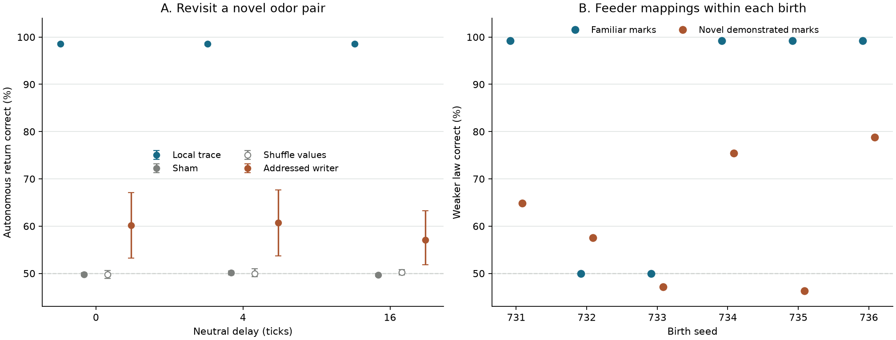

# 一次实际反馈能否改变下一次行动

20 节点自由有向循环图在陌生气味上获得一次正或负反馈，经过四拍等待并随机交换左右位置后，六个独立出生平均选对 **98.61%**。在同一批冻结个体上保留前向活动和全部时钟、关闭生内写入，正确率为 **50.11%**。延长到训练范围外的 16 拍，完整写入仍为 **98.55%**。带有不同含义的两个固定标记也能在同一生命里学习，六个出生中有四个把两种映射都学到了 99% 左右。

## 图怎样根据经历改变自己

图中每个节点保留两个发送迹和两个接收迹，共增加 80 个动态数值。它们从节点前后两拍的激活及其乘积更新，更新规则在全图共享，保留系数可学。中性等待期间活动照常演化，迹保持。收到味觉后，每个接收节点利用自己的接触活动、品尝活动及其变化生成带符号的调制信号。发送迹与受调制的接收迹相乘后，可以同时修改多条已有连接；偏置使用本地接收信号更新。增加和退出连接分别抽样，每次接触各最多一次，新增边取得自己的权重，破坏强连通的退出会被拒绝。存在位与权重分别保存。每个出生有独立的共享规则和出生图；这次共享规则由外层训练，生命内可改的是图的接线、权重和偏置。[实现](../experiments/pulse_game/local_trace_graph.py)

外层仍用 Adam。每次更新时，两个孪生世界给同一个出生相同的输入、左右布局和采样随机数，哪个选择有利恰好相反。个体自主发出早期动作，收到自己尝到的反馈，然后实际作出最终选择。外层用 **最后这个动作真实获得的 +1 或 −1**，乘以本条经历中实际采样的动作和结构编辑的对数概率，用 REINFORCE 更新。基线取同一出生其他独立世界对的平均收益。连续活动及已写入的数值可以通过以后的动作概率得到梯度。训练没有正确动作交叉熵、逐边目标更新、未来分叉给出的排序标签。终局之前，图看不到终局收益；独立评估全程关闭梯度。[训练器与采样目标](../experiments/pulse_game/local_trace_train.py)

对照包括把此前收到的反馈换成独立规则的反馈，以及用上轮的双候选写入器在相同预算、相同任务、相同 17 拍接触流程和相同终局收益目标下重新训练。气味和给料器分别拟合；六个出生、两种控制器、两种反馈条件、两项任务共 48 次拟合，每次 8,000 步、256,000 条生命。局部图有更多迹和每次接触的数值写入机会。等预算旧图对比衡量整套设计，剂量和落点的作用另在同一冻结个体上干预。

## 学到了什么



各图对应的分母、训练组对照、逐出生读数和文件指纹随[可携带结果](evidence/local-trace-2026-11-19/results.json)发布。

| 最终留出指标 | 局部图的实际选择或配对差 |
|---|---:|
| 陌生气味，等待四拍 | 98.61%，六出生配对重采样 95% 区间 [98.33%, 98.78%] |
| 正反馈后再选同一气味 / 负反馈后改选另一气味 | 98.39% / 98.83% |
| 位置未换 / 已交换 | 98.74% / 98.48% |
| 同一气味、相反反馈的两条生命都答对 | 97.22% |
| 局部图相对同预算旧写入器，等待四拍 | +37.89 个百分点 [30.90, 44.90] |
| 固定标记，两个映射合计 / 各个体较弱映射的均值 | 91.04% / 82.81% |
| 换成未训练过的标记、仍先体验两个标记 | 62.21%，较弱映射 61.68% |

在四拍气味回访中，只把个体第一次实际尝到的反馈反转，正确率从 **98.61% 降到 1.39%**。遮住反馈、或给它另一个独立世界的反馈，均为 50.00%。如果启蒙期间就持续给独立反馈，最终恢复真实反馈也只有 49.98%。这两组干预分别检验测试生命是否使用反馈，以及启蒙期间反馈和后果的联系是否影响了写法。

旧写入器只用终局收益重训后也有进步，陌生气味四拍为 **60.72%**。新的局部图中，较弱标记映射的六个逐出生成绩是 **99.22%、50.00%、50.00%、99.22%、99.22%、99.22%**。新标记上结果波动较大，局部图与旧写入器的差为 +9.43 点，95% 区间 [−0.65, +19.64]。主结果使用每个出生 192 个独立世界，再在世界内交叉规律和位置；区间以训练出生为单位计算。[完整冻结评估](../data/local-trace-20261119/eval-8000/summary.json)

## 是哪些改动起了作用

在陌生气味上保持拓扑编辑完全相同，仅重新分配最后一次写入的数值落点，正确率比正常写入低 **48.61 个百分点**，95% 区间 [47.68, 49.37]。4,608 条生命的数值更新数量和带符号数值均匹配，浮点舍入最大差为 1.19×10⁻⁷。把终局前的整个图参数替换为经历相反味觉的孪生个体参数，正确率降至 **1.65%**；只交换活动仍为 **98.35%**。这些干预说明选择确实使用了具体位置上留下的经验。位置打乱的结论采用保留物理拓扑事件的版本，因为重新指定退出地址有时会移除不同幅度的旧权重。[写入与交换干预](../experiments/pulse_game/local_trace_eval.py)

| 同一冻结图，从首次接触起干预全部写入 | 全部写入 | 仅已有边权 | 仅偏置 | 仅生退边 | 关闭写入 |
|---|---:|---:|---:|---:|---:|
| 气味训练 → 陌生气味 | 98.61% | 98.61% | 50.00% | 50.22% | 50.11% |
| 给料器训练 → 固定标记 | 91.04% | 91.03% | 51.64% | 49.93% | 49.98% |
| 给料器训练 → 新标记 | 62.21% | 62.59% | 51.19% | 49.98% | 50.04% |

在这两项短任务上，已有边权承担了可测的生内收益。生退边都曾实际发生。关于它们的更长期作用，这轮短生命没有给出结论。跨任务迁移也仍然弱：气味训练的图移到固定给料器得 47.27%，给料器训练的图移到陌生气味得 40.47%。[逐出生分量消融与跨任务测试](evidence/local-trace-2026-11-19/components.json)

## 时间和提交回执的作用

从同一个品尝后状态分叉，原先的双候选图在接下来的四拍提名过程中，对首次有利侧的独立线性读出为 52.86%，等时自然演化为 57.30%。提交后真实回执相对零回执使读出提高 1.18 个百分点，两者自然选择都接近 50%。在新的气味训练图中，六拍后等时自然演化与正常局部写入均保有较高的线性可读性，但再等待四拍后的实际选择分别是 50.24% 和 94.73%。这里用另一套独立采样并对首次动作、位置和反馈的组合等权；主评估按自然采样计分。能从状态读出信息与网络实际用它去行动，可以通过这组分叉直接区分。[等时分叉与独立读出](evidence/local-trace-2026-11-19/timing.json)

## 复现

使用 Python 3.14、PyTorch 2.11 和 NumPy。以下命令在项目根目录运行，各自写入新的输出目录。原始运行参数和源码指纹随[局部训练清单](../data/local-trace-20261119/local/run.json)与[旧写入器训练清单](../data/local-trace-20261119/legacy/run.json)发布。先用 Git LFS 取得逐世界评估文件。

```powershell
git lfs pull
python -m experiments.pulse_game.local_trace_train --out data/trace-replay/local --controller local --workers 4 --group-size 6
python -m experiments.pulse_game.local_trace_train --out data/trace-replay/legacy --controller legacy --workers 4 --group-size 6
python -m experiments.pulse_game.local_trace_eval --run data/trace-replay/local --legacy-run data/trace-replay/legacy --out data/trace-replay/final --pairs 192 --steps 8000
python -m pytest experiments/pulse_game/tests -q
```
