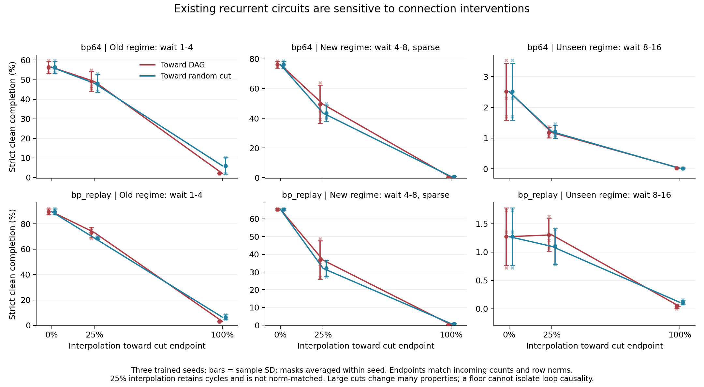
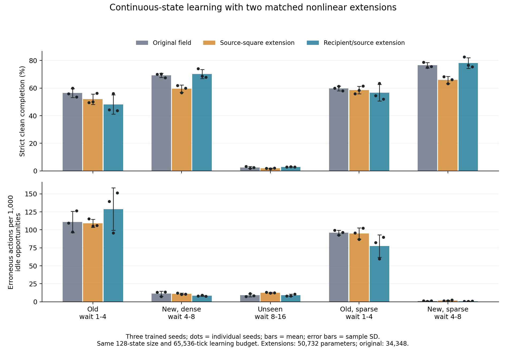

# 已有回路的作用与非线性循环场扩展

日期：2026-10-28。接续[连续状态、内容读出与时间信用实验](credit-experiment-2026-10-27.md)。实现入口见 [experiments/loops](../experiments/loops/README.md)。

**完成：9 个旧存档的 540 个诊断分叉，三种子、三臂共 9 组继续学习，以及 75 个新结构评估分叉；两个严格汇总均通过。**

原模型早已有多环路和不同长度的回路。新增两端状态交互比同参数的平方特征更适合新任务，但相对原小模型收益有限，旧能力保持更差，更远等待仍未解决。本轮没有证实“增加拓扑复杂度就能提高智能/参数比”，也没有实现连接自动增删。

## 1. 原模型已有不同长度的有向回路

原模型在输入脉冲之间积分 `dh/dt=-h+W tanh(h)`，随后注入一次 `encoder(observation)`，由 `head(tanh(h))` 产生动作。`W[i,j]` 表示来源 j 到接收者 i 的边。稠密的 128×128 W 已允许自连接、双向连接和经过三个乃至更多不同节点的回路。二元边不等于只有二节点回路。

非零支持为完整有向图时，2 至 128 个不同节点的简单回路都可能存在；实际精确支持及阈值图由存档确认。结构存在、状态附近的传播增益和任务所需记忆是三个层次。任何一个层次都不能单独证明某种长度的回路在存储内容，或某条路径负责多少表现。

九个实际存档均有 16,256 条非对角边和 128 条自连接，组成一个强连通分量；每个都有 8,128 个二节点简单环、682,752 个三节点简单环，且保证存在 2–128 各长度的简单环。这里的长度是经过的不同节点数，不是延迟 tick 数。“一层”描述状态更新的计算形式，不能据此认为网络只能沿一条固定环传播。

## 2. 图、加权闭合游走与瞬时状态

[structure.py](../experiments/loops/structure.py)在 CPU float64 副本上分析 W，不推进模型或环境。精确图使用 `W!=0`；另列 `|W|>0.001/0.01/0.1` 的描述性图。阈值矩阵没有替换自主评估中的模型。

图指标包含强连通分量、互惠边、二/三节点简单回路、最短不同节点回路及保证存在的简单回路长度。未列出的长度只有在标明穷尽时才能判定不存在。

对 W 和去对角矩阵，代码另列长度 2–8 的 `tr(M^k)`、`tr(|M|^k)`、符号抵消及共同尺度归一化值：

~~~text
s = ||abs(M)||_2，M=0 时用 1 作除数
normalized_signed   = tr((M/s)^k) / 128
normalized_absolute = tr((abs(M)/s)^k) / 128
~~~

trace 加总带起点的加权闭合游走，允许重复节点。仅两个互连节点也会在长度 4、6 的 trace 中贡献重复往返，不能据此称为四节点、六节点简单回路。去掉对角线排除了自环，仍未排除短回路重复。

每个检查点另取保存边界的前 16 个 actor，计算 `D=diag(1-tanh(h)^2)`、`R=WD`、`K=offdiag(R)`、`J=-I+R` 的范数、谱及相关闭合游走，并报告饱和导数分布。它们描述终点冻结线性化，没有测量跨时间变化的 Heun 切向传播，也没有把 trace 或谱半径换算成记忆时长。16 个状态样本不是独立训练重复，终点观察也不能代表整段轨迹分布。

## 3. 既有模型上的参数反事实

既有审计的[冻结协议](evidence/loops-2026-10-28/audit-protocol-v1.json)取三个训练种子，各自的 A、`bp64`、`bp_replay` 保存点，共 9 个来源。分叉继承完整模型、h、世界、时钟、预定事件、合同及回执，只改参数副本；学习更新次数为零。

mask 种子 11、29、47 使用独立 CPU generator，不改训练 RNG，不按分数重抽。`dag_cut` 按随机拓扑次序只保留从较早节点到较晚节点的非对角边，自连接不变。`random_cut` 对每个接收者保留相同数量的非对角边，随机选来源。

两种原始删除端点另各有行范数匹配版本：共同目标为每行 DAG/random 原始非对角 L2 范数中较小者，各自只缩小，不放大。`diagonal_only` 仅保留自连接，`none` 保留原 W。

完整稠密图的 DAG 端点会删掉一半非对角边，可能大幅改变动力学和可用输入。随机对照匹配每个接收者的保留边数；匹配行 L2 范数后，出度、谱、带符号输入平衡、特征分布和实际状态仍未匹配。随机图也可能无环，协议没有为制造有环对照而反复抽样。端点低分或全部落到地板，不能归因于去环，更不能推出被删信息不存在。

另用较小幅度的两组干预：

~~~text
W_dag_quarter    = 0.75 W + 0.25 W_dag_norm_matched
W_random_quarter = 0.75 W + 0.25 W_random_norm_matched
~~~

它们保留原有回路，不是温和去环；共同端点范数也不保证插值后范数相同。它们检查相近方向的小一些参数变化，仍不足以隔离纯拓扑效应。

每个来源在 `iid`、`long_sparse`、`longer` 各继续 1,024 tick，`dt=.25`，统一 CPU。第一个 mask 含 8 组，后两个各含 6 组，合计 27 个任务、540 个分叉。模型选择自己的 11 类 argmax 动作，评分观察器不代替模型行动。

统计先在训练种子内平均三个固定 mask，再在三个训练种子间算均值和样本标准差。配对差异在同种子、同 mask 内相减后平均；`none`、`diagonal_only` 每种子只算一次。未定义分母保留为未定义，不删去该 mask 后改变权重。actor 和 mask 不是新增独立训练重复。

已有 BP64 的严格完成率如下（%，三个训练种子的均值 ± 样本标准差）：

| 干预 | 旧条件 1–4 | 新条件 4–8、稀疏 | 更远等待 8–16 |
|---|---:|---:|---:|
| 原模型 | 56.34 ± 3.14 | 76.15 ± 2.24 | 2.51 ± 0.93 |
| 仅自连接 | 0.43 ± 0.19 | 0.00 ± 0.00 | 0.00 ± 0.00 |
| DAG，范数匹配端点 | 2.07 ± 0.18 | 0.13 ± 0.03 | 0.02 ± 0.02 |
| 随机删除，范数匹配端点 | 5.98 ± 4.16 | 0.73 ± 0.14 | 0.01 ± 0.02 |
| 向 DAG 端点插值 25% | 49.07 ± 5.13 | 49.41 ± 12.94 | 1.18 ± 0.17 |
| 向随机端点插值 25% | 48.15 ± 4.55 | 43.45 ± 5.54 | 1.21 ± 0.22 |

这说明现有控制行为依赖神经元之间的耦合。它没有干净地隔离多节点环的独立贡献：大幅随机删除也几乎摧毁新条件表现，温和插值中 DAG 方向又没有一致劣于随机方向。端点结果有明显地板效应，不能把差异解释为“环越多越好”，也不能把未分出差异解释为环没有作用。完整 A/BP/重放三组数据、每个种子的配对差异和结构统计见[审计汇总](evidence/loops-2026-10-28/audit-aggregate-v1/report.md)。该诊断为 1,024 tick，后续主比较为 2,048 tick，两个表的分母不同。

## 4. 从完整 A 存档加入新非线性项

新增比较从相同三个 A 存档分叉，不使用删除实验后的参数。两种扩展均保留 128 维持续状态、原编码器和动作头：

| 分支 | 第 i 个自主场分量，`r=tanh(h)` | 新增参数 | 总参数 |
|---|---|---:|---:|
| `baseline` | `-h_i + sum_j W_ij r_j` | 0 | 34,348 |
| `source_square` | 原场 `+ sum_j V_ij r_j²` | 16,384 | 50,732 |
| `interaction` | 原场 `+ r_i sum_j V_ij r_j` | 16,384 | 50,732 |

source-square 给来源活动平方增加独立权重；interaction 把接收者活动与来源活动相乘。因此 i≠j 时，interaction 的瞬时混合二阶偏导可为 `V_ij(1-r_i²)(1-r_j²)`，原场及 source-square 的对应偏导为零。这是瞬时场的代数性质；原稠密非线性网络经过多步演化本来就能形成复杂依赖。

source-square 区分“多了一块参数和另一种非线性来源特征”与接收者/来源乘积的差别。两种扩展每次场计算都执行 W、V 两次稠密矩阵乘法，另有逐元素平方或乘法。匹配新增参数和主要稠密运算，不等于特征分布、梯度条件性、裁剪行为或训练总开销相同。两者都加入关于 h 的偶函数项，都会破坏原场奇对称性。

对不同节点 i、j，交互组的瞬时影响为 `∂f_i/∂h_j=(W_ij+r_i V_ij)(1-r_j²)`。因此接收者的状态也能改变这条边的作用强弱，甚至符号；原场则为 `W_ij(1-r_j²)`。它允许状态依赖的功能连接，但不把这种变化冒称为物理连接的自动新建或删除。

分叉时 V 精确为零，旧 Parameter 和 Adam 对象继续使用，旧动量不重建，不额外消耗 RNG。W、编码、读出、h、世界、时钟、回执和旧经历库全部继承。V 以相同超参数进入新 Adam 参数组，初始没有历史矩。零初始化保持起点函数；V 的梯度仍参与首次联合裁剪，不同臂旧参数的第一次更新不必相同。

[model.py](../experiments/loops/model.py)在两个 Heun 场阶段都使用完整新场，观测只在积分后注入一次。baseline 直接调用原积分实现，保留原计算图的浮点累加次序。[train.py](../experiments/loops/train.py)以独立版本包装旧 CreditTrainer，没有更改旧训练实现。

这里增加的是既有完整图上的非线性相互作用。没有新增隐藏层、神经元出生、连接剪枝、离散路由选择或学习稀疏拓扑，也未实现局部信用规则或模型自评。

## 5. 继续学习与冻结评估

[extension_study.py](../experiments/loops/extension_study.py)要求既有审计完整通过，再冻结三臂协议与有限清单。三个种子、三个分支共 9 组，各继续 65,536 tick，每 64 tick 一次 BPTT、联合裁剪及继承 Adam 更新，共 1,024 次更新。边界只截断梯度图，保留 h 数值；A 经验库保留，但本阶段不读取旧块学习。

未来 NEW 等待范围为 4–8，最终合同截止至下次 NEW 的空档为 4–12；取消周期以 CANCEL 时刻作为空档起点。空档不是相邻 NEW 的完整间隔。已有合同与预定事件维持原历史。标签来自每条分支行动前的外部因果教师，模型执行自己的 argmax。

训练时间步从源存档继承；已现场核验三个种子的 `train_dts=[.25]`。构造器默认候选时间步不代表正式存档配置，本说明不据默认值声称循环训练多个时间步。最终评估统一 `dt=.25`。

每个最终检查点冻结，在 CPU 分出五个 2,048-tick 副本：

| 条件 | 未来 NEW 等待 | 最终合同截止至下次 NEW 空档 |
|---|---|---|
| `iid` | 1–4 | 0.5–2 |
| `long_wait` | 4–8 | 0.5–2 |
| `longer` | 8–16 | 0.5–2 |
| `sparse` | 1–4 | 4–12 |
| `long_sparse` | 4–8 | 4–12 |

`longer`、`long_sparse` 另做最大 Heun 子步从 `.25` 缩至 `.125` 的检查；两个扩展臂另做已学习 V 置零。计划共 45 个自主分叉、18 个积分细化分叉、12 个 V 消融分叉。V 置零保留该臂训练后的 W/编码/读出和原 h，不等于重训 baseline，也不把状态切回从未使用 V 的历史。

主指标为分叉后新环境产生、完整截止窗口已成熟且最终有效请求的无错误完成率。普通完成另列；继承请求、旧合同后续替换和右删失分别记账。已完成但窗口未结束的请求也不提前进入成熟分母。空闲误动作同时按空闲机会与全部启用槽机会报告。

同一保存点干预核对起始 h、世界、生成器及外部请求。不同动作会改变后续回执，不要求所有公开观察相同；外部事件和成熟请求指纹仍需配对。旧 `bp64` 终点仅作带字节哈希的历史参照，不能用其他历史运行替代本次协议的新 baseline。

## 6. 三种连接形式的实际成绩

以下均为新一轮 2,048-tick CPU 自主评估，严格完成率单位 %；均值 ± 样本标准差，三个训练种子。完整分种子记录见[主表 CSV](evidence/loops-2026-10-28/extension-aggregate-v1/main_summary.csv)与[汇总 JSON](evidence/loops-2026-10-28/extension-aggregate-v1/report.json)。

| 环境 | 原模型，34,348 参数 | 平方特征，50,732 参数 | 两端交互，50,732 参数 |
|---|---:|---:|---:|
| 旧条件，等待 1–4 | 56.39 ± 3.24 | 51.94 ± 3.82 | 48.05 ± 6.94 |
| 新等待 4–8，输入密集 | 69.19 ± 1.52 | 59.52 ± 2.65 | 70.21 ± 3.27 |
| 更远等待 8–16 | 2.49 ± 0.67 | 1.80 ± 0.23 | 2.92 ± 0.06 |
| 旧等待 1–4，输入稀疏 | 59.76 ± 1.68 | 58.57 ± 2.80 | 56.62 ± 5.96 |
| 新等待 4–8，输入稀疏 | 76.49 ± 1.98 | 65.84 ± 2.57 | 78.13 ± 3.81 |

交互组减去同参数平方组，新稀疏条件为 **+12.30 ± 2.62 个百分点**，三个种子分别为 +14.20、+13.38、+9.31；新密集条件为 +10.69 ± 2.38。连接的非线性形式确实改变了这一预算下的学习结果。但平方对照本身低于原模型，因此不能把这 12 个百分点当作相对旧架构的进步。

交互组减去原模型，新稀疏条件只有 **+1.65 ± 1.98 个百分点**，三个种子为 +3.72、+1.44、−0.22；旧条件则 **−8.34 ± 4.02 个百分点**，三个种子均下降。参数增加约 47.7%，没有换来全面收益；三种子的标准差也不等于总体置信区间。这里没有验证统一调参后的收敛上限。

8–16 等待的普通完成率，原模型/平方/交互为 **10.76 / 12.25 / 15.28%**，都高于各自严格完成率，表明有些请求经历错误动作后仍被完成。不能把低严格分数称为完全不会完成，但这一结果仍远未解决长等待的可靠控制。

空闲控制也没有全面改善。每千次空闲机会的误动作，原模型/平方/交互在新稀疏条件为 **1.10 / 1.76 / 0.80**，旧密集条件为 **110.96 / 108.96 / 128.84**，旧稀疏条件为 **96.18 / 94.97 / 77.34**。报告保留全部五种环境、普通完成和内容指标，避免用单个较好的成绩遮蔽其他行为。

## 7. 新连接是否真正被使用

从各自训练后的同一完整状态把 V 置零，新稀疏条件的严格完成率变化为：平方组 **−21.88 ± 6.43 个百分点**，交互组 **−37.86 ± 2.54 个百分点**。这支持训练后控制已经依赖新增项；它不说明新增项单独贡献了这些百分点，因为 W、编码器、动作头和 h 都与 V 共同适应了。移除后也没有变回原 baseline。

最大 Heun 子步减半时，18 个配对分叉中严格完成率的单种子变化绝对值最大 **0.465 个百分点**，没有消除更远等待的失败。18 条动作序列哈希全部改变，因此这里只能说所报告的完成指标对这次细化较稳定，不能说轨迹或模型数值完全不变，也没有证明连续时间极限已收敛。

终点实际 h 上，交互组新增场的 RMS 为 **0.169 ± 0.010**，其旧 W 场为 **0.723 ± 0.019**；平方组分别为 **0.131 ± 0.019 / 0.695 ± 0.030**。`|tanh(h)|≥.95` 比例，原模型/平方/交互为 **3.56 / 3.21 / 3.43%**。这次没有出现早先共激活组那样的终点大面积饱和；这些单一边界的描述不能替代整段活动统计或长期可塑性验证。

每组新增阶段仍为 65,536 tick、64 个并行 actor、1,024 次优化器更新，实时隐藏状态重置次数均为零。只计算循环矩阵的前向 MAC，原模型为 **137.44 billion**，两种扩展均为 **274.88 billion**；不含编码/读出、反向和 Adam，因此不能当成训练总 FLOPs。六个并发 GPU worker 下记录的分支训练时间均值为约 **270 / 324 / 315 秒**，运行尾部并发数下降；这不是隔离硬件条件的速度基准。[成本表](evidence/loops-2026-10-28/extension-aggregate-v1/cost_summary.csv)同时保存每个种子的值。

## 8. 来源、恢复与核验

协议冻结源码及来源哈希；启动清单绑定协议、分支、种子和来源。恢复校验 V、旧参数、Adam 分组/矩、h、世界、时钟和 RNG，继续同一累计目标。完整边界在首次更新前即保存，提供首次周期存档之前的恢复起点。

完成标记、检查点字节及语义哈希共同约束最终评估。CPU/GPU 迁移只规范化设备元数据，张量与保存的 RNG 仍参与语义比较。评估使用副本，核对源状态未变，拒绝覆盖已有结果。有限队列的失败恢复保留记录，不通过多次运行挑分数。

原始诊断位于 `data/loops/audit-v1/`，新增训练与评估位于 `data/loops/extension-v1/`；协议和紧凑证据位于 [docs/evidence/loops-2026-10-28](evidence/loops-2026-10-28/)。两次严格汇总分别执行 **153,786 / 290,701** 项一致性检查，错误均为空；这些检查验证存档和计数，不是独立科学样本。

三个新 baseline 与旧 BP64 的最终模型参数、Adam 矩、h、动作和数据哈希全部精确一致。原始世界哈希不相同，因为新阶段名为 `loops-B`、旧阶段名为 `credit`；仅去掉当前 regime 与 regime_history 中的 name 字段后，世界内容也逐项一致。完整检查点还有实验版本等元数据差异，因此不宣称完整文件相同。

最终 **407 项联合测试通过**，其中 loops 183 项、此前 continuity/integration/credit 224 项；测试记录与文件哈希见[完成清单](evidence/loops-2026-10-28/completion.json)。运行入口和有限断点恢复命令见[目录说明](../experiments/loops/README.md)。本轮正式队列全部一次完成，没有按分数重跑或筛选种子。

## 9. 下一步应针对什么

当前结果支持继续研究**连接作用怎样由状态调节、不同路径怎样承担可复用计算**，但不支持继续按环数量堆复杂度。全连接图本来就容纳许多路径；它缺少的可能是有用的组织方式、学习目标或跨长跨度的信用，而不是数学上的环。

下一轮可用要求多阶段依赖、分支合流与旧规则复访的持续任务，让不同计算路径有可区分的用途，再比较完整稠密图与可学习的稀疏组织。若做连接生长，应保留旧边逐渐失活的自由，不采用新增一条就强删一条；同时设置固定稀疏、随机生长和容量增加对照。该后续尚未实现，本轮不把条件相关的连接作用写成已获得自主拓扑演化。

更长等待仍需单独验证内容保持、时间判断和结束更新；不能因为旧任务下降就立刻添加保护阈值或多个记忆模块。结构存在、参数扰动、非线性表达与学习表现分别解释，长等待小任务的变化不足以证明通用推理或自主终身学习。
