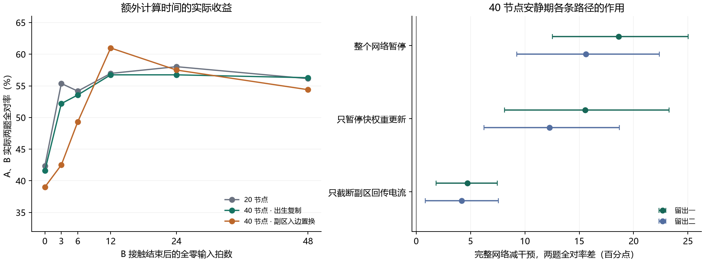

# 让持续运行的图在没有外部线索时计算

本轮先检验一次试写、两次显式重演能否保住新旧行为，再检验整张网络能否在没有回执缓存或外部重演程序的情况下取得行为收益。后者有两种不同的「复制」：出生时将一组神经元和连线复制到同一图里，或让副区在生命中每拍读取本体的现行权重、试运行身体自己正要采用的一份增量。

## 一个草稿、两次显式重演

先真实经历无关 C、旧 A 和新 B。所有试验组共享身体起点、三笔真实味觉、时钟及 B 产生的原生草稿。临时区域依次运行两次重演，使用本人曾选侧与尝到的味觉重建当时的目标方向。分别在写前图上重演 A/B，在写后图上重演 A/B，或在写后图上重演 C/B。外层训练只用最后所选的一份修订实际获得的 A、B 两次行动结果。修订只改变物理剂量配平的 B 权重写入地址；主生命保留同一连续活动，重演结果只能经最终图改变行为。训练预算为三组、每组两份独立复本，共 2,211,840 条实际路线。无关回执确实来自本人，但 C 在 A 之前接触，因而回执新旧程度也随替换而改变。[实现与等时干预](evidence/draft-rehearsal-20261120/physics.md) · [实际训练](evidence/draft-rehearsal-20261120/fit-results.md)

六个未参与选址训练的身体，在 256 个新几何上测试 15°、30°、奖惩相反的对象。A/B 双对率为原生全写 37.80%、等剂量随机地址 33.44%、草稿前重演 34.12%、草稿后重演 34.29%。后减前为 +0.17 [−0.45, +0.86] 个百分点。同一个草稿后头把 C 换回本人旧 A，双对差为 +0.16 [−0.39, +0.73] 点。草稿后组相对原生全写，旧 A 高 7.39 点，新 B 低 11.30 点；允许它原样接受草稿也没有稳定优于同接受率随机。预先约定的两对象门槛未达到，未开启让模型从 A、C 中自主挑一次回忆的后续选题实验。[主结果和重复接触](evidence/draft-rehearsal-20261120/eval-results.md) · [原样接受对照](evidence/draft-rehearsal-20261120/accept-results.md)

在相同草稿上，给冻结的诊断程序更多计算，用自己真实经历过的 A/B 比较多种修订后仅实际提交一个。独立六个体的双对率为 45.10%，相对同体原生全写 +6.88 [5.06, 8.71] 点；另一批 +7.88 [5.95, 9.90] 点。有限候选内确有更好的地址。因此，单草稿方法的阴性结果首先指向它读取和利用两次重演的方式。这里只能确定在所测候选和预算下发现了差距。[草稿邻域诊断](evidence/draft-rehearsal-20261120/neighborhood-results.md)

## 把第二组神经元直接放入持续运行的图

整个部署模型每拍接收 10 维物理输入，B 接触结束后连续 12 拍输入全为零，此后才会看到正式回访的菜单。两个区的活动、慢迹和已有边的快权重一直更新；没有旧菜单槽、题号、静默开始标记、读回回执的调用或候选分支搜索。快权重是本生可修改的数值。本组固定生内拓扑，出生权重和更新规则在训练中可学。三个出生分别配对比较，每种训练条件每出生 1,536 次 × 64 条真实生命。目标为实际 A、B 各自正确和两题都正确；前两次旧接触 A/C 的顺序和最后回访顺序均随机。训练的物理输入端和输出端位于第一区。

20 节点组的三个身体各有 207–230 条有向边。40 节点组把原图参数放入另一个 20 节点区，加 160 条双向跨区通路中的有向边，总数为 574–620。复制仅发生在出生时，此后两区各有自己的权重和状态。同规模的置换对照只打乱副区各入边的来源，保持每行的边数、数值和符号。在新的安静期动力学下，各组均从头训练开发期规则，与上节的冻结身体和时钟有差别，两节之间的绝对正确率不能直接相减归因。[模型与五种训练方案](evidence/native-rehearsal-20261120/protocol.md) · [逐拍代码](../experiments/pulse_game/native_rehearsal_graph.py)

另外两组与 40 节点复制组完全同构。只在开发训练中，让静默末四拍回到原生感觉端的内在电流接近旧 A 的有利方向，或接近无关 C 的方向。教学方向由身体的真实菜单、动作与味觉重建，教师知道哪件旧东西会被问；推理时移除教师。把 B 接触后的状态单独保存，在新进程仅加载神经状态（活动、快权重、慢迹）、出生参数与未来真实菜单，三组共 768 条生命的静默末态和 1,536 次实际回答均逐位复现。[新进程核验](evidence/native-rehearsal-20261120/stream-resume.json)

## 没有输入时网络实际做了什么

两个互相独立的留出世界库各 384 个新几何，使用相同三个训练出生。表为 15° 和 30° 的冲突条件，每条生命的两个原生动作都正确的比例。行为区间对身体和几何配对重抽样，两个世界库共享三个模型种子。

| 条件 | 留出一 | 留出二 |
|---|---:|---:|
| 20 节点 | 56.6% | 55.1% |
| 40 节点，出生复制，只用行动收益训练 | 60.9% | 58.4% |
| 40 节点，副区入边来源置换 | 62.2% | 59.4% |
| 复制组暂时关闭安静期的全部数值写入 | 45.3% | 46.2% |
| 复制组只截断副区向主区传回的普通神经电流 | 56.2% | 54.3% |
| 复制组让整个状态停留在 B 接触末端 | 42.3% | 42.8% |

关闭安静期写入使双对降低 15.56 [8.12, 23.26] / 12.27 [6.23, 18.70] 点。只截断副区回流使双对降低 4.72 [1.82, 7.45] / 4.17 [0.82, 7.56] 点；这个操作截断普通电流，局部快权重的调制通路仍在。40 节点复制相对 20 节点的差为 +4.26 [0.36, 7.68] / +3.35 [−1.43, 7.78] 点，复制相对同规模置换为 −1.33 / −0.95 点，两个区间都跨零。复制起点的独立优势尚未建立。[实际动作、状态互换与两套留出](evidence/native-rehearsal-20261120/behavior.json)

另取一套新世界只改变空白时长。复制组在 0、3、6、12、24、48 拍分别为 41.6%、52.2%、53.6%、56.7%、56.7%、56.3%。它能在空白期间改善后续选择，多等到 48 拍没有持续增加收益。此项是不同外界等待时间的干预，模型本身未决定何时结束。[改变静默时长](evidence/native-rehearsal-20261120/wait.json)

## 良好的安静期计算与针对旧经历的推演

我们从副区回到主感觉端口的实际电流里，测其中是否有本人过去学到的 A 的方向。用相同 B/C 的 A 反规律兄弟排除几何和近期 B 的共有部分，并在 C、B 的实际动作和味觉也一致时复验。只靠收益训练的复制组和置换组，静默晚期读数的区间都跨零。有教学的两组能测出 A 的残留方向，但没有稳定高于 B 接触尾部或静默早期。交换含有另一 A 经历的回流会影响一些行为；与逐拍等幅度的无关干扰相比，四种 40 节点组都没有通过旧 A 特异性判据。因此，对双答有帮助的回流和主动重现指定旧 A 的证据，需要分别陈述。[旧 A 方向与真实动作的针对性](evidence/native-rehearsal-20261120/reactivation-results.md)

从同一个 B 后活动与慢迹，外部诊断另做保留或撤去 B 写入的分叉。静默活动在新几何上可预测一些 B 的行为变化；对 A 不稳定。强对照已经知道旧迹、静默起点、草稿改量及撤去改动支路的静默信息，在此基础上再提供两支路的活动差，对 A、B 都没有稳定提升。强制换成同剂量的反号改写后，该读数也没有稳定迁移。这些分叉由诊断程序构造，受测图没有得到另一条路线的结果。[预测干预后果的专项检验](evidence/native-rehearsal-20261120/prospect-results.md)

## 让副区试算本体自己提出的候选权重

这一次，两组 40 节点图在整个生命中每拍都把本体当前的有效权重提供给副区。本体根据节点活动和发送迹产生一笔待采用的局部增量 D。在下一拍，一组让 D 先作用于副区的递归电流；另一组只屏蔽这条试算路径。两组的实际采用门都仍能把同一份 D 写入本体，兑现比例由副区活动经可训练连接产生。所有时段用同一方程。没有另外保存回执、指定 A/B 身份、触发模拟的外部指令，环境也不给被放弃路线的结果。这相当于把「试一笔自己的改动」接成图内机制。两个区怎样共享参数和传递 D 由实验设计提供。两种条件各三次初始化、每次 1,536 步，共 589,824 条真实训练生命。[回路和对照方案](evidence/native-rehearsal-20261120/trial-plan.md) · [实现](../experiments/pulse_game/native_rehearsal_trial.py)

| 15°、30° 冲突，真实两题都答对 | 留出一 | 留出二 |
|---|---:|---:|
| 副区先试 D | 58.96% | 58.22% |
| 同规模屏蔽副区试 D | 58.89% | 58.00% |
| 两组配对百分点差 | +0.07 [−5.63, +5.63] | +0.22 [−4.17, +5.11] |

冻结后只在静默期切断 D 的试算，对草稿本身的实际采用通路照常开放。终末主区快权重确实改变，每条生命取最大单边变化后求均值，为 0.00451 / 0.00459。自然状态相对切断后的双对差为 −0.07 / +0.39 点，换入同 B/C、旧 A 不同生命的候选也没有稳定改变双对。直接关闭采用门使新 B 大幅退步，但同时移除了实际写入量；最后一拍保持正负写量、只混排成功改过的位置，双对差约为零。前者表明实际写入对 B 很重要；两个效果都不能单独证明副区替本体挑对了更好的改法。[冻结干预、剂量与独立复核](evidence/native-rehearsal-20261120/trial-results.md)

目前可复验的是：在没有新感觉时，整张图仍能改写内部状态和权重，改善即将发生的动作；在生命中复制当前参数、试本体提出的一笔修改、再由内部神经活动控制采用量，这条物理路径也能实际运行。还没有证据把这些行为提升归因于模型主动重演了某个有用的旧情景、推断出两种改法的不同后果并选对。在三个训练出生和这个确定性两对象任务上的阴性结果，不能推广为更大网络或其他任务的能力上限。

15 个主训练终点的步数、起始更新复现、30 个核心新世界文件和 368,640 次自然动作已逐项核验。运行时代码和可加载检查点的位置见[复算入口](evidence/native-rehearsal-20261120/README.md)及[训练审计](evidence/native-rehearsal-20261120/primary-audit.json)。Pulse Game 回归测试共 364 项通过。
