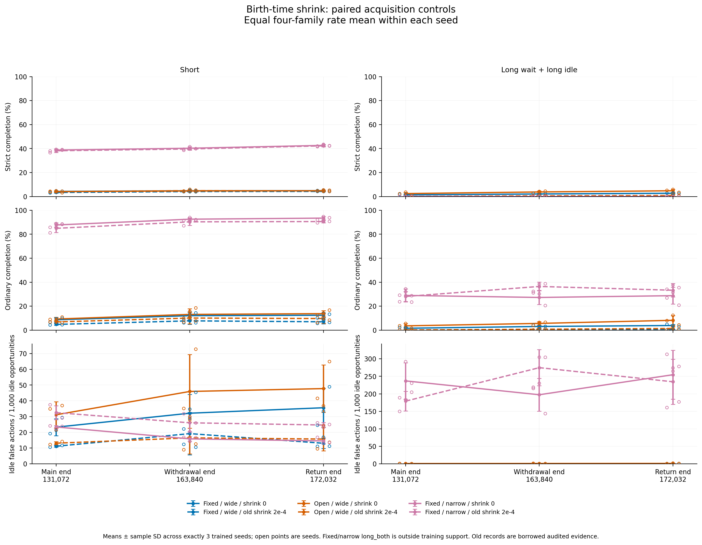
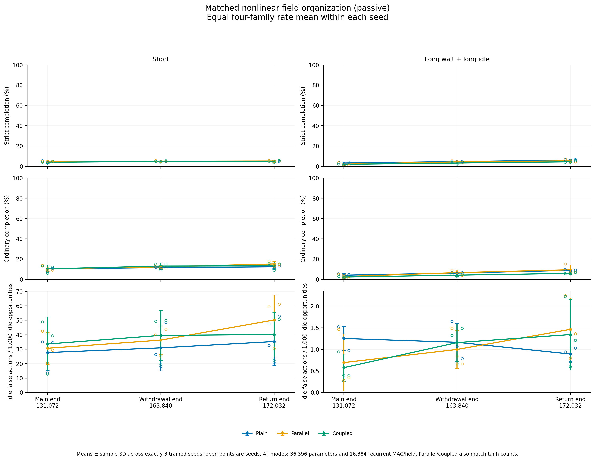
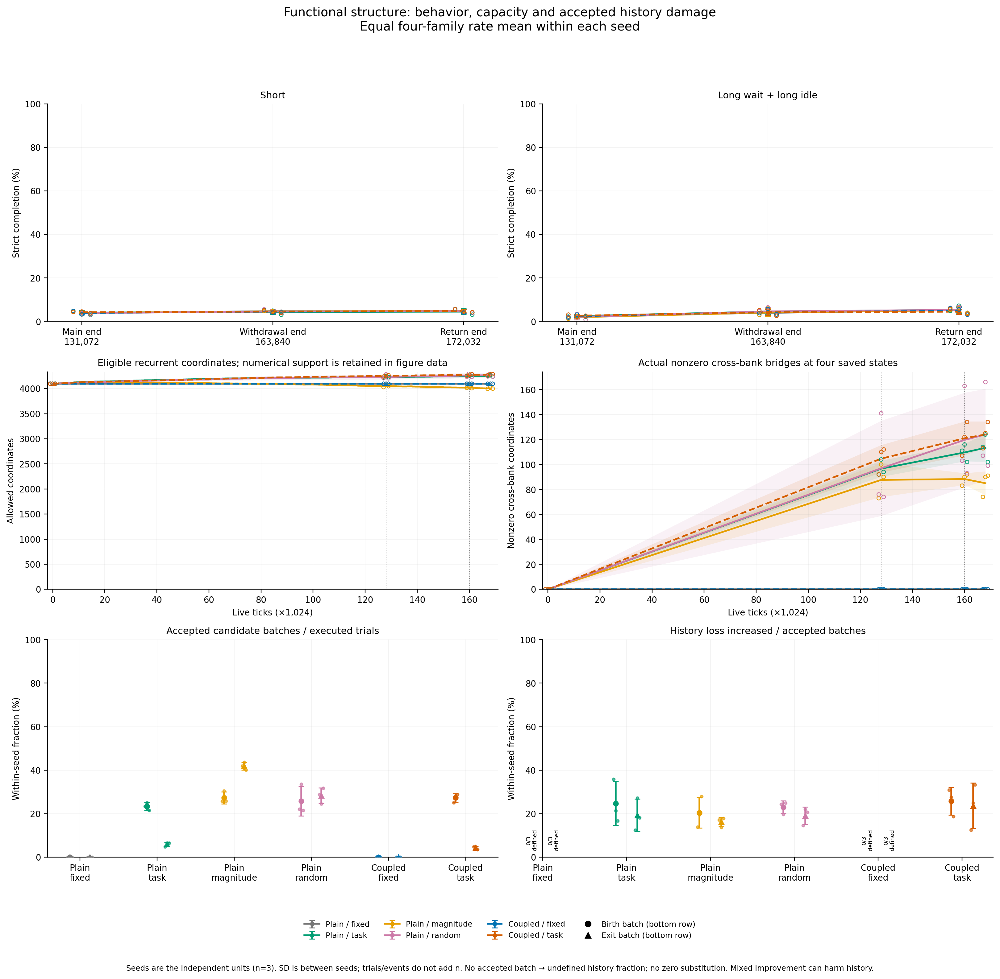

# 原生习得、非线性回路组织与功能性生长／退出

日期：2026-10-30。接续[原生任务交错与历史复习实验](lifelong-experiment-2026-10-29.md)。**已完成 36 组新训练、144 份完整快照、864 个新冻结分叉，另借用 216 个旧分叉作收缩配对。独立种子数为三个。** [代码与复算入口](../experiments/organization/README.md)，旧执行源码与原始证据保留。

取消收缩改善了部分长任务习得，但没有解决可靠完成。实际运行的两种更复杂非线性组织没有优于匹配 plain 的整体表现。新诊断揭示了许多全删提案会增加损失，并对出生和有限减弱执行真实损失复核；任务排名组最终没有实际退出连接，也未显示清楚的严格完成优势。当前证据支持继续研究功能损伤与复杂组织，尚不支持把这套规则称为有效的自主长期记忆机制。

上一轮 wide 模型在撤出前就没有可靠习得长任务，不能用之后的地板分数评价长期遗忘。本轮同时推进三项受控比较：先检查出生即收缩是否妨碍习得，实际比较更复杂的非线性回路，再用真实任务损失检验生长和退出候选。功能聚集仍需功能性证据，图上的分组或边数不作替代。

## 1. 对生长、退出与退火类比的判断

旧规则把活边统一向零缩，并在每个结构窗口接纳全部非零影子提案。它没有估计移除某条连接会损害多少当前或历史功能，也没有以功能聚集为优化目标。此前某些对照中，收缩/限制更新位置减少了旧能力损失；另一些条件存在适应和控制代价。因此不能把每次退出都解释为遗忘，也不能把已有保持收益解释为找到了无用连接。

生长可以打开固定可塑子空间以外的优化方向；退出可以减少不利或冗余的作用。让二者依据同一任务效用比较，是可检验的设计。模拟退火还包含随机提案、温度及一定条件下接受更差状态的规则；本轮方法没有这些完整条件，不声称是模拟退火或具有其收敛保证。

原始研究核验见[研究笔记](evidence/organization-2026-10-30/research-notes.md)：

- [DeepR（2018）](https://arxiv.org/html/1711.05136)把结构重连放进随机采样过程；其中 soft-DEEP R 不施加全局固定边数。它支持自由容量方向，但其温度、先验和噪声不是当前影子 Adam 的理论保证。
- [RigL（2020）](https://proceedings.mlr.press/v119/evci20a.html)用幅度删除和梯度生长更新稀疏连接，保持固定预算。本项目不把等量增删作为主线约束。
- [GateON（作者稿）](https://arxiv.org/html/2306.01690v2)从删除造成的损失变化及 Taylor 近似构造相关性。局部导数可以筛选候选，但梯度接近零的已学连接仍可能非常必要，不能省略真实损伤复核。
- [模块化增长 RNN（2024 作者稿）](https://arxiv.org/html/2406.06262v1)实际比较模块内循环和模块间连接，其方法同时使用课程、复制与旧模块冻结。这是推进复杂连接的依据，不能把联合效果单独归因于拓扑。
- [Geometric sparsification（2025）](https://www.nature.com/articles/s44387-025-00013-x)说明几何相关稀疏组织值得实测；其正则化与剪枝方法并不等于本项目已形成自主功能模块。
- [Rethinking DST（2025 作者稿）](https://arxiv.org/html/2510.12096v1)比较不同网络部分的动态策略；不同作用部分不必适用同一重连规则。这里按可访问作者稿引用，不宣称已核实最终会议状态。

## 2. 习得对照：只取消收缩

[acquisition.py](../experiments/organization/acquisition.py)直接调用冻结的旧 `lifelong.NativeTrainer`。新增三组条件，各三个种子：mixed／history_replay 下的 fixed-wide、open-wide、fixed-narrow；只把 `shrink_step` 从 `2e-4` 改成 0，其余配置与各自旧分支完全相同。旧九个分支作为只读配对来源，不重复训练。

每种子比较出生权重、h、世界、空 Adam 与随机来源绑定。仍连续训练 172,032 live tick：主训练 131,072，family 0 撤出 32,768，返回 8,192。每 128 tick 更新一次，数值状态跨阶段保留。历史/近期损失口径、WAIT 权重、处理时长、空档和观察步长沿用上一轮。

每分支保存出生、主训练末、撤出末和返回末四份完整快照。三个非零快照分别评估四种 family × short/long_both × 2,048 tick，共 216 个新分叉；对比旧表中同条件、同 horizon 的 216 个已审计分叉。原生训练共新增九组，借用分叉不是新训练重复。

## 3. 真正改变非线性回路的组织

将持续状态写为 `h=(x,y)`，两部分各 64 维，唯一循环参数划分为 `W=[[A,B],[C,D]]`。两部分没有预设任务、记忆或计时分工；观察编码器和动作头仍连接全部状态。

| 场 | dx/dt | dy/dt |
|---|---|---|
| plain | `−x + A tanh(x) + B tanh(y)` | `−y + D tanh(y) + C tanh(x)` |
| parallel | `−x + A tanh(x) + tanh(B tanh(y))` | `−y + D tanh(y) + tanh(C tanh(x))` |
| coupled | `−x + A tanh(x + B tanh(y))` | `−y + D tanh(y + C tanh(x))` |

plain 是普通完整循环方程的分块实现。parallel 增加独立的非线性支路；coupled 则让跨部分的信号与接收状态在下一次非线性内部结合。后者有非零的跨部分混合偏导；这比仅把一个矩阵重新命名为模块更实质。它仍是同步 Heun 求解的连续场，不是自由异步执行器。

混合偏导的区别针对单次向量场。plain 在 Heun 求解和多 tick 展开后也能形成非线性组合，不能据此说旧模型整体不可能实现联合计算。本轮比较的是相同主要计算量下，非线性放在哪里，以及这种组织是否更容易学到有用行为。

三者持续状态都是 128 标量，循环参数都是 16,384，总参数都是 36,396；每次场计算均用四个 `64×64` 乘法，矩阵 MAC 都为 16,384。parallel/coupled 的 tanh 标量数也相同；plain 较少。CPU/GPU 调度与实际耗时不因此必然相同。

出生时 B=C=0，A/D 每行在本部分内随机保留 32 个输入，总非零数 4,096。三种场的出生函数完全一致，跨部分参数在零起点仍有梯度。该出生函数与旧 lifelong 的随机跨部分掩码不同，因此不能把旧模型直接称为本组的精确 plain 对照。

## 4. 功能性候选复核：允许共存和净增长

[plasticity.py](../experiments/organization/plasticity.py)不对全图施加收缩。每八次更新，从这一窗口的任务导数与实际 Adam 统计产生至多四个生长、四个退出候选，保存为 pending；到下一个真实训练块才复核。候选数限制每次变动的幅度与探索速度，不是总边数，也不要求增删相等。本实现联合评估一批候选，四次额外前向是另一个固定预算；增加候选数不自动增加前向调用次数。

四种策略为：固定允许图但做相同探测、任务导数排名、幅度排名和随机位置排名。任务/幅度组使用同一种梯度生长提案规则，退出分别按一阶删除损失近似或绝对权重排序；随机组改变候选位置。分支轨迹分化后，具体坐标和幅度没有逐次匹配。它们比较完整选择策略，没有单独分离随机组中生长与退出排序的作用。

复核目标为 `L_mix = .5 L_live + .5 L_history`，分别按原训练损失归一化。所有候选从各自保存的起始 h 重算当前 live128，以及本次选中历史块的 warmup128＋suffix128；只对相应 suffix 计损失。它不会重放操作到实时世界，不覆盖 h，不生成新闭环经验。历史可能被重复使用；这是时间上后续训练块的检验，不是独立测试集。

每轮固定四次额外前向测量：

1. 当前基点损失。
2. 四条生长候选的联合小步提案损失；仅混合损失严格下降才接受，否则回滚。
3. 以接受生长后的基点，测四条退出候选全部置零的损伤，再回滚；此项用于记录近似评分与真实损伤的差异。
4. 测有限减弱：权重减半，绝对值不超过当前学习率时才试置零；仅混合损失严格下降才接受。

固定组做同样的候选计算和四次测量，但不接受结构提案。新旧边可并存，减弱后的连接仍可以通过普通梯度恢复；没有永久保护某个任务或强制一增一删。混合损失下降不保证近期与历史损失分别都下降，须分别记录这些损伤。联合四条边的检验也不是每条边在所有情境下无害的证明。

本轮不加结构成本 `λC`。因此等价冗余、但移除不降低任务损失的边不一定退出；不能把保留这种边称为算法错误，也不能宣称已找到最小图。半幅步长、候选预算和窗口是公开的研究设置，尚未优化或证明普遍最优。

四种功能性策略都让全部循环坐标参与梯度裁剪和 Adam 统计，包括休眠位置；优化后仅把未允许位置的权重恢复零，生长/退出不清零其矩。这样新生位置的全局 Adam 年龄对应真实积累的梯度历史，不再使用“零矩配合旧年龄”的交接。该优化约定与旧固定掩码策略不同，所以功能性策略之间才是主要选择规则对照，不能把其与旧算法的所有差异归因于连接选择。

逐边资格变化、数值跨零、出生/退出时间、曾启用位置、候选与真实损伤分开保存；pending、窗口梯度、RNG 与实时状态共同恢复。来源代码和完整状态摘要均由新版本绑定。

## 5. 组织实验矩阵与评价

组织实验预定每个种子九种条件，共 27 组：plain/parallel/coupled 三种场的全位置普通学习；plain 下固定/任务/幅度/随机四种功能性策略；coupled 下固定/任务两种策略。全部使用 mixed／history_replay／wide、无全局收缩和相同的连续生涯预算。

三场普通学习比较非线性组织；plain 四策略比较候选选择；plain/coupled × fixed/task 四格比较组织与可塑性组合。没有运行全部场和选择规则的全因子组合。功能性策略额外计算与普通学习不同，必须分别报告。

还需限定固定组的解释：functional_fixed 不开放出生允许图以外的位置，因此在真实控制、辅助学习和存档边界，B=C 始终为零；plain/coupled 此时实现同一类受约束前向函数。二者对休眠 B/C 的导数不同，而这些导数仍进入全参数裁剪和 Adam，所以学习路径可能不同。固定组的成绩差不能称为实际跨部分非线性的收益；四格差分只描述完整参数化与结构学习策略的交互。候选探测中可以暂时插入 B/C，固定组随后全部回滚。[只读机械核验](evidence/organization-2026-10-30/fixed-field-boundary.md)验证了同前向、不同休眠梯度这一边界，没有据机械例推断正式行为效应大小。

组织实验每组四份完整快照，共 108 份；同样三个非零端点 × 四套规则 × 两种时间条件 × 2,048 tick，共 648 个冻结分叉。加上习得对照，计划新增 36 组训练、144 份快照及 864 个冻结分叉；独立种子数仍是三个。

先读主训练末的能力获得，再判断撤出与返回。严格完成、普通完成、空闲误动作和有合法机会却未完成同时保留；条件内容读出不等于整个隐藏状态的信息量。宽范围实际请求少于窄范围，配对内部时间覆盖相同，跨覆盖仍需记录真实事件数。图上的初始两部分不等于已经自发出现的功能聚集，稠密旧模型也早有多种长度的环。

## 6. 执行与核验

习得和组织实验均已完成。习得九组保留旧基线的 CUDA 训练条件；组织 27 组统一采用 CPU、单线程工作进程，分支内部的设备与预算一致。两套出生函数也不同，不能把它们直接合并成纯架构或硬件对照。

协议和命令分别由[习得协议](evidence/organization-2026-10-30/acquisition-protocol-v1.json)、[组织协议](evidence/organization-2026-10-30/organization-protocol-v1.json)绑定。新模块[112 项联合测试](evidence/organization-2026-10-30/tests-final.xml)全部通过，无跳过，包括 CPU/CUDA 完整恢复、pending 跨窗口接续、探针不改实时状态、真实数据/分母拒绝检查，以及串行与并行报告一致性。这些是实现证据，不增加三个科学种子的重复数。

用户指出此前有其他 GPU 后台负载，因此补做了[独立吞吐测量](evidence/organization-2026-10-30/isolated-throughput-v2.json)：暂时挂起本研究的训练/队列进程，状态保留在内存，测量后全部恢复。各设备同出生参数、batch32、宽度128、128 tick/更新，预热四次后测量十二次完整更新；原循环 CPU/GPU 为 `.323/.540` 秒，plain 为 `.419/1.043`，coupled 为 `.445/1.112`。这反映当前完整小模型程序，不能推广到大模型或纯矩阵计算；暂停进程的 CUDA 分配仍驻留，桌面等其他应用未关闭。82.28 秒的操作窗口及进程恢复身份均保存，训练 elapsed 计数可能包含该窗口，故不把并发日志里的秒数当作独占速度比较。

曾通过机械测试专用的 template 参数准备过 CPU 计划，发现其 probe horizon 被设成八 tick；这份计划没有执行，原样归档。随后增加正式设备选项并验证 CPU 计划仍为 2,048 tick 和完整训练预算。另有一个 acquisition 进程未能推进到首个周期检查点，保留诊断和 checkpoint 摘要后按原种子、原代码从既有完整状态恢复；执行故障不记为模型失败，也不替换科学种子。具体操作见[连续运行记录](evidence/organization-2026-10-30/run-status.md)。

两套严格审计分别通过 **1,649,206** 和 **7,413,293** 项检查，无错误；核对实际出生、完整恢复、真实历史、分母、候选事件、额外计算和输入摘要。审计数量不是科学重复数。结果入口为[习得汇总](evidence/organization-2026-10-30/acquisition-aggregate-v1/report.json)、[组织汇总](evidence/organization-2026-10-30/aggregate-v1/header.json)和[完成清单](evidence/organization-2026-10-30/completion.json)。

下文除另标 family 0 外，均先在每个种子内平均四种 family 的率，再汇总三个种子；`±` 为样本标准差。配对差先在同一种子内相减。完成率的分母为成熟的有效分叉后请求，右删失另计；空闲错误使用实际空闲行动机会。原始表及[表格生成记录](evidence/organization-2026-10-30/selected-tables.json)保留完整种子信息的来源。

## 7. 去掉收缩：有改善，仍未可靠习得

主训练末 131,072 tick，同一出生、同一外源流、同一更新预算下的配对如下。旧→零表示收缩 `2e-4 → 0`，完成率单位为 %，配对差为百分点；idle 为每千空闲机会。

| 条件 | 严格：旧→零 | 严格配对差 | 普通：旧→零 | idle：旧→零 |
|---|---|---|---|---|
| fixed/wide，short | 3.38 → 4.26 | 0.88 ± 0.32 | 4.79 → 8.66 | 11.15 → 23.26 |
| fixed/wide，long_both | 0.04 → 1.37 | 1.33 ± 0.72 | 0.04 → 1.58 | 0.02 → 0.25 |
| open/wide，short | 4.08 → 4.05 | -0.03 ± 1.05 | 6.87 → 9.29 | 13.09 → 31.14 |
| open/wide，long_both | 0.11 → 2.45 | 2.33 ± 1.13 | 0.12 → 3.59 | 0.06 → 0.67 |
| fixed/narrow，short | 38.17 → 38.78 | 0.61 ± 0.73 | 84.93 → 87.73 | 32.49 → 23.39 |
| fixed/narrow，long_both | 0.09 → 0.02 | -0.07 ± 0.05 | 28.11 → 28.98 | 179.12 → 236.94 |

fixed/open 的 wide long_both 严格完成在三个种子中都提高，但零收缩后的均值仍只有约 **1.37%／2.45%**。普通完成的配对增益为 `+1.54 ± 0.90／+3.47 ± 2.01` 个百分点。对应成熟请求中仍有 **98.42%／96.41%** 在出现合法机会后未完成，而且这些请求已经 BEGIN。取消收缩是有效干预的一部分，没有解决主要的获得和执行困难。

narrow／short 的普通完成达到 87.73%，严格只有 38.78%。约 `48.95 ± 1.00` 个百分点的请求是出错后完成；首错 wrong_payload 占成熟请求 `52.16 ± 1.06%`。两项人群可重叠，不相加。narrow／long_both 是时间支撑外测试，其高普通完成伴随极低严格完成和大量空闲误动作，不是可靠长任务能力。

容量也变化了。主训练末，旧 fixed/wide 的实际非零约 `2,977 ± 116`，零收缩为 4,096；旧 open/wide 约 `7,400 ± 484`，零收缩为 16,384。零收缩 fixed 没有出生/退出，open 则启用全部 12,288 个初始空位后不再数值退出。这是收缩策略的整体效应，不能解释为纯功能选边。

family 0 的 narrow／short 严格曲线，旧组为 `36.00 → 34.24 → 41.21%`，零收缩为 `36.13 → 35.08 → 42.74%`，分别对应主训末、撤出末、返回末。普通完成在撤出期间反而提高；历史复习仍然存在。因此本轮不是大幅遗忘被修复，也没有冷启动速度对照来证明快速再学习。

## 8. 更复杂的非线性组织：这两个具体形式没有胜出

三种 passive 场均允许全位置更新、没有全局收缩。以下是 wide long_both，单位 %，idle 另计：

| 场 | 主训末严格 | 最终严格 | 最终普通 | 最终idle/千机会 |
|---|---|---|---|---|
| plain | 3.22 ± 1.12 | 6.11 ± 0.79 | 8.88 ± 0.73 | 0.89 ± 0.16 |
| parallel | 2.12 ± 1.34 | 5.38 ± 1.50 | 9.45 ± 4.88 | 1.46 ± 0.73 |
| coupled | 1.96 ± 0.52 | 4.45 ± 0.89 | 5.91 ± 0.84 | 1.34 ± 0.82 |

最终 coupled 相对 plain，严格完成配对差为 **−1.66 ± 0.79 个百分点**，普通完成为 **−2.97 ± 0.97 个百分点**，三个种子的方向均为负。parallel 的最终 short 普通完成较 plain 高 `2.83 ± 1.56` 个百分点，但空闲误动作也多 `14.90 ± 10.26/千机会`，没有全面控制优势。

最终 long_both 的合法完成时刻中，未选择 FINISH 的比例仍约为 plain 90.28%、parallel 90.17%、coupled 93.46%。这个分母是行动时刻，与成熟请求未完成比例不同。当前主要问题仍是如何获得并可靠执行长任务，而不只是旧能力是否保留。

这轮确实改变并训练了非线性回路组织；结论只约束这三个场、当前任务与预算。它不证明一般复杂拓扑无效，更不能从这里推出“单层足够”或“多层无用”。同样，9 组习得对照与本组初始化和设备不同，跨研究分数差不能单独归因于分块架构。

## 9. 功能性选择：普通完成有局部收益，严格完成没有清楚优势

功能性策略内部匹配候选窗口、四次探测和全坐标 Adam 统计。最终 long_both：

| 策略 | 严格完成（%） | 普通完成（%） | idle/千机会 |
|---|---|---|---|
| plain/fixed | 5.29 ± 1.19 | 9.36 ± 1.96 | 1.78 ± 0.30 |
| plain/task | 5.31 ± 1.72 | 12.85 ± 2.18 | 1.08 ± 0.36 |
| plain/magnitude | 5.19 ± 1.14 | 10.97 ± 1.87 | 1.28 ± 0.26 |
| plain/random | 5.32 ± 1.89 | 10.32 ± 1.51 | 1.33 ± 0.60 |
| coupled/fixed | 4.86 ± 1.55 | 9.75 ± 2.15 | 2.11 ± 0.46 |
| coupled/task | 4.48 ± 1.15 | 8.31 ± 1.62 | 1.20 ± 0.42 |

plain task 相对 fixed 的严格完成差仅 **+0.02 ± 1.41 个百分点**；普通完成提高 **3.48 ± 1.65 个百分点**，空闲误动作减少 **0.70 ± 0.19/千机会**。普通完成的提升主要增加了出错后最终完成，并没有消除首次错误。主训练末 task 的严格/普通差仍为 `−0.11 ± 0.65／−0.54 ± 1.10` 个百分点，也不能称为从习得开始就稳定更好。

coupled 下 task 相对 fixed 的最终 long_both 严格/普通差为 `−0.37 ± 0.86／−1.44 ± 0.79` 个百分点。完整参数化×策略的普通完成差分为 **−4.92 ± 0.86 个百分点**，没有支持二者结合产生优势。第 5 节的固定前向族/休眠梯度边界仍适用。

同种子的真实命令计数一致；每个 functional 分支有 167 轮探测、668 次 loss 调用，额外前向 256,512 tick，为基础 live＋aux 前向的 **49.71%**。这一额外成本已由 fixed 功能组匹配，但 passive 场没有这项成本。

## 10. 损伤复核测到了什么

每种策略三个种子共 501 轮；这是重复的训练诊断，不是 501 个独立实验。

| 策略 | 接受出生 | 接受减弱 | 全删会增加mixed loss | 减弱可接受但全删有害 |
|---|---|---|---|---|
| plain/task | 117/501 | 30/501 | 478/501 | 7/30 |
| plain/magnitude | 137/501 | 210/501 | 291/501 | 0/210 |
| plain/random | 129/501 | 142/501 | 427/501 | 68/142 |
| coupled/task | 137/501 | 22/501 | 485/501 | 6/22 |

任务排名的旧窗口一阶合并全删预测在 501 轮中均为负，但 plain 的下一块真实全删损伤有 478 轮为正，coupled 有 485 轮为正。这里同时改变了数据块、参数和接受生长后的基点，不能把不一致全部归为同一状态下的 Taylor 近似误差；它说明旧窗口评分不足以判定下一块可以安全删除。

plain task 接受的 30 次半幅减弱中，有 7 次若改成全删就会增加混合损失；coupled 对应 6/22。**这批候选的有限减弱可接受，不意味着可将整批全部删除。** 全删始终只测量后回滚，不直接决定接受；出生与有限减弱各自依据其实际损失。我们没有运行“去掉复核后直接全删”的长期分支，不能从局部诊断声称已证明避免了长期遗忘，也不能把联合批的损伤归因到其中某一条连接。

接受条件也没有逐项保护旧经验：

| 策略 | 已接受出生中历史loss恶化（%） | 已接受减弱中历史loss恶化（%） |
|---|---|---|
| plain/task | 24.66 ± 10.02 | 19.32 ± 7.45 |
| plain/magnitude | 20.49 ± 7.02 | 16.25 ± 2.24 |
| plain/random | 22.99 ± 2.92 | 19.10 ± 3.95 |
| coupled/task | 25.79 ± 6.31 | 23.61 ± 10.49 |

比例先在每个种子内以“历史损失上升的已接受批／已接受批”计算，再取三种子均值/SD。fixed 没有接受批，比例未定义。平均目标改善仍可使历史部分变差，更不是对所有旧知识的安全保证；这些检查使用训练轨迹，未形成独立验证集。

## 11. 边、退出与功能聚集不能混为一谈

以下是功能性策略的最终数量（均值±SD）；出生/退出统计的是允许图变化，和 passive 的数值 support 启用不是同一种事件：

| 策略 | 非零边 | 非零跨部分边 | 累计出生 | 累计退出 |
|---|---|---|---|---|
| plain/fixed | 4096.0 ± 0.0 | 0.0 ± 0.0 | 0.0 ± 0.0 | 0.0 ± 0.0 |
| plain/task | 4252.0 ± 12.0 | 113.3 ± 11.0 | 156.0 ± 12.0 | 0.0 ± 0.0 |
| plain/magnitude | 4005.3 ± 12.9 | 85.0 ± 9.5 | 182.7 ± 18.5 | 273.3 ± 6.1 |
| plain/random | 4267.7 ± 45.3 | 124.0 ± 36.6 | 172.0 ± 45.1 | 0.3 ± 0.6 |
| coupled/fixed | 4096.0 ± 0.0 | 0.0 ± 0.0 | 0.0 ± 0.0 | 0.0 ± 0.0 |
| coupled/task | 4278.7 ± 12.9 | 124.0 ± 10.5 | 182.7 ± 12.9 | 0.0 ± 0.0 |

plain/coupled task 的全部 4,096 条初始边仍保留，实际退出均为零。magnitude 确实退出了约 273 次连接资格，但没有因此取得更高严格完成。新机制能进行渐退与退出，当前任务排名并没有形成有效的清理策略。连接资格保留也不等于知识保留：权重和内部表示始终在改变，出生连接当时更没有已经学好的长期知识。

没有再次铺满图，也不能单独算作自主稀疏组织成功。本预算最多执行 167 轮，每轮至多四条出生，因此即使全部接受，允许位置最多为 `4,096 + 167×4 = 4,764`。这是有限搜索速度造成的有效增长上限，虽然没有强制一增一删或固定总边数。当前较少的边既受选择结果影响，也受这个预设幅度影响。

初始图本来分成两个块；跨块边增加、初始边存活或某种图分数，均不足以证明有用连接已经形成稳定功能分工。本轮没有新的功能聚集、层级组合或一般智能证据。逐边资格寿命已完整记录，尚存的连接按右删失处理，不把它们当作已结束寿命。

图中的 Exit batch 指接受有限减弱的候选批，不是实际删边次数；任务排名组的实际退出仍为零。

## 12. 对本轮问题的回答与下一步

1. **关于退出是否找到无用连接：**旧规则没有功能损伤测量；新规则补上了真实前向复核，诊断显示多数任务排名候选整批全删有害，task 最终没有实际退出，平均目标还会牺牲部分历史损失。全删损伤只被记录，没有成为后续排名的长期重要性记忆。现在有了可检查的信号，尚未找到可称为合理通用退出的规则。
2. **关于生长与退出的关联：**本轮通过共同目标和“接受生长后的基点”关联二者，允许新旧并存，避免硬等量替换。还没有长期 birth-only／fade-only 对照；它也包含对已有权重的额外优化，不能把所有效果解释成纯拓扑搜索或证明联合优于单独操作。完整退火的温度/上坡接受并未实现。
3. **关于复杂拓扑：**已实际训练同参数、同主要矩阵计算量的三种组织及其与结构学习的组合。这个具体形式没有胜出，结论不推广为排除复杂拓扑。后续应继续让它们与 plain 同场比较，而不是仅凭环数或一次低分决定去留。

当前所有 wide 条件仍未可靠习得，并且部分成绩随继续训练上升。下一步优先保留这些原生结构，比较更长训练曲线和由短到长的课程；同时按实际 NEW、tick 和更新数分别报告经验/计算量。wide 同 tick 的请求约为 narrow 的五分之一，这一差异不能被忽略。获得可测能力后，再轮换缺席规则和间隔，拆开纯生长、纯减弱与联合策略，并用功能性消融检验是否形成了可复用组织。

这些后续对照尚未执行。本轮完成的是有限任务上的受控研究，没有宣称自主记忆重要性、可靠长期积累或架构突破。
