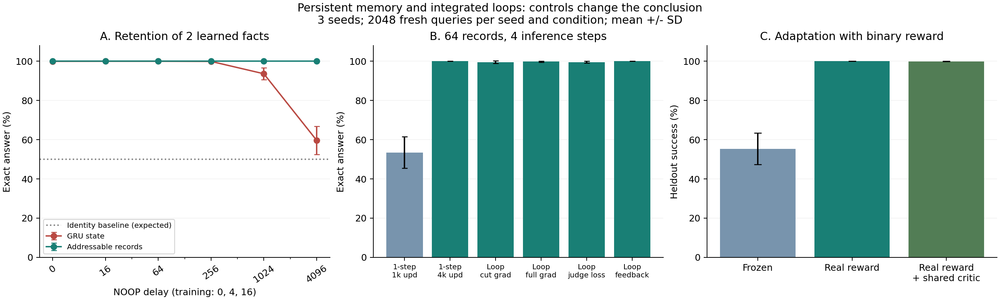

# 持续记忆与原生循环：实现和对照结果

日期：2026-10-26。用户提出：固定隐状态会遗忘；把模型、循环、记忆和评判放入共同训练过程，可能比外部拼接更有效。本轮据此实现小型 PyTorch 原型并运行对照，没有修改旧 LIF 实验。

**结果支持可寻址存储和基于真实反馈的参数适应；本任务没有检出原生联合循环、自评反馈相对于充分训练的简单循环的稳定额外收益。** 不能据此否定它们在更复杂任务中的作用，也不能把本轮小任务结果推广到通用智能体。

代码与复现命令见 [experiments/persistent](../experiments/persistent/README.md)。完整指标、配置、种子、源码及检查点哈希保存在 [results.json](evidence/persistent-2026-10-26/results.json)。训练检查点和逐运行日志在本机 `data/persistent/`，未纳入 Git。

图中误差线为三个模型种子的样本标准差，不是置信区间；每个条件、每个种子使用 2,048 个新测试样本。

## 实现及证据范围

任务是随机键值图的多跳追踪：观察乱序的 `key -> value` 事实，之后给出查询和跳数，回答终点。每批生成独立随机图，固定词表 64。模型输入没有正确答案或中间路径；真值由独立的字典遍历校验。

| 部分 | 本轮实现 | 未实现 / 未证明 |
|---|---|---|
| 压缩运行状态 | 128 维 GRU，支持状态跨分段传递 | 不是对所有循环网络的最优实现或能力上限 |
| 可寻址记忆 | 保留原始事实；学习键、查询、读取后的更新 | 写入、分配、替换策略固定；没有无限容量 |
| 内部计算 | 同一读取器重复调用，在最终答案上训练 | 跳数由任务给定；没有自主决定思考步数 |
| 自评 | 预测候选正确性；可反馈到下一步 | 自评分不是独立事实，未成为可靠通用评判器 |
| 经验适应 | 从真实二值奖励更新模型参数 | 不是长期非平稳环境、任务序列或终身学习验证 |

记忆模型有 33,346 参数，GRU 有 211,905 参数。二者状态容量、存储形式与计算不同；该比较检验的是结构组合。只有 `joint` 与 `detach` 的同权重前向、相同数据、相同循环、相同答案损失，直接比较跨步反传连接。

## 1. 长延迟保持确实存在问题

为避免“模型一开始就没学会”被误称遗忘，另训一组较简单的单跳任务：2/4/8 条事实，训练延迟为 0/4/16 步，5,000 次更新，种子 10/11/12。下表使用其中已基本学会的两条事实条件。

| 空输入间隔 | GRU | 可寻址记录 |
|---|---:|---:|
| 0 步 | 99.97 ± 0.06% | 100.00 ± 0.00% |
| 1,024 步 | 93.64 ± 3.02% | 100.00 ± 0.00% |
| 4,096 步 | 59.70 ± 7.20% | 100.00 ± 0.00% |

这支持本实现存在长延迟状态退化。它不证明任意 GRU 必然在该长度失败：更合适的训练分布、初始化或其他循环结构可能改变结果。

**记录存储直接跳过 NOOP，事实不会因等待而改变。其稳定保持是结构给出的能力，不是学出了 4,096 步不衰减的循环状态。** 事实数量在延迟比较中固定，容量外推另测。减少衰减与增加可保存的信息量是不同问题。

四条事实时，GRU 即使零延迟也只有 46.73 ± 1.02%，4,096 步后为 16.63 ± 4.50%；这个条件已经同时包含获取、寻址和保持困难，不能全归因为衰减。所有条件均保留在原始指标中。

## 2. 训练循环的初始优势，在补足单步训练后消失

主实验：种子 0/1/2，每次更新 128 个样本，训练 8/16/24 条事实、1–4 跳，1,000 次更新。`single` 每个样本仅训练一次单跳；其它组每批执行四次读取，最终答案损失按各样本要求的跳数读取。没有路径中间监督。测试时各组使用相同的题目和规定读取次数。

| 模式 | 16 条事实 / 4 跳 | 64 条事实 / 4 跳 | 16 条事实 / 8 跳 |
|---|---:|---:|---:|
| 单步训练 1,000 次，再循环推理 | 99.33 ± 0.29% | 53.47 ± 8.06% | 95.08 ± 1.47% |
| 单步训练 4,000 次，再循环推理 | 100.00 ± 0.00% | 100.00 ± 0.00% | 99.95 ± 0.08% |
| 多步训练，步间截断梯度 | 100.00 ± 0.00% | 99.59 ± 0.70% | 99.98 ± 0.03% |
| 多步训练，完整跨步反传 | 99.98 ± 0.03% | 99.84 ± 0.28% | 99.90 ± 0.05% |
| 完整反传 + 自评辅助损失 | 100.00 ± 0.00% | 99.61 ± 0.51% | 99.90 ± 0.05% |
| 完整反传 + 自评辅助与反馈 | 99.98 ± 0.03% | 100.00 ± 0.00% | 99.97 ± 0.06% |

1,000 次更新时，多步训练的容量外推明显更好。但单步组训练中实际调用读取器的次数少四倍。补到 4,000 次后，它在主要条件也达到满分。

这个补充控制匹配实际读取调用次数，同时让单步组看到更多独立样本并多做更新，**不等于 FLOPs 和耗时严格相等**。墙钟耗时和样本预算另有记录。该结果足以说明不能把最初差距直接称为“原生整合优势”；本任务可能太容易由可重复的单步算法解决。

`joint` 与 `detach` 的差异也没有稳定到足以宣称完整跨步反传更优。两者都接近天花板。自评反馈置零或跨样本打乱没有实质降低四跳成绩；这是分布干预诊断，不是完整的反馈因果证明。

本自评器在正常四跳终点上仍缺乏校准；仅使用步位置的独立验证集基线即可更准确判断正常终点的成功概率。若用自评最高分选择中间候选，还会显著降低最终答案准确率。结果因此没有支持“加一个自评头就能稳定自我纠错”。判断器同时接收步数信息，其可能收益也不能全部解释为发现错误。

## 3. 真实成功/失败反馈能改善已有模型

从单步训练 1,000 次的相同检查点出发，在 64 条事实、四跳的新条件中继续适应。每组 500 次更新、batch 128，只采样答案并获得 `0/1` 成功奖励，**没有正确答案交叉熵、路径提示或正确节点回灌**。

| 适应方式 | 新条件测试成功率 | 原单跳任务测试成功率 |
|---|---:|---:|
| 冻结参数 | 55.40 ± 7.95% | 100.00 ± 0.00% |
| REINFORCE + 真实二值奖励 | 100.00 ± 0.00% | 100.00 ± 0.00% |
| 真实奖励 + 共享 critic 与反馈 | 99.98 ± 0.03% | 100.00 ± 0.00% |

普通 REINFORCE 使用 leave-one-out 批次奖励基线。critic 组用自己的价值估计作基线，真实奖励训练 critic，其前序分数也进入后续循环。critic 不是知道正确答案的环境替身，也不把自评分当真实奖励。

三组参数从逐字节相同的副本开始；critic 开启反馈可能改变初始前向，因此各组第零步分别测量并保存。任务 RNG 和采样 RNG 成对一致。所有组报告固定最后一步，不挑最佳检查点；学习曲线使用验证世界，最终报告用另一组世界。

这里证明了从实际后果中适应较大记忆表的能力；旧的简单任务没有观察到掉点。它没有验证冲突任务、长期遗忘或开放世界探索。共享 critic 没有带来额外的最终准确率优势。

## 实验完整性与硬件

- RTX 4060 Ti 8GB、i5-14600KF（14 核 / 20 线程）、约 32GB RAM，Windows 11。
- 项目独立 `.venv`：Python 3.14.5、PyTorch 2.11.0+cu130；原有全局 CPU PyTorch 未替换。所有正式训练使用 CUDA；小模型不需要占满显存。
- 27 次监督训练及 6 次奖励适应，另有三个冻结对照。pilot 与 CPU smoke 单独保存，不进入正式表格。
- 主训练种子 0/1/2；保持实验种子 10/11/12。开发评估为 `900000 + seed`；最终主评估为 `2900000 + seed`，保持评估为 `5900000 + seed`。奖励训练、动作采样、验证、测试使用独立随机流。
- pilot 使用了种子 0 的开发世界；正式报告通过新 `evaluate.py` 使用未在 pilot 中查看的世界，不复用开发分数。固定最后一个检查点，没有按测试结果选模。
- 同世界配对延迟/反馈干预；记录无短环子集和 identity 基线。置换有短环：16 条事实、四跳时恒答 query 的期望成功率为 18.75%，不是 1/64；该项不被算作推理能力。
- 45 项数据和模型检查通过，覆盖独立 oracle、随机数独立、标签不进入前向、joint/detach 前向一致而梯度不同、记忆排列不变、GRU 分段状态保留等。奖励适应另检查梯度、冻结参数、随机流配对和输出目录拒绝覆盖。
- 配置、环境、源码哈希和逐运行指纹用于防止错误复用。旧结果目录不会被新实验静默覆盖。

SkyPile-150B 的目录和格式已检查，本轮未用于训练。它是文本预训练语料，不能直接给这几个机制问题提供精确行动后果。也没有下载基础模型或调用付费模型 API。

## 与 VISTA 和 DeepSeek 的关系

同名 VISTA 有两个项目，需要分开阅读：

- [上下文版 VISTA](https://arxiv.org/html/2606.30005v5) 的主要跨模型结果使用无需训练的上下文管理层；论文另有 Qwen3-8B 的 RL 适应分支，优化推理、归档、恢复和答案生成。它支持“接口与任务训练可以结合”的研究动机，但没有证明完整联合自评器的优势。
- [视觉版 VISTA](https://arxiv.org/html/2610.02200v1) 保留可恢复的原始视觉记录，由现成模型主动检索。该方法没有新的联合训练；作者也讨论了公开游戏可能已进入基础模型训练数据的限制。
- [DeepSeek V4.1-Flash-1017 官方发布](https://api-docs.deepseek.com/news/news261017/) 确认使用基于自反馈的强化学习改善项目开发，但没有公开足以还原该版本反馈来源、critic、奖励和更新配方的细节。本轮只实现透明的真实奖励与 critic 对照，不声称复现该方法。

## 对下一版结构的含义

当前证据更支持把运行状态、可寻址事实和已学参数一起纳入系统状态，并训练模型怎样使用它们。有限隐状态不必承担逐字保存全部经历的职责；放慢衰减也不能创造额外的信息容量。

“拐杖变成机械腿”的可检验部分，是让使用记忆和调用计算的行为接受任务后果的训练。是否必须全部放进同一神经网络、是否必须完整反传、是否需要自评奖励，本轮都没有得到普遍结论。下一项更有区分力的问题，是在容量预算下由模型选择读写与停止，检验充分训练的简单外循环是否仍然同样有效；这仍是开放假说，而非新项目约束。
