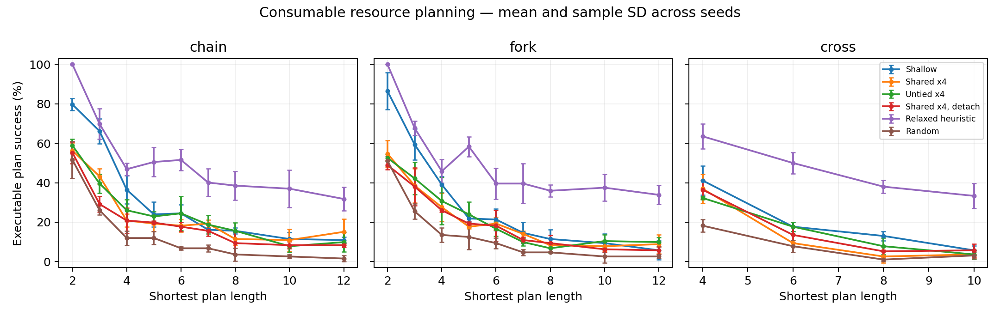
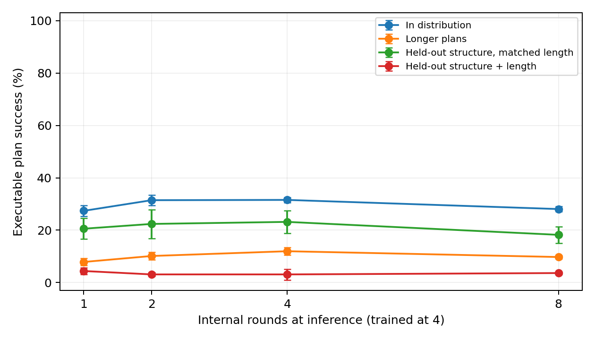

# 消耗式规划与共享内部计算实测

三个种子的结果没有支持当前共享循环的优势。相同的 660 道配对测试题上，浅层贪心成功率为 **27.58%**，共享四轮为 **21.82%**，浅层模型引导的外部搜索为 **88.33%**。最后一项使用了更多候选转移和搜索结构；它不是把同一网络多运行几轮的效果。

本实验从已接近饱和的记忆分类任务转向有限资源规划：观察完整库存、目标和配方，选出能真正执行到目标的动作序列。它检验共享计算核心是否提高这个任务上的能力与参数利用率，不预设内部循环比外部搜索更强。

代码与运行入口见 [planning](../experiments/planning/README.md)。以下实验独立于历史 LIF 框架，没有接入语言模型、额外记忆库或自评机制。

## 先排除任务捷径

第一版“保护唯一资源”的生成器被废弃：在 1,650 道诊断题上，静态资源保护和一步执行后的删除松弛检查均达到 100%，且全部为最短计划。随机或首个合法动作表现差，不能说明这个任务需要复杂规划。

正式生成器改用随机二分资源分配：有限原料可以制成多个不同组件，目标同时需要其中若干组件。错误分配后，每个剩余组件可能单独仍可制作，但原料已不足以把它们全部制作出来。任务不再依赖一个固定的“稀缺物品不能先用”模板。

冻结生成器后，620 道独立诊断题中，删除松弛策略成功 292 道（47.10%），原资源保护策略为 0；310 组反事实题保持相同库存和配方，只换目标，都存在动作从正确变为致命的角色反转。504 道至少三资源的题均确认存在删除松弛看不出的真实死路。这说明两个已知捷径失效，并不证明没有其他简单算法。该环境仍是最多六份资源的合成分配及配方 DAG；它可由符号算法求解，不代表一般规划问题。

## 世界、输入与监督

- 每题固定 40 个物品坐标、32 条配方；物品编号和规则顺序随机置换。不足的规则槽用真实配方的重复填充，没有零输入的免费动作。
- 库存和配方含整数数量；执行时先检查全部输入，再真实扣除输入并添加输出。资源批次数随任务长度上升，最多六份，之后增长的是加工步骤。
- `chain` 合并后串行加工，`fork` 分支加工；`cross` 至少含一个真正的双输入、双输出中间加工。`cross` 的资源数和加工数量分布也有差异，因此结构留出不是单一结构变量的完美消融。
- 本文“长度”是精确最短计划动作数，**不是神经推理深度或关键路径长度**。每题另存资源数、加工步骤和关键路径用于核对。
- 训练任务为 `chain/fork`、长度 2–6。测试分别报告同分布、新长度 7/8/10/12、同长度结构留出 `cross` 4/6、结构与长度共同留出 `cross` 8/10。
- 精确求解器枚举有限可达状态图并反向计算距离，只为生成验收、训练标签和离线最优长度提供信息；超出搜索上限会报错，不会被误标为不可解。
- 每题保存初态及最多七个其他可解非终止状态。每批均匀选题，再以各 50% 概率选初态或其他状态。监督是所有最优下一步的概率总和，不指定唯一教师路线。
- 推理只见当前库存、目标、配方和当前合法动作；看不到任务种子、最优长度、未来距离或可解性。模拟器提供合法动作屏蔽、状态转移及目标停止，尚未学会这些接口。
- 完整输出计划由不调用训练求解器和策略转移函数的独立执行器复核。

## 模型与预算

每条规则编码其消耗、产出、当前库存、目标及当前合法性。编码宽度 128，注意力四头，前馈宽度 256，无规则位置编码。规则置换等变性经过测试；物品坐标置换等变性没有结构保证，需要从随机重命名样本中学习。

每次环境决策从 `h=0` 开始，内部更新为 `h ← core(LayerNorm(h+x))`，其中 `x` 是当前题目的固定输入编码。这里重置跨动作状态，是为了隔离内部计算；它不是持续运行的主体或经验积累实验。

| 模型 | 核心执行 | 参数 | 每个共同批次的更新次数 |
|---|---|---:|---:|
| 浅层 | 单层一次 | 153,857 | 4 |
| 共享四轮 | 同一层重复四次，完整反传 | 153,857 | 1 |
| 独立四层 | 四个独立层，使用相同输入注入方式 | 551,297 | 1 |
| 共享四轮截断 | 同样前向，只截断反馈状态的梯度 | 153,857 | 1 |

所有模型共享初始化种子、第一层及输入输出模块的初值，逐批看到完全相同的数据索引。浅层四次更新复用同一个批次。各组匹配核心层处理的样本数；输入编码、输出头、优化器和反向路径不同，**不是精确 FLOPs 或耗时匹配**。截断组反向更便宜，也不能作为等训练成本的独立结论。

外部基线使用充分训练的浅层模型做 best-first 搜索，按累计策略概率排序，每次保留最多四个不同后继，候选队列宽度 32。相同配方先合并概率，避免重复规则稀释分支分数；所有实际模拟转移另行计数。不访问精确求解器，不用未来距离修复计划。

贪心执行的核心调用上限为每题 96，动作上限统一为 24。共享模型另测 1/2/4/8 轮；训练只用四轮，八轮是外推。外部搜索分别用 32/96 次浅层核心调用上限，并有 `调用上限 × 32` 的独立转移上限。计数单位是一道题的一层核心前向，不是一批数据的一次 API 调用。

## 试跑与正式协议

两次试跑仅查看独立验证集：

| 试跑 | 训练题 | 外部批次 × 批大小 | 最后验证完整计划成功率：浅层 / 共享 / 独立 / 截断 |
|---|---:|---:|---|
| seed 101 | 1,024 | 1,000 × 128 | 23.13% / 27.50% / 33.75% / 23.75% |
| seed 102 | 8,192 | 2,000 × 256 | 52.50% / 30.94% / 34.38% / 30.63% |

小池训练动作准确率接近 99%，新题计划成功率却很低，因此增加了题目多样性。试跑不进入正式统计，也没有读取其测试评估结果。

正式配置在打开任何正式测试结果前一次冻结：种子 0/1/2，每个种子 8,192 道训练题，2,000 个外部批次，每批 256。每模型每种子处理 2,048,000 个核心层样本；浅层更新 8,000 次，其余各 2,000 次。AdamW 学习率 0.0003、权重衰减 0.0001，梯度范数裁剪 1；使用最后检查点，不按验证最高分选模型。

每种子有 320 道验证题、1,408 道测试题，覆盖 22 个条件，每条件 64 题。搜索在每条件 10 题、共 220 题的预先固定子集上测量，所有其他模型也在同一子集上另行汇总。三个种子的训练和测试世界均不同，因此标准差同时包含初始化与抽样变化。

## 正式测试结果

以下为三个种子的均值 ± 样本标准差，单位为完整计划成功率百分比。每个种子单独统计后求均值；误差不是置信区间。共 4,224 道测试题，第一列 1,920 道，后三列分别 1,536 / 384 / 384 道。

| 策略 | 同分布 | 更长计划 | 结构留出、长度匹配 | 结构与长度共同留出 |
|---|---:|---:|---:|---:|
| 浅层贪心 | **45.89 ± 3.54** | 11.91 ± 1.28 | **29.43 ± 3.85** | **9.38 ± 1.56** |
| 共享四轮 | 31.56 ± 0.95 | 11.98 ± 1.39 | 23.18 ± 4.30 | 3.12 ± 2.07 |
| 独立四层 | 33.80 ± 2.64 | 11.13 ± 0.98 | 25.00 ± 1.35 | 5.73 ± 3.16 |
| 共享四轮、截断反馈梯度 | 29.32 ± 0.45 | 9.24 ± 0.30 | 25.00 ± 2.34 | 5.47 ± 2.07 |
| 删除松弛启发式 | 63.02 ± 2.49 | 36.78 ± 3.05 | 56.77 ± 2.96 | 35.68 ± 2.51 |
| 随机合法动作 | 22.03 ± 1.59 | 3.65 ± 0.41 | 13.02 ± 3.16 | 2.08 ± 1.19 |

精确求解器对所有生成题均能找到经独立执行验证的最短计划。所有策略的成功计划也都是最短计划；本生成器中无效的资源分配通常造成不可恢复的失败。因此，本次“成功率”与“最优完成率”相同，不能解释成模型另学会了最短路优化。



共享四轮的同分布分数比截断组略高，但在结构留出上没有同向收益。独立四层有约 3.58 倍参数，也没有超过充分更新的浅层组。更长计划上三种主模型都只有约 12%；参数复用、增加层数或保留跨轮反传，都没有在这里建立稳定的泛化优势。

## 额外计算是否有用

对同一个训练四轮的共享模型，推理改为 1/2/4/8 轮，同分布成功率分别为 **27.40 / 31.46 / 31.56 / 28.07%**；更长计划为 **7.88 / 10.16 / 11.98 / 9.77%**。四轮优于一轮说明它确实使用了迭代计算，但八轮没有继续改善。由于只在四轮上训练，这个失败只约束当前训练方式，不能推成“循环永远没有用”。



外部搜索与其它方法在同一预先固定的 660 道子集上比较：

| 策略 | 成功率 | 平均神经核心调用 | 平均真实模拟转移 |
|---|---:|---:|---:|
| 浅层贪心 | 27.58 ± 1.46% | 5.26 | 5.26 |
| 共享四轮贪心 | 21.82 ± 1.64% | 21.81 | 5.45 |
| 独立四层贪心 | 20.45 ± 1.57% | 21.75 | 5.44 |
| 浅层引导搜索，上限 32 | 70.76 ± 1.84% | 16.83 | 49.80 |
| 浅层引导搜索，上限 96 | **88.33 ± 2.50%** | 28.88 | 83.32 |
| 无学习的均匀配方搜索，上限 96，事后诊断 | 61.52 ± 0.26% | **0** | 159.78 |

均匀配方搜索在第一组正式结果出来后补充，明确属于事后诊断，未改动主协议、数据、检查点或结果。它使用相同搜索代码和配对子集，对不同语义配方给相同先验，不加载任何学习参数；96 上限表示扩展决策数，平均为 52.95 次，不能计成神经调用。另一种均匀动作编号对照为 62.88%，可在证据文件中复核。

这项诊断区分了两种贡献：搜索过程本身已能解决不少题；学习到的评分进一步把相同扩展上限下的成功率从 61.52% 提高到 88.33%，同时减少平均扩展。但搜索拥有精确模拟器、可保留多个候选并回到其他分支，当前共享循环没有这些显式中间结构。结果支持的是“学习评分与可执行搜索结合有用”，没有证明“把循环移进网络就能得到相同能力”。

外部搜索在同分布子集达到 99.67%，但在更长计划上为 78.33%，结构与长度共同留出为 61.67%。后续可以保留同分布条件作为回归，优先观察这些尚未饱和的部分。各方法耗时的批处理方式不同，报告保存实际耗时，但不把贪心的批均摊延迟与逐题搜索延迟直接相除。

## 训练成本与证据

每个正式种子保存 52,424 个训练状态；训练时 GPU 特征缓存约 1.08 GB，PyTorch 峰值分配约 2.17 GB。每种子含验证的训练约 134–136 秒，另有生成与测试成本。核心训练计时中浅层约 43–44 秒，共享四轮约 29.5 秒，独立四层约 30.6 秒，截断组约 17.6 秒；这也直接显示代理预算相同不等于实际训练成本相同。

可携带的[汇总证据](evidence/planning-2026-10-26/summary.json)包含三组配置、数据与源码指纹、分层统计、两次验证试跑及事后对照。[测试题](evidence/planning-2026-10-26/test_cases.jsonl.gz)、[全部主实验预测计划](evidence/planning-2026-10-26/predictions.jsonl.gz)与[无学习搜索计划](evidence/planning-2026-10-26/uniform_predictions.jsonl.gz)可独立解压复核；[生成器审计](evidence/planning-2026-10-26/generator-audit-v1.json)保留了被废弃的旧模板和修正过程，[正式协议](evidence/planning-2026-10-26/main-study-v1.json)在测试前写入。

最终四个新实验目录共 **293 项测试通过**。证据打包后重新解压 4,224 道题，并用独立整数运算重放全部 **58,872 条候选计划**，合法性和成功标记逐条一致；同时核对了证据文件、五个冻结运行时文件及事后诊断代码的指纹，见[复核记录](evidence/planning-2026-10-26/verification.json)。

## 适用边界与后续

这项实验测量有监督的全观察符号规划。规则、环境转移、合法动作及目标判定均由外界提供；没有学习语言、世界动力学、记忆选择、自评、在线适应或停止策略。当前布局可以定位共享迭代的局部收益与失败，不能证明或否定通用智能、意识或整个持续学习方向。

后续需要区分“会拟合训练图”与“学到可迁移的求解过程”：特别是对随机重命名、未见关系结构及额外内部迭代的稳定性。经验积累应另用跨任务的学习成本及新题求解计算衡量，不用本轮训练集拟合程度替代。

## 复现与核对

```powershell
.venv/Scripts/python.exe -m experiments.planning.run train --out data/planning/reproduce-seed0 --seed 0 --train-problems 8192 --updates 2000 --batch-size 256 --val-per-group 32 --test-per-group 64 --include-detach --val-every 500 --log-every 500 --beam-limit 220 --beam-budget 32 96 --device cuda --test
.venv/Scripts/python.exe -m pytest experiments/persistent experiments/streaming experiments/consolidation experiments/planning -q
```

同样命令替换 seed 与空输出目录运行种子 1/2。每个运行目录保存代码副本、源代码和数据指纹、逐步训练曲线、验证记录、最终检查点、实际预测计划与独立执行结果。代码或数据变化会使原运行的后续评估拒绝继续，非空目录不会覆盖。

正式输出位于 `data/planning/main-seed{0,1,2}-v1/`；生成器审计和试跑均另存目录。原 2026-10-22 设计草案及旧实验结果保留，本轮未修改语言模型训练工作区。
