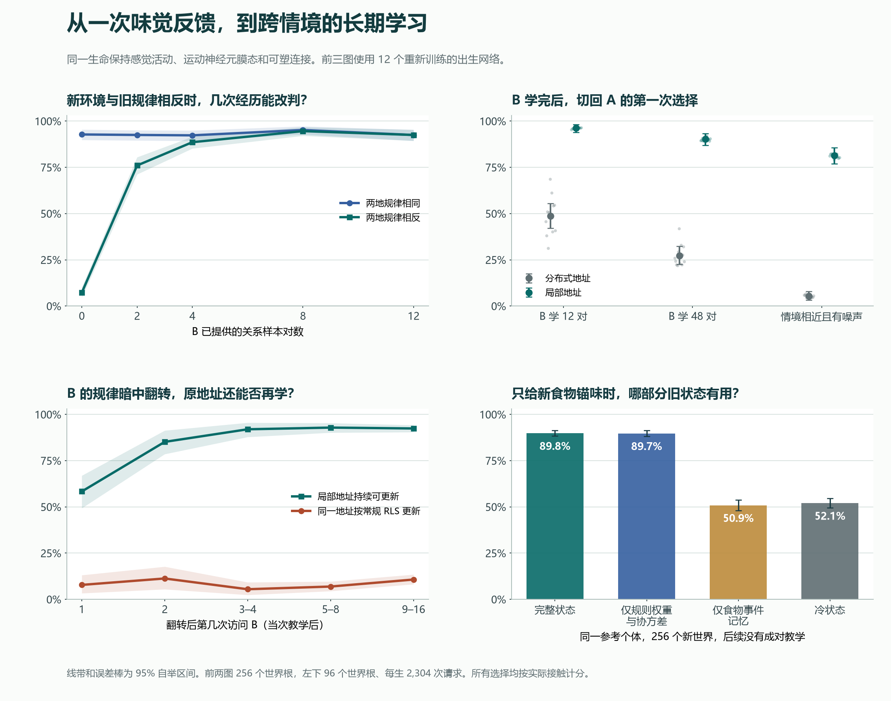

# 夜间研究结果 · 连续状态网络学会了什么

2026 年 11 月 19 日，北京时间。主要结果来自两种游戏和一轮回到原题本的复测。每个生命从空经验开始，感觉活动、运动神经元膜态和可塑权重跨请求保留，物理身体在新请求时回到场地中央。独立出生复验覆盖预先登记的全部 12 个训练起点，分别重新生成感觉图、采集训练世界、学习地址并优化运动。测试保留同一物理世界的多种隐藏规律，以世界和训练出生为统计单位。

## 同一网络能迁移、纠错和回访

身体每次面对两份食物，两路脉冲分别向左、右加速。真正碰到食物才尝到一次正负味道。A 中反复出现成对的气味变换，个体要从实际味道判断，两种气味的好坏是相同还是相反。B 先给一道锚题，两个端点是同一份新气味，实际触到任意一端才得到锚味。随后要在两份不同食物中选择，B 的变换规律仍需亲自学习。自由选择题的得分由环境记录，选择结果对本生隐藏。

| 冻结后的实际选择 | 正确率 | 说明 |
|---|---:|---|
| B 沿用 A，尚无 B 关系样本 | 92.8% | 训练时两地沿用同一规律的概率为 77% |
| B 与 A 冲突，尚无 B 关系样本 | 7.2% | 同一锚味和感觉场景要求相反的选择 |
| 冲突 B，环境提供 2、4、12 对样本后 | 76.0%、88.6%、92.5% | 一个已出生的个体连续更新 |
| 随后切回 A 的第一次选择 | **96.3%** | 同一生命的末次 B 和回访 A 都正确为 **88.8%** |
| 单独在 B 学 48 对后，再回 A | **90.3%** | 同一批冻结网络改用分布式地址为 27.3%，配对差 **+63.0 点**，95% 区间 **[56.1, 69.4]** |

前四行使用相同的 256 个新世界根，每个世界运行四种私有规律组合。冲突组 12 对后的正确率在 12 个训练出生中为 91.8%–93.2%。48 对条件同时增加了训练间隔、味觉噪声及前后配对跨度，应在该条件内比较地址机制。[独立出生与全部分母](../data/pulse-game/morning-20261119/learning-and-retention.json)

**主要改动在规则写到哪里。** 连续有向感觉图先留下气味痕迹。快记忆记录近期真正尝过的食物和结果，更慢的权重记录在当前情境该怎样使用这些经验。分布式地址让 A、B 的写入方向可能重合。把同一个体复制到相同的最后一次 A 请求，只恢复旧规则权重在 A 方向的分量，三个冻结模型的 A 首答就恢复到约 85%。这把问题定位到了被后来经历覆盖的规则权重。[同历史状态分叉](../data/pulse-game/research-2026-11-19/A-return-forks)

表中表现最好的局部地址版本根据真正出现的背景感觉脉冲分配原型。新出现的地址继承第一个已知规则作为初值，后续回执只更新当前地址。**最近原型、角距阈值和默认复制是手写的归纳偏置。** 感觉图、食物读出、运动参数和部分塑性参数经过训练，地址里的规则在每个新生命内由实际结果形成。感觉完全相同时，两条冲突规律难以分开。在四个独立栖息地里给足四个地址，实测 673/768 次回访成功，只有两个地址则为 535/768。[局部地址与容量复验](../data/pulse-game/context-local-20261119/README.md)

## 复杂连线贡献了多少

六个匹配的出生分别从头训练两套感觉层，使用同一批物理世界、同样的地址和动作学习预算。一套有定向交叉连接，另一套每个感觉单元只保留自身的衰减状态。在冲突 B 提供 12 对样本后，两套的正确率分别为 **94.7% 和 95.1%**。长 B 后回 A 则为 **92.3% 和 92.4%**，差值 0.13 点的 95% 区间为 [−0.88, 1.27]。

对学好的有向图动手术，结论不同。在同一长 B 回访上，训练后拿掉交叉边为 87.3%，保留递归矩阵的谱而打乱它和感觉单元的对齐为 58.8%，去掉所有跨拍递归为 50.1%。已经学好的个体会用自己的连线。从头学习的简单感觉单元也能补偿，所以这批游戏尚未显示复杂多环本身的独立优势。[六个完全匹配的训练对照](../data/pulse-game/morning-20261119/topology-comparison.json)
## 长期运行后，还改得动吗

在 2,304 请求的连续生命里，只有 B 暗中翻转，A 继续保持原规律。12 个独立出生使用相同局部地址，翻转后第 3–4 次访问 B，在当次教学后，常规递归最小二乘更新的正确率是 **5.5%**。给当前涉及的突触方向持续保留更新余量后是 **92.0%**，同时稳定 A 为 **92.0%**。此前积累的协方差继续决定更新方向。预测误差单独变大时再开放、只提高步长下限、持续开放，都做了独立对照。另用三个固定的分布式地址模型做噪声对照。高噪声环境里加快改判会付出稳定表现的代价。[长期逐世界记录](../data/pulse-game/research-2026-11-19/self-organized-twelve-births) · [长期对照与噪声代价](../data/pulse-game/research-2026-11-19/lifetime-review-report.md)

还有一项直接检验“过去的经验值多少”。在 256 个新世界完成前 768 次请求后复制个体，所有分支进入相同的新食物场景。每次可以尝一个新锚，后续八次自由选择都拿不到配对教学。完整状态正确率 **89.8%**，只保留高阶规则权重和协方差为 **89.7%**，只保留食物事件记忆为 **50.9%**，冷状态为 **52.1%**。这些分支保留相同的未来运动噪声。这次任务中，能迁往新食物的是此前从经验中总结出来的规律。[实际身体分叉](../data/pulse-game/native-long-life-v1/retention-fork)

参考个体还在纯 NumPy 环境里运行了 **每生 96,000 次请求、1,536,000 个物理 tick**。未来环境分段生成，跨段不清神经状态。每组在三个检查点分别从原状态和落盘后恢复的状态继续，核对脉冲、触端、回执以及全部内部数组才继续。用局部地址运行时，最后 50 次访问在教学前仍有 **91.1%** 正确。每种地址设置分别有 36 个生命，并在九次完整状态续接中核对了 1,658,880 个逐通道脉冲位。该项是固定检查点的长期复验，前面的 12 个独立出生属于另一项研究。[逐段记录](../data/pulse-game/native-long-life-v1) · [局部地址的同世界长跑](../data/pulse-game/native-long-life-local-v1)

## 回到上一轮的私有符号任务

冻结游戏中学到的 24 节点连续感觉图，再用原模拟器中随机合法尝试后实际收到的 **32,768 条 ACK/REJ** 训练一个八维读写地址头。每次出生重新学习自己的 A/B 符号表。冻结选点后才打开两批测试世界，每批 32 个世界、每世界八个生命。

| 同一原题本的策略 | 原 32 严格完成 | 新 32 严格完成 | 新 32 双回访 |
|---|---:|---:|---:|
| 夜间第一版脉冲桥接 | 74.20% | 73.94% | 64.72% |
| 冻结感觉图＋实际回执训练的地址 | **91.77%** | **91.93%** | **98.88%** |
| 同出生随机感觉图＋相同回执训练 | 89.56% | 89.73% | 94.33% |
| 可补答的显式查表参照 | 90.64% | 90.62% | 100.00% |

原项目上一轮接收节点调制组在原 32 世界为 **24.93% 严格完成**。本轮改变了架构、训练方法和先验，不能从该差额单独归因到拓扑。新 32 的实际回执地址头在停写后为 25.29%，打乱训练回执为 31.52%，冻结后只切感觉循环为 25.40%。这一次能具体指出回执在何处产生了作用。[完整对照、冻结回放与配对区间](../data/pulse-game/research-2026-11-19/legacy_grounded-report.md)

## 自主探查与训练速度

把两项任务串进同一个生命后，个体先在长 B 冲突中保住旧规则。96 个冲突生命中，回访 A 对了 85 个，末次 B 对了 81 个。随后保持全部状态，进入两个新栖息地自己决定是否买信息。192 个生命平均净收益 **+4.838**，不探查为 **+3.667**，同次数同费用随机时机为 **+3.149**，固定每区首访探一次为 **+4.860**。这一关能证明花票的时机有实际价值，现有学习头和简单固定首访策略的收益差区间仍含零。购票意向经手写电流接入同一对持续有状态的运动神经元。[同一主体跨游戏复验](../data/pulse-game/context-active-20261119/README.md)

另一组个体每生命只有 4、8 或 14 张票，可以付费探查，也可以直接收获。身体实际碰到牌才作数。用净回报训练的小决策头在 384 个新世界中，平均每生净收益 **+2.95**。同一生命、同一区域、同次数、同费用，只随机改变探查时机，净收益 **+0.96**。配对差 **+1.98 [1.59, 2.37]**。公开后验规划参照为 **+5.29**。第一版曾在部分相同状态中费用越高越愿意探查，修订版的独立同状态复验纠正了这个方向。该实验的牌到左右脉冲由显式接口执行。[付费探查实验](../data/pulse-game/research-2026-11-19/active-symmetry-final.md)

在 RTX 4060 Ti 上，同批 1,024 候选、48 对世界的六批物理评分流水线由 **6,578 提高到 7,920 候选/秒**。两臂各自的吞吐中位数列在前句。平衡顺序计时后，逐块配对的几何加速比为 **1.224× [1.203, 1.246]**。计时包含世界生成、CPU 预取、GPU 感觉计算、真实动作评分和排名。遗传分布更新、检查点和周期性确认另计。长序列把公开感觉缓存以 16 位实际存储时，缓存减半，含准备的速度另有约 1.11 倍，但少量实际脉冲和选择随舍入改变。这项近似优化保留为独立选项。[精度对照](../data/pulse-game/research-2026-11-19/precision-cache-report.md) 1,179,648 个整数计数、24,576 个评分和 6,144 个排名与旧 GPU 实现一致。[吞吐方法与原始结果](../data/pulse-game/research-2026-11-19/physical-throughput/report.md)

## 学习的范围

直接换成全新物体辨别时，原样网络第二次只对 **52.7%**。提供同物与变换两种可选读法，并让当前感觉和预测误差同时影响读写，在一次连续的跨游戏测试里，新物体第二次选择达到 **94.0%**，再回旧关系为 **86.7%**。连续来回切换 32 次时，最后四轮如果不给旧例味觉，旧规则为 60.2%。同样的物理机会，七次间隔复习提供真实味觉后，旧规则为 **91.2%**，新物体第二次选择仍为 **93.4%**。在另一项测试里，真实回执允许跨请求乱序，额外等待使锚味能够送达。用感觉回声匹配到原活动，回 A 为 **92.7%**，单按先来后到为 **61.5%**。这些对照分别暴露了相似性假设和回执归因的边界。[跨游戏与异步回执](pulse-game-transfer-boundaries-2026-11-19.md) · [一对真实生命的轨迹](../data/pulse-game/morning-20261119/single-life-trace.png)

## 复现

[下载 CPU 运行包](../data/pulse-game/morning-20261119/continuous-learning-cpu.zip) · [用法与输入端口](../data/pulse-game/morning-20261119/README.md) · [检查点与干净环境复验](../data/pulse-game/morning-20261119/portable-verification.json) · [所有研究分支与证据](pulse-game-evidence-2026-11-19.md)

参考检查点按 12 个出生的开发分数排序，取下中位个体（第 6 个，出生种子 433810157），两种地址机制共用它的感觉和运动参数。默认 `distributed` 复现训练学得的分布式地址，`local` 复现局部写入。`local-selective` 在同一事件记忆上增加同物与变换的比较，能够复现跨游戏的读写实验。两侧各有 24 个持续演化的感觉节点，两侧共享连接参数，另有两个脉冲运动单元。每侧有 164 条有向非自连接和 24 条自连接。生命周期内变化的是感觉活动、事件记忆和规则权重，感觉图的连边由出生结构和外层训练确定。

