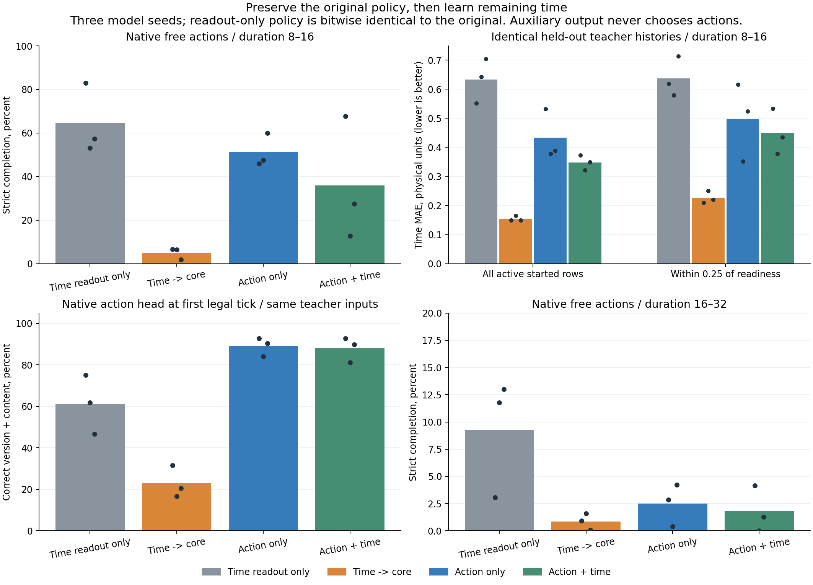

# 剩余时间预测改善了，行动可靠性没有改善

2026 年 11 月 6 日。本轮完整保留原循环和动作头，增加一个不参与动作选择的时间预测目标。**共同教师历史上的时间预测明显变准，旧动作头的内容排序却变差；另在自主世界中，实际完成率下降。动作与时间一起训练也没有稳定胜过只练动作。** 原策略的初始化和运行未因新增读出改变，已通过逐位对照。[上一轮](reports/actions/action-split-experiment-2026-11-05.md) · [预定方案](../experiments/remaining_time/analysis-plan.md) · [逐种子计数、误差及来源校验值](evidence/remaining-time-2026-11-06/results.json)

## 起点保留了什么

三个种子都从原 FINISH 教师时刻组 B008 复制 192 维普通 GRU 及原十一动作头，只添加零初始化的线性时间读出，每槽一个标量。总参数为 148,632，增加 386。原动作前向路径不计算时间读出，真实动作仍是原十一分数的 argmax。没有外部计时器、私有状态门控或把预测值接到动作选择。

| 组 | 原策略的训练 | 时间读出的训练 |
|---|---|---|
| 只读时间（probe） | 循环与动作头都冻结 | 仅拟合时间读出 |
| 时间更新循环（time） | 循环接收时间损失，动作头权重冻结 | 拟合时间读出 |
| 只练动作（action） | 循环和动作头接受原动作监督 | 在停止梯度的 h 上拟合时间读出 |
| 动作与时间联合（joint） | 循环接受两个损失，动作头接受动作损失 | 拟合时间读出 |

probe 与原策略在所有六条自主世界中的公开观察、动作、回执、原生状态及末尾 h **逐位一致**。time 组虽然冻结动作头权重，但改变循环仍会改变策略。检验时间辅助目标的主要对照是 joint/action，另外用 time/probe 检验单独学习时间会怎样影响原行为。

## 怎样训练时间

四组使用相同的三条既有最早合法教师流，每条 32 actor、双槽，先连续预热 512 tick，再顺序学习 32,768 tick。每 128 tick 更新一次，共 256 次，不重复 epoch。数值 h 全程延续，块边界只截断梯度，参数更新后不重算已有 h。[训练协议](../data/remaining-time/train-v1/protocol.json)

标签为 `(ready_time − now) / 16`，只在当前活跃、已启动且就绪时刻有限的行监督，不按未来取消、替换或成熟合格性选样。三个种子分别有 686,230、686,089、684,588 行训练时间标签，负值为 11,002、10,971、10,942 行。其余无效行填零且不进损失。教师在首次合法时刻就完成，所以负值只覆盖约 0.25 个环境单位内的短暂区间，没有覆盖完整的过期轨迹。[标签派生与核验](../data/remaining-time/targets-v1/completion.json)

时间损失是有效行的均方误差。动作损失沿用十一分类交叉熵，WAIT 权重 0.25；joint 两项系数都为 1。16 是预先固定的物理时间尺度，不能理解为两个目标的重要性已经配平。政策参数和时间读出的梯度分别按范数 1 裁剪，避免 action 组停止梯度的辅助读出通过共同裁剪间接改变动作更新。

所有组使用相同的新 Adam 和学习率 0.001，float32，无 AMP/TF32。固定第 256 次为评估终点，没有选择中途最优模型。零时间头使 time 的第一次循环时间梯度为零，第二次才可能改变循环；action/joint 第一轮仍有动作梯度。原动作头没有像上一轮那样重新置零。

## 实际行为

在新世界中，各模型自行行动 512 tick 后再测 4,096 tick。主要条件处理时长 8–16，空档 16–32。计入全部测试段新发、合格且成熟的请求，包括没有启动或没有合法窗口的失败。三个种子分母分别为 1,321、1,340、1,372，共 4,033。表中百分比和空闲误动为三个模型种子的等权平均，计数为合计。[自主评估协议](../data/remaining-time/eval-v1/protocol.json)

| 训练组 | 严格完成 | 普通完成 | 旧 A 冲突严格 | 新 B 冲突严格 | 空闲误动 / 千机会 |
|---|---:|---:|---:|---:|---:|
| 原策略 / 只读时间 | 64.5% | 80.7% | 45.6% | 52.8% | 7.55 |
| 时间更新循环 | 5.0% | 11.5% | 5.7% | 4.8% | 106.85 |
| 只练动作 | 51.2% | 93.2% | 39.9% | 54.4% | 0.04 |
| 动作与时间联合 | 36.0% | 90.1% | 29.6% | 39.3% | 0.05 |

joint 相对 action 的严格完成计数分别为 **895 对 608、172 对 637、377 对 823**，只有种子 0 改善，另外两个明显下降。三种子合计严格为 1,444 对 2,068。首次主动错误是抢答的请求从 action 的 **1,627/4,033** 增到 joint 的 **2,369/4,033**；窗口内全程未发 FINISH 从 **167 增到 223**。因此普通完成保持较高并不表示全程无错。

time 的严格完成合计为 201，原策略为 2,594。time 空闲误动的较大均值主要由种子 2 驱动，三个种子分别为每千机会 1.82、6.01、312.73，不能说三者都同程度失稳。

## 同样的经历里，时间变准了吗

另外生成六条真实最早合法教师轨迹，每条先冻结再交给所有终点只读重放。外部事件和成熟请求身份与自主评估对应，但模型的候选动作不进入世界。这样可以在完全相同的公开观察与回执上比较状态。教师完成率只用于核对分母，不是模型的成绩。[共同历史协议](../data/remaining-time/common-v1/protocol.json)

下面的时间误差单位是环境时间，一个 tick 为 0.25；内容为原生动作头在八个 FINISH 中选对版本与内容的比例。时间 MAE 使用测试段所有活跃、已启动且就绪时刻有限的行，包含非成熟和不合格请求；首次合法内容及相邻符号判断使用 4,033 个成熟配对请求。两类分母不同，各项仍用三个种子等权平均。

| 共同教师历史，时长 8–16 | 全部有效行时间 MAE | 就绪前后 0.25 内的 MAE | 首次合法时内容正确 | 相邻边界两步符号都对 |
|---|---:|---:|---:|---:|
| 只读时间 | 0.633 | 0.637 | 61.2% | 7.4% |
| 时间更新循环 | 0.154 | 0.227 | 22.9% | 22.1% |
| 只练动作 | 0.433 | 0.497 | 89.1% | 6.0% |
| 动作与时间联合 | 0.348 | 0.448 | 87.9% | 6.1% |

time 的时间 MAE 确实下降，边界附近也改善；与此同时，相同输入历史下固定旧动作头的内容排序从 61.2% 降到 22.9%。这说明修改循环破坏了旧读出所依赖的部分表示，不能据此断言内容从 h 中彻底消失。更低的时间误差没有自动成为原动作头能用好的控制信号。

joint 相对 action 的平均时间误差也下降，但相邻边界两步同时判对仍只有约 6%。原始成对计数为 246 对 241，分母同为 4,033。符号阈值固定为零，这只是诊断，没有把预测值拿来决定 FINISH。真实任务允许在合法窗口内完成，边界两步分类也不能代替实际完成率。

## 自身行动历史与更长等待

在模型各自的实际行动历史上，probe/time/action/joint 的有效行时间 MAE 为 **0.665、0.282、0.464、0.397**。边界附近分别为 **0.636、0.315、0.614、0.657**。joint 的整体误差较低，边界附近却略高于 action；各组的实际回执与有效行暴露不同，不能把这个差异当成完全匹配历史下的单因素变化。共同历史结果和自主历史结果分别保留。[完整时间侧录与分母](evidence/remaining-time-2026-11-06/results.json)

只把处理时长延长到 16–32，空档不变，严格完成率分别为 **9.27%、0.87%、2.49%、1.82%**。共同教师历史上时间 MAE 分别为 **6.20、4.94、5.57、5.52** 个单位，明显高于训练时长内的误差。没有建立长等待外推能力。本轮也只用固定 dt，未验证不规则时间步或自由异步运行。

## 结论与下一步

保留原策略后，时间预测目标仍未带来可靠性收益。它可以改善时间回归，同时破坏旧动作头的内容排序；与动作监督合并后，部分时间误差下降，抢答却更多。因此不能把标量预测误差下降当作内部计时已经服务于行动的证据，也不能用这项固定配方的失败否定循环模型或辅助训练的上限。

训练示范还有一个值得直接检验的因素：当前教师要求首次合法 tick 立即结束，而环境允许整个合法窗口，原策略的较早训练则主要采用中点教师。负时间样本又只覆盖刚就绪的一小段。下一步宜保留原策略和同预算，直接比较教师在首次合法时刻与窗口内部结束的训练，并分开记录实际公开回执、时间标签覆盖和真实抢答。这个待测比较会改变示范时机及其后续历史，不能预先归因为某一个标签或损失权重。本轮未追加该实验。

## 核验

32 项测试通过。12 个训练终点、36 个快照及全部更新预算已冻结。独立代码逐位复算 24 次实际初始 CUDA 更新，包括损失、梯度、分别裁剪、Adam、参数和连续 h。30 条自主运行的原生世界、动作、最终 h，以及 24 份时间预测和动作分数均逐位重放；原策略与 probe 的六对完整原始数组相同。共同教师历史的六套分母及 24 份时间统计也通过独立复算。[更新审计](../data/remaining-time/train-audit-v1/audit.json) · [原生与策略重放](../data/remaining-time/eval-audit-v1/replay.json) · [行为分母](../data/remaining-time/eval-audit-v1/metrics.json) · [自主时间统计](../data/remaining-time/eval-audit-v1/auxiliary_metrics.json) · [共同历史统计](../data/remaining-time/eval-audit-v1/common_history_metrics.json)

测试中发现 CPU 任意形状下 `requires_grad` 标志可能改变 GRU 的浮点运算路径，因此精确初始化比较、CPU 自主评估与只读重放统一冻结所有策略的参数标志，再比较同一推理路径；声明的 CUDA 训练起点也已逐位核验。共同历史首次协议声明的元组/列表哈希检查在采集前失败，保留失败声明后修正序列化，重新冻结，再开始采集和评分。原模型、训练流和已完成历史实验均未改写。[代码入口](../experiments/remaining_time/README.md)
