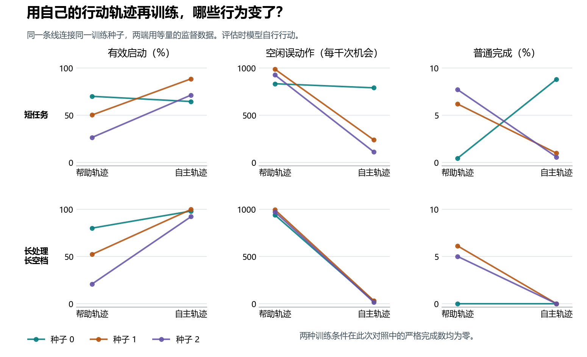

# 可读的状态能否驱动行动，退出过弱边的系统能否保持旧任务

2026 年 11 月 3 日。上一轮在统一端口模型里读出了命令消失后的版本信息。在另一套能完成短任务的模型里，三个种子分别退出了 20、8、36 条弱边。这次分别沿这两套存档检验自由行动和旧任务保持。[上一轮结果](../structure/coverage-exit-experiment-2026-11-02.md)

模型在自己实际走过的轨迹上接受监督后，长任务启动更多，空闲误动更少，长任务完成数却降到了零。模型在合法结束窗口很少出手，即使只比较八种结束动作，所需的版本和内容也很少同时排到第一。连接实验中，弱边退出组与未退出组在保留复习的情况下都维持了原有的部分短任务能力。

## 让模型自己决定什么时候开始

冻结三个曾获得部分 BEGIN 帮助的端口模型，在当时真实发生过的公开观察和动作回执上，用端点参数连续重放内部状态。对每个种子和槽，用前 64 个更新、四个 actor 的全部动作位置拟合线性读出，训练目标分为 OTHER、BEGIN1、BEGIN2。原教师对 WAIT 的权重为 0.1，其他动作权重为 1。在线决策只读取公开观察或模型自己的状态。读出器与动作得分的连接方式改变了，原来的循环场固定。这是监督拟合的外部读出。

测试从 147,456 tick 的真实端点世界和隐藏状态出发，直接执行十一类分数的 argmax。主表只计未参与读出拟合的另外四个 actor。它们以前参与过骨干训练。每个种子在四个家族分叉中合计成熟请求数以及实际空闲机会。严格完成要求成功结束且请求途中没有错误。有效启动要求实际执行了被世界接受、并且当时教师也认可的正确 BEGIN。[读出与原生对照详情](action-return-readout-2026-11-03.md)

80 个节点中，56 个接收输入，22 个兼作原生动作端口，另外 2 个没有固定接口。表中的 24 个非输入状态包括这些动作端口的连续值。原生端口在实际决策时直接比较分数，外部读出可以重新组合它们。

| BEGIN 读出 | 短任务有效启动率，种子 0 / 1 / 2 | 空闲错误 BEGIN，每千次空闲机会，种子 0 / 1 / 2 |
|---|---|---|
| 原生端口 | 0 / 0 / 0% | 0 / 0 / 0 |
| 24 个非输入状态 | 70.8 / 80.4 / 70.4% | 833.9 / 224.0 / 53.7 |
| 全部 80 个状态 | 31.1 / 61.3 / 74.2% | 400.1 / 361.6 / 801.6 |
| 当前公开观察 | 100 / 100 / 100% | 10.5 / 13.2 / 5.5 |

由于部分状态读出器会频繁出手，看到上述结果后又做了一个版本反转对照。相同观察和状态下保留是否启动的选择，把两个 BEGIN 的版本次序互换。短任务有效启动率下降到 **27.1 / 33.1 / 30.4%**。原版本排序对实际启动有贡献。动作改变后，后续回执和状态随之改变。公开观察中可以在命令到达时直接取到版本，后来也可能利用上一动作的回执。这些因素都参与自由行动。[反转对照与脉冲分解](../../../data/action-return/readout-swap-v1/summary.json)

## 自己选择结束动作

只换 BEGIN 读出时，所有模型的 FINISH 尝试都是零，即使成功启动后世界已经产生大量合法完成机会。另给相同的 24 个非输入状态拟合一个条件线性读出。使用相同的拟合 actor 和时间段，在教师标签属于 WAIT 或八种 FINISH 的位置拟合这九种选择。部署时，已训练的 BEGIN 控制器先在自己的分数上选动作。若其选择 BEGIN，保留所选版本。若其选择其他动作，由条件读出决定等候或结束。整个过程只依赖模型可见的信息。冻结比较保留相同状态上的启动决定，新的 FINISH 会影响后续的世界和状态。[拟合与验证协议](../../../data/action-return/finish-readout-v1/protocol.json)

在非输入状态 BEGIN 读出上接入条件 FINISH 后，短任务三个种子分别普通完成 **12/2,240、130/2,248、164/2,260**。严格完成均为零，每千次空闲机会有 **841、986、915** 次非 WAIT 动作。此时的完成伴随大量重复和错误尝试。在教师给出 FINISH 标签的位置，种子 0 有 5,234/5,642 次仍在发 BEGIN，种子 2 则有 1,790/1,877 次发出了 FINISH，其中 26 次选择了教师要求的具体内容。报告按种子拆开了阶段选择和内容选择。[原始计数](../../../data/action-return/finish-readout-v1/summary.json)

看到上述表现后，补齐了这组四格对照。用已经拟合的公开观察 BEGIN 控制器，接入同一份 24 状态 FINISH 读出，复用全部系数。三个种子的短任务都启动了全部成熟请求，普通完成 **49/2,240、278/2,248、8/2,260**，严格完成 **7、1、1** 个。长处理加长空档下，普通完成分别为 **0/344、27/360、6/340**，严格完成均为零。较可靠的启动能创造后续机会，任务完成质量依然受结束时机、内容及空闲控制制约。[完整四格和请求分母](../../../data/action-return/crossed-readout-v1/summary.json)

## 用自己行动造成的经历再学一次

看到两个动作读出频繁误动后，补做了一轮等预算复拟合。每个种子、每个任务槽先取同样的 32,768 个历史位置，再各加 32,768 个位置。对照组取原先有部分启动帮助的后半段历史。另一组从同一中点世界和连续重建的内部状态出发，自主行动 8,192 tick，把自己的动作回执和随后的状态纳入训练。两组经历相同的外部事件，在各自实际遇到的状态上使用环境教师给出的正确动作。训练器、24 个输入状态、骨干权重及其余设置相同。重新拟合的是启动和结束两个读出，评估时均从同一个真实端点出发。[冻结方案与样本来源](../../../data/action-return/refit-policy-v1/protocol.json)

| 测试条件与训练轨迹 | 有效启动 | 空闲误动作 / 千次空闲机会 | 普通完成 | 严格完成 |
|---|---:|---:|---:|---:|
| 短任务，帮助轨迹 | 48.86% | 914.90 | 4.78% | 0% |
| 短任务，自主轨迹 | 74.70% | 379.75 | 3.45% | 0% |
| 长处理及长空档，帮助轨迹 | 51.02% | 967.88 | 3.70% | 0% |
| 长处理及长空档，自主轨迹 | 96.58% | 25.06 | 0% | 0% |

各数值先在同种子内合计四个家族的分子和分母，再对三个种子等权平均。空闲误动作包括空闲时的 BEGIN 和 FINISH。短任务普通完成的原始计数分别从 10 到 197、139 到 22、174 到 13，种子间方向不同。教师标签与实际行动也有差别。在对照组的训练数据中，三个种子分别有 923、950、908 个 FINISH 标签，实际执行的 FINISH 却都是零。自主轨迹组的标签根据它自己造成的状态重新生成。独立复算重放了全部 24,576 个自主采样 tick 的动作和连续特征，并核对了 24 个拟合目标值。[逐种子训练与评估](../../../data/action-return/refit-policy-v1/report.md) · [独立复算](../../../data/action-return/independent_audit_refit.json)

在长条件中，自主轨迹组正确启动了 **337/344、359/360、313/340** 个成熟请求。在三个种子各自的 **2,221、2,528、2,147** 个合法结束机会中，它只尝试了 **0、16、1** 次 FINISH，且均未被接受。这次使用自身经历改善了启动和空闲控制，正确动作仍由外部教师标注。[采样与逐动作计数](../../../data/action-return/refit-policy-v1/summary.json)

还可以从已保存的实际轨迹检查，即使当时选择了 WAIT 或 BEGIN，八种 FINISH 中哪一个得分最高。此项记录覆盖全部八个 actor，只取分叉后新发起且到达合法窗口的请求，每个请求仅看首次合法时刻。长条件下，自主轨迹组三个种子的版本和内容同时排对第一的数量分别为 **99/660、89/710、87/618**，约为 **15.0%、12.5%、14.1%**。所以有限的 17 次实际出手并非判断收尾问题的唯一证据。在大多数首次合法时刻，即使只在八种结束动作里选，模型给最高分的组合也不对。这里读取的是模型自己的得分，实际世界仍执行它当时自由选择的动作。[诊断分子与分母](../../../data/action-return/refit-policy-v1/report.md)

## 退过弱边的模型经受旧任务缺席和返回

从两个模型各自的 147,456 tick 完整存档出发。一组此前实际退出过 20、8、36 条边，另一组仍有 640 条。本次两臂固定各自继承的连接资格，归档并取消已有的第 16 个待执行提案。模型权重、优化器、信用记录、隐藏状态、旧经历库和世界继续推进。先让未来的新请求只来自另外三个任务家族，共 16,384 tick，随后只产生 family 0 新请求，共 8,192 tick。每个新端点在四种规则及短、长条件上自由行动。[六个分支的完整报告](../../../data/action-return/absence-v1/report.md)

| Family 0 短任务严格完成率，三种子均值 | 撤出前 | 撤出末 | 返回末 |
|---|---:|---:|---:|
| 先前按弱边排名退出过的系统 | 15.292% | 15.631% | 16.721% |
| 原排名对照 | 15.202% | 15.542% | 16.839% |

同种子先各自减去撤出前的成绩，再比较两个系统的变化。撤出末的配对差为 **−0.001 ± 0.385 个百分点**，返回末为 **−0.208 ± 0.516 个百分点**，± 为三个配对差的样本标准差。三种子的返回差依次为 +0.088、+0.091、−0.804 个百分点。短任务上可见的初始能力在两组中都得到了保持，本轮观察不到一致的保持优势。两组继承的权重和内部状态也已经不同。长条件在撤出前就没有成功请求，此处评价保持主要依据短任务。

撤出期间，family 0 的新增和替换事件均为零。原有请求在实时训练里还留下了 284、278、123 个上下文位置，历史复习里则分别有 61,479、66,207、65,409 个 family 0 位置，其中包括 WAIT，也可重复抽取同一经历。这些结果覆盖外部任务停止出现、旧经历仍参与学习的情形。[暴露和分母明细](../../../data/action-return/absence-v1/counts.csv) · [独立复算](../../../data/action-return/independent_audit_absence.json)

### 在未剪枝模型上瞬时关掉同一批边

两个继续学习的分支各自带有不同的权重、优化器和经历。为了单独看那些具体的边，在看到上一节的结果后，另取未剪枝对照的三个真实端点。在每个端点复制模型，用另一分支的退出记录找出对应的 20、8、36 条无向边，将这些边的双向权重同时置零。分叉从对照原有的世界和隐藏状态开始，之后 2,048 tick 只测自由行动。三个阶段始终使用同一批节点对。每个种子、阶段和家族比较相同的成熟请求。[固定边的身份、协议和解释范围](../../../data/action-return/edge-identity-v1/protocol.json)

| Family 0 短任务，瞬时删边减原对照的严格完成率差（百分点） | 种子 0，20 条 | 种子 1，8 条 | 种子 2，36 条 | 三种子均值 |
|---|---:|---:|---:|---:|
| 撤出前 | −0.536 | −0.264 | +0.618 | −0.061 |
| 撤出末 | +0.089 | +0.265 | +0.088 | +0.148 |
| 返回末 | −0.267 | −0.347 | +0.180 | −0.145 |

这些坐标在未剪枝对照中一直有非零权重。到返回末，它们分别占整张循环权重矩阵 Frobenius 范数的 **0.71%、0.48%、1.20%**。撤出末三个种子的差均为正，返回末又有两个变为负。这里测到的是固定这批边和当前状态后的短期影响。训练过的网络可能已经通过其他权重适应退出，瞬时实验无法重建这种适应，也没有测任意同数量边的影响。独立核对覆盖 9 个来源端点的实际双向权重差、36 对分叉以及每一对的完整分母。[逐分叉计数和权重](../../../data/action-return/edge-identity-v1/summary.json) · [独立核对](../../../data/action-return/independent_audit_edge_identity.json) · [中断与原协议重跑记录](../../../data/action-return/edge-identity-v1/report.md)

## 下一轮优先验证

动作线上，先让两个请求的公开输入和等待时长配对，只改变要记的版本或内容。在提示到达、等待中段和首次合法结束时刻比较同一个冻结读出的内容排序。再用相同内容、不同等待时长检验结束时机。这样可以分辨结束内容在哪个阶段丢失，以及模型何时开始压制正确动作。现有结果中，只取公开观察就能可靠启动，启动成绩本身不足以判定长期记忆。

连接线上，最值得补的是旧任务撤出时能否在没有该家族复习的情况下保持已经取得的能力。两组从同一有能力端点出发，锁定连接和更新次数，只改变其历史抽样是否包含这个家族，并记录实际发生的复习量。当前结果来自三个种子、一个撤出时长和一个返回时长。[实验入口与核对方式](../../../experiments/action_return/README.md)
