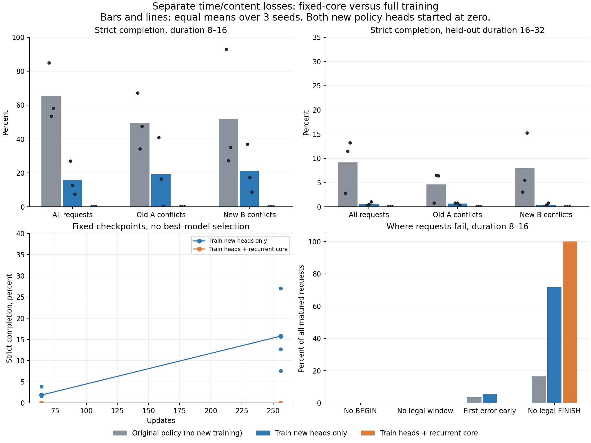
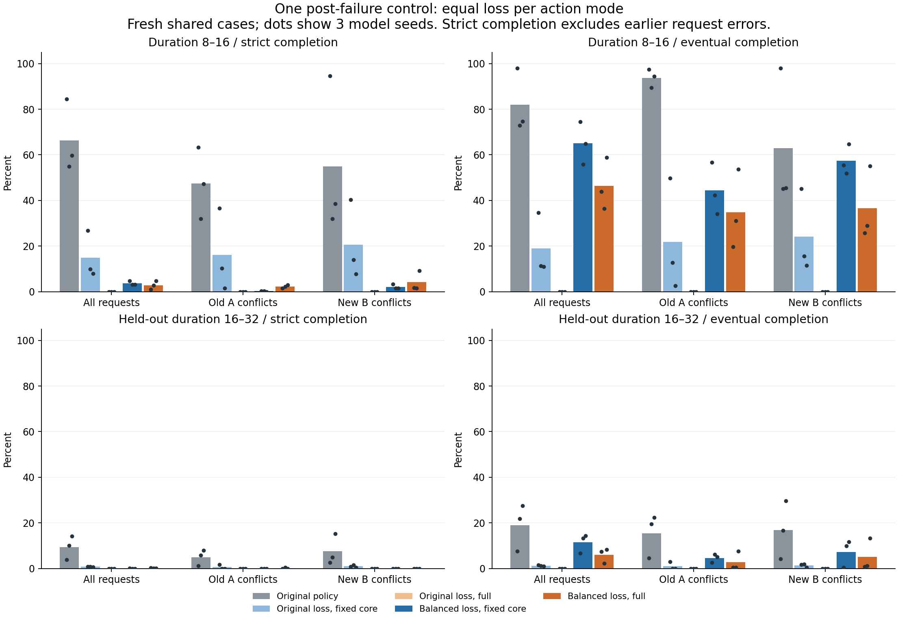

# 同样经历上，更新循环状态是否更容易学会行动

2026 年 11 月 5 日。上一轮状态诊断发现，结束内容比精确时机更容易读出。本轮实际训练新的动作读出，在相同预算下比较冻结循环部分和同时更新循环部分。最初的配方失败得很明确：全训练组会启动，却始终不结束。为检验模式监督中 WAIT 占比过高是否有影响，随后只补测一个固定的三类等权归一化方案，保留原失败结果。[前轮诊断](timing-boundary-experiment-2026-11-04.md) · [本轮预定方案](../../../experiments/action_split/analysis-plan.md)

## 哪些东西相同

三个种子都取原教师时刻 FINISH 组 B008 的 192 维普通 GRU 循环参数。两个实验组均新建相同读出，每槽分别输出三个动作类型、两个启动版本、八个结束版本与内容分数。推理先选 WAIT、BEGIN 或 FINISH，再选相应版本与内容，直接向原世界提交动作，没有额外时钟或合法性过滤。

两组新读出权重和偏置都为零，初始函数都选择 WAIT。frozen 只更新读出，full 允许循环部分也更新。新模型总参数 149,018，比原策略多 772；frozen 可训练参数 5,018。主对照两组结构相同。原策略保留旧读出且没有获得本轮训练预算，只作为另列参照。因此本轮不能单独证明拆分输出比原输出更好，也不是在保持原策略函数的前提下微调。

每种子有一条 32 actor、双槽、A/B 随机交错的原生长任务流。教师在最早合法时刻执行正确动作。先预热 512 tick，再单次顺序学习 32,768 tick，每 128 tick 更新一次，共 256 次。h 不按请求或更新块重置；块边界只截断梯度，更新后也不重算已经形成的 h。没有反复训练 epoch。[连续数据协议](../../../data/action-split/streams-v1/protocol.json) · [主训练协议](../../../data/action-split/train-v1/protocol.json)

模式在全部 tick/槽监督，WAIT 权重为 0.25；启动版本在教师 BEGIN 行监督；结束版本与内容在全部当前活跃行监督，包括处理期的 WAIT。三个损失各按声明分母归一化，再等权相加。未来会取消或替换的活跃请求也参与训练，没有使用未来合格性过滤训练行。每组每种子都有 2,097,152 行模式监督，约 70 万行内容监督；两组各项原始行数完全相同。

两组使用相同的新 Adam、学习率 0.001、梯度范数上限 1、float32。所有终点冻结后才评估。256 次是固定终点，第 64 次仅作进度观察。新头为零导致 full 第一次更新的循环梯度恰为零，第二次起才实际更新循环参数。冻结组反向计算量更小，相同更新预算不等于相同 FLOPs。

## 最初的同预算对照

在新世界中，原策略及两组新策略都从独立起点连续自行行动 512 tick，再测试 4,096 tick。主要条件处理时长 8–16、空档 16–32。分母包括所有新发、外部合格且成熟的请求，包括从未启动和没有到达合法窗口的失败。三个种子合计 4,038 个请求。百分比和每千机会误动作均为三个种子等权平均，计数则合并列出。[自主评估协议](../../../data/action-split/eval-v1/protocol.json) · [原始计数与校验值](../../evidence/action-split-2026-11-05/results.json)

| 最初配方，固定第 256 次更新 | 全部严格完成 | 旧 A 冲突严格 | 新 B 冲突严格 | 普通完成 | 空闲误动 / 千机会 |
|---|---:|---:|---:|---:|---:|
| 原策略，未获本轮训练 | 65.5% | 49.6% | 51.8% | 80.5% | 7.41 |
| 只训新读出 | 15.8% | 19.2% | 21.0% | 19.8% | 0.14 |
| 同时训循环部分 | 0% | 0% | 0% | 0% | 0 |

全训练组的 4,038 个请求都已启动并实际走到合法窗口，但全部整窗不发 FINISH。只训读出的组也有 2,895 个窗口漏发，224 个请求的首次主动错误是抢答。原策略分别为 665 个窗口漏发和 142 个抢答首错。低空闲误动不能替代完成能力。

第 64 次更新时，只训读出的严格完成率为 1.9%，全训练仍为零。仅把测试处理时长延长到 16–32，空档保持相同，原策略、冻结组和全训练组的严格完成为 9.2%、0.6%、0%。这没有建立长等待外推收益。

## 失败是否只出现在自己行动以后

冻结两个终点，另在原训练教师流、新的共同教师流、以及各自已经实际走过的自由历史上重放，分别统计模式与条件内容。这不是恢复训练时每步旧权重下的在线状态，而是最终固定权重的事后重放。表中是合并行统计，不能当作独立模型重复。

| 最初配方的终点 / 历史 | 合法行选择 FINISH | 条件内容正确率 |
|---|---:|---:|
| 冻结循环 / 原训练教师 | 2,433 / 32,915 | 72.2% |
| 全训练 / 原训练教师 | 0 / 32,915 | 79.6% |
| 冻结循环 / 新教师 | 343 / 4,106 | 71.4% |
| 全训练 / 新教师 | 0 / 4,106 | 78.5% |
| 冻结循环 / 自身历史 | 1,687 / 28,775 | 63.3% |
| 全训练 / 自身历史 | 0 / 32,969 | 77.6% |

全训练组在原训练示范的最终权重重放中就不选择 FINISH，不能只用自主回执造成的状态变化解释。它在新教师历史的 6,645 个 BEGIN 机会中全部选对模式，在合法结束时却平均给 WAIT 约 95.4% 概率、给 FINISH 约 4.3%。它保留了相当一部分可读内容，但这些内容没有转成结束动作。[冻结诊断与来源](../../../data/action-split/diagnostic-v1/summary.json) · [合法行独立复算](../../../data/action-split/diagnostic-v1/legal_rows_audit.json)

即使 WAIT 只按 0.25 加权，三种模式的加权监督量仍约为 WAIT 94.72%、BEGIN 3.27%、FINISH 2.01%。这提出了一个可测的候选原因，不能单凭比例认定原因；BEGIN 同样稀少却已学会，计时难度和内容损失的共同影响仍要区分。

## 单个事后归一化对照

在看到上述失败与教师重放结果以后，只补测一种模式损失，先在 WAIT、BEGIN、FINISH 各自的行上分别取交叉熵平均，再对三者等权平均。所有训练块都包含三类，因而没有缺类分支、抽样变化或阈值调节。两个条件读出损失、原始标签、连续流、起始循环参数、零新头、学习率和 256 次更新保持相同。新模型从原始起点重训，没有继承失败终点。

这个对照改变了模式梯度相对于内容梯度的贡献，也可能改变裁剪行为，所以不能称为损失强度未变。补测使用另一批新 actor 和新世界种子，同时重新测试原配方两个终点与原策略，确保所有条件在这批新请求上可直接配对。[新请求评估协议](../../../data/action-split/balanced-eval-v1/protocol.json)

补测的 8–16 时长条件有 4,066 个成熟请求，三个种子分别为 1,343、1,349、1,374。下表均在这同一批新请求上测试，不能直接与上表不同分母相减。

| 第 256 次更新终点 / 模式损失 | 全部严格 | 普通完成 | 旧 A 冲突严格 | 新 B 冲突严格 | 空闲误动 / 千机会 |
|---|---:|---:|---:|---:|---:|
| 原策略，未获本轮训练 | 66.4% | 81.9% | 47.5% | 55.0% | 7.19 |
| 冻结循环，原加权 | 14.9% | 19.0% | 16.2% | 20.6% | 0.16 |
| 全训练，原加权 | 0% | 0% | 0% | 0% | 0 |
| 冻结循环，三类等权 | 3.7% | 65.1% | 0.2% | 2.1% | 56.00 |
| 全训练，三类等权 | 2.9% | 46.4% | 2.2% | 4.1% | 1.82 |

归一化改变了行动倾向，但未使时机可靠。冻结组的窗口漏发从 **2,934 减至 219**，首错抢答从 **221 增至 3,874**。全训练组的窗口漏发从 **4,066 减至 1,356**，首错抢答从 **0 增至 3,908**。普通完成允许早先出错后重试，因此其上升不能解释为已经学会准确结束。

三类等权冻结组的严格完成为 **63/1,343、42/1,349、44/1,374**，全训练组为 **14/1,343、38/1,349、65/1,374**。三个独立模型种子没有给出全训练一致优于冻结的结果。合计分别是 149 和 117，原策略为 2,697。A/B 都参与本轮练习，此处不是没有复习时的保持测试。[补测逐种子计数与配对变化](../../evidence/action-split-2026-11-05/balanced-results.json)

只把处理时长延长到 16–32 时，新测试流共有 3,038 个成熟请求。三类等权冻结/全训练的普通完成为 11.4%/5.9%，严格为 0.03%/0.16%，合计严格完成分别仅 1 个和 5 个。没有取得长等待外推能力。[补测训练协议](../../../data/action-split/balanced-v1/protocol.json)

## 能确定什么，下一步怎样避免绕回权重调整

本轮没有得到更强、更可靠的策略。原加权配方下，允许循环参数更新没有优于冻结，且最终模型在训练教师历史上也完全不选结束。将三类模式等权后，两种模型恢复了不少普通完成，同时大量抢答。这支持损失归一化会影响出手与漏发的取舍，但不证明样本比例是全部原因，也不能从这些有限配方推断循环结构的能力上限。

读出从零开始和示范形式变化，是这轮与原策略比较时的重要边界。下一步应保留原动作头及原策略初始行为，用相同预算检验一项直接针对边界的训练信号是否有用，例如从状态预测到就绪的有符号剩余时间。预测值只作为训练目标，部署时仍由原策略自行行动。先比较仅拟合这个时间读出与允许它更新循环部分，分开测内容、时间误差和真实动作，避免把整体提高 FINISH 倾向当作计时能力。这里是后续待检验的方案，本轮没有执行。

## 核验与存档

本轮及单个补测共训练 12 个终点，在两批独立外部流上完成 60 次自由评估。两个对照各自都是三个模型种子、同 256 次更新，不能把请求、轨迹或核验行数当成额外训练重复。全部模型与评估终点按预定位置冻结，没有选取中途最好成绩。

24 项模型、数据、训练、行为分母及归一化测试通过。原配方与补测各有 12 次真实初始 CUDA 更新由独立代码逐位复算，包括损失、梯度、裁剪、Adam、参数和连续 h。完整训练流的标签与逐块预算、60 次评估的请求状态机、原生世界、动作和最终 h 均通过独立核验。[主训练审计](../../../data/action-split/train-audit-v1/audit.json) · [补测更新审计](../../../data/action-split/balanced-audit-v1/audit.json) · [主行为复算](../../../data/action-split/eval-audit-v1/metrics.json) · [补测行为复算](../../../data/action-split/balanced-eval-audit-v1/metrics.json) · [主世界与策略重放](../../../data/action-split/eval-audit-v1/replay.json) · [补测世界与策略重放](../../../data/action-split/balanced-eval-audit-v1/replay.json)

训练数据的首次独立审计因 JSON 把元组保存为列表而中断，仅修正审计器的表示归一化后重新通过，失败日志保留。诊断源码中自身历史的 block1 损失说明曾写成逐行，实际为每 tick 的 64 行批次归一化，已单独保存说明；原始源码与数值未改。[诊断解释说明](../../../data/action-split/diagnostic-v1/interpretation_notes.json) · [代码入口](../../../experiments/action_split/README.md)
