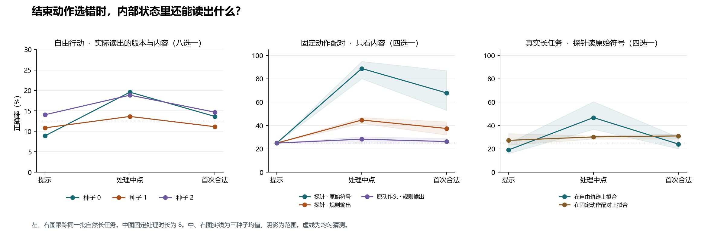

# 结束动作的内容是在提示时就读错，还是在等待中丢失

2026 年 11 月 3 日。上一轮，模型在长任务中大多能启动，却在 6,896 个合法结束机会里只尝试了 17 次 FINISH，全部失败。本轮沿用产生这个结果的三个自主轨迹复拟合模型。每个任务槽有八种结束动作，正确答案同时取决于两种版本之一和四种内容之一。环境在提示时给出原始符号与家族规则，四个家族把原始符号按不同的排列映射到实际所需的内容。[上一轮研究](action-return-experiment-2026-11-03.md)

新提示要到下一 tick 才能传播到动作端口。固定行动历史时，只过这一个 tick 就能从内部状态读出 84%–93% 的原始符号。回到自由行动，在短任务结束时，状态里常常还能读到符号，原动作头仍频繁选错。长任务结束时，这种可读性明显下降。另有独立的计时问题，同一时刻给短任务和长任务不同的结束要求，也几乎引不起模型改选动作。[三种子阶段图](../../evidence/content-timing-2026-11-03/content-by-stage.png)

## 怎样跟踪同一条请求

**实际自由行动。** 从每个模型之前的真实世界和隐藏状态恢复，重新执行四个家族、短任务与长处理长空档的测试。额外保存得分，模型继续按十一动作的最高分行动。按请求身份跟踪提示到达、处理中点、首次合法结束三个时刻。中点从世界接受 BEGIN 算起，首个合法时刻从处理完成算起。测试保留模型先前动作和实际回执，也保留另一任务槽的持续干扰。[自由行动协议](../../../data/content-timing/natural-v1/protocol.json)

**只改变提示内容和处理时长。** 从实际轨迹取同一个提示前的状态和背景，保留版本，分别发出四种原始符号，给每种符号安排 2 或 8 个环境时间单位的处理。为让同一组只在这些因素上不同，目标槽执行一次正确 BEGIN，之后等候。这会生成真实操作回执，其中 BEGIN 还会透露版本，但不会透露此次被替换的载荷。模型原本想选什么始终独立记录。比较相同的绝对时间时，可以看到模型是否根据提示中的时长作出了区分。[配对分叉协议](../../../data/content-timing/matched-v1/protocol.json)

**独立读取状态。** 原模型有 80 个节点。排除 56 个接收公开输入的端口后，用其余 24 个节点的值拟合四选一的线性读出，其中 22 个是原动作端口，2 个没有固定接口。分别预测原始符号和该家族规则要求的目标内容。一个 actor 的所有背景和所有配对变体只属于训练侧或测试侧，两个方向交叉验证。主测试只拿到当前的一个状态，同一背景其他变体的状态不会作为分类器输入。还将提示阶段拟合的同一组读出权重直接用于后两个时刻，区分一直可用的读法和需要按阶段重新学习的读法。[预先固定的探针方案](../../../experiments/content_timing/probe-plan.md)

## 原动作读出从哪一步开始错

下表每行的三个阶段都取同一批请求。分子为八种 FINISH 分数中，版本及内容同时排对第一的请求数，即使实际最高分动作是 WAIT 或 BEGIN 也能计算。只取上轮策略读出拟合时留出的 actor 4–7。四个家族在种子内合计。短条件的处理时长为 1–4，长条件为 8–16，长条件的请求间隔也较长。

| 条件 | 种子 | 三阶段齐全 / 成熟请求 | 提示正确 | 处理中点正确 | 首次合法正确 |
|---|---:|---:|---:|---:|---:|
| 短 | 0 | 1,432 / 2,240 | 238 | 259 | 301 |
| 短 | 1 | 1,982 / 2,248 | 201 | 398 | 384 |
| 短 | 2 | 1,608 / 2,260 | 182 | 298 | 324 |
| 长 | 0 | 337 / 344 | 30 | 66 | 46 |
| 长 | 1 | 359 / 360 | 39 | 49 | 40 |
| 长 | 2 | 313 / 340 | 44 | 59 | 46 |

长条件下，三个种子在提示当下的正确率分别为 **8.9%、10.9%、14.1%**，从中点到首次合法均有回落。按请求看，提示读对、首次合法读错的数量分别是 **17、13、12**，反过来从错到对的有 **33、14、14**。提示和首次合法都读错的有 **274、306、255**。这些轨迹同时存在遗失和恢复，更多请求在两个时刻都读错。短条件下三个种子的晚期正确数都高于提示时，期间经历自己的动作和回执。

在长条件的三阶段完整请求中，到首次合法前已经有过错误行动并收到拒绝的有 **336/337、359/359、313/313**。自然轨迹上的分数变动同时含有等待、持续干扰和动作反馈，不能只归因于状态自然衰减。未能启动或没有观察到合法时刻的请求保留在分母表中。[完整请求计数](../../../data/content-timing/natural-v1/request_status.csv) · [同一请求早晚读对与读错的转移](../../../data/content-timing/natural-v1/paired_transitions.csv)

## 提示要经过一次内部传播

模型每步先让旧状态随时间演化，再把新提示加到输入端口，最后读动作端口。提示在这一刻已经改变了输入节点，24 个非输入节点还只能反映之前的历史。在三个种子共 576 个真实背景中，把相同提示换成四种不同内容，提示当刻这 24 个数和八个 FINISH 得分都逐位相同。由于四种内容在每个背景中各出现一次，四选一读出恰好为 25%。这解释了为什么不能用提示当刻的低分判断该模型学没学会记内容。[图的单步执行顺序](../../../experiments/undirected/model.py) · [配对数据](../../../data/content-timing/matched-v1/summary.json)

看到这个零差异后，另行固定补测，只多测下一步，即提示后 **0.25 个环境时间单位**。用同一批背景恢复提示当刻的分数与状态，逐位一致。到下一步，三个种子各自的 **192/192** 个背景都已产生四种不同的非输入状态。跨 actor 读原始符号达到 **644/768、712/768、689/768**，即 **83.9%、92.7%、89.7%**。同一步读映射后内容为 **43.2%、47.4%、47.1%**。因此在这些固定回执的分叉里，从提示进入图到符号可被非输入状态区分，只需要一次后续更新。[补测协议](../../../data/content-timing/onset-v1/protocol.json) · [逐种子结果](../../../data/content-timing/onset-v1/report.md)

控制动作与回执后，下面比较 8 个时间单位处理条件下的三个读出。每个单元格从左到右为种子 0、1、2，每种子均有 768 个变体。探针在各阶段单独拟合，并在不同 actor 上测试。原动作头的载荷取八个 FINISH 中得分最高者的载荷部分。四选一均匀猜测为 25%。

| 读取什么 | 提示到达 | 处理中点 | 首次合法结束 |
|---|---:|---:|---:|
| 线性探针读原始符号 | 25 / 25 / 25% | 80.1 / 94.9 / 91.4% | 53.0 / 87.0 / 63.7% |
| 线性探针读按规则换算的目标内容 | 25 / 25 / 25% | 41.9 / 46.9 / 45.3% | 31.9 / 43.2 / 37.4% |
| 原动作头所选 FINISH 的载荷 | 25 / 25 / 25% | 30.5 / 29.6 / 25.0% | 28.9 / 25.0 / 25.0% |

三个种子的原始符号可读性都从中点下降到首次合法时刻，但都仍高于 25%。处理时长为 2 时，同阶段重拟合读出在首次合法时仍能认出 **90.0%、98.7%、94.9%** 的原始符号。目标内容的四种家族规则部分重合。在这个家族和原始符号都均衡的设计里，若已知正确原始符号，直接照抄它、不用家族信息也可取得 50% 的映射准确率。上表不足以证明网络已学会组合规则与符号。将同背景四种变体的测试状态换成同一平均值后，两个目标的全部折都精确回到 25%。[各折分母、混淆矩阵与阴性对照](../../../data/content-timing/probe-v1/summary.json)

只看原有 FINISH 分数的相对顺序，在长处理的首次合法时刻，三个种子有 **851、792、562 / 1,152** 个内容对在交换提示后把两者的相对分数朝正确方向移动。但最后的八选一最高分真正随两个提示而变的只有 **196、0、0 / 1,152** 对。在这里，一点分数差和实际改选动作之间还有可测的差距。每六个内容对都来自同一个四选一背景。[原始配对得分](../../../data/content-timing/matched-v1/summary.json)

## 同一个时刻，短任务该结束而长任务该等

每个配对背景沿用真实版本和结束窗口，保留相同的背景输入。只把提示中的处理时长从 2 改为 8。时间走到 2 时，短任务刚变得可以结束，教师在所有案例中仍要求等候。因此主要比较选在短任务**首次获得教师 FINISH 标签**的那一刻，长任务此时仍在处理。两边在该时刻之前都只正确启动过一次，随后等候。

每个种子有 768 对。三个种子的短分支分别有 **1、0、0** 次想发 FINISH，对应长分支也是 **1、0、0** 次。种子 0 的两次来自同一对。合计 **2,304 对中，没有一对只在短分支想结束而在长分支等候或启动**。时长已经影响连续分数，在这 2,304 对里却未能引起一次符合上述方向的离散切换。这是给定同一行动历史时的决策诊断，实际受控世界仍执行固定的等候动作。[各对的时长、教师动作、模型动作及分数差](../../../data/content-timing/matched-v1/matched_timing.json)

## 在模型自己行动的轨迹上，内容还能读到多少

固定动作的分叉去除了由载荷尝试造成的反馈差异，真实模型则会做错、重试，并遇到长短不一的干扰。为检验两种经历的差别，按原样重放三个种子共 **49,152 tick** 的自由轨迹，逐步核对 11 类得分、动作和隐藏状态。第一次重放的整段动作摘要少用了旧评估器的格式前缀，修正摘要算法并重跑后，逐步数值和整段摘要都与原记录一致。[迁移协议](../../../data/content-timing/transfer-v1/protocol.json) · [校验修正记录](../../../data/content-timing/transfer-v1/replay_correction.json)

先将只用配对分叉训练的同阶段读出直接用于真实轨迹，保留跨 actor 分割。另做域内校准，同样的线性读出仅用另外两个 actor 的自然轨迹拟合，预测另两个 actor，再交换。两种方法测试的都是同一批三阶段齐全的真实请求，输入都只有 24 个非输入状态。短条件用时长 2 的配对读出，长条件用时长 8 的配对读出。两种训练集的请求量、时长分布和行动历史不同，差值不能单独归给回执。[迁移逐种子分母和基线](../../../data/content-timing/transfer-v1/per_seed.csv) · [域内校准协议与混淆矩阵](../../../data/content-timing/natural-probe-v1/summary.json)

| 在自由轨迹识别原始符号，种子 0 / 1 / 2 | 短任务，首次合法 | 长任务，处理中点 | 长任务，首次合法 |
|---|---:|---:|---:|
| 配对分叉训练，直接迁移到自由轨迹 | 28.9 / 43.1 / 31.0% | 31.2 / 31.2 / 28.4% | 28.5 / 32.9 / 31.9% |
| 其他 actor 的自由轨迹训练 | 71.2 / 88.7 / 68.6% | 36.8 / 60.4 / 43.1% | 30.0 / 22.3 / 20.1% |

在真实短任务结束时，这批状态仍有相当多可跨 actor 读出的原始内容，原动作头在这些时刻选对载荷的比例只有 **25.1%、28.6%、26.4%**。到了真实长任务末，域内探针的原始符号宏平均召回是 **30.0%、21.0%、17.1%**，四类均匀猜测期望为 25%。自然组样本和各类频率不均衡，所以准确率与宏平均召回分别列出。真实长条件的证据只够说明当前线性读法未能跨三个种子可靠保留内容，无法排除其他状态或非线性读法。上述探针都在指定阶段由评估者读取，模型未获得额外时钟、私有标签或探针预测。[校准各折结果](../../../data/content-timing/natural-probe-v1/summary.json)

还有一个直接面向行动的比较。对同一批成熟请求，只在正确版本对应的四个 FINISH 分数里选载荷，长条件首次合法时仍只有 **87/337、83/359、85/313** 个排对。即使评估者替原动作头解决了版本选择，原动作头也很少给正确载荷最高分。实际世界继续执行原十一动作选择。[按正确版本限制候选的诊断计数](../../evidence/content-timing-2026-11-03/figure-values.json)

## 下一轮训练

先比较等待期间是否给现有的八个 FINISH 分数提供内容监督。两组使用相同的自然长短任务、模型结构、更新和样本预算。一组只在原结束标签位置学习内容，另一组把同等数量的内容学习位置分配到提示已经传播后的等待期和合法窗口。辅助目标只比较八个结束动作之间的排序，等待时仍以 WAIT 为动作目标。用自由行动的长任务严格完成、空闲误动作及合法窗口内的正确出手判断成败。此次测量给出了内容何时可读，但没有改变策略或提高原模型完成率。

六项核验均已完成。独立脚本从自然轨迹复算请求和阶段计数，核对受控分叉的 576 个背景、41,472 个内容对、4,608 个共同时间配对，并验证探针的 actor 划分、混淆矩阵和分母。三种子各取一折用独立的数值求解交叉检查长条件下的拟合。[审计结果](../../../data/content-timing/independent-audit.json) · [运行入口](../../../experiments/content_timing/README.md)
