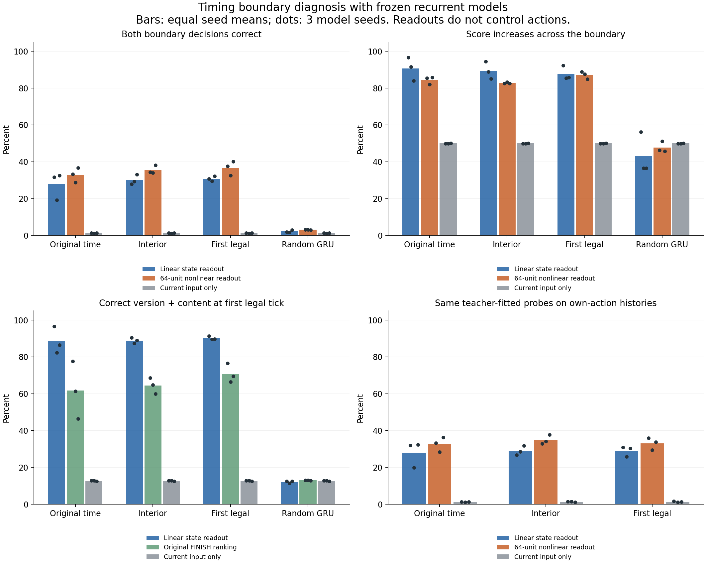

# 状态里有时间信息，但边界判断还不够准确

2026 年 11 月 4 日。上一轮改变旧 A 的结束正例位置，改善新 B 出手的同时又增加了旧 A 抢答。本轮冻结三个训练终点，在同一批新请求上分别读出就绪时间与结束内容。**固定读出在训练后状态上取得了比随机网络和当前输入更高的计时准确率，但仍不能可靠地区分相邻的最后等待与首次合法时刻。内容可读性更高。** [上一轮](../../finish-position-experiment-2026-11-03.md) · [预定方案](../../../experiments/timing_boundary/analysis-plan.md) · [逐种子数值与来源校验值](../../evidence/timing-boundary-2026-11-04/results.json)

## 怎样分开状态、读出与行为

原模型都是 192 维、单层 GRU，接收原有 56 维公开观察。三个训练终点分别在原教师时刻、两者之间、首次合法时刻复习旧 A 的 FINISH。模型的循环与动作头在本轮均不更新；随机初始化的同结构 GRU 是额外对照。

每个模型种子使用三组互不重叠的 32 个 actor，分别用于拟合、验证和测试。每条新流先运行 512 tick，再观察 4,096 tick，保留原生双槽、A/B 交错、取消与替换，处理时长为 8–16 个环境单位。每 tick 为 0.25 单位。隐藏态只在独立流的起点初始化，此后连续演化，不按请求重置，也没有训练块或梯度截断。[数据协议](../../../data/timing-boundary/v1/protocol.json)

在共同历史条件下，中点教师真实执行动作，所有冻结模型都读取相同公开观察与回执。模型看不到私有的就绪时刻。只对新发、合格、成熟的请求取样，要求同一请求活跃且已启动，最后一个不合法 tick 与第一个合法 tick 相邻。三个种子的测试分母分别为 1,340、1,356、1,344，共 **4,040 对**。其中 3,868 对在这两步的当前公开观察完全相同，区分它们需要利用历史状态。

两个输出槽分别拟合固定读出，槽内共用 A/B、符号和版本的数据。标准化只用拟合集，逻辑回归的正则和 0.5 阈值固定，另加入一个固定 64 单元 tanh 隐层读出。全部 216 个读出及标准化参数冻结后才评分验证集和测试集，没有用它们选择超参数。内容另用八类线性读出，时间回归另用附近七个位置，两者不接入实际动作。[读出协议](../../../data/timing-boundary/probe-v1/protocol.json) · [全部读出冻结记录](../../../data/timing-boundary/probe-v1/freeze.json)

## 时间在变化，不等于判断准了

各项百分比采用三个模型种子等权平均。每个请求的“两步都对”要求上一 tick 判未就绪，下一 tick 判就绪；“方向正确”只要求后一时刻分数更高，平局计半分并单列原始次数。4,040 对请求仍嵌套在三个模型种子中，不是 4,040 次独立训练重复。

| 原 FINISH 监督位置 | 线性时间读出逐步正确 | 同请求两步都对 | 时间分数方向正确 | 小型非线性读出两步都对 |
|---|---:|---:|---:|---:|
| 原教师时刻 | 62.8% | 27.8% | 90.7% | 32.9% |
| 两者之间 | 63.8% | 30.1% | 89.4% | 35.5% |
| 首次合法 | 63.8% | 30.8% | 87.8% | 36.8% |
| 随机 GRU | 50.0% | 2.2% | 43.1% | 3.1% |

只看当前输入，逐步准确率为 49.9%，两步都对为 1.3%。同一请求两个状态高度相关，不能把单步随机猜测的概率相乘作为这个表的对照。训练对的标签随机翻转后，线性 h 读出的逐步准确率为 49.6%–50.7%，实际两步都对为 11.5%–13.8%。这些对照支持训练后的状态确实带有可读信息，但其统一边界仍不够精确。

原教师组的线性读出两步都对，三个种子分别为 31.6%、19.2%、32.5%。中间组为 27.9%、29.4%、33.1%，首次合法组为 30.8%、29.5%、32.1%。不能从三个平均值推出 FINISH 越早，计时就越好。对旧 A 冲突请求，线性两步都对为 30.7%、36.3%、32.9%；对新 B 冲突请求为 27.4%、27.5%、32.5%。

读取原动作头的 11 个分数再拟合一个线性时间判断，方向正确率可达 93.6%–97.6%，但两步都对只有 9.8%–17.1%。这与“分数通常随时间朝正确方向变化，跨请求的判定位置却不够一致”相符。它尚未证明误差完全来自时间表征，也不排除其他读出形式或训练方式。

时间回归使用首次合法前后 −8、−4、−2、−1、0、1、2 tick 的有效状态。对这七个位置，平均绝对误差分别为 **1.25、1.18、1.38 tick**；只看相邻的 −1/0 两步，为 **1.04、0.97、1.08 tick**。这是本次固定岭回归读法的误差，不能当作所有解码器的信息上限。它也接受了比二分类更多的监督行，不能当成同预算竞争。

## 内容比精确时机更容易读出

| 原 FINISH 监督位置 | 首合法时，h 独立读出版本与内容 | 原动作头在八个 FINISH 中选对 | 只看当前输入 |
|---|---:|---:|---:|
| 原教师时刻 | 88.5% | 61.8% | 12.7% |
| 两者之间 | 88.9% | 64.5% | 12.7% |
| 首次合法 | 90.2% | 70.8% | 12.7% |

随机 GRU 的内容读出为 12.1%。原模型在这个时刻可能合理地继续等待，因为合法窗口还未结束，所以原动作头没有立即选择 FINISH 本身不算任务失败。这里仅比较内容在候选结束动作中的排序。两个边界点都读对具体内容的比例为 85.7%、85.5%、87.7%，也高于精确时间的成对判断。

未用于调参的验证集上，三组线性时间读出的两步都对为 28.1%、30.4%、31.6%，与测试集接近。没有把验证集或测试集的结果反馈给本轮拟合。

## 换成自己的行动历史会怎样

对相同外部请求另运行原模型自己的十一选一动作，包括预热段。这里没有教师替代，也没有新读出控制动作。所有组仍有完整的 4,040 对边界，但更晚的 +1/+2 位置可能已经结束，不能补齐成同样的回归行数。

将教师数据上冻结的读出原样用于这些隐藏态，线性时间两步都对为 **28.0%、29.0%、29.1%**；小型非线性读出为 **32.6%、34.9%、33.1%**。共同教师历史中已存在的时间模糊仍然存在，不能全部归咎于自身动作造成的状态变化。

首次合法组的变化更明显。其内容读出从 90.2% 降到 81.5%，线性时间方向正确率从 87.8% 降到 75.1%；在相同 −1/0 位置上的时间回归误差从 1.08 升到 2.11 tick。这说明该组的自身行动历史还会额外影响读出的可用性。开始时刻和回执都是实际行动的结果，不能把不同历史的 h 当作完全相同条件下的单因素干预。

原模型在新测试流的实际行为如下。这是旧终点的一次新复测，读出诊断没有训练出新的策略。表内百分比与每千机会误动作也采用三个种子等权平均，表后的分子分母为合计，因此不能要求两者相除后的舍入值完全相同。

| 原 FINISH 监督位置 | 全部请求严格完成 | 旧 A 冲突严格完成 | 新 B 冲突严格完成 | 空闲误动作 / 千机会 |
|---|---:|---:|---:|---:|
| 原教师时刻 | 65.0% | 46.7% | 52.6% | 7.37 |
| 两者之间 | 66.4% | 33.9% | 68.6% | 0.65 |
| 首次合法 | 52.3% | 12.9% | 79.9% | 0.36 |

每组普通/严格完成的总数分别为 3,258/2,623、3,702/2,682、3,434/2,114，分母均为 4,040。旧 A 冲突请求共 1,047，新 B 共 986。这批独立请求再次出现了旧 A 与新 B 的取舍。

## 复核与可复现范围

独立审计重放了 18 条完整原生世界流与 45 条模型流，核对 419,003 行取样状态。全部取样 h 和 logits 在独立逐 tick 重放中逐位一致；216 份读出系数、99 份预测文件及全部分层统计已用独立计算复核。原检查点和事实流哈希保持不变，三个测试模块合计 20 项通过。[独立审计](../../../data/timing-boundary/audit-v1/audit.json) · [核验范围](../../../experiments/timing_boundary/audit-plan.md) · [代码与入口](../../../experiments/timing_boundary/README.md)

分块执行 GRU 与原逐 tick 路径出现了浮点差异，h 最大约 2.00×10⁻⁵，logits 最大约 8.34×10⁻⁵，超过最初的分块数值核验容差。保留该记录后另做精确逐 tick 复算，没有放宽通过阈值。自身行动流的分块与逐 tick 动作 argmax 差异为零。这里的数值检查不增加独立训练种子数。

## 边界与下一步

本轮的相邻时刻分类比真实任务更严格。真实世界允许在一个合法窗口内完成，首合法 tick 没立即出手并不等于失败。上面的实际严格完成率也说明，精确到一个 tick 的边界判断并非当前任务成功的必要条件。这个诊断用于定位抢答与漏发，不能替代最终行为评估。

固定的小型非线性读出改善了相邻两步判断，但没有达到可靠水平。其 24 个拟合均执行预定 400 轮，保存了达到预算的警告，没有宣称优化收敛。另有首次合法组种子 2、槽 1 的内容线性读出达到 2,000 次上限，结果照原设置保留。失败的有限读出不能证明状态中完全没有相关信息。本轮还只测试固定 dt 和已覆盖的处理时长，不证明不规则时间或更长等待的外推。

下一步可以固定同一批公开经历和监督预算，比较**只训练动作读出**与**允许循环状态一起学习**。把“何时已经可以结束”和“结束时具体答什么”分别计损失，动作仍在原生世界中实际执行，等待期仍要求 WAIT。这样能检验时间判断是否需要改变内部状态，以及内容的可读优势能否转成新旧情境交错时的无错行动。实验必须保留旧 A、新 B、空闲和整个合法窗口的指标，不能只优化这次的相邻两步分类。
