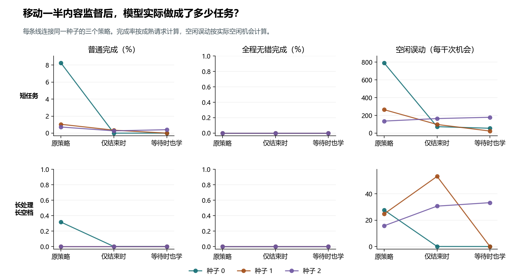

# 等待时学习结束内容，能否改善长任务的实际完成

2026 年 11 月 3 日。上一轮在真实短任务结束时，线性读出仍能从内部状态认出许多原始符号，模型自己的结束动作却经常选错。在真实长任务末，符号也变得难以稳定读出。本轮直接训练现有网络，评价它在世界中实际完成的请求和空闲时真正执行的动作。[上一轮三阶段实验](content-timing-experiment-2026-11-03.md)

**等待期监督把相同长任务经历上处理期的八选一内容正确率从 14.91% 提到 16.98%，但没有提高实际完成率。** 主评估与额外后缀分别有 984 和 3,080 个成熟长请求，两种训练策略在两个窗口都完成了零个。等待组的空闲误动平均较少，降低幅度主要来自一个种子，另一个种子的空闲误动反而增加。两个测试窗口使用相同模型，独立训练重复数为三。

## 两组究竟学了什么

起点是三个种子分别训练出的 80 节点无向图和已有的动作读出。各自原策略继续在持续输入中自由行动，保留完整世界、时钟、隐藏状态和动作回执。短与长条件各和四个任务家族交错出现。教师只标注这一刻正确的动作，世界执行的仍是模型自己选的动作。两组学生重放同一份真实公共轨迹，等预算比较不会被两组在训练早期碰巧遇到不同请求所干扰。

两组都训练原图现有的共享连接和现有的结束读出，沿用同一套启动读出。每个位置都有相同的动作监督。只有在附加的八选一内容损失中，两组学习的时间位置不同。

| 训练组 | 对同一批请求怎样安排额外监督 | 等待期的动作目标 |
|---|---|---|
| 仅结束时学习内容 | 每条选中请求取教师首次要求结束的块内位置，区分两个版本及四个载荷 | WAIT |
| 等待时也学习内容 | 一半沿用相同的结束位置，另一半移到同一请求已启动、尚未就绪的处理位置，沿用完全相同的版本和载荷 | WAIT |

所有等待样本都晚于提示注入，课程切换时保留已有请求。只有同一更新块内同时出现合适的等待位置和真实教师结束位置的请求才能配对。八个 FINISH 分数之间的相对排序会在等待位置收到梯度，等待时没有要求提前结束的动作标签。两组均能在原有教师结束位置通过共同的动作损失学习具体内容。[分析口径](../../../experiments/wait_content/analysis-plan.md)

## 训练量和状态连续性

每个种子、每组接收同样的 **16,384 tick、131,072 个训练动作位置、128 次 Adam 更新**。原有的 640 条有效无向边和两个任务槽的 400 个结束读出参数参加训练。两组从同一旧模型权重、同一隐藏状态和相同的新 Adam 初始化出发。每 128 tick 截断梯度，隐藏状态延续到下一块。启动读出的系数固定，但输入给它的图状态会随训练改变，因而两组的实际启动率也可能不同。所有计算采用 FP64。[训练协议](../../../data/wait-content/train-v1/protocol.json)

| 种子 | 两组各自的额外内容样本 | 其中长处理样本 | 等待组移至等待期 | 其中长处理移入等待期 |
|---|---:|---:|---:|---:|
| 0 | 1,462 | 308 | 731 | 146 |
| 1 | 2,032 | 344 | 1,016 | 165 |
| 2 | 1,606 | 324 | 803 | 155 |

对同一更新，两组使用的请求、版本和载荷完全相同。其中种子 1 有两次更新没有可配对样本，两组都只执行共同动作监督。三个种子的长处理样本移入等待期后，监督位置相对原结束位置提前的时间中位数都是 6.75 个环境时间单位。课程中长短块一样多，但长请求之间的空档更长，实际进入配对的长请求较少。[逐步预算核验](../../../data/wait-content/train-v1/budget_verification.json)

移动的标签取自同一请求后来的教师结束标签，训练时通过保存的请求身份回填。两个学生都只接收公开观察和真实动作回执作为模型输入。辅助样本覆盖的是原策略已经启动、且在同一块中出现过教师结束机会的请求。没有启动的请求依然参与逐位置的动作学习。这里测试的是外部内容监督施加在什么时刻更有效，模型没有自行生成这些回填标签。

评估保留另外四个 actor。每套训练后的固定权重都从原隐藏状态开始重放完整公共历史，以自己的连续状态进入同一个真实世界端点。此后分别在四个家族和两种难度上自由运行 2,048 tick。未训练策略也从同一端点重测。自由评估期间没有教师干预、参数更新或请求级状态清空。主要结果只计分叉之后新发起且已经成熟的合格请求；空闲错误以每个策略实际遇到的空闲机会为分母。[评估协议](../../../data/wait-content/eval-v1/protocol.json)

## 自由行动结果

完成数按三个种子的成熟请求合计。有效启动率和每千次空闲机会的误动作率先在同种子内合计四个家族的计数，再对三个种子等权平均。若先发错了动作，后来仍然完成，计入普通完成；严格完成要求请求全程无错。

| 条件和策略 | 普通完成 / 成熟请求 | 严格完成 | 有效启动 | 空闲误动 / 千机会 |
|---|---:|---:|---:|---:|
| 长，未继续训练的原策略 | 1 / 984 | 0 | 96.0% | 22.71 |
| 长，仅结束时学习内容 | 0 / 984 | 0 | 41.1% | 27.97 |
| 长，等待时也学习内容 | 0 / 984 | 0 | 47.9% | 11.10 |
| 短，未继续训练的原策略 | 221 / 6,728 | 0 | 73.6% | 396.88 |
| 短，仅结束时学习内容 | 14 / 6,728 | 0 | 36.7% | 111.64 |
| 短，等待时也学习内容 | 9 / 6,728 | 0 | 41.6% | 85.73 |

两种训练后的策略都已启动了一部分长请求。仅结束组实际遇到 **2,703** 个合法结束机会，等待组遇到 **3,038** 个。两组在这些机会里各尝试了 **0** 次 FINISH。原策略在 6,390 个机会中尝试 15 次，仅 1 次成功。和原策略相比，两种继续训练方案都失去了大量有效启动，也都损害了短任务原有的部分完成能力。这限制了把两种训练之间的局部差异解释成整体进步。[逐分叉的实际请求和动作分母](../../../data/wait-content/eval-v1/summary.json)

有些合法位置按训练教师的规则仍应稍等。再只看教师已经明确要求 FINISH 的实际位置，等待组 **1,512 次中选择 WAIT 1,497 次、选择 BEGIN 15 次**；仅结束组 **1,360 次中选择 WAIT 1,348 次、选择 BEGIN 12 次**。两组都主要是在该结束的时候继续等候。[从实际动作和教师标签复算的计数](../../evidence/wait-content-2026-11-03/free-behavior.json)

### 空闲时是哪种动作改变了

| 长条件 | 种子 0 | 种子 1 | 种子 2 |
|---|---:|---:|---:|
| 仅结束组，空闲误动作 / 实际空闲机会 | 1 / 41,792 | 2,202 / 41,368 | 1,258 / 41,040 |
| 等待组，空闲误动作 / 实际空闲机会 | 0 / 41,792 | 0 / 41,368 | 1,366 / 41,040 |
| 等待组减仅结束组，每千次机会 | −0.02 | −53.23 | +2.63 |

平均配对差为 **−16.87 个/千机会**，三个差值的样本标准差为 **31.51**。种子 1 的改善主要是 2,106 次空闲 FINISH 消失，同时有效启动从 55/340 降到 16/340。种子 2 的空闲误动作增加，处理中提前 FINISH 也从 47 次增加到 355 次。等待期增加内容监督没有造成一致的空闲惩罚，也没有稳定解决乱动作。[独立复算的训练更新及行为结果](../../../data/wait-content/independent-audit.json)

## 在更长的连续测试中复核

未继续训练的原策略在首批长请求中也只完成了一次。看到这个低基率后，在读取两种训练策略的比较前，固定补测，把长条件的 36 个原分叉各自延续到 8,192 tick。逐条对齐原先 2,048 tick 的状态、动作和统计后，只在后面 6,144 tick 中统计新发起且成熟的请求。三个种子的分母为 1,000、1,060、1,020。跨越前后窗口的 12、8、4 个请求未计入后缀，后缀末端还未成熟的数量分别为 0、8、4。所有臂排除的是同一批身份。[补测协议](../../../data/wait-content/long-v1/protocol.json) · [前缀一致性](../../../data/wait-content/long-v1/prefix_verification.json)

| 后续长任务 | 普通完成 / 成熟请求 | 严格完成 | 合法 FINISH 尝试 | 空闲误动 / 千机会，三种子均值 |
|---|---:|---:|---:|---:|
| 原策略 | 1 / 3,080 | 0 | 78 | 26.70 |
| 仅结束时学习内容 | 0 / 3,080 | 0 | 2 | 29.01 |
| 等待时也学习内容 | 0 / 3,080 | 0 | 0 | 12.75 |

等待组相对仅结束组，每千次空闲机会的变化分别为 **−0.23、−51.43、+2.88**。种子间的方向与主评估一致。合计两个互不重叠的请求窗口，每种训练策略各面对 4,064 个成熟长任务，均无成功。额外观察增加了长请求数，没有增加独立训练种子数。[完整后缀结果](../../../data/wait-content/long-v1/summary.json) · [逐请求、回执和空闲分母独立核验](../../../data/wait-content/long-v1/independent-audit.json)

## 相同经历上的结束内容和出手意愿

取未继续训练的原策略实际走过的同一段未来公开轨迹，让三个策略分别打分。两种已训练策略的候选动作不送回世界，因而用到的动作回执和外部干扰完全一样。只取留出 actor 的新合格请求，处理期按教师要求 WAIT 的实际 tick 统计，教师首次要求 FINISH 时每条请求只取一次。它们与自由行动完成率的分母不同。

| 长条件，同一批经历，三种子等权平均 | 仅结束时学习内容 | 等待时也学习内容 |
|---|---:|---:|
| 处理期八选一结束内容正确 | 14.91% | 16.98% |
| 首次教师要求结束时八选一内容正确 | 12.22% | 13.32% |
| 首次教师要求结束时，十一动作实际会选 FINISH | 16.42% | 0% |

等待组在长处理中对内容的排序比仅结束组分别多对 **2.24、1.86、2.09 个百分点**。这一小幅收益出现在三种子上，但没有转成合法出手。在首次该结束的时刻，等待组的正确内容排序也只约 13%。短任务上的同轨迹结果方向不同，处理期的三种子平均从 **18.12%** 降到 **16.03%**。[相同经历、各自模型打分的分母和分子](../../../data/wait-content/common-v1/summary.json)

种子 1 说明了经历差异的大小。在原策略走出的长任务经历上，仅结束组在 339 个首次教师结束位置中有 167 次会发 FINISH，其中 18 次内容正确。让同一模型自己行动时，它在实际遇到的 338 个合法机会里一次也没有发 FINISH。前者是固定历史上的打分，后者才是自由行为。改动策略会改变哪些请求走到合法窗口，也会改变此后收到的回执。因此，从离线内容正确率推断完成率会漏掉这部分变化。[逐种子同轨迹记录](../../../data/wait-content/common-v1/seed_001.json)

## 复核方式

三种子的全部 49,152 个采集 tick 都按原保存的公共观察、教师标签、实际动作、世界和隐藏状态重新核对。训练两臂的每一步检查了同一批输入、请求和类别。另用原图的逐 tick 实现和独立重写的损失，在种子 0 重算了两组第一次有标签移动的优化步骤。更新后参数最大绝对误差为 1.39 × 10⁻¹⁷，隐藏状态逐位相同。[训练与行为独立复算](../../../data/wait-content/independent-audit.json)

初次自由评估在保存未启动请求的就绪时间时，JSON 无法表示世界中的无穷大哨兵。原冻结文件、失败日志和实现差异均已保留。修正仅在写轨迹时将哨兵记录为空值，随后完整重跑全部 72 个分叉，并从新保存的逐 tick 事实复算结果。[序列化修正](../../../data/wait-content/eval-v1/implementation-amendment.json) · [自由评估核对](../../../data/wait-content/eval-v1/raw-audit.json)

补测首次保存请求身份时遇到 NumPy 整数的 JSON 编码问题。保留原件，转换为普通整数后重跑，汇总只导出实际测量的指标。独立脚本从紧凑事实与真实回执重新构造了后缀的成熟、普通、严格完成和空闲计数，并逐分叉核对前缀。[补测实现修正](../../../data/wait-content/long-v1/implementation-amendment.json)

若继续迭代，优先用训练后策略自己走出的状态来校正结束时机。可以从同一训练端点出发，配平更新和标签数量，一组继续使用原策略的经历，另一组使用自己的新经历。判断标准仍是实际合法 FINISH、严格完成率和空闲误动作。种子 1 在两种历史上表现出的巨大出手差异，为这项对照提供了具体理由。
