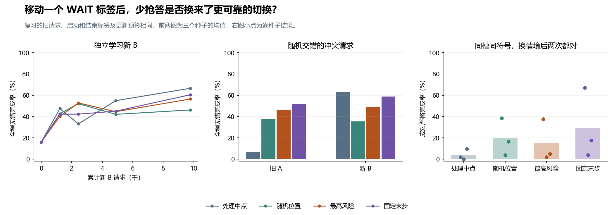

# 同一条旧请求，在什么时候教 WAIT 最有效

**把 WAIT 从处理中点移开，确实能减少抢答。** 在新旧规则交错时，最高风险组对旧 A 冲突请求的全程无错完成率从中点组的 6.5% 升到 46.3%。但它在新 B 上更容易错过结束窗口。另一个更简单的选择——固定在就绪前的最后一个可等待 tick 监督 WAIT——在同槽换规则时得到最多的无错请求对。以下区分学新规则的早期速度、最终水平和两次连续做对。[上一轮的抢答诊断](../memory/review-selection-experiment-2026-11-03.md) · [本轮事先规定的比较口径](../../../experiments/wait_position/analysis-plan.md)

## 只移动一行监督

从已经学会 A 的三个 GRU 检查点出发，所有学习组使用同一组连续 B 示范与同一个旧请求库。两个规则在四种符号里有两种要求不同的载荷。每种子沿用上一轮的 256 个旧请求，连每次候选 128 条、均匀选中 64 条的身份和顺序都一致。每条旧请求的两个标签始终固定，即正确启动和教师首次要求的正确结束。唯一可动的是中间一个 WAIT 标签。[旧请求库与可用位置](../../../data/wait-position/bank-v1/summary.json)

候选位置必须属于该槽、该请求，实际成功启动以后、真正就绪以前，且教师要求 WAIT。每个请求有 4–63 个这样的位置。模型始终只看 56 个公开输入；筛选这些位置时用到的私有阶段信息不进入模型。每次复习用当前模型读取相同的旧轨迹，取各位置最高 FINISH 分数减去最佳 WAIT 或 BEGIN 分数。达到最高差值的位置定义为最高风险，平局取最早。整段都不想发 FINISH 时仍选取差值最高的一步，同时记录这一事实。

| WAIT 的位置 | 训练含义 |
|---|---|
| 中点 | 复现上轮均匀选请求的原方案。行号取旧库中已保存的等待中点。 |
| 随机 | 在同一请求可等待的 tick 里均匀选一个，使用预设的可重现随机数。 |
| 最高风险 | 模型在自己的旧经历上打分，取当下最倾向发 FINISH 的有效 tick。 |
| 固定末步（补充） | 总取实际就绪以前最后一个有效 WAIT。这个控制是在发现首轮最高风险选择高度集中在末步以后设立的。冻结时已知一个中途快照的抢答诊断。 |

每组、每种子总共做 2,048 次更新，其中 A 复习 256 次、B 学习 1,792 次，A 共用 49,152 行动作监督。四组都执行相同规模的无梯度候选扫描。所有实际 B 演示、旧请求身份、启动与结束标签、计算形状和损失权重均配平。复习的 h 只服务于旧轨迹，实时 B 状态继续携带各自的公开历史。重跑的中点组直到最终检查点，模型、Adam、实时 h 和世界均与原均匀组逐种子逐位一致。[主线训练协议](../../../data/wait-position/train-v1/protocol.json) · [固定末步补充](../../../data/wait-position/last-v1/protocol.json)

## 自由行动的结果

测试使用训练外的新世界，全程执行各模型自己的十一选一动作。表中百分数先在每个种子内计算，再对三个种子等权平均。早期 B 取前四轮的规定快照，按累计新发 B 请求数对严格完成率曲线积分，再除以这段请求数。空闲率按各模型实际遇到的空闲机会计算。末列为另一批连续请求对的实际成功数。

| WAIT 位置 | 早期独立 B 严格 | 末轮独立 B 严格 | 随机交错旧 A 冲突严格 | 随机交错新 B 冲突严格 | 交错空闲误动 / 千次 | 同符号切换两次均无错 |
|---|---:|---:|---:|---:|---:|---:|
| 中点 | 40.0% | 66.6% | 6.5% | 63.0% | 4.7 | 12/317 |
| 随机 | 42.7% | 46.2% | 37.8% | 35.4% | 9.0 | 63/317 |
| 最高风险 | 43.0% | 56.5% | 46.3% | 49.1% | 6.2 | 48/317 |
| 固定末步 | 39.7% | 60.5% | 51.7% | 58.9% | 7.4 | **95/317** |

设定的目标得到部分满足。风险组的早期 B 均值略高于中点，在旧 A 上也有改善，但它的最终 B 严格率下降了约 10 个百分点。固定末步的早期 B 平均曲线接近中点，两者各自的种子差异都很大。末步组在原混合测试的旧 A、新 B 上均高于风险组，独立 B 末端仍低于中点。观察到的空闲误动也没有一致随抢答一起下降。[主评估与逐种子分母](../../../data/wait-position/eval-v1/report.md) · [末步的独立评估](../../../data/wait-position/eval-last-v1/report.md)

## 抢答减少以后发生了什么

随机交错测试中，所有组面对相同的 118 个成熟旧 A 冲突请求和 117 个新 B 冲突请求，四组的这些请求都成功启动，也都达到实际合法结束窗口。首错按真实活跃状态、已启动、尚未就绪且尝试 FINISH 判定，保留同时发生的版本或内容错误。合法窗口从就绪一直到截止时间，按每条请求第一次在窗口内真正尝试的 FINISH 分解。

| 位置 | 旧 A 首错抢答 / 118 | 旧 A 首次合法出手正确 / 错误 / 未发 | 新 B 首错抢答 / 117 | 新 B 首次合法出手正确 / 错误 / 未发 |
|---|---:|---:|---:|---:|
| 中点 | 106 | 49 / 44 / 25 | 15 | 82 / 27 / 8 |
| 随机 | 46 | 63 / 49 / 6 | 18 | 49 / 26 / 42 |
| 最高风险 | 19 | 62 / 53 / 3 | 1 | 60 / 29 / 28 |
| 固定末步 | 9 | 69 / 47 / 2 | 3 | 73 / 11 / 33 |

最高风险与末步两组在旧 A 上既少抢答，合法机会中完全没有 FINISH 的请求也从 25 个分别降至 3、2 个。新 B 则有另一种代价，末步组 117 个合法请求里有 33 个等到窗口关闭也没出手。旧 A 的合法窗口里，末步组仍有 47 个请求第一次选错了版本或内容，说明修好时机只能挽回一部分能力。[回执、时间与分母的逐请求核验](../../../data/wait-position/eval-v1/timing-summary.json) · [末步对应计数](../../../data/wait-position/eval-last-v1/summary.json)

## 真的能连续做对吗

同槽控制固定原始符号，连续发出两件事，在 AB、BA 换情境与 AA、BB 重复情境之间打散，模型看不到配对标记，也不能通过机械轮换就稳定答对。独立世界保留真实时长、空档、另一槽干扰和动作回执，这项配对诊断不设取消或替换。主要指标只取 AB/BA 两次正确答案不同的冲突对，分母分别为 109、105、103 对。

| 位置 | 种子 0 两次无错 | 种子 1 两次无错 | 种子 2 两次无错 | 两次最终都完成，允许中途错误 |
|---|---:|---:|---:|---:|
| 中点 | 2/109 | 0/105 | 10/103 | 157/317 |
| 随机 | 42/109 | 4/105 | 17/103 | 141/317 |
| 最高风险 | 41/109 | 2/105 | 5/103 | 183/317 |
| 固定末步 | 73/109 | 4/105 | 18/103 | 176/317 |

固定末步相对中点在三个种子上都增加了真正的无错切换，但净增加的 83 对里有 71 对来自种子 0。均值不能代表各次训练都获得了可靠切换。随机位置也有改善，在此项计数上超过最高风险。各组的相同外部命令和全部实际回执另行重建核对。[主配对审计](../../../data/wait-position/pairs-v1/summary.json) · [末步配对审计](../../../data/wait-position/last-checks-v1/pairs/summary.json)

## 风险位置和固定边界

49,152 次最高风险选择中，**92.13%** 落在实际就绪以前最后一个可等待 tick，距就绪的中位数为 **0.126 个环境时间单位**，接近处理过程的末尾。只有 **5,273 次（10.73%）** 的最高风险位置真有 FINISH 分数超过非 FINISH；其余 **89.27%** 的旧窗口内本来就不存在真实的 FINISH 首选。这里说“最高风险”指当前模型在旧公开轨迹上的分数差，不等同于在自由部署时实际犯错的位置。随机位置覆盖了所有 768 个旧请求的早期和晚期候选，最高风险只在 185 个请求上选中过早期位置。[选取位置、物理距离和逐请求覆盖](../../../data/wait-position/bank-v1/mechanism_report.md)

另将四组模型放到同一份原中点策略实际产生的独立 A/B 公开轨迹上打分。旧 A 的 118 个已进入处理期的冲突请求中，至少有一次想提前 FINISH 的分别为中点 107、随机 54、最高风险 40、末步 29 个。它们收到的公开输入和回执相同，也都没有在重放中执行候选动作。自由测试里实际首次错误的减少，至少有一部分能在相同历史的模型打分里重现。重放中有些参考请求在教师结束时刻之前就结束，首次教师结束机会的分母更小，两种指标分别保存。[汇总图数值与共同历史诊断](../../evidence/wait-position-2026-11-03/counts.json)

本轮支持“等待标签放在哪里会改变实际时机控制”。所测最高风险规则没有稳定胜过简单的末步监督。末步组能多做对不少旧请求，但仍有超过三分之二的冲突切换对未能全程无错，且新 B 的合法窗口漏发增多。下一轮若只改一个因素，值得在保留末步 WAIT 的同时，固定数量地比较**首次合法时刻**与现有**教师窗口中点**的 FINISH 监督，检查能否挽回新 B 漏发，同时维持旧 A 的抢答改善。这个问题还没有在本轮验证。
