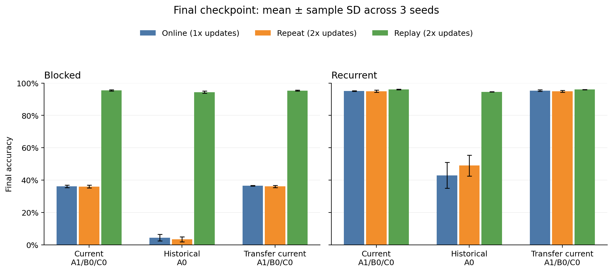

# 反复经历、共享规律与记忆巩固

日期：2026-10-26。接续[持续流与结构渐变实验](../../streaming-experiment-2026-10-26.md)，本轮实际运行了 18 组 GPU 训练：三个种子 × 两种输入日程 × 三种学习方式。

**在这个有明确上下文和规则版本的受控任务中，反复交替让持续出现的任务逐渐保持；有限真实经历的重放进一步保住了已经不再出现的旧规则。同等更新次数下，交替组的旧规则准确率从 49.03% 提升到 94.63%，当前任务仍达到约 96%。** 这支持让旧经历继续参与学习，不证明需要不可修改的长期连接，也不证明已实现自主选择重要记忆或生物睡眠。

## 实现和对照

代码及完整运行说明见 [consolidation](../../../experiments/consolidation/README.md)。系统只有共享预测模型、有限经历库和普通学习更新：

- 32 维连续原始属性，加上可观察的上下文与规则版本；两层 256 宽的 MLP，共 **76,548 个参数**。
- 经历库保存最多 **8,192 条**已观察输入与真实反馈，约 **1.28 MiB**（含随机优先级）。均匀历史采样，没有重要性评分、永久保护区、连接生长或生成式回放。
- 环境提供四分类标签，用 Adam 和交叉熵更新。这是有监督巩固实验，不是仅凭活动频率、奖励或自评的学习。
- 评估只读取权重，不读取经历库，不做参数或缓存更新。因此独立测试成绩反映已整合到模型的预测功能，不能靠查询时直接查原始记录得到答案。

| 方法 | 每批外界经历后的更新 | 每次运行的总更新数 |
|---|---|---:|
| online | 当前批次一次 | 2,700 |
| repeat | 当前批次两次 | 5,400 |
| replay | 当前批次一次，真实历史批次一次 | 5,400 |

主要比较 **repeat 与 replay**，两者处理的训练样本总数、优化器更新次数、模型大小、初始参数和外界经历完全配对。三个方法都维护同样的经历库，只有 replay 在训练中读取；同一日程、种子的最终库内容哈希一致。第一个批次没有历史时，replay 与 repeat 一样复习当前批次。每条外界经历只登记一次，重放不再登记为新经历。

每组有 691,200 次外界样本接触；repeat/replay 训练样本呈现次数均为 1,382,400。这些是接触次数，不是互不重复的新样本数量：输入从 16,384 个训练属性向量有放回抽样。

## 环境确实包含什么关系

A0 的答案来自基础教师；B0 使用部分共享、部分变化的教师；C0 在相同属性上给出与 A0 不同的答案，但上下文不同。后来 A 的规则变成 A1，并提供可观察版本条件；A1 与 A0、C0 均不同。B/C 不改变版本。模型没有获得“相同/冲突”类别标签，关系分组仅用于离线评估。

集中日程先分别集中学习 A0、B0、C0，随后集中学习 A1、B0、C0。交替日程先六轮 `A0 B0 C0`，再三轮 `A1 B0 C0`。每个区块 100 次输入，两日程每个条件内部的样本序列和总接触次数相同，只改变穿插方式。

A0 修订后不再从外界出现，但历史问题仍以旧版本查询。A1 表示当前规则。因此保存 A0 和学习 A1 不要求对同一个完整输入给出矛盾答案；本实验没有解决缺少情境线索时的自主变化识别。

训练、验证、测试属性分别生成。普通样本排除前两维同时为正的联合区域，额外测试仅来自该区域；单个属性的正值已在训练中出现。它检验一个具体的未见联合区域，不等于广泛组合推理。

## 三种子正式结果

数值为独立测试准确率百分比，均值 ± 三个种子的样本标准差。每个种子、条件、测试分布为 8,192 个独立属性样本。标准差表示种子间波动，不是置信区间。

| 日程 / 方法 | 历史 A0 | 当前 A1 | B0 | C0 | 当前三任务平均 |
|---|---:|---:|---:|---:|---:|
| 集中 / online | 4.47 ± 1.95 | 5.58 ± 2.68 | 10.33 ± 2.05 | 92.67 ± 4.79 | 36.19 ± 0.79 |
| 集中 / repeat | 3.43 ± 1.56 | 2.73 ± 1.20 | 9.78 ± 1.38 | 95.67 ± 0.78 | 36.06 ± 0.81 |
| 集中 / replay | **94.37 ± 0.66** | **93.98 ± 0.66** | 95.93 ± 0.45 | 96.57 ± 0.34 | **95.49 ± 0.40** |
| 交替 / online | 42.97 ± 7.96 | 93.83 ± 0.22 | 94.78 ± 0.13 | 96.79 ± 0.65 | 95.13 ± 0.25 |
| 交替 / repeat | 49.03 ± 6.44 | 93.70 ± 0.62 | 94.80 ± 1.09 | 96.57 ± 0.48 | 95.02 ± 0.68 |
| 交替 / replay | **94.63 ± 0.08** | **95.49 ± 0.13** | 96.26 ± 0.12 | 96.41 ± 0.31 | **96.05 ± 0.16** |

相同种子配对的 replay−repeat 历史 A0 改善：集中组 **+90.93 ± 2.15 个百分点**，交替组 **+45.60 ± 6.51 个百分点**。这里比较的是每个日程内部，不把不同日程的终点差当成纯间隔效应：最后一次 A0 外界输入距测试，集中组为 2,100 步，交替组为 1,100 步。A1/B0 的最近训练间隔也不同；完整日志逐条件记录了间隔。

仅多复习当前批次没有解决集中学习中的覆盖。交替输入则已经能让经常返回的当前任务达到约 95%，所以重放并非所有指标上都有巨大提升；它在本任务中最明显的补充，是保留不再回来的 A0。

完整过程见[训练曲线](../../evidence/consolidation-2026-10-26/trajectories.png)。图中误差带为种子间样本标准差；修订处的当前任务集合从 A0/B0/C0 切换为 A1/B0/C0。

## 返回前已经记得，还是回来后重新学会

下表读取每次 A0 区块**第一条反馈之前**的独立测试成绩，避免用当前区块内重新学习后的成绩冒充保持。首次没有训练，后五次均经过 B/C 干扰。

| 交替日程 / 方法 | 首次 | 第二次返回 | 第三次 | 第四次 | 第五次 | 第六次 |
|---|---:|---:|---:|---:|---:|---:|
| online | 27.10 | 2.25 | 5.85 | 9.69 | 14.22 | 53.91 |
| repeat | 27.10 | 1.66 | 5.00 | 11.58 | 29.50 | 74.41 |
| replay | 27.10 | **87.11** | **93.81** | **95.49** | **95.94** | **95.92** |

外界反复接触确实逐渐改变了系统，单纯重复当前任务也能让后续返回前成绩改善。重放使这种保持更早建立。该证据限于这套规律和接触预算，不推出普遍最优的复习间隔。

## 共享、冲突和修订的分项

第一次接触 B 之前，集中组已经学习 A。B 中与 A 同答案的样本，模型准确率从初始约 **26.98%** 提升到约 **97.6%**；不同答案的样本却只有约 **6%**。这同时显示了共享部分的迁移与条件差异造成的干扰，不能用一个平均成绩掩盖两者。

重放也有初期适应代价：第一次 B 区块结束时，B 的不同答案子集，repeat 为约 **91.73%**，replay 为约 **66.46%**；对应旧 A 子集则为 **8.03%** 与 **54.30%**。这说明早期仍在协调新旧要求，不是加入重放后立即同时最优。经过完整训练后，重放组 A0/A1/B0/C0 均达到较高成绩。

整体成绩并非只由相同答案子集支撑。最终交替组中，A/B 不同答案子集的旧 A 准确率，repeat 为 **19.81 ± 5.11%**、replay 为 **85.55 ± 0.58%**；B 则为 **85.02 ± 3.34%** 与 **90.64 ± 0.66%**。三个种子中，这个子集约占普通测试样本的 24%–26%。这里保留的是可查询的旧功能；旧 A 答错不代表与它相关的全部底层规律都已从参数中消失，因为 C/A1 本身仍是同一基础规律的标签置换。

额外联合区域中，当前三任务平均准确率：集中 repeat **36.07 ± 0.74%**、replay **95.38 ± 0.27%**；交替 repeat **94.95 ± 0.58%**、replay **95.99 ± 0.05%**。交替组历史 A0 则为 **44.51 ± 1.41%** 与 **94.82 ± 0.22%**。这些查询属性从未作为训练记录出现，支持模型学到了此任务可外推的预测规律；不等于自然语言语义或跨域能力。

## 证据与复现边界

验证预跑为 seed 101、每区块 30 步、仅验证集；正式固定默认 100 步、种子 0/1/2、最后检查点，未按测试成绩修改配置或选择模型。

完整数据在 `data/consolidation/main-seed0-v1`、`main-seed1-v1`、`main-seed2-v1`。每个目录保留源码快照及哈希、世界/输入序列/初始参数/最终经历库指纹、逐区块结果和最终检查点。三种子并行使用 RTX 4060 Ti，采样观察到 GPU 利用率约 97%。18 次运行的计时相加约 374 秒，包含训练、评估和日志，并行条件下不能解释为独占硬件吞吐。

汇总证据及图由 [summarize.py](../../../experiments/consolidation/summarize.py) 从完整原始记录生成：[自包含 JSON](../../evidence/consolidation-2026-10-26/summary.json)、[全部结果表](../../evidence/consolidation-2026-10-26/tables.md)。运行命令与边界见[代码说明](../../../experiments/consolidation/README.md)。新旧三个实验目录共 **151 项测试通过**。

这次实现的巩固是实际经历的均匀重放。哪些记忆更重要、该什么时候复习、怎样形成有损摘要、没有明确版本线索时怎样识别变化，都没有被自动学会。也未把新机制加入历史 LIF 网络，或重跑原来的结构生长任务。因此本轮不能单独定位上一轮所有遗忘的原因，更不能将结果称为终身自主学习。

研究动机可参照[互补学习系统原始论文](https://web.stanford.edu/~jlmcc/papers/McCMcNaughtonOReilly95.pdf)、[词汇提取练习实验](https://doi.org/10.1126/science.1152408)与[相关记忆整合和区分实验](https://pmc.ncbi.nlm.nih.gov/articles/PMC4560815/)。这里使用可复现的工程对照，没有声称复现人脑睡眠机制。
