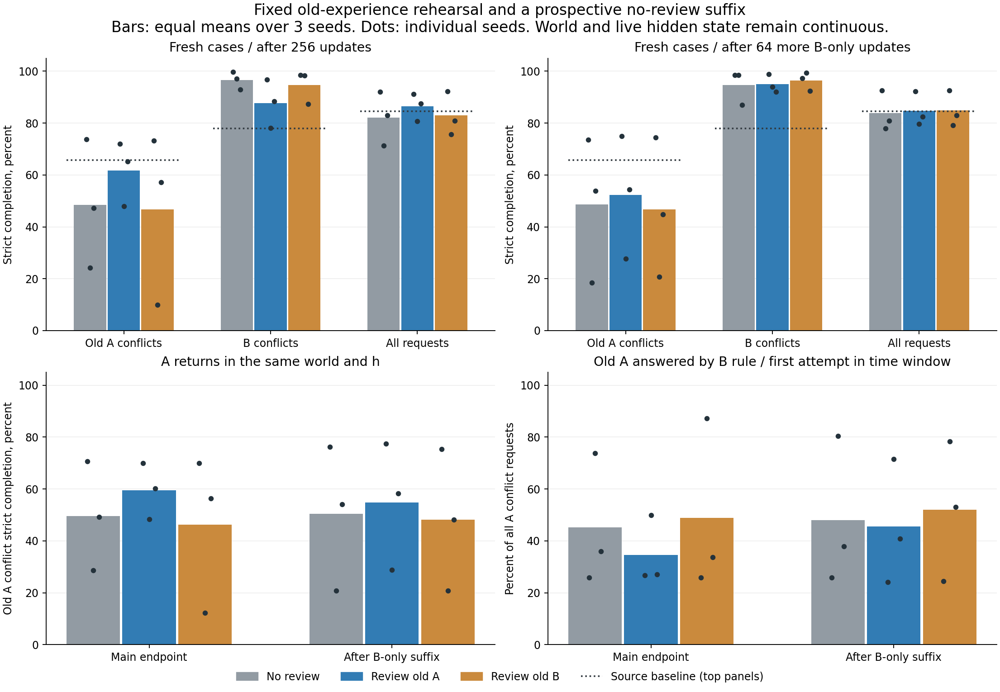

# 旧经验复习与停止复习后的保持

2026 年 11 月 7 日。接续 [规则撤出实验](../../coverage-retention-experiment-2026-11-07.md)，本轮比较少量旧 A 复习、等量旧 B 重复和不复习，并固定一段停止复习后的 B 学习后缀。**复习旧 A 减轻了遗忘，但付出了部分 B 成绩；停止复习后，旧 A 的大部分平均优势又缩小。** 时长仍为 8–16，没有同时扩大时长覆盖。[主方案](../../../experiments/episodic_review/analysis-plan.md) · [在评分前追加的保持检查](../../../experiments/episodic_review/retention-plan.md) · [逐种子计数与来源](../../evidence/episodic-review-2026-11-07/results.json)

## 从同一个撤出前状态分叉

为与上轮无复习结果直接核对，三组均从同一个撤出之前的中点动作组终点重新分叉，不是从已经遗忘 A 的终点开始补救。复制完整模型、已训练时间读出、Adam 第 256 步状态、数值 h 与 RNG，使用上轮同一条真实中点教师流：新周期只选 B，边界继承的 A 周期仍可自然修改和收尾。主流仍连续处理全部 32,768 tick，没有新预热或状态重置。

| 条件 | 新增 256 次更新的来源 |
|---|---|
| none | 256 次主流 B 块 |
| replay_A | 224 次 B 块，32 次旧 A 片段 |
| replay_B | 224 次相同 B 块，32 次配对旧 B 片段 |

复习固定发生在第 8、16……256 次更新。对应 B 块仍前向处理并形成主 h，只不用于该次梯度更新。随后在独立的辅助状态上训练旧片段，更新参数后继续携带那个 B 终点 h，不移入复习片段的 h。时间头以停止梯度的 h 为输入，自身继续接受 MSE 更新，但时间梯度不回传政策；实际动作仍由原十一动作头决定。

none 的第 0、64、256 步模型、Adam、h、RNG 和工作计数要求逐位复现上轮 withdraw。旧 A/B 片段的比较是主要对照，none 提供完整 B 学习的参照。训练消费已冻结的真实教师轨迹，这种数值连续性不等于已验证物理实时环境中的异步复习。

## 复习了哪些旧经历

每种子从撤出前实际中点教师历史中选择 256 对已成功结束的 A/B 请求，四种 raw 各 64 对。配对匹配任务槽、符号、版本、NEW/REPLACE 类型、任务长度与首次合法位置，没有按当前预测误差挑选。过去已完成是库的选择条件，不能声称它保留了所有失败或取消经历。

每个窗口保留 32 tick cue 前史，加上从 cue 开始的 96 tick 目标槽监督，包括 BEGIN、等待、FINISH 和真实结束后的空闲 WAIT。其它槽和前史观察原样保留，但没有它们的梯度标签。因此旧 B 对照仍可能看到附带的 A 观察，不能说它完全没有 A 输入。

A/B 两侧的动作类别骨架、动作掩码、时间掩码和正负位置完全一致。32 次复习每次选 32 对中的对应一侧，固定四遍排列，每对恰好呈现四次。[记忆库协议](../../../data/episodic-review/bank-v1/protocol.json)

每次旧梯度更新有 3,072 行动作监督，共 98,304 行。加上 224 个主流块的 1,835,008 行，复习组实际动作梯度标签总计 **1,933,312**；none 为 **2,097,152**。新增旧库回放标签占该阶段实际动作梯度标签约 **5.08%**，更新次数占 1/8；比例的分子只统计新增旧库标签，分母仍包含各组共有的边界继承监督。两种复习组完全等量，但它们和 none 不能称为所有标签量相同。

## 旧片段起始状态如何得到

不保存并直接移入旧模型的隐藏态。每次复习都用当前固定权重，从旧公开历史的起点 h=0 重新读到所选窗口之前，按选中 actor 去重，在不超过 512 tick 的块及所需 anchor 边界处前向。前史重建无梯度，随后对 128 tick 窗口反传。不同更新之间不缓存旧 h。

这避免把辅助历史状态覆盖到正在继续的 B 状态，但增加了计算和存储成本。虽然梯度库每类只有 256 个窗口，重建还读取完整旧公开历史，不能把所需存储量说成只有这些片段。相同优化器更新次数不等于相同 FLOPs 或墙钟时间。[主训练协议](../../../data/episodic-review/train-v1/protocol.json)

## 不只看最后一次复习后的状态

第 256 次恰好是复习更新，因此在看到任何留出成绩之前，另行固定一个保持检查：所有条件在主终点的 model/Adam512/h 上，再接受同一条 **8,192 tick、64 次更新的 B-only 流**，完全没有复习。实际世界从全局 tick 66048 接续到 74239，Adam 到 576，不重置或预热。

主终点称 study256，后缀终点称 study320。两处都报告，不选其中最好的一处。这个后缀检验继续受到 B 监督后保留多少能力，不能证明永久巩固。[后缀数据协议](../../../data/episodic-review/retention-streams-v1/protocol.json)

## 主终点的保持与代价

所有模型和两个阶段先冻结，再在训练外新世界中评估。每条流自行行动 512 tick 后测试 4,096 tick，计入全部测试段新发、外部合格且成熟的请求。主要时长 8–16 下有 4,036 个请求，A 冲突占 1,049 个。以下百分比和空闲误动都是三个种子等权平均，计数则合并列出。[统一评估协议](../../../data/episodic-review/eval-v1/protocol.json)

| 主终点 study256 | 旧 A 冲突严格 | B 冲突严格 | 全部严格 | 普通完成 | 空闲误动 / 千机会 |
|---|---:|---:|---:|---:|---:|
| 源基线，未参加本轮训练 | 65.7% | 77.9% | 84.6% | 96.6% | 0.71 |
| none | 48.4% | 96.6% | 82.1% | 93.5% | 0.56 |
| replay_A | 61.7% | 87.7% | 86.4% | 96.8% | 0.18 |
| replay_B | 46.8% | 94.7% | 82.9% | 92.8% | 0.28 |

旧 A 的严格完成合计分别为源基线 **688/1,049**、none **504/1,049**、replay_A **646/1,049**、replay_B **488/1,049**。回放 A 的平均表现高于同量 B 回放，说明收益不能只用重复旧数据的通用效果解释。不过它没有完全恢复源基线，且 B 比 none 低约 8.9 个百分点。

旧 A 的逐种子严格率，none 为 **73.8%、24.2%、47.2%**，replay_A 为 **72.0%、47.9%、65.2%**，replay_B 为 **73.2%、10.0%、57.2%**。平均优势主要来自种子 1、2，种子 0 没有改善。因此不能说三次训练都同样受益。

## 停止复习后，优势剩下多少

后缀中没有 A 请求、A 活跃监督或任何复习。下表仍用上面同一批新世界请求，因而可以按请求配对两个阶段的行为。

| 再学习 64 次 B 后，study320 | 旧 A 冲突严格 | B 冲突严格 | 全部严格 | 普通完成 |
|---|---:|---:|---:|---:|
| none | 48.6% | 94.7% | 83.8% | 92.5% |
| replay_A | 52.4% | 94.9% | 84.7% | 93.9% |
| replay_B | 46.7% | 96.4% | 84.9% | 94.0% |

replay_A 的 A 冲突严格完成由 **646 降到 546**，none 为 **504→507**，replay_B 为 **488→485**，分母均为 1,049。A 回放对 none 的平均优势从约 **13.3 缩至 3.7 个百分点**，对 B 回放的优势从约 14.9 缩至 5.7 个百分点。与此同时，B 成绩重新提高。

这份固定配方留下了一部分保持收益，但不能把主终点的改善全当作稳定巩固。它也不等于收益完全只是最后一次复习的瞬时效果：在又经历 8,192 tick B 监督后，仍有有限残留。三种子和这一个固定后缀长度不足以确定更长时间的衰减规律。[后缀训练协议](../../../data/episodic-review/retention-train-v1/protocol.json)

## 不重置世界和 h 的返回检查

对每个阶段恢复其真实 B 世界和各自 h，只将未来家族恢复为 A/B，冻结权重，自行运行 512+4,096 tick。study256 与 study320 的世界时钟和请求不同，只在同一阶段内配对三个模型，不能把跨阶段 live 百分比相减当作同一批请求的干预。

| 原世界连续返回的 A 冲突严格率 | none | replay_A | replay_B |
|---|---:|---:|---:|
| study256 | 49.5% | 59.5% | 46.2% |
| study320 | 50.4% | 54.8% | 48.1% |

两个阶段的全部成熟请求分别为 4,076 和 4,054，A 冲突分别为 1,004 和 973。主终点 A 严格计数为 **496/597/463**，后缀终点为 **497/539/475**。同一阶段内的旧 A 回放仍有平均优势，后缀后优势较小。这支持前述保持结果，不需要用重置主状态来解释。[连续返回协议](../../../data/episodic-review/live-v1/protocol.json)

## 预先指定的错误答案检查

本轮在评分前就固定分类：对全部成熟冲突请求，核对合法窗口首次实际 FINISH 是当前规则的答案、另一规则的答案、其它载荷、错误版本，还是未出手。没有按失败或成功筛选请求；首次出手正确也不一定表示之前从未犯错。

| 新世界 A 冲突请求答成 B 的比例 | none | replay_A | replay_B |
|---|---:|---:|---:|
| study256 | 45.2% | 34.6% | 48.9% |
| study320 | 48.0% | 45.5% | 51.9% |

旧 A 回放减少了这种错误，停止回放后它又增加。连续返回中的对应比例为主终点 **45.1%/37.4%/48.9%**，后缀终点 **45.8%/43.4%/50.0%**。这些是实际答案的签名，不能单凭它们推断旧信息被完全删除，或已确定内部唯一的遗忘机制。

## 范围、成本与后续

本轮没有扩大时长覆盖。三个学习组在 16–32 时长的总体严格率，主终点约为 **8.5%–12.6%**，后缀后约为 **10.9%–12.1%**，没有建立更长等待的可靠能力。更长时长上的失败还受到计时与未出手影响，不能只看其中的规则答案比例判断记忆保持。

回放的计算代价不可忽略。每个回放模型额外重建约 **2,052 万至 2,116 万 actor·tick** 的前史，而主流前向为 1,048,576 actor·tick。前史无反传，但仍消耗算力；旧 A/B 的监督掩码和更新量严格相等，并非与 none 同 FLOPs。库之外的完整旧公开历史也仍要保存。

运行后段只提高了本任务 seed2 工作进程的 CPU/GPU 调度优先级，设置经读取回验；模型、数据、精度、预算与冻结源码未改。执行时间存在并发负载波动，不把墙钟变化当作算法能力的收益。[本地调度记录](../../../data/episodic-review/runtime-notes/process-priority.json) · [使用的 Windows 进程调度接口](https://learn.microsoft.com/en-us/windows-hardware/drivers/ddi/d3dkmthk/nf-d3dkmthk-d3dkmtsetprocessschedulingpriorityclass)

当前结论是，定向复习旧 A 能减轻功能性遗忘，但仍有 B 成绩的短期代价，停止复习后大部分平均优势减弱。固定保存记录、固定复习日程和教师标签均由研究者提供，这还不是模型自主决定记什么或永久巩固。

下一步值得在同一旧库和预算内比较均匀选样与按当前预测误差选样，观察能否把有限复习用到实际下降的规则上。保持检查仍应包含停止复习后的统一 B 后缀，不能只看刚刚复习完的成绩。本轮未执行这个后续对照。

## 核验

主训练、后缀和数据/评价共 24 项测试通过。主 9 个终点、27 个快照，后缀 9 个终点、18 个快照均在留出评分前冻结。主阶段及后缀各有 18 次真实 CUDA 更新被独立逐位复算，包含每个复习组首个真实回放的当前权重前史起点。全部 2,880 个主流块的身份、计数和 h 链，以及 192 个回放批次的选样、掩码与预算均检查通过。源 model/Adam/h/RNG 拷贝核验通过，none 的九个命名快照完整复现上轮撤出结果。[主训练审计](../../../data/episodic-review/train-audit-v1/audit.json) · [后缀审计](../../../data/episodic-review/retention-audit-v1/audit.json)

42 次新世界与 18 次连续返回的完整请求账本、时间侧录、预定规则分类及原生世界/策略重放全部通过，包含所有动作、logits、时间值、最终 h，以及 live 的完整末世界。[指标与分类审计](../../../data/episodic-review/eval-audit-v1/metrics.json) · [完整重放](../../../data/episodic-review/eval-audit-v1/replay.json)

后缀数据的首个协议哈希检查因元组/列表的序列化表示差异，在任何世界采集前失败；原声明保留，规范化 JSON 后重新冻结，未变更世界、标签或预算。[代码与复现入口](../../../experiments/episodic_review/README.md)
