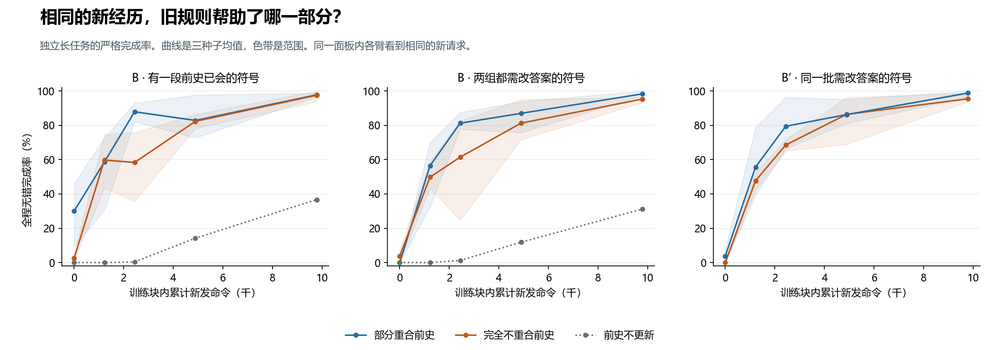
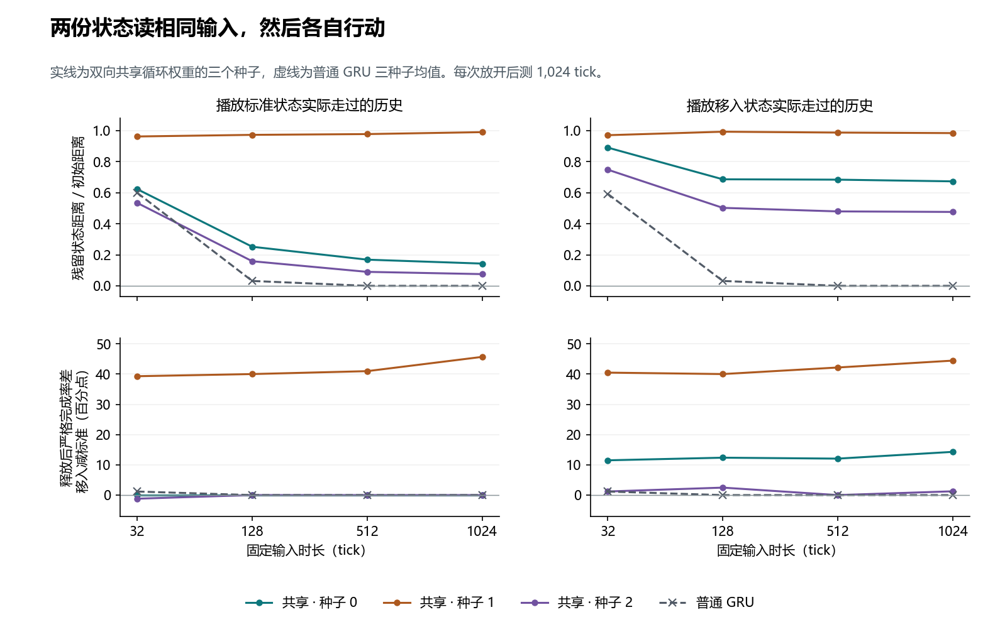

# 旧规则能否帮助学会新差异，同样的输入能否抹平状态差异

2026 年 11 月 3 日。上一轮的普通 GRU 能在长等待后独立完成部分请求，固定预算的历史复习改善了旧规则保持。双向共享循环权重的 GRU 则对进入测试时的隐藏状态特别敏感。这一轮分别检查不同学习前史对新规则的影响，以及固定权重时两种工作状态的差异怎样演变。[上一轮结果](learn-remember-experiment-2026-11-03.md) · [本轮分析方案](../../../experiments/experience_transfer/analysis-plan.md)

**相关前史给出了更好的起点。在必须改掉相同旧答案的部分，提速却主要集中在一个种子。** 两种受训前史最终都能学会新规则，然而无旧样本复习时，旧情境里的冲突答案大多被覆盖。状态实验则表明，至少一个共享权重模型即使连续 1,024 tick 接收完全相同的输入，仍保持两种有截然不同行为后果的内部状态。

## 迁移实验怎样区分会旧答案和学新答案

三个种子从上轮普通 GRU 的短课程存档出发。各自的模型、Adam、世界和 h 完全相同，已经接触过的只有规则 D。分叉后，一组学习 A，另一组学习 C。每组 12 轮，使用相同的任务类型、公开情境提示编号和预算，训练后半段自己行动。还有一个参照保留已学的 D，在同样长的环境时间内活动但不更新权重。A、B、C 的四个符号答案均与原有 D 不同。A 与 C 的学习都会改变真实的行动回执，因此主比较衡量整段学习经历的作用。

随后三组学习未出现过的 B。公开提示明确指出情境已切换。A 对其中两个符号已有正确答案，C 对四个符号的答案全与 B 不同。剩下的两个符号是本轮的主问题，因为 A 和 C 在这两项上原来给出**完全相同的错误答案**。再把目标换成 B′，保留这两个难点及其正确答案，另外两个符号改为与 C 一致。仍从相同 A、C 存档开始，相关前史便对调了。数字举例取种子 0，载荷按原始符号 0、1、2、3 顺序列出。

| 规则 | 0 | 1 | 2 | 3 |
|---|---:|---:|---:|---:|
| 前史 A | 0 | 1 | 2 | 3 |
| 前史 C | 2 | 1 | 0 | 3 |
| 新目标 B | 0 | **3** | 2 | **1** |
| 新目标 B′ | 2 | **3** | 0 | **1** |

难点是表中加粗的两列。其他种子轮换符号和公开情境编号。C 与 B 的对应关系是特意选成零重合的，所以这个对照包含干扰。B 和 B′ 分别使用各自的真实教师示范，同一目标的两个学习组获得同样的教师动作与训练标签。边界保留旧的未结束请求，屏蔽这些槽的学习目标。没有历史复习。原始符号与版本提示公开，正确目标载荷、合法时机和教师标签只用于训练损失或评分。[训练代码](../../../experiments/experience_transfer/train_transfer.py) · [主训练协议](../../../data/experience-transfer/training-v1/protocol.json)

每轮 1,024 tick、64 个并行 actor，128 tick 截断反传，32 遍学习当轮连续轨迹。第一轮还在第一遍 2 次和 8 次更新后保存模型，用来区分看见新请求的效果与反复拟合同一批反馈的效果。在训练外的长任务上冻结模型，实际执行十一种动作中得分最高者。每个种子比较同一批成熟请求，严格完成要求全程无错。先看 B0，再看固定预算时的绝对成绩和相对自身 B0 的变化；同一个快照的不同家族、请求和时刻均不计作独立训练重复。[独立行为评分程序](../../../experiments/experience_transfer/eval_transfer.py)

## 新规则 B 的实际学习曲线

表中是长任务严格完成率，先按种子算百分比，再对三个种子等权平均。两种已训练前史各花 3,072 次更新。参照组在同样的前史时间里只继续活动，保留短课程学来的参数。因此 A 或 C 相对参照的优势包含额外的长任务练习、优化和动作控制经验。B 阶段三组均做 2,048 次更新，对应各自世界的真实 B 示范数相同。

| 学习 B 的进度 | 重合符号，A | 重合符号，C | 共同难点，A | 共同难点，C | 共同难点，前史不更新 |
|---|---:|---:|---:|---:|---:|
| 未学 B | 30.0% | 2.5% | 0.0% | 3.8% | 0.0% |
| 同一首轮的第一遍，8 次更新 | 23.8% | 8.4% | 1.7% | 7.1% | 0.0% |
| 第 1 轮末，256 次更新 | 58.6% | 59.7% | 56.4% | 49.8% | 0.0% |
| 第 2 轮末 | 87.9% | 58.3% | 81.2% | 61.4% | 1.2% |
| 第 4 轮末 | 82.8% | 82.3% | 86.9% | 81.2% | 11.8% |
| 第 8 轮末 | 97.8% | 97.5% | 98.3% | 95.3% | 31.1% |

接触 B 前，相关前史的优势集中在旧答案仍适用的那两个符号上。两种有前史训练的模型经过足量 B 示范后都能独立完成大部分难点请求。第 2 轮的差异远大于第 4 轮，不能用峰值 19.8 个百分点代表整段迁移。在 B 后半段仍反复使用当轮的教师示范，成绩不构成只靠极少反馈就学会的证据。[所有种子、快照、请求分母和预算](../../../data/experience-transfer/eval-v1/curves.csv)

所有主曲线快照在每种子都面对同一组成熟请求，总共 502 个，其中共同难点 235 个。B 训练块中新发请求数按种子分别为 9,820、9,730、9,773，每个种子的各臂均相同；边界另有 2、1、3 个无损失步新发请求。首遍第 8 次更新和第 1 轮末见过相同的约 1,200 个新发请求，但后者已在当轮数据上做了 256 次更新。相关组 A 与不重合组 C 接收的 B 阶段公开观察、实际示范动作、有效位置和标签全部逐位相同。直接参照组有少量继承旧槽的公开回执不同，B 槽及监督反馈仍一致。[真实训练预算与逐步复核](../../../data/experience-transfer/training-v1/summary.json)

### 换边后，早期优势有多大

把已有前史不变地迁到 B′，这次与目标部分重合的是 C。主问题仍只看相同的两个共同难点，依照学习前固定的口径，取 B0、第 1、2、4 轮末的严格完成率，按训练块中实际新增请求数积分并除以该段请求量。结果是这一段曲线上平均领先的**百分点**。下表每个种子先在同一目标内做配对差，最后一行再对两个目标等权平均。

| 共同难点，相关前史减完全不重合前史 | 种子 0 | 种子 1 | 种子 2 | 三种子均值 |
|---|---:|---:|---:|---:|
| 学习 B，A 减 C | +29.71 | −4.01 | +4.38 | +10.03 |
| 学习 B′，C 减 A | +19.72 | +3.77 | −3.90 | +6.53 |
| 两目标换边配对 | **+24.72** | **−0.12** | **+0.24** | **+8.28** |

换边配对的样本标准差为 14.24 个百分点。此次共同难点上，两个目标的零点差在换边平均时恰好抵消，按各自零点算进步量得到相同的 +8.28。种子 0 对两个新目标均显示正向迁移；其他两个种子换边后的净差很小。因而能观察到相关前史加速纠正新答案的实例，但三个种子还不足以支持稳定加速。与此相对，两种有长任务训练的前史在 B 末都远好于没有前史更新的参照。后者缺少同等的长任务练习，不能用这个差值估算规则重合的独立效应。[逐种子曲线、分子分母及计算输入](../../evidence/experience-transfer-2026-11-03/paired-curves.json)

### 学会 B 后，还能否分别使用两种规则

把旧、新情境按请求交错，模型都能看到真实情境提示。在共同难点上，A 组对旧 A 的严格完成率从 **67.2% 降到 0%**，同时对新 B 从 **0% 升到 98.3%**。C 组对旧 C 从 **56.7% 降到 3.6%**，新 B 从 **3.9% 升到 94.8%**。这轮没有复习旧规则。高 B 分数说明新答案学会了，但还不能说明模型把两套冲突答案按情境整合了。[旧规则和交错测试](../../../data/experience-transfer/eval-v1/compact-results.json)

同轨迹诊断也检查了改选内容的过程。在三组完全相同的真实 B 教师轨迹上，每条请求只取第一次教师要求 FINISH 的位置。给定正确版本，A 组在共同难点上让新答案得分高于旧答案的比例从 B0 的 **21.3%** 达到 B8 的 **99.6%**；C 组从 **33.3%** 到 **99.6%**。八种结束内容中排对第一的比例到 B8 分别为 **98.5%、96.4%**。这里诊断的是公开经历固定时的读出，实际完成仍来自上面的自由测试。[诊断方案](../../../data/experience-transfer/content-v2/protocol.json)

## 固定输入后，怎样测状态是否仍有区别

固定普通 GRU 与双向共享循环权重 GRU 各自的三个宽课程端点。在同一个陌生世界中，沿用上一轮的两种起始 h，一份来自标准留出历史，另一份从模型自己的训练端点移入。分别让两份状态各自生成一段真实的自由行动轨迹。选择其中一段播放时，两份 h 都逐 tick 接收该段**完全相同**的公开观察和动作回执。只有驱动该段轨迹的模型动作作用到世界，另一份 h 的候选动作只记录。

在 32、128、512、1,024 tick 的播放边界，把相同世界复制给两个分支，让两份 h 分别自由控制此后 1,024 tick。零播放时复现上一轮的 2,048 tick 原测试。释放后的请求身份在每一对内相同，模型权重始终冻结。状态逐维均方根差、同一观察下的动作分歧和放开后的实际完成分别报告。[播放与释放的固定方案](../../../data/experience-transfer/state-v1/protocol.json)

普通 GRU 在两种播放源下都表现出类似的收敛。播放 128 tick 后，三个种子的释放严格完成数和空闲误动作数已在各配对内相同，实际空闲机会的分母仍有 1–2 次差异。512 和 1,024 tick 时，面对相同下一观察，两个初态衍生出的动作在 48 个槽机会中已无分歧，释放后的严格完成和空闲误动分子、分母也一致。此处的结论限于选定的两种初态和实际播放历史。

循环权重双向共享的模型则有明显的种子差异。下面只看已经连续播放满 1,024 tick 再放开的测试。箭头两端分别来自标准初态和移入初态，同一行的公开观察、回执和释放时的世界完全相同。

| 种子 | 播放历史由哪一份状态生成 | 隐状态距离保留比例 | 同一下一观察的动作分歧 | 严格完成，标准→移入 / 成熟请求 |
|---|---|---:|---:|---:|
| 0 | 标准状态 | 14.3% | 5/16 | 18→18 / 84 |
| 0 | 移入状态 | 67.3% | 6/16 | 18→30 / 84 |
| 1 | 标准状态 | 99.0% | 16/16 | 0→37 / 81 |
| 1 | 移入状态 | 98.4% | 15/16 | 0→36 / 81 |

种子 2 在这两个播放条件下分别为 6→6 和 6→7，分母各 80。种子 1 的差异尤其清楚：在标准历史后释放，标准初态分支的 10,288 个空闲机会全部误动，移入初态分支则为 34/10,359。释放之后产生不同回执固然可能继续放大差异，但在释放**之前**，两份状态仅凭相同输入已经维持了截然不同的动作倾向。种子 0 又说明输入内容本身会影响两份状态是否靠拢。有限时长的结果还不足以识别吸引子数量、稳定盆地或任意初态的恢复能力。[全部时刻、分母与独立重放](../../../data/experience-transfer/state-v1/report.md)

## 核验与下一步

主迁移实验保留 90 个自由评估分叉，换边对照保留 30 个。主线还独立重放了真实训练输入、动作与世界，重新计算首批第 2、8 次更新的权重、Adam 和连续 h。固定输入实验的 108 个释放分叉均核验了动作与计数，另用原评估器交叉重放其中 36 个。固定示范读出的初次运行沿用环境的四槽默认值，生成的 112 维输入在读出前被 GRU 拒绝。该次没有产生模型得分，改为预定的双槽 56 维后重新生成诊断数据，与主训练和自由评估分开。状态审计改用真实逐 tick 推理边界复核，不靠放宽误差阈值通过。[自由评估计数与共同案例](../../../data/experience-transfer/eval-v1/summary.json) · [状态实验核验](../../../data/experience-transfer/state-v1/summary.json) · [代码与复现入口](../../../experiments/experience_transfer/README.md)

接下来最有区分度的学习对照，是从同一批 A/C 历史出发，保留等量的旧冲突样本参与 B 训练，再看模型能否同时保住旧情境、学会新情境，以及是否牺牲早期学习速度。现有 1/8 复习可以直接作基线。工作状态这条线则适合固定权重，找出哪些真实经历能让长期分离的状态转换，并检查放开行动后能否维持恢复。两者分别检验能否兼容旧新知识和能否自行恢复控制。
