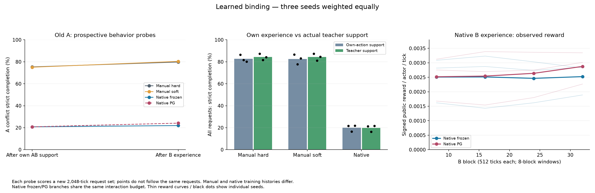

# 固定循环特征，仅训练记忆读写

2026-11-10。这是查看[前两版学习绑定结果](learned-binding-experiment-2026-11-07.md)后的新一轮对照。先读后写版仍未学会可靠关联使用，本轮只固定encoder参数，检查让特征和读写规则同时学习是否增加了困难。

[预定方案](../../../experiments/learned_binding/frozen-trace-plan.md) · [代码入口](../../../experiments/learned_binding/README.md)

## 改动与不变项

相对于read-first-v2，只将encoder的5,952个参数固定在相同种子的初始值。query/key/value/gate与读出尺度仍由动作CE及自身回报训练，可训练参数为2,258。没有新增绑定标签、固定地址、成功写开关、回放库或读写模块。

encoder参数固定，z仍随公开观察逐tick演化。h192、z64、M64的状态容量、总模型参数、初始值、读写顺序、16条每种子训练流、512次动作更新和32块自身PG预算全部不变。初始化仍包含update bias合计+4的保持先验，不能称完全无先验的随机表征。

这项干预同时改变优化自由度、共同适应过程和参与全局梯度裁剪的参数。因此即使改善，也不能唯一解释为表征漂移被修复。先前97%与92%的线性探针数字仅来自有绑定标签的事后诊断，不是策略成绩。

## 状态

新实现的15项测试与49项基础回归通过，含CPU/CUDA、encoder梯度/参数保持、完整加载、Windows worker激活和独立PG小夹具。三个训练终点均完成512次更新，编码器与同种子初始化逐位一致。正式行为与独立审计全部完成，结果仍未建立可靠绑定。

三种子等权平均，比较直接基线read-first-v2与本轮固定特征版：

| 条件 | 基线总体严格完成 | 固定特征总体严格完成 | 固定特征评分请求内容正确 |
|---|---:|---:|---:|
| 自身A/B经历后 | 19.29% | 20.00% | 23.89% |
| 继续B，参数冻结 | 20.52% | 20.40% | 23.90% |
| 继续B，实际回报PG | 21.40% | 22.19% | 24.30% |
| 正确教师经历后 | 19.60% | 19.75% | 24.20% |
| 教师后全程禁读 | 21.06% | 20.96% | 24.45% |

本表的内容正确率与完成率均使用成熟合格请求作分母；JSON另列全部命令的翻译率，不能混用。固定特征没有使内容翻译摆脱四分类近随机水平，也未建立相对于禁读的可靠行为收益。手写soft参照在相同教师历史下仍为84.37%总体严格完成。结果不支持仅靠固定encoder就能修复读写学习，但不能唯一归因某个头或训练环节。

旧A冲突的严格率在自身支持后为20.81%，继续B后冻结/PG分别21.94%/24.14%。由于旧A最初就没可靠学会，不能据这些数字宣称旧记忆被保住。继续B后的空闲误动，冻结/PG为6.39/5.42次每千机会；手写soft参照为0.78。小幅行动回报变化不等同关联记忆习得。

本轮没有追加绑定标签、修改损失或扩展预算。可读的请求身份尚未被这套读写模块转为有效控制，下一步应继续分开检验写入内容、地址对应和读取的作用；这仍只约束冻结执行器与软符号适配器这一路线，不是对原生持续学习能力上限的结论。

手写hard/soft的18份评分及192块由原工件逐字节复用，不重复计为新增结果；本轮只新增三个学习者终点、21份评分及192块。评价集已用于此前研究选择，所以本轮仍是受控事后比较，不是全新独立验证。

[完整均值、逐种子计数及来源](../../evidence/frozen-trace-2026-11-10/results.json) · [训练与行为审计](../../evidence/frozen-trace-2026-11-10/audit.json)。审计核对本版39份评分、384块、九条完整策略重放及六次实际PG/Adam更新；其中含复用对照。另对630个学习者快照及三个CE终点核对encoder参数等于同种子初始化。encoder梯度为空和优化器参数集合由构造、运行检查及小测试验证，不混称所有梯度均逐步存档。

图中的Native frozen指B阶段冻结读写参数；本图的两条Native都已固定encoder。图的不同评分点对应不同时间的新请求，不是同一批请求持续被评分。

## 环境恢复

原虚拟环境指向的Python3.14.5路径已不存在，系统Python为3.15。为保留torch2.11.0+cu130的cp314运行依赖，使用[Python官方3.14.5安装包](https://www.python.org/downloads/release/python-3145/)在项目`.tools/Python3145`恢复独立运行时，核验官方SHA256；保留并备份原venv配置，辅助依赖改为项目内安装。系统默认Python仍为3.15，本轮未验证所有历史实验的额外依赖。

Windows Smart App Control随后阻止torch CPU/CUDA DLL。用户自行处理系统拦截后，重新验证CUDA加载和计算成功；代理没有修改安全策略。辅助包版本与旧记录可能不同，因此另做旧read-first世界、状态和PG更新的独立重放，记录在本机[环境资料](../../../data/learned-binding/runtime-2026-11-10/environment.json)及[基线重算](../../../data/learned-binding/runtime-2026-11-10/baseline_reaudit.json)。环境恢复不计为模型收益。
