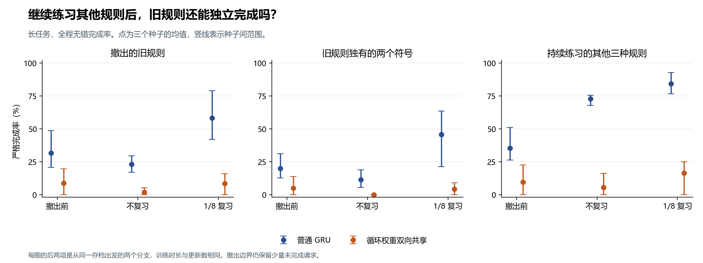

# 能完成长任务以后，还能记住被撤出的规则吗

2026 年 11 月 3 日。上轮无向图在 4,064 个成熟长请求上零完成。本轮把“学会并记住”拆成三个可观察的问题。模型能否在新世界中自己启动和结束？一次性命令消失后，它的内部状态是否影响最后选出的内容？在继续练习其他规则之后，它是否仍能执行旧规则特有的部分？三个问题分别使用实际行动、状态交换和旧规则复测。[上一轮训练](../actions/wait-content-experiment-2026-11-03.md)

**单层 GRU 做到了有限的自主完成和规则保持。** 在旧规则的独立长任务上，交错习得后的严格完成率为 31.51%。撤出这个规则后，不复习降到 22.93%，同预算用部分旧经历复习则达到 58.14%。双向共享循环权重的模型还暴露出对持续工作状态的依赖。在相同的新请求上，只把测试起点的 h 换为训练端点保存的 h，其严格完成率从 8.66% 升至 27.58%。两项结果分别测量学习经历和进入运行时的状态。[保持对照图](../../evidence/learn-remember-2026-11-03/retention.png)

## 任务与判断口径

世界里有两个并行任务槽。每个新请求用一次公开提示给出原始符号、版本、处理时间、结束窗口和家族。家族决定怎样把符号换算成答案。模型只能看 56 个公开输入，包括自己上一步动作的回执，每槽在 WAIT、两个 BEGIN 和八个 FINISH 中选一个。版本正确地启动后，需要等到合法时刻，再用正确版本和换算后的内容结束。普通完成可以包含先前错误，严格完成要求请求全程没有错误。空闲指标按实际空闲机会计数。

长条件的处理时长为 8–16 个环境时间单位，两次请求间空档为 16–32；每一步为 0.25。每个种子、每个模型快照都在训练以外的新世界和 actor 上测试。先以相同的 1,024 tick 公开背景建立各自的 h 和共同的世界端点，再在每个家族、每个难度分别自由行动 2,048 tick。只将分叉后新发起、已经成熟的合格请求计入分母，各个快照面对相同的请求身份。评估者没有用教师替模型执行动作。[评估方案](../../../data/learn-remember/evaluation-v1/protocol.json)

## 两条训练路线

**直接校正原无向图。** 从上轮“仅结束时学习内容”模型继续，保留 80 节点图、已有连接、动作读出和 Adam 进度。两组学生的结构和更新数相同。一组在自己实际行动后遇到的状态上接受教师校正，另一组使用原采集策略走出的公开输入与回执。另保留不学习但经历同样时长的基线。每组继续 4,096 tick、32 次更新，再测后续新请求。此项单独评价，不能与另一条路线的新模型做等预算的架构比较。[原图校正协议与实际计数](../../../data/learn-remember/correction-v1/summary.json)

**从零学习完整行为。** 用一个单层 GRU 加线性读出，每槽直接做十一选一。每轮收集 64 条并行流的 1,024 个连续 tick，监督拟合这一轮的公开观察与正确动作。在一个阶段的前半段，一部分 actor 执行教师动作，以便能看到成功启动后的真实结果；后半段全部执行模型自己的动作，仍有监督标签。测试只执行模型的 argmax。先用短任务熟悉第 3 家族，再用 16 轮交错学习四种家族，时长扩到 1–16。隐状态和世界贯穿采集，128 tick 截断只作用于反传。模型参数、样本量、示范、自主校正及数值精度均与原 80 节点图不同。[训练实现](../../../experiments/learn_remember/gru_train.py) · [冻结课程与配置](../../../data/learn-remember/gru-v1/plan_seed_000.json)

**撤出与复习。** 从交错习得末端改变未来新请求，接下来 12 轮只练习家族 0、1、2。家族 3 对原始符号 1、3 的要求分别是输出 2、0，与其余三个家族全部不同，因此单列这两个符号。第一组只用当前经历学习，切换时尚未结束的少量旧请求仍然保留。另一组从同一存档出发，把原有梯度更新中的 1/8 改为复习固定的最后四轮混合旧经历，每轮仍是 256 次更新。两组后续动作与回执可以不同。最终在旧规则再次参加训练之前测试。[历史复习对照](../../../data/learn-remember/gru-v1/review_frozen_plan.json)

## 原图校正与普通 GRU 的实际表现

原 80 节点图的自主经历校正在 456 个成熟长请求中普通完成 0 个，原策略轨迹组完成 1 个，两组的严格完成均为 0。自主校正组在合法窗口尝试了 30 次 FINISH，内容全部选错。每千次实际空闲机会的误动作分别为 45.03 和 20.98（三种子等权）。这 32 次更新没能把原模型从失败状态带出来。[逐种子失败位置与核验](../../../data/learn-remember/correction-v1/report.md)

单层 GRU 出生时三个种子的严格完成均为零。只练短任务后，第 3 家族的短任务严格完成为 18.3%、14.4%、18.1%，长任务仍为零。改为交错学习四个家族和较宽时长后，同一批长请求的严格完成数分别为 **36/174、43/170、83/171**。这是真实完成，模型自行选择了正确 BEGIN 和 FINISH，期间也没有违反该请求的要求。下表每个百分数先在同一种子内合计请求，再等权平均三个种子。[独立留出评估的逐请求与配对表](../../../data/learn-remember/evaluation-v1/tables.json)

| 普通 GRU，长条件 | 旧规则普通完成 | 旧规则严格完成 | 旧规则独有符号普通完成 | 独有符号严格完成 | 其他三种规则严格完成 | 旧规则空闲误动 / 千机会 |
|---|---:|---:|---:|---:|---:|---:|
| 四家族交错习得末 | 67.47% | 31.51% | 60.58% | 19.94% | 35.38% | 1.51 |
| 继续练另外三种规则，无旧历史复习 | 45.60% | 22.93% | 21.68% | 11.32% | 72.85% | 1.69 |
| 同一出发点和时长，1/8 更新复习混合历史 | 88.53% | 58.14% | 83.31% | 45.59% | 84.25% | 0.78 |

两条撤出分支都得到 12,288 个新环境 tick、3,072 次梯度更新。复习组其中 384 次使用历史数据，旧家族位置实际只占该阶段全部梯度样本位置的 **3.03%–3.27%**。它的独有符号严格完成率在三个种子上分别为 **21.3%、52.2%、63.3%**，无复习时为 **9.6%、18.8%、5.6%**。复习组既保留了旧能力，又在继续练习的三个规则上取得了更高的平均分。本次旧规则没有以新请求回到环境，但它确实通过历史标签再次参与学习；复习组超过撤出前的成绩，也包含这些额外练习的贡献。

无复习分支在撤出边界延续原状态，未结束的第 3 家族仍留下 1、1、3 次变更命令和 18、11、14 个非 WAIT 教师位置。撤出的是未来新请求，已有因果历史未清除。训练后半段虽由模型行动，学习信号仍来自任务教师。三种子是独立训练重复，成千上万个动作位置不增加独立种子数。[训练量、复习位置与剩余暴露](../../../data/learn-remember/gru-v1/training_report.json)

## 双向共享循环连接的对照

看到普通 GRU 在宽任务的自主采集阶段开始成功后，补做了一个从出生就共享循环权重的模型。保留 192 维状态、相同的公开输入、动作空间、数据生成器和梯度更新预算。每个门单独学习一张含自连接的对称权重矩阵。每个无序节点对只有一个可训练标量，两条方向都从它展开。普通模型共有 **148,246** 个可训练参数，对称版本有 **93,238** 个，其中 **55,584** 个属于门的对称循环连接。导出成标准 GRU 是为了复用同一推理器，检查点里恢复出的唯一坐标和 Adam 形状均可核对。输入与输出仍是有方向的接口，状态依赖的门也会使两个方向在某一时刻产生不同的实际影响。这是与原 80 节点统一端口图不同的一种内部无向连接模型。[实现与导数核验](../../../experiments/learn_remember/symmetric_gru.py) · [对照声明](../../../data/learn-remember/symmetric-v1/protocol.json)

| 循环权重双向共享，统一 WAIT 背景后的长任务 | 旧规则普通完成 | 旧规则严格完成 | 独有符号严格完成 | 其他三种规则严格完成 | 旧规则空闲误动 / 千机会 |
|---|---:|---:|---:|---:|---:|
| 交错习得末 | 25.63% | 8.66% | 4.98% | 9.35% | 539.47 |
| 撤出后，不复习旧历史 | 12.28% | 1.75% | 0.00% | 5.39% | 875.00 |
| 撤出后，1/8 更新复习 | 25.98% | 8.52% | 4.03% | 16.49% | 707.45 |

同样的预算和测试背景下，复习使部分能力恢复，但其稳定性仍远低于普通 GRU。宽任务习得末，三个种子的旧规则严格完成分别为 **34/174、0/170、11/171**。第二个种子在每次空闲机会都误动。因两种模型的有效自由参数量、递归动力学和训练中自己造成的回执不同，不能仅凭这一对照归因于无向性。[所有表格的分子、分母和来源哈希](../../evidence/learn-remember-2026-11-03/results.json) · [双向权重和行为独立核验](../../../data/learn-remember/symmetric-v1/independent-audit.json)

### 同一组权重为何有时能工作，有时会一直乱动

双向共享模型在真实训练流中常能完成请求，统一测试背景下却出现几乎一直乱动的种子。针对这个差异，冻结模型后单独比较三种进入测试的方式。标准背景是留出世界先行 1,024 步 WAIT；自主背景由相同的新世界出生、经历相同的外部事件，从第一步就用模型动作生成回执；真实端点则带着训练中实际形成的世界和 h 继续。前两种可以逐请求配对，第三种有另外 64 个训练 actor，只用于观察完整连续运行，分母不可与前两种逐请求配对。[补测协议与跨背景结果](../../../data/learn-remember/evaluation-deployment-v1/summary.json)

对交错习得末的双向共享模型，统一背景、自主背景、真实训练端点的旧规则长任务严格完成率分别为 **8.66%、8.72%、25.39%**；空闲误动分别为 **539.47、708.70、3.52 次/千机会**。普通 GRU 来自这三种背景的严格完成率为 **31.51%、31.51%、32.13%**。因此，把开头 1,024 步的操作从 WAIT 改成自主行动，本身不足以恢复共享模型在训练端点的控制表现。

随后做了一项明示的状态干预。锁住同一个训练外世界、同一套习得末权重和完全相同的未来请求，只把测试开始时的 h 换成相应模型训练端点前八个 actor 实际保存的状态，不按成功与否选取。提供 h 的 actor 从未见过这些测试请求。后续动作仍由模型自由执行，干预只发生一次。[状态替换方案](../../../data/learn-remember/state-transfer-v1/protocol.json)

| 旧规则长任务，三种子均值 | 标准测试状态，严格完成 | 移入训练状态，严格完成 | 标准状态，空闲误动 / 千机会 | 移入训练状态，空闲误动 / 千机会 |
|---|---:|---:|---:|---:|
| 普通 GRU | 31.51% | 31.90% | 1.51 | 1.77 |
| 双向共享循环权重 | 8.66% | **27.58%** | 539.47 | **4.24** |

共享权重组三个种子在完全相同的成熟请求上，严格完成数从 **34→56 / 174、0→73 / 170、11→13 / 171**。只看后 1,024 tick 中新发起且成熟的请求，仍是 **9.61%→29.60%**；普通 GRU 的该后缀是 **29.42%→29.42%**。这说明初始状态可以通过后续动力学、行动和回执对该共享模型的工作表现产生持续影响。一次移入 h 改善表现，尚未说明这个状态怎样形成，也没有证明系统从任意起点都能自己恢复到它。这个干预次数有限，其结果不计入主评估的自主保持成绩。[逐种子完整计数](../../../data/learn-remember/state-transfer-v1/seed_001.json)

## 一次性命令是否真的靠内部状态保存

从项目已有的真实持续背景中选取经过至少 128 tick 公共历史的命令，三个种子各有 42、42、44 个背景。从同一个提示前状态分叉，交叉替换 4 种原始符号与 4 种家族提示，保留原版本和另一槽的真实干扰，固定处理时长为 8。目标槽在提示时正确启动一次，之后等候，所以回执透露版本，不透露符号或家族。每个背景的 16 个变体在提示以后收到的全部公开输入逐位相同。另选每种子的两个槽、两种版本各一个真实背景，16 个变体都用原世界执行，192 个分叉验证了公开输入和教师首次要求结束的时刻。[事先固定的状态干预](../../../data/learn-remember/memory-v1/protocol.json) · [原世界核对](../../../data/learn-remember/memory-v1/public-world-check.json)

在等待中途，仅把内部状态换成同一背景、同一家族、另一符号的分支状态，然后继续输入完全一样的观察。下面是在真教师首次要求 FINISH 时，八种结束动作的最高分能否答对当前请求。右列仍按被替换状态的原请求计分。三个种子等权。

| 模型与阶段 | 原状态 | 等待中途换成另一符号的状态 |
|---|---:|---:|
| 未训练普通 GRU | 12.3% | 12.3% |
| 普通 GRU 交错习得末 | 43.9% | 24.7% |
| 普通 GRU 撤出后、无历史复习 | 66.2% | 20.7% |
| 普通 GRU 撤出后、1/8 历史复习 | 79.5% | 10.6% |

在最后一行，保留原状态且在全部十一动作中自由取最大值，58.8% 的位置会恰好发出正确 FINISH。交换状态后，输出分数跟随提供状态的那条命令。仅看旧家族独有的两个符号，提示真是旧家族时有 47.2% 把旧答案排第一；同一背景和符号只改为其他家族时，仍选该旧答案的比例为 0.9%。这说明当前状态确实携带了随后动作使用的信息。该实验没有区分网络保存的是原始命令还是已计算的目标内容，也没有让干预动作驱动自由轨迹。真实完成率仍以上节的完整自由行动为准。[输入、状态和逐分支选择](../../../experiments/learn_remember/memory_assay.py)

## 本轮边界和下一步

本轮得到两种不同的记忆证据。单条命令能在输入消失后借助 h 影响随后选择，旧规则也能在训练其他规则时通过有限复习得到保持。这些结果来自四种规则、三个种子和有教师的学习。实际标签、示范和少量历史回放都可追踪。这轮没有检验模型自行判断经验价值，或者多轮撤出后无限期地保持技能。

对原项目最值得继续追踪的是共享模型的起始状态依赖。可先固定这批权重，比较自然任务切换或短暂扰动后，何种公开经历能让模型自己回到空闲时安静、需要时能工作的状态，并在全新的持续流上验证。对复习策略，现有固定 1/8 是可测的基线，后续可以在相同预算下比较由模型挑选复习内容的方式。[运行入口](../../../experiments/learn_remember/README.md)

核验分别覆盖了普通模型的 168 个主测试分叉、双向共享模型的 72 个主测试分叉和 42 个部署背景补测。普通模型另独立重放 42 个分叉的模型动作和末状态，18 个分叉的完整世界演化。共享模型从实际回执重算普通与严格完成，也从部署权重重新恢复唯一循环坐标和 Adam 形状。原图校正第一次导出请求身份时的字符串类型问题、共享复习在运行前的设备修正及补测的枚举修正均分开保留记录，未把失败工件计成正式成绩。[普通模型审计](../../../data/learn-remember/evaluation-v1/independent-audit.json) · [共享模型训练审计](../../../data/learn-remember/symmetric-v1/training-audit.json) · [部署背景审计](../../../data/learn-remember/evaluation-deployment-v1/audit.json)
