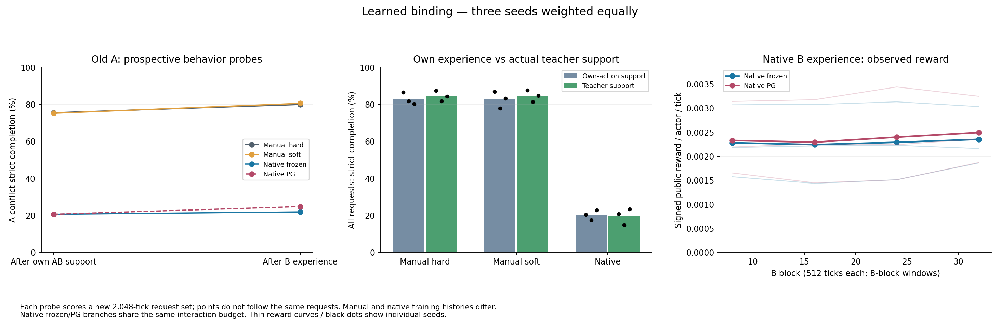

# 学习请求绑定、读写地址与写入时机

2026 年 11 月 7 日。接续[关联快状态实验](../../associative-state-experiment-2026-11-07.md)，将手写绑定器、固定地址查表和成功回执写开关交给神经网络学习，并加入真实自身行动回报训练。**第一版已经跑通和核验，但没有学会可靠的关联使用；正确示范也未能使其接近手写对照。** 后续只改变读写顺序的对照单独记录，不覆盖失败版。

[原方案](../../../experiments/learned_binding/analysis-plan.md) · [读写顺序后续](../../../experiments/learned_binding/read-first-plan.md) · [代码](../../../experiments/learned_binding/README.md) · [第一版全部结果](../../evidence/learned-binding-2026-11-07/results.json)

## 真正交给模型学习了什么

新模型只读取原有公开56维观察。每任务槽用共享32维GRU维持历史，再将其状态与当前观察拼接，生成query、key、四维value及sigmoid写入门。两个槽每tick都可以更新共享16×4的delta矩阵，没有按成功/失败或事件类型硬屏蔽写入，也没有直接以context×raw索引地址。

读出概率经固定的可微逆置换，送入原动作执行器的命令payload字段。该兼容接口仍由程序提供，读取对行动的作用也仍限于NEW/REPLACE接口；没有声称模型已经自主学会完整输入输出协议。原192维GRU与十一动作头的权重冻结，但其输入梯度保留，因此未来行动损失能训练更早的写入。

新模块有8,210个可训练参数，动态状态为原h192、encoder z64、M64，共320个FP32标量。手写参照仍为原h192、M64及八个绑定缓存量，新增参数和先验训练方式不同；不能把此比较叫作等参数、等总状态或等累计训练成本。

## 两种训练不能混称

第一阶段是有监督的动作示范。每种子16条实际中点教师轨迹，每条1,024tick、32actor，独立随机分配A/B规则。512次更新，每条轨迹完整反传，不在128tick截断；只用十一动作CE，没有绑定、地址、内容或gate辅助标签。WAIT权重0.25，其余动作权重1。独立训练轨迹起点归零，这不是单个永不重置的训练生涯。

第二阶段才是自身结果学习。新留出世界从零状态开始，模型先自行采样4,096tick A/B经历。全部十一动作都可被采样，没有教师替换或合法性过滤。学习者在此完整终点分成参数冻结与outcome两支，随后只让未来NEW选择B，继承的A请求自然结束。

每支继续32×512tick自身行动，另有一个明确计数的回执收尾tick。outcome仅从下一tick公开回执得到成功FINISH的+1、被拒动作的−0.1，其余为0；没有oracle或正确载荷标签。两槽共享记忆，故用actor的两槽总回报和联合动作概率进行PG，基线来自其它actor。参数更新后不移入重算的h/z/M，实际流、pending观察和RNG继续保留。

frozen与PG具有同样交互预算和共同起点，但自身动作与回执会随参数变化，不能称观察完全相同。评价阶段再独立分叉，自主argmax运行2,048tick，参数冻结、快状态仍可更新。

## 第一版的实际行为

下表均为三种子等权平均。严格完成指成功FINISH前活跃请求期间没有被拒动作，完成后的空闲误动另计。

| 条件 | 自身A/B经历后，总体严格完成 | 继续B后，总体严格完成 | 继续B后，旧A冲突严格 | 相同正确教师经历后，总体严格 |
|---|---:|---:|---:|---:|
| 原手写hard | 82.7% | 84.5% | 79.8% | 84.4% |
| 手写读写＋soft接口 | 82.6% | 84.1% | 80.4% | 84.4% |
| 学习版，参数冻结 | 20.1% | 21.3% | 21.7% | 19.5% |
| 同起点学习版，B阶段做PG | 同一个20.1%终点 | 22.6% | 24.6% | 不另训教师版 |

手写soft控制仍能达到约84%，说明概率接口这一形式本身不足以解释全部差距；它不能排除学习者低置信输出与冻结执行器之间的交互瓶颈。学习版在完整正确示范下也失败，说明问题不只是自行探索时没收集到足够正例。

学习版在成熟合格评分请求上的内容翻译在自身支持后约23.5%，继续B后冻结/PG分别约24.9%/24.7%，都接近四分类随机水平。自身支持后的空闲误动约6.14/千机会，继续B后冻结/PG约6.30/5.68；手写两组继续B后约0.75/0.78。不能将PG略有改善的总体动作成绩描述成已经学会了关联记忆。

三个种子的32个B训练块内（不含额外收尾动作），成功FINISH合计frozen为7,837，PG为7,928；被拒动作分别42,403、41,945。实际回报从合计3,596.7到3,733.5，变化同时包含多一些成功与少一些拒绝，不能仅看总回报判断记忆能力。

旧A在开始时就没有可靠学会，所以其后约20%–25%的严格率不能成为“旧记忆保持成功”的证据，也不能将所有差距都称为训练B导致的遗忘。评分中还会继续吸收新回执；首次合格actor/family/raw请求已单列，但它仍可能发生在其它A反馈之后。

## 三项定位检查

**记忆消融未出现可靠的能力下降。** 在正确教师支持终点，学习版总体严格率为19.49%，清M后20.20%，清z后19.44%，全程禁读21.06%。清状态后仍可重新写入，因此不能单凭清M无下降就断言M完全无作用；全程禁读同样没有显示明显损失，与内容翻译近随机的结果一致。

**不是简单的“WAIT太多”。** 在各种子的固定训练stream08上，WAIT标签确实约占98.6%，但FINISH已贡献原加权CE的90.6%–96.6%。WAIT与FINISH梯度的夹角并不一致，总梯度与FINISH方向的cosine仍为0.893–0.988。这不支持把主要故障归于WAIT抵消，故没有据此追加一组更大FINISH权重来冒充确定修复。这是事后训练集诊断，不是因果证明。[损失与梯度诊断](../../evidence/learned-binding-2026-11-07/action-loss.json)

**请求身份没有从z中完全消失。** 另一项事后分析，仅在成功FINISH回执到达、该槽本tick没有新命令的位置，用公共历史绑定器给分析头产生context/raw八分类标签。训练头使用原16条训练轨迹，测试使用已经评分的独立教师支持流；固定ridge λ=1，不更新策略。

| 线性分析头特征 | 八分类测试准确率，三种子均值 |
|---|---:|
| 当前公开28维 | 11.17% |
| 已训练z32＋当前28维 | 92.21% |
| 同初始化但未训练z32＋当前28维 | 96.91% |
| 原冻结GRU在未翻译公开流上的h192＋当前28维 | 64.31% |

随机基准为12.5%。这说明在正确教师历史下，绑定所需身份信息可由额外线性读法恢复，却没有被现有读写头可靠用于行动。最后一行是额外只读特征参照，不是主模型实际已经持有的另一份状态。未训练z的高可读性也不是自主策略已学会；这些分析头有绑定标签，正式策略没有。[状态可读性诊断](../../evidence/learned-binding-2026-11-07/binding-probe.json)

训练梯度检查也确认，最后256tick的动作损失可到达较早成功回执位置的key/value/gate，而执行器无参数梯度。梯度可达、状态可读、最终学会有用读写，是三个不同结论。

## 只改变读写顺序的后续

第一版先把当前输入写入M，再读取M用于当前命令。在教师支持后的自主评分（teacher_probe）中，学习出的门在命令位置平均约0.067–0.469，在成功FINISH位置约0.051–0.207，其它位置仍约0.031–0.141。它并非完全不更新，而是没有形成可靠的经验使用。门值本身不能证明实际写入有用，也未单独定位失败原因。

一个待测解释是，当前输入可通过“本tick写入→本tick读取”成为短路径，训练没有充分依赖历史关联。因此第二版只将读取移到写入之前，其余参数、初始化、状态、数据和预算不变；仍允许模型每tick自主写入。第一版失败结果和手写对照完整保留。

第二版是看过第一版结果后的明确追加，重复使用相同评价集，不作为全新独立验证。手写hard/soft的18份评分与相关B工件逐字节复用，不重复计为新实验；仅新增三个学习者训练终点、21份评分及192个B块。

第二版已完成，以下为三种子等权平均（2026-11-10整理）：

| 先读后写学习版 | 总体严格完成 | 内容翻译正确 | 旧A冲突严格 |
|---|---:|---:|---:|
| 自身A/B支持后 | 19.29% | 22.88% | 21.25% |
| 继续B，参数冻结 | 20.52% | 24.16% | 21.12% |
| 继续B，真实回报PG | 21.40% | 23.75% | 23.36% |
| 正确教师经历后 | 19.60% | 22.23% | 21.62% |
| 教师后全程禁读 | 21.06% | 24.45% | 19.07% |

只调整读写顺序没有建立可靠绑定，也没有使内容翻译脱离近随机水平。这个结果不支持把当前失败主要归因于本tick的写读短路径，但不能证明该路径完全没有影响。两版的原始失败结果均保留。[第二版全部结果](../../evidence/learned-binding-2026-11-07/read-first-v2/results.json)

第二版同样通过39份评分、384个B块、九条完整策略重放和六次PG/Adam独立重算。扣除复用对照，两版共六个新训练终点、60份独立评分和576个独立B块；不可将复用的18份手写评分重复当成新实验。[第二版审计](../../evidence/learned-binding-2026-11-07/read-first-v2/audit.json)

## 范围与复核

11/10另行进行[固定encoder的对照](frozen-trace-experiment-2026-11-10.md)，不修改本轮冻结协议、预算或失败结果。

当前只有两个情境、四种内容和有限时间范围。训练与测试的B都由A固定交换raw0/1得到，所以旧A行为还可能受已知规则关系影响，不能把分数独自当作旧内容在内部原样保存的证明。

第一版39份评分、384个B块的世界动作、公开奖励和状态链全部核对；九份评分完整重放，每种子首末各一次实际PG/Adam更新独立逐位重算，共六次。检查包含最后回执、跨job回报、更新时不替换live状态、完整成熟失败分母及所有原执行器参数不变。[审计](../../evidence/learned-binding-2026-11-07/audit.json)

本机完整模型、轨迹、优化器和来源位于 `data/learned-binding/`，便携证据在本报告目录。运行仅提高过本任务预训练子进程的调度优先级，未改变精度、数据或预算；任务退出后相应进程已结束。不要把设备间墙钟差异当作算法收益。
