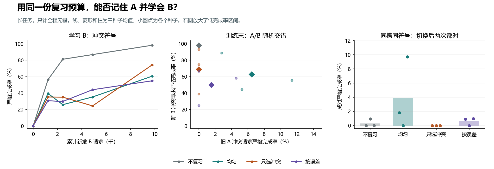

# 同一份复习预算应该复习哪些旧请求

2026 年 11 月 3 日。上一轮模型学完新规则 B 后，在 A/B 交错的长任务中，相关前史组对冲突符号的新 B 严格完成为 98.3%，旧 A 为 0%。这轮从学完 A、刚要接触 B 的三个相同存档出发，比较三种复习选择。测试时模型自行选择启动、等候和结束，严格完成要求一次请求全程无错。[上一轮的前史与迁移](experience-transfer-experiment-2026-11-03.md) · [本轮分析口径](../../../experiments/review_selection/analysis-plan.md)

**三种方式都改善了旧 A 最终完成的机会，但都没有同时保住新 B 的学习速度和可靠的 A/B 切换。** 在 317 对同槽、同符号、必须换答案的连续长请求里，均匀组有 12 对两次都全程无错，只选冲突组为 0 对，按预测误差组为 2 对。错因包含抢先结束。只选冲突组的旧 A 成熟冲突请求中，有 116/118 个请求的第一次主动错误是过早 FINISH，即使有些请求已记得正确的载荷。

## 训练预算与旧样本

每个种子取最后四轮 A 的真实自主轨迹，只保留能够还原完整公共窗口、已经启动并实际到达教师结束位置的请求。库中 256 个请求，四种原始符号各 64 个。每例 128 tick，两槽输入和真实动作回执都保留。复习只在目标槽的三个位置比较旧教师答案，分别为启动、处理中应等候、首次教师要求结束。另一槽提供背景和干扰，不收到复习梯度。库的起始状态通过冻结的 A 模型从真实采集锚点回放至窗口开头得到。复习支路的状态不写回当前 B 的持续状态。

该库是经过筛选的旧经历。三个种子各自有 1,713、1,691、1,507 个可配对的完整候选请求，最后按符号及原轮次均衡留下 256 个。已经在教师结束位置前自主完成、未启动、取消或没有完整窗口的请求可能被排除。库中的成功比例不代表所有 A 经历。[建库、来源选择和逐步重放核验](../../../data/review-selection/bank-v1/report.md)

| 选法 | 在同一批 128 个候选里选 64 个 |
|---|---|
| 均匀 | 不看分数，从候选里均匀抽取。 |
| 只选冲突 | 选出 A、B 正确答案不相同的请求。每次候选按原始符号各 32 个，这一组恰好取走其中 64 个。研究者事先知道规则映射。 |
| 按自身误差 | 用当前模型对三个旧监督位置的交叉熵取平均，选分数最高的 64 个。选样时不传冲突标志、B 标签或情境难度。它仍需要保存的 A 正确答案来计算误差。 |

三个复习组都对相同候选做相同的无梯度评分。每个种子 8 轮、2,048 次梯度更新，其中 256 次用于 A，1,792 次用于 B。每组累计选择 16,384 次旧请求，使用 49,152 个 A 监督位置。第 1 遍 B 的流按真实时序推进，首轮 2、8 次更新及各轮末均保留检查点。无复习参照复用上一轮相关前史分支，它有相同的 2,048 次更新，但所有更新都用于 B，也没有候选评分成本。三种复习方式之间的选样和计算预算才是完全配平的对照。[训练协议](../../../data/review-selection/train-v1/protocol.json)

每个种子、每个复习组有 98,304 次候选监督位置比较。误差组选择的冲突请求比例依次为 **72.06%、66.89%、59.93%**，高于均匀组的 49.71%、49.97%、50.18%。三个种子的误差组实际覆盖 254、253、255 个不同请求，均匀组都覆盖 256 个，只选冲突组都只能覆盖 128 个。在误差组选中的窗口内，三个种子等权平均，结束位置的交叉熵约为 0.507，启动和等待位置均约为 0.001。误差选择确实偏向某些容易答错的旧内容，但分数只描述在旧轨迹三个指定时刻的预测。[训练预算、选样覆盖与重复](../../../data/review-selection/train-v1/summary.json)

## 两种检验情境切换的方式

**原环境中的随机交错。** 在独立世界中，每个任务槽的新请求都可能属于 A 或 B，两个槽可以同时有不同情境。外部事件、成熟请求身份、情境提示和测试预算在各臂之间匹配。只训练了 B 或明显偏向 A 都不能靠一个混合平均分掩盖。按两个冲突符号分别计旧 A、新 B 的严格与普通完成。在单独的长 B 请求上测较早学习曲线与终点，同时记录实际空闲误动作。[自由评估协议](../../../data/review-selection/eval-v1/protocol.json)

**同一槽、同一符号的相邻请求对。** 在另一批长任务中，测试者预先安排两次相邻请求给出相同原始符号，情境顺序有 AA、BB、AB、BA 四种，块内随机打散，模型看不到配对标记。保留双槽干扰、时长、空档、版本、结束窗口和真实动作回执。为了明确“相邻两次”的身份，此项补测不设取消与替换，两项都在 512 tick 自主预热后发起、并在随后的 4,096 tick 内成熟才纳入分母。主指标是冲突符号的 AB/BA 对里，两次都全程无错的比例。它是另一个独立任务分布，不能与原混合流合并分母。[配对方案](../../../data/review-selection/pairs-v1/protocol.json)

## B 的习得与 A 的保持

下表所有百分数先在每个种子内计算，再对三个种子等权平均。早期 B 用第 0、1、2、4 轮各自的自由严格完成率，沿累计收到的新 B 请求数积分，再除以前四轮的请求量。因此早期列反映同样反馈进度下曲线有多高。每种子学习阶段实际新发 B 请求分别为 **9,822、9,731、9,776** 个，含边界无损失步。测试中的三个复习组与无复习参照在首次复习前完全相同。

| 选法 | 早期全部 B 严格 | 早期冲突 B 严格 | 末轮纯 B 严格 | 交错中旧 A 冲突普通 / 严格 | 交错中新 B 冲突严格 | 交错空闲误动 / 千机会 |
|---|---:|---:|---:|---:|---:|---:|
| 不复习 | 69.37% | 66.31% | 98.02% | 8.66% / 0% | 98.33% | 0.49 |
| 均匀 | 40.01% | 28.46% | 66.55% | 61.12% / 6.47% | 62.96% | 4.74 |
| 只选冲突 | 34.69% | 28.12% | 77.18% | 44.12% / 0% | 69.07% | 2.83 |
| 按误差 | 42.92% | 29.90% | 66.26% | 67.92% / 1.52% | 50.00% | 5.09 |

按误差选择在三个复习组中有较高的早期 B 均值，但按种子看，早期全部 B 相对均匀分别变化 **−14.65、+3.10、+20.29 个百分点**。只看冲突符号，三种复习方式的早期均值都在 28%–30%。三组都慢于把全部更新用于 B 的参照。末轮均匀组的旧 A 冲突严格完成数分别是 **1/36、2/38、5/44**，冲突组都是零，误差组是 **0/36、0/38、2/44**。复习减慢了旧规则初期的遗忘，却没能在交错测试中稳定保住它。均匀组这项指标从 B0 的 67.2%，经第 1 轮末的 27.9%，降到第 8 轮末的 6.5%。[逐快照分母、真实动作和评估审计](../../../data/review-selection/eval-v1/report.md)

## 同一个符号换情境，两次能否都做对

每种策略在三个种子上有相同的 **109、105、103** 个冲突切换对，合计 317 对。这里按原始计数合计，不能把每个请求对当作一次独立训练。

| 选法 | 两次都普通完成 / 317 | 两次都全程无错 / 317 | A 后接 B，两次都无错 / 165 | B 后接 A，两次都无错 / 152 |
|---|---:|---:|---:|---:|
| 不复习 | 19 | 1 | 0 | 1 |
| 均匀 | 157 | **12** | 3 | 9 |
| 只选冲突 | 146 | **0** | 0 | 0 |
| 按误差 | **178** | **2** | 1 | 1 |

“普通完成”允许一次或多次动作被拒绝后再重试。误差组在 178 对中最终完成两项，只有 2 对从头到尾都没有错。均匀组有最多的无错对，其中 10 对来自同一个种子，另两个种子分别贡献 2 对和 0 对。只用旧 A 尚未学 B 的起点是 0/317。四组动作均由实际十一类得分直接选出。独立审计根据每条请求的开始、就绪、截止时间及真实动作重新核对所有回执和成功条件，并逐条核对每组接受的外部命令。[学习曲线和切换计数](../../evidence/review-selection-2026-11-03/counts-and-curves.json) · [真实回执审计](../../../data/review-selection/pairs-v1/audit.json)

## 为什么只复习冲突，旧 A 仍然严格零完成

回到原随机交错的世界，三个种子的 118 个成熟旧 A 冲突请求全部成功启动，也都真正到达合法结束窗口。检查首次在窗口内发出的 FINISH，有 **37 个**选对版本和 A 载荷，**18 个**版本正确却选了 B 载荷，**10 个**给出别的错误组合，另外 **53 个**在窗口内根本没有尝试结束。不复习时，以上四个计数是 **2、89、19、8**。只复习冲突明显改变了结束内容的选择，也使更多请求在合法时刻没有出手。

只复习冲突组最终普通完成的 50 个请求中，49 个的首次错误是过早 FINISH。具体看这 49 次，其中有 21 次当时已经选对 A 载荷，24 次用的是 B 载荷，另有 4 次选择其他载荷。严格完成率为零，有一部分是早于合法窗口的行动已经破坏了整条请求。将这项失败全归给内容遗忘，会漏掉真实发生的时机错误。[按种子与回执重建的错误分类](../../../data/review-selection/error-analysis-v1/report.md)

## 适用范围和下一步

上轮混合完整轨迹的历史复习在另一项课程中改善过旧规则保持。这次给出的是更窄的结论：对固定小库、每个旧请求三个监督点和确定的 1/8 梯度预算，单靠改变挑哪条旧请求，不能可靠恢复切换。训练时新 B 的示范流与旧 A 的归档片段分开，部署时不同情境却可以紧挨出现。误差组选到更多冲突，说明当前模型在这些旧样本上更容易出错，并不说明复习它们最能改善随后的严格行动。三种子和这四种规则也不能确定通用最优的选样法。

下一项可区分的原因是**在什么时刻教等待和结束**。可先固定同一批均匀旧请求、同样的更新和标签数量，把唯一的 WAIT 监督从处理中点移到模型实际企图提前 FINISH 的等待位置，与原方案配对。仍以合法 FINISH、旧 A 和新 B 各自的严格完成、以及同槽两次都无错作为判据。这是由本轮回执提出的待验解释。

独立验证覆盖了每个种子第一次复习的候选、分数、选择、模型和 Adam。初版审计器按逐请求张量除以 3，在 GPU 上与训练用的标量除数相差最多一个 FP32 ULP。保留原始退出记录后，以训练实际使用的标量运算重新独立复算，更新逐位匹配。评估另对检查点内的张量元数据使用 JSON 转换适配器。两项修正都只涉及审计或记录，训练过程和自由评估模型未变。[训练审计说明](../../../data/review-selection/train-v1/audit_correction.json) · [评估核验与完整性](../../../data/review-selection/eval-v1/completion.json)
