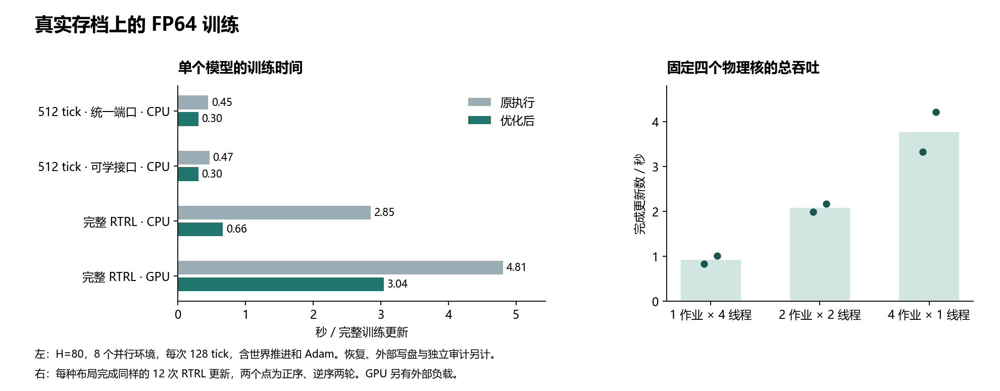

# 成功启动后的经历、删边候选与双精度训练速度

2026 年 11 月 2 日。上一轮的统一端口模型在主训练末总是等待，可学习接口模型还能在短任务上取得严格完成。本轮从同一批 131,072 tick 存档接着训练，分别在这两类模型上检验启动经历和删边决策。[上一轮三种子正式结果](../../undirected-results-2026-10-30.md)

## 让统一端口模型经历成功启动

三个种子各自分出两臂。对照由模型选择每个动作。另一臂在约四分之一的 NEW/REPLACE 命令上，如果模型错过正确 BEGIN，就替它执行这一次 BEGIN。候选命令由外部请求身份的哈希选出。FINISH 始终由模型选择。每个分支延续 128 次更新，保留实时状态、512 tick 信用、Adam 和历史库。实际动作保存在实时块、复习记录和动作散列中，信用引擎保存执行这些动作后实际得到的观察与标签。端点评估继承各分支自己的世界和隐藏状态，全部自由行动。[冻结协议](../../../data/coverage-exit/coverage-v1/protocol.json)

| 种子 | 新命令及替换 | 实际帮助成功 BEGIN | 实时 FINISH 标签位置，对照 → 帮助 | 复习 FINISH 标签位置，对照 → 帮助 |
|---:|---:|---:|---:|---:|
| 0 | 3,111 | 752 | 0 → 1,818 | 10,478 → 10,635 |
| 1 | 3,183 | 786 | 0 → 1,930 | 7,050 → 7,160 |
| 2 | 3,189 | 798 | 0 → 1,894 | 8,582 → 8,712 |

2,336 次成功启动带来了 5,642 个实时 FINISH 标签位置。在相同预算内，六个分支的模型自行选择 BEGIN 和 FINISH 的次数均为零。撤掉帮助后，48 个新评估分叉的任务完成数与空闲误动作同样为零。历史库本来就能提供 FINISH 监督，表中复习计数包含重复抽到的经历。帮助启动还减少了同一请求后续的 BEGIN 标签，因为世界已确认启动。这项对照衡量的是改变行动后整段经历对学习的作用。[训练计数](../../../data/coverage-exit/coverage-v1/training.csv) · [自由评估](../../../data/coverage-exit/coverage-v1/evaluation.csv)

768 个继续训练块均逐块核对了实际观察、教师目标、模型选择与执行动作。三个无帮助分支的全部 128 个更新记录逐位复现各自的原始训练记录。[核验清单](../../../data/coverage-exit/coverage-v1/verification.json)

看到全等待的结果后，我重建了模型做出选择前的 logits。在帮助组的后 64 次更新里，仅看两个 BEGIN 选项，按版本等权的识别率依次为 50.19%、49.86%、50.00%。仅看八种 FINISH 选项，按类等权的识别率为 12.46%、12.75%、14.37%，八类均匀猜测的参考值为 12.5%。教师要求开始时，最佳 BEGIN 分数减去最佳组外分数的中位数在三个种子上分别为 −0.63、−0.50、−0.51。这里同时存在出手时机和动作内容判别两处困难。本实验的干预发生在模型已经形成等待策略之后。[原生动作分数与分母](../../../data/coverage-exit/coverage-v1/native-action-margins.json)

为了区分状态里保存的信息和原生端口实际使用的信息，又对无帮助组做了离线版本读出。只取命令已经过去、当前槽没有事件和版本位、教师仍要求 BEGIN 的位置。每个种子和任务槽分别拟合固定正则强度的线性读出器。训练集是前 64 次更新的前四个 actor，测试集是后 64 次更新的后四个 actor，训练与测试的请求身份也互不重叠。共 17,000 个测试位置，距上次提示 1–9 tick，中位 4 tick。同一请求可贡献多个位置。[分析协议](../../../data/coverage-exit/coverage-v1/version-probe-posthoc-v1/protocol.json)

| 测试集版本均衡识别率，两个任务槽等权 | 种子 0 | 种子 1 | 种子 2 |
|---|---:|---:|---:|
| 当下的 56 项公开观察，线性读出 | 50.01% | 50.03% | 49.98% |
| 全部 80 个状态，线性读出 | 79.21% | 87.69% | 79.57% |
| 排除 56 个输入端口后的 24 个状态，线性读出 | 72.77% | 71.23% | 58.58% |
| 模型原有的两个 BEGIN 分数，直接选最大 | 50.41% | 49.68% | 50.00% |

状态在这段短延迟后仍含有可跨 actor 读出的版本信息。排除输入端口后也能读到一部分，且不同种子、任务槽的读出难度不同。离线读出器使用了版本标签，部署时仍由原模型自己的动作端口决策。这项测量只考察“已经到了应启动的位置时，能否判别两个版本”。[按种子及槽分列的结果](../../../data/coverage-exit/coverage-v1/version-probe-posthoc-v1/compact.json)

## 在已经能完成任务的模型上允许全删

三个可学习接口、共享无向权重的模型均从固定图存档接入同一渐退算子。两臂使用同样的候选排名和同样的四次前向探测。一臂延用原渐退规则。另一臂允许整批全删在当次混合损失严格降低时生效，否则仍检验原半退候选。混合损失等权计入实时块和历史块。两臂均使用本轮验证过的 FP64 窗口执行器。每臂 128 次更新产生 16 次提案，其中 15 次在预算内得到实际探测。[冻结协议](../../../data/coverage-exit/retirement-v1/protocol.json)

每个种子的两个臂都接受了 0 批全删、0 批渐退，640 条边全部保留。三个种子的短任务严格完成率分别为 15.71%、15.79%、16.45%，两臂逐种子相等。长处理加长空档的严格完成率均为零。三个种子每臂合计 45 个实际探测窗口，原排名挑出的整批边被全删时，没有一次降低当下混合损失。放开提交条件之后，候选选择仍然决定了什么能送去删。[配对结果及原始损失](../../../data/coverage-exit/retirement-v1/report.json)

看到最早完成的分支没有接受删除后，另行登记了一项短任务消融。取三个只允许渐退的完整端点，在模型副本中把尚待下一次检验的四条候选边置零，再用另一份副本把当时幅度最小的四条资格边置零。每个条件都从同一个世界和隐藏状态自由行动，期间固定权重。实际新增 24 个分叉，原模型的 12 个对照分叉来自同一端点评估。[消融规则](../../../data/coverage-exit/retirement-ablation-v1/design.json)

| 强制消融相对原模型 | 种子 0 严格完成差 | 种子 1 | 种子 2 | 三种子平均普通完成差 | 平均空闲误动作差，每千次空闲机会 |
|---|---:|---:|---:|---:|---:|
| 排名选出的四条 | −6.14 个百分点 | −1.76 | +2.19 | +1.08 个百分点 | +7.12 |
| 幅度最小的四条 | −0.11 个百分点 | −0.04 | −0.04 | −0.18 个百分点 | +0.19 |

两种规则在三个种子里都选中了互不重合的四条边。排名候选的权重绝对值约为 0.296–0.665，最弱候选为 0.000142–0.004749。两组匹配了边数，权重幅度与位置都不同。现有排名选出的边足以大幅改变短任务行为，而且改变方向随种子而异。取最弱的四条边时，三个模型的即刻损伤都小得多。[候选位置与权重](../../../data/coverage-exit/retirement-ablation-v1/report.json) · [逐种子差值](../../../data/coverage-exit/retirement-ablation-v1/summary_units.csv)

## 把弱边作为在线退出候选

上面的强制消融只测即时影响。看过消融结果后，又登记了一个在线实验，从同样的三个 131,072 tick 存档重新出发。唯一改动是优先提出当前资格集合中共享参数绝对值最小的四条边，平局按原来的节点对编号打破。每次仍用相同的四次探测，整批全删要在当次复核中严格降低混合损失才可提交，否则试验原渐退规则。对照复用前一项已经跑完的“原排名＋允许全删”分支。每个新增分支仍为 128 次更新、15 个执行窗口。[在线验证协议](../../../data/coverage-exit/magnitude-v1/protocol.json)

| 种子 | 初始资格边 | 实际退出 | 期末资格边 | 全删获准批数 / 执行窗口 | 相对原排名的短任务严格完成差 | 空闲误动作差，每千次机会 |
|---:|---:|---:|---:|---:|---:|---:|
| 0 | 640 | 20 | 620 | 5/15 | 0.000 个百分点 | +0.260 |
| 1 | 640 | 8 | 632 | 2/15 | −0.066 个百分点 | +0.440 |
| 2 | 640 | 36 | 604 | 9/15 | +0.221 个百分点 | −0.225 |

这 64 条边来自 16 批获准的全删，三个分支的出生数和获准半退批数均为零。三种子的短任务严格完成配对差为 +0.052 ± 0.150 个百分点，普通完成差为 +0.044 ± 0.101 个百分点，± 为三项配对差的样本标准差。长处理加长空档时两臂完成率都为零。获准批次中有 3 批增加了实时损失，另外有 3 批增加了历史样本损失，等权平均均严格下降。这次做到了在一个已获得部分能力的模型上在线退出 1.25%–5.63% 的资格边，短任务端点指标变化很小。旧任务长期缺席后再返回时的保持能力仍需单独测量。[审计结果](../../../data/coverage-exit/magnitude-v1/report.json) · [逐种子差值](../../../data/coverage-exit/magnitude-v1/paired.csv)

## 计算路径

窗口训练中，一个参数快照会被同段所有时间步重复使用。新执行器每段只展开一次连接矩阵，并将这段历史的函数调用与有限值检查合并。每次改变参数、开始下一段历史或者试探性删边时都会重建矩阵。RTRL 的另一项改动是沿 Heun 的两个阶段传播完整的状态导数，把各时刻对同一矩阵的导数用批量矩阵乘法相加。两项优化均保留 FP64、原积分子步、完整梯度以及原学习更新规则。[窗口执行器](../../../experiments/coverage_exit/fast_window.py) · [RTRL 执行器](../../../experiments/coverage_exit/fast_credit.py)

在两个已训练存档上，各做 1 次带梯度核对的预热更新，随后交错计时 6 次完整更新。CPU 单线程、H=80、B=8，每次更新 128 tick。在端口图上，512 tick 信用的中位耗时由 0.446 秒降至 0.302 秒（1.48 倍）。可学习接口由 0.466 秒降至 0.302 秒（1.54 倍）。7 次连续更新的动作、数据、世界和逻辑更新预算一致，两个存档的模型参数最大绝对差均为 5.56×10⁻¹⁷ 以内。计时覆盖推进世界、计算梯度、Adam 和训练记录，文件读写及独立审计另计。[逐次计时与张量误差](../../../data/coverage-exit/perf/recorded-window-cpu-v1.json)

完整 RTRL 使用种子 0 在 131,072 tick 的真实共享无向端口存档。两边从相同的非零敏感度和 Adam 状态开始，每项预热后交错配对计时四轮。下表列中位秒数。各项独立计时，整次更新包含真实世界、实时损失、历史复习、Adam 和记录开销。

| 设备及计时范围 | 原执行 | 优化后 | 加速倍数 |
|---|---:|---:|---:|
| CPU 单线程，块 Jacobian | 2.684 s | 0.224 s | 11.98× |
| CPU 单线程，完整信用梯度和敏感度传播 | 2.916 s | 0.286 s | 10.20× |
| CPU 单线程，整次训练更新 | 2.853 s | 0.663 s | 4.30× |
| RTX 4060 Ti，整次训练更新 | 4.809 s | 3.044 s | 1.58× |

CPU 的三次连续真实更新中，完整敏感度最大绝对差为 4.88×10⁻¹⁵，参数最大绝对差为 6.94×10⁻¹⁸，实际动作、世界、回放和隐藏状态逐位相同。这是列出的连续步数上的精度校验。CUDA 整步显存峰值由原生路径的 139 MiB 增至 316 MiB，解析后端用更多显存暂存时间轴上的系数。显卡当时另有约 44–55% 的外部负载，CPU 与 GPU 基准的主机核绑定也不同。加速倍数取自各设备内部的原/新配对。[CPU 原始计时](../../../data/coverage-exit/perf/block-rtrl-cpu-real-cp.json) · [GPU 原始计时](../../../data/coverage-exit/perf/block-rtrl-gpu-real-cp.json) · [内存与精度核验](../../evidence/coverage-exit-2026-11-02/fast-rtrl/README.md)

只运行一个优化后的 RTRL 作业时，分配 1、2、4 个物理核的整步中位延迟分别为 0.603、0.530、0.527 秒。这组数据里，两个核已接近四个核的单作业延迟。[原始轮次、亲和性和主机负载](../../../data/coverage-exit/perf/block-rtrl-cpu-thread-sweep.json)

多种子吞吐另做等资源测试。固定逻辑核 0、2、4、6，它们在本机属于四个不同的物理核。四个独立存档副本都完成恢复与预热，再计四个作业总共执行 12 次完整更新的壁钟时间。正序、逆序各测一轮。四份作业的动作和世界逐位核对，浮点状态和 Adam 按同样的数值容差核对。

| 同时推进的作业数 × 每作业线程数 | 第一轮，更新/秒 | 逆序第二轮，更新/秒 |
|---|---:|---:|
| 1 × 4 | 0.83 | 1.01 |
| 2 × 2 | 1.99 | 2.17 |
| 4 × 1 | **3.32** | **4.21** |

因此，这一规模的单模型低延迟运行可先分配两个物理核。有多组独立训练要完成时，在测过的四核预算下优先用四个单线程作业。这些物理核上的另一条硬件线程在测量时也有外部负载，采样忙碌度约 85%–98%。两轮绝对吞吐不同，排序一致。四个进程采样工作集之和最高约 3.88 GiB，24 份末态核验数据的内容哈希一致。[调度实测](../../../data/coverage-exit/perf/block-rtrl-four-core-scheduling.json)

本轮合计 15 个继续训练分支、120 个新端点自由评估和 24 个额外冻结消融分叉。原 26 项执行源码指纹均已核对。第一项删边对照的原始结果摘要在 JSON 写出前计算，读取时按原定义恢复整数阶段索引和三组区间元组，六份文件都重现了已有摘要。三个已发生实际退出的端点均经过保存、恢复和下一次更新的逐位核对。[结果读取校验](../../../data/coverage-exit/retirement-v1/report.json) · [实际退出后的恢复校验](../../../data/coverage-exit/magnitude-v1/actual_retirement_recovery.json) · [代码与复现命令](../../../experiments/coverage_exit/README.md)
