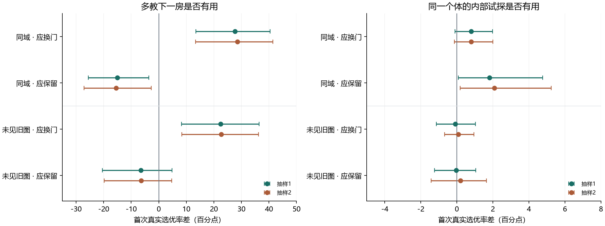

# 房内改道后，回到起点的第一次选择

训练整个 40 节点双区个体预测「我试的这扇门会到哪间房」，让它在中途形成了相当可靠的房间信息。只教最终收益的图更容易坚持旧门；增加下一房教学让它更愿意改选，也更容易放弃仍然正确的旧门。按预先规定的标准，同一身体的内部试探在新事实要求改选时，尚未带来稳定的首次行动增益。[前一轮的内部试动作](fork-lesson-2026-11-20.md)

## 身体得到了哪些经验

每条生命由两扇门、两间房、三个终点组成。身体先各走一次原路线，实际看见当前门、房间、终点。随后直接进入一间房复查一次，看它现在通向哪里。两扇起点门都不再展示通往新终点的完整路线。回到起点外界才公布本局三个终点的价值：+1、0、−1 的一种排列。个体在没有新感觉的时段自行选择一次试探，只在副区运动节点发送未执行的动作，之后主区马达实际选门，身体真的走到相应房间、到达终点并结算。所有条件使用同一连续状态与时钟。

例如，房 0 从终点甲改通终点丙，而房 1 继续通往乙。若甲、乙、丙分别值 +1、0、−1，正确门应当翻转。如果目标使乙比甲与丙都好，同一真实改道之后仍应选择通向房 1 的门。这里的“旧优门”使用相同的最终目标回算；身体在早先探索中还没有见到这个目标。完整前史、局部观察及当前目标足以重建两条路线。[世界可辨识性与测试](evidence/reroute-20261120/world.md)

## 教中间一步，与靠试探做好选择

三个主组的原生主区 14 号节点在试探第 5 拍报告最终收益，另两拍后原生马达决定实际动作。第二组额外让主区 15 号节点在第 3 拍预测物理房间，第三组把这份额外教学换成别条生命的真实房间，副区始终没有房间或收益标签。试探与实走一致时才用实走路线的结果训练预告。真实两门行动都有自己的实际到账和策略梯度。各组使用相同出生、随机带、接触数和更新数；策略学成后会选不同的路线。主训练与另行地图划分复验共六个独立出生、30 个训练终点、3,440,640 条实际路线。[训练设置、全量账本与末步复算](evidence/reroute-20261120/fit-results.md)

| 首次真实选优率 | 局部改道，应当换门 | 局部改道，应保留最佳门 | 原出口没有改变 |
|---|---:|---:|---:|
| 只教终局 | 26.29% / 25.54% | 84.53% / 85.10% | 79.83% / 80.35% |
| 同时教下一房 | 53.96% / 54.10% | 69.50% / 69.59% | 65.06% / 64.76% |
| 同时教下一房，同一身体取消内部试探脉冲 | 53.15% / 53.30% | 67.69% / 67.51% | 63.88% / 63.43% |

两套抽样带均在训练支持域内，每套每组有 12,288 次翻转场景首次实际选择。真实下一房教学相对只教收益，翻转差为 +27.67 [13.52, 40.43] / +28.56 [13.33, 41.39] 个百分点，保留差为 −15.03 [−25.51, −3.58] / −15.51 [−27.16, −2.72] 点，未能满足最多损失 5 点的预定条件。只保留最后一间房的观察时，两组关键条件都回到 50%。房间教学组翻转时约 54% 的绝对水平与该参照的差在配对区间上仍不确定。

同一下一房个体的自然试探相对空试，在翻转情形只高 0.81 [−0.11, 1.99] / 0.80 [−0.13, 2.00] 点。保留情形则有 +1.81 / +2.08 点的收益。把所有预定条件等权组合后，真实试探相对空试每生多得 0.0129 / 0.0143 单位，但同时教房间相对单教终局的平均到账低了 0.0784 / 0.0821 单位。改变训练方法与临场使用查询是两次不同的比较。自然试探的下一房读数为 87.25% / 87.28%，两门终局排序为 63.23% / 63.02%；进入真正要求翻转的场景，终局排序只剩 53.30% / 53.17%。[主留出、错配教学和所有冻结对照](evidence/reroute-20261120/eval-results.md)

## 地图有没有真的留出

门、房和终点只有有限种物理身份。在同一个生成器里换种子，不能保证旧地图没见过。因此另训两组相同规模模型，从训练中完全排除三种旧房→出口排列，只在另外三种上学。两侧互换门、目标、复查的房和前史顺序；单项观察和改道后的终图仍可重叠。每侧有六张完整旧图及 432 种完整任务条件。两侧分别穷举，不把多次随机抽签视作更多独立地图。

在未见旧图上，翻转时首次选优为只教终局 30.32% / 29.71%，同时教下一房 52.79% / 52.35%；应保留时分别为 68.48% / 68.51% 与 62.02% / 62.16%。后者在完整图与取消试探之间的翻转差为 −0.08 / +0.09 点。对同一个体只改变复查看到的出口、固定两份行动随机数，下一房组在应翻转的成对生命中两次都对为 22.4%，两次都错为 9.7%；原终局组的两次都对为 11.7%。从六种目标下的实际预报反推更新终点，两个训练组都只有约 65% 与新出口一致。[真正未见的旧图、配对更新与两段预测](evidence/reroute-20261120/novel-map.md)

## 中途替换的是房间，还是最终的好坏

供体两份历史中，同一扇门在改道前后都保持相同终点与收益；只换掉其中途房间身份。供体当前两门同归，且从未看到受体的目标。将它们在第 3 拍的副区活动分别放入完全相同的接收者，保留主区活动、痕迹及权重，继续真实运行。若受体的两间房通向不同终点，且目标从偏好房 0 终点改成偏好房 1 终点，哪份供体活动使它更愿意走被试探门，也应随之变化。

下一房教学组在分流图上的实际走向沿预期方向改变，交互为 +4.38 / +5.03 个百分点；该交互比两房同归时高 5.52 [0.47, 11.26] / 6.12 [1.30, 11.46] 点。主区马达倾向同向。主区终局预告只变约 0.004 个收益单位，区间跨零；相对等范数错配，实际走向的优势只在一套抽样中明确。同归扰动是否小于 3 点也未得到区间确认。能从副区活动读到房间，以及替换整组活动会影响动作，仍不足以证明自然决策中完整运行了「房间→终点→目标价值→选门」的计算链。[换房干预、控制与局限](evidence/reroute-20261120/midpoint-results.md)

严格旧图留出上，还单独读取第 3 拍的 20 维副区活动。固定同一个试探门、每扇门原先及当前的终点和收益，只互换房间身份，冻结后的分析器在两份活动中识别哪份对应房 0 的正确率为下一房教学 76.27% [67.50%, 84.99%]、终点教学 51.66%。只看单份状态的房间准确率分别为 68.07% 和 50.87%。诊断方向由独立的旧图校准，不进入网络。只沿这条方向改变受体活动，同时约束在原生范围内，再看实际结算和门选择，没有检出稳定效果。早先的未缩幅敏感性运行出现范围外活动，已单列并用物理范围内的版本复核。[跨图解码、范围修正与定向干预](evidence/reroute-20261120/axis-results.md)

数据与已训练的模型保存在本机 `data/reroute-20261120/`。主训练与严格地图复验分别在 `fit-<kind>/birth-<birth>.pt` 与 `fit-transfer-<kind>/birth-<birth>.pt`，使用固定训练代码中的 `load_final` 载入。评估和诊断的原始文件指纹均列在相应结果 JSON。[复算入口](evidence/reroute-20261120/README.md)
