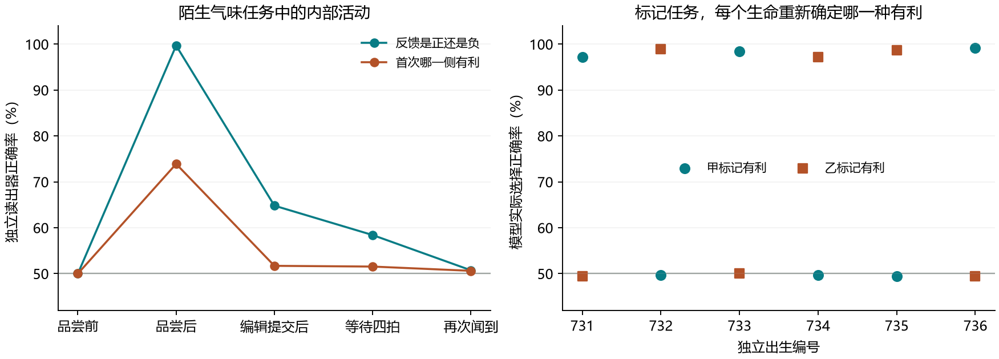

# 模型能否从自己的经历判断反馈的含义

六个出生在陌生气味任务上都能编码收到的正负味觉，回访时的行动仍在 50% 左右。换成能够单独观察「标记预告哪种实际后果」的任务，同样结构的图可以用生命中的反馈调整选择。它学到的用法具有明显的方向偏好。

## 一次反馈能否指导下一次选择

20 个节点含 8 个写入节点。首次接触的两个气味互为相反向量，哪一个有利在新生命中随机确定。模型自主选择，尝到正或负的结果，从同一个品尝后状态独立提出两笔编辑，有专门的图内输出负责选择候选或放弃，另有输出预测候选收益。网络可以选择全部 420 个地址、调整现有边权和偏置、给新边赋值或退边；执行器保留强连通。模型经过 0–8 拍中性等待，再选择一次。重遇时左右排列独立重抽。[图与时序](../experiments/pulse_game/revisit_choice_graph.py)

启蒙时对同一个状态分别执行两个候选或放弃，三份个体共用下一次动作抽样的随机数，以实际获得的味觉比较。相同后果保留为平局。六个出生各接受真实排序、整组三个后果打乱、仅练实际行为三种训练。每次拟合共遇到 128,000 条新生命，经过 8,000 次 Adam 更新。三个组都有实际选择和提名的行为梯度，以及沿已选分支数值写入传递的梯度。离开启蒙后没有优化器、未来分支或梯度输入。[训练](../experiments/pulse_game/revisit_choice_train.py) · [评估与实际动作](../data/revisit-choice-20261119/eval.json)

在真实排序组，最终检查点的自主回访正确率在等待 0、1、4、8、16 拍时分别为 50.02%、50.00%、50.00%、50.00%、50.00%。四拍等待时，打乱组和仅练实际行为组也都为 50.00%。隐藏、反转或借用另一条生命的反馈同样得到约 50%。在左右首选作平衡干预的留出世界，强制执行两个候选仅有 0.27% 的机会改变实际选择；事后知道正确方向，再从已经提出的两笔和放弃中挑最高正确概率，平均也只比原策略高 0.16 个百分点。该数值衡量这批实际候选在这批世界中的选择余地。

独立线性读出器用另外的生命拟合，从未把输出传给图。以下是六个出生的等权平均。第二列的目标需要同时用到第一次选择了哪一侧和实际收到的味觉。

| 读出时点 | 味觉正负 | 首次呈现中哪一侧有利 |
|---|---:|---:|
| 收到味觉前 | 50.00% | 50.00% |
| 收到味觉后 | 99.69% | 73.91% |
| 编辑提交并处理回执后 | 64.81% | 51.71% |
| 中性等待四拍后 | 58.41% | 51.54% |

重遇后、作第二次选择前，对当前哪一侧有利的读出为 50.08%；这套独立采样中模型实际选对 49.99%。已观测到第一次有利侧的线性可读性在提名、选择、提交和回执这一段显著下降。仍可能有线性探针无法提取的表示。[读出协议与分出生结果](../data/revisit-choice-20261119/probe-summary.json)

## 标记能否在一生中获得不同含义

另从相同的六个出生重新启蒙相同结构的图。两台给料器各有一个可辨认的标记。生命先体验两个标记各一次，一次使资源增加 1，一次使资源减少 1；示范顺序随机，之后两个标记左右随机呈现，模型自行选择。资源变化由同一个物理感觉口提供。究竟如何计分由环境规定。

一组启蒙生命始终由甲标记带来资源；另一组的映射在每条生命中等概率重抽。两个组使用相同预算和匹配随机数。测试时两种映射、示范顺序、给料器位置和借用反馈的映射完全交叉。截止 4,000 步，变化组部分出生似乎只处理好一种映射，于是将两组延至 12,000 步。在一条连续优化轨迹上重新执行相同前缀，逐位核验起点至 4,000 步的所有已存检查点。下表取另一套留出随机数。[任务与训练](../experiments/pulse_game/revisit_choice_value.py) · [延长试验与逐出生结果](../data/revisit-choice-20261119/value/longitudinal/summary.json)

| 每条生命重抽映射的组 | 4,000 步 | 8,000 步 | 12,000 步 |
|---|---:|---:|---:|
| 两种映射总体正确率 | 65.78% | 72.92% | 73.96% |
| 各个体较差映射的平均正确率 | 47.31% | 49.31% | 49.65% |

12,000 步时，固定映射组在熟悉映射上达到 99.09%，反过来只有 0.87%。变化映射组在两种映射混合的留出生命中达到 73.96%（六出生均值的 95% t 区间 73.47%–74.45%），遮住资源结果或借给它另一条生命的资源结果时均为 50%。对每个出生分别计算，擅长的映射平均 98.26%，另一种为 49.65%。三个出生擅长甲有利，另外三个擅长乙有利。六个出生都只掌握了一半映射。两个标记的身份和行动方式与启蒙时相同。

### 哪部分状态在使用这些反馈

取两条完全匹配的生命，只交换哪种标记能带来资源。它们见到的标记、次序、选项和采样随机数一致，亲自经历的资源结果相反。在最终选择前，让两条生命互换一部分内部状态，再按接受方的实际规则计分。

| 12,000 步变化映射组 | 正确率 |
|---|---:|
| 完整使用自己的活动和参数 | 73.96% |
| 换入对方活动，保留自己的参数 | 28.82% |
| 换入对方参数，保留自己的活动 | 71.18% |
| 活动和参数一同交换 | 26.04% |

交换活动使得分下降 45.14 个百分点，配对出生 bootstrap 95% 区间 [−48.09, −39.82]。交换参数下降 2.78 点，区间 [−7.62, −0.04]。活动交换会让选择跟着对方体验过的含义走。参数指全部权重、偏置和接线。两者在循环图中相互影响，以上是最终选择前的状态交换效果。[状态交换记录](../data/revisit-choice-20261119/value/longitudinal/exchange-12000.json)

已经能在标记任务得分的图，换回陌生气味一次反馈任务，等待四拍的实际正确率为 50.09%，十六拍为 49.74%。在四拍时，真实相对反转反馈的差为 +0.17 个百分点，配对出生 bootstrap 95% 区间为 [−4.86, +4.34]。这次训练尚未观察到跨这两类任务的泛化。[双向任务中的回测](../data/revisit-choice-20261119/value/reverse-transfer.json)

## 是否在模仿梯度

模型在独立生命中从未收到梯度向量。为检验一种可能学出来的更新算法，另在主气味任务冻结的真实排序组上，离线计算「按刚尝到的结果，调整首次选择倾向」的梯度，在模型自己实际编辑的地址上与其带符号改动比较。3,504 笔连续调整中，1,772 笔顺着梯度，1,728 笔逆着，4 笔接近零。按出生等权，对齐率为 50.56%，95% 区间为 49.31%–51.82%。结构增删另以实际有限差分计。这个检验只针对所定义的即时目标和气味模型；确立任意内在目标或还原完整算法，需要其他证据。[梯度比较与原始分母](evidence/revisit-choice-2026-11-19/gradient-probe.json)

下一项检验应把每个个体较弱映射的成绩和新标记上的一次反馈迁移作为主要指标。气味任务中，还可以从同一个品尝后状态分叉，分别走提名、提交、回执和等时中性等待，检验哪一步令已经可读的有利侧信息失去行为用途。[可复核的汇总与材料指纹](evidence/revisit-choice-2026-11-19/summary.json)
