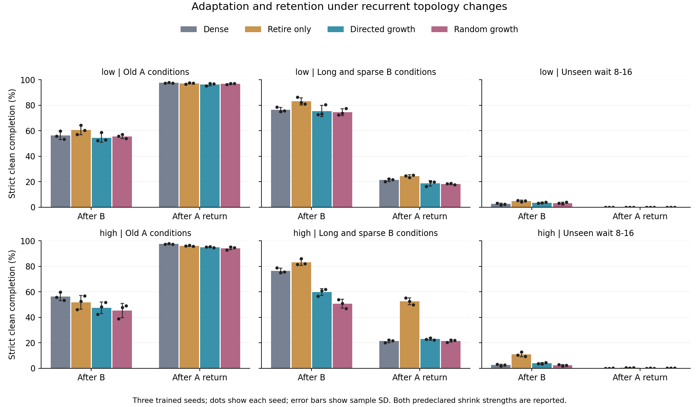
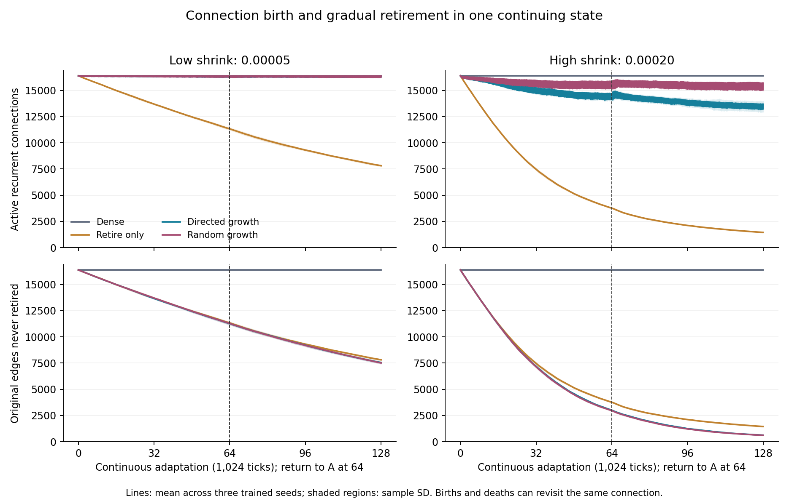

# 持续循环网络的连接渐进退出与再生长

日期：2026-10-28。接续[回路诊断与非线性连接实验](loops-experiment-2026-10-28.md)。实现与运行入口见 [experiments/rewiring](../experiments/rewiring/README.md)。

**完成：21 组连续训练、42 个完整阶段端点、210 个冻结评估分叉；5,302,688 项一致性检查通过。** 循环矩阵中已实际发生独立的连接退出与再生长，h、世界和学习历史持续保留。

这套定向再生长规则没有超过同收缩强度的只退出对照。较强的软收缩加只退出在部分长任务保持指标上更好，但空闲误动作增多，收益也随输入密度变化。结构能自动变化已经得到验证，结构变化能带来全面能力提升仍未成立。

正式[协议](evidence/rewiring-2026-10-28/study-protocol-v1.json)在评估前声明三个种子、七种条件、两个固定收缩幅度及全部评估条件。协议 SHA256 为 `ebb35d430e4ec69e618b754137e749e3f73fbb52a9592c9b80ea16ab8bc4c7c7`。两个幅度均须报告，不根据表现择优保留。

## 1. 本轮检验的问题

上一轮区分了图中的既有回路和状态相关的连接作用，本轮直接改变同一个循环矩阵 W 的实际非零支持：旧边逐步缩到零后退出，空位根据当前经验的潜在梯度重新激活。主要问题是：在同样的退出规则下，按梯度方向安排的再生长是否比不生长或随机安排位置更有利于新条件适应与返回旧条件后的继续学习。

模型仍为 `dh/dt=-h+W tanh(h)`。每次观察在自主 Heun 积分后只注入一次，动作头读取 `tanh(h)`。`W[i,j]` 表示来源 j 到接收者 i。没有新增隐藏层、神经元、允许的连接位置或预设功能模块，也没有引入旧经历重放。

三个实际来源均为[完整连续状态实验](continuity-experiment-2026-10-27.md)中种子 0/1/2 的 `online128` 最终 A 存档。逐一读取存档已确认：隐藏宽度 128，循环 W 有 16,384 个精确非零项，含 128 个自连接；总模型参数 34,348，batch=64，每个 actor 有四条并发订单流；A 已运行 131,072 tick、2,048 次更新。

起点全连接意味着首批出生必然重新激活曾退出的位置。后续再出生也发生在同一组已有位置之内，不能称为发现此前从未允许的新神经元对。附加结构算子时保留 W、编码器、动作头、h、世界、时钟、合同、待发生事件、回执、原 Adam 及 RNG，不先硬剪旧参数来腾出空位。

## 2. 普通前向中的潜在梯度与活跃更新

前向始终直接使用 W。失活位置在 W 中精确为零，没有在模型表达式中另乘固定掩码。因此，沿本块完整 Heun 计算图做 BPTT 时，可以得到零权重位置的普通导数；该导数描述在当前位置加入小权重的局部损失变化。

每 64 tick 求一次本块 BPTT，边界只截断计算图，保留 h 的数值。设更新开始时的有效掩码为 M，完整循环梯度为 g，则进入活 Adam 的循环梯度为 `M*g`。编码器、动作头及活跃循环梯度一起做 L2 裁剪，裁剪上限为 1。失活梯度在求联合裁剪范数前被排除，其候选更新使用同一个实际裁剪系数。

三个源存档均继承 Adam：学习率 `.001`、beta=`(.9,.999)`、epsilon=`1e-8`，无权重衰减。原 Adam 的步号和仍活跃位置的动量继续保留。失活与刚退出位置的活 Adam 矩清零；新生位置也以零矩进入后续活 Adam 更新，全参数步号继续。

CPU 和 CUDA 的实现检查比较了零坐标的真实 BPTT 导数与中心有限差分，并检查活跃裁剪、候选矩、精确零、后续出生和磁盘恢复后的续接一致性。它们核验数值实现，不替代正式任务表现。

## 3. 退出与候选再生长

[plasticity.py](../experiments/rewiring/plasticity.py)在完整活 Adam 更新后执行结构步骤。设固定收缩幅度为 s，对更新前活跃的位置做：

~~~text
W_after = sign(W_Adam) * max(abs(W_Adam) - s, 0)
~~~

只有缩到精确零的边退出；没有按排名或固定配额删除非零边。退出时清空该位置的活 Adam 矩和候选状态。刚退出的位置从下一次更新开始接收候选信号，不在同一次更新立即重生。更新开始时已经失活的位置继续保持 W=0，候选计算不改变本步前向。

每条失活边有独立的候选一阶矩、二阶矩及生命周期计数。用 `g*实际裁剪系数` 更新这些矩，以该失活生命周期的年龄做 Adam 偏差修正，再累加带符号的候选步长。生命周期矩可跨结构窗口继续；出生后清空，下一次退出开启新的失活生命周期。

每 8 次优化器更新检查一次出生，对应 512 tick。设本窗口实际观察次数为 n，累加的候选步长为 p，出生值为：

~~~text
q = sign(p) * max(abs(p) - s*n, 0)
~~~

窗口中途退出的边只按自己实际收到候选信号的次数计收缩成本。q 非零才提出出生；带相反符号的步长可相互抵消，不以绝对值累加替代。窗口结束清空 p 与 n，未出生位置的生命周期矩和年龄继续保留。

这是一项明确指定的“Adam 更新后做欧氏软收缩”的优化器启发式。本轮不把它称为同一 L1 目标下的精确 Adam 近端算法，也没有让模型学会结构窗口和收缩幅度。

## 4. 七种条件与控制边界

每个训练种子从同一个完整 A 来源分出以下七组，共 21 组继续学习：

| 条件 | 每步收缩幅度 s | 失活位置的处理 |
|---|---:|---|
| `dense` | 0 | 原始稠密 Adam，结构算子不改 W、梯度或活 Adam |
| `retire_low` / `retire_high` | `5e-5` / `2e-4` | 可以退出，不执行出生 |
| `learned_low` / `learned_high` | `5e-5` / `2e-4` | 将非零候选值放回提出它的失活位置 |
| `random_low` / `random_high` | `5e-5` / `2e-4` | 按接收行保留本组候选数量和带符号值，随机安排空位 |

随机组使用自己的经验和候选，不读取 learned 组的提案。对每个接收者，从本次更新开始时已有的失活位置中无放回抽样；数量与该组本行的提案数相同，带符号值来自该组本行的候选。使用独立 CPU generator，结构种子为 `91000+训练种子`，不消耗训练全局 RNG。

因此，随机组匹配的是自己每次提案的数量和带符号值，不保证后来与 learned 组有相同的死亡数、容量轨迹、梯度或任务状态。出生与退出分别触发，没有“生一条必须删一条”的要求。

稠密组提供完整允许连接容量的对照。所有来源原本都全连接，记录中的峰值容量从起点就是 16,384；本轮不把这个峰值当作训练后才发现的资源需求，也不引入一个起点被硬剪、继承函数已改变的静态稀疏模型。该设计可比较这套退出与再生长规则，尚不能单独证明纯拓扑效应。

## 5. 连续 B 与返回 A2 的预算

每组先继续 65,536 tick 的 B，再返回原 A 条件继续 65,536 tick，合计 131,072 个新增 tick、2,048 次参数更新。每个阶段均为 1,024 次更新，不额外重复当前块或回放旧块。

| 阶段 | 未来 NEW 的声明等待范围 | 最终合同截止至下次 NEW 的空档范围 |
|---|---|---|
| B | 4–8 | 4–12 |
| A2 | 1–4 | 0.5–2 |

空档不是相邻 NEW 的完整间隔；取消周期按原世界规则从 CANCEL 时刻计空档。改变分布只影响未来 NEW，已存在请求及预定替换继续履行原合同。

实际 `dt=.25`、最大 Heun 子步 `.25`，均来自源存档并已逐一核验。正式训练使用 CUDA。h、世界和结构候选状态跨 B/A2 保留，阶段切换没有重置；A 的经验库保留在完整存档中，但本轮不读取它参与学习。

模型持续执行自己的 11 类 argmax 动作。训练标签仍来自各分支行动前的因果教师，使用交叉熵监督及 WAIT 权重 `.1`。这不属于只凭稀疏环境奖励的自主学习。外部事件可以配对，动作导致的世界执行状态和后续观察仍可不同。

B 端点在返回 A 条件前保存；A2 端点在返回学习结束后保存。完整检查点包括模型、Adam、h、世界、调度器、回执、缓存、各类 RNG，以及全部掩码、候选矩、年龄、窗口计数与结构历史。恢复要求这些内容和源码绑定一致，不能只加载权重冒充同一个连续个体。

## 6. 冻结评估与统计口径

每个 B/A2 端点均复制完整状态，在 CPU 上冻结权重继续五种条件，各运行 2,048 tick、`dt=.25`。总计 42 个阶段端点、210 个冻结分叉。

| 评估条件 | 未来 NEW 等待 | 空档 |
|---|---|---|
| `iid` | 1–4 | 0.5–2 |
| `long_wait` | 4–8 | 0.5–2 |
| `longer` | 8–16 | 0.5–2 |
| `sparse` | 1–4 | 4–12 |
| `long_sparse` | 4–8 | 4–12 |

主指标为分叉后由评估分布 NEW 产生、截至结束已走完截止窗口、最终有效请求的无错误完成率：`clean_completed/matured`。替换按最终有效合同计。继承请求、分叉后继续履行旧合同的请求及右删失分别列出；即使已完成，窗口尚未结束的请求也不提前进入成熟分母。

普通完成率、FINISH 精确率、阶段错误和现有动作头的内容读出另报。内容读出的机会由模型自己的状态和行动决定，不能把其正确率等同于全部隐藏信息可读性。空闲误动作同时按空闲机会与全部启用槽机会归一化，避免只给请求完成率掩盖控制缺陷。

统计重复单位为三个训练种子。每个种子先计算各项率，再跨种子报告均值与样本标准差，标准差分母为 `n-1`；actor、请求和评估条件不作为额外训练重复。零分母保留为未定义，并明确未定义数量。

主要差异在同种子、同学习阶段、同评估条件下配对：两个幅度各自比较 learned 与 random、retire、dense，并列其他预定组间差异。A2−B 表示同一继续学习分支两个端点的变化；端点的内部状态和世界历史不同，不能把它直接解释成排除了状态影响的纯权重知识变化。

## 7. 结构、资源与结果发布边界

结构轨迹按每次完整更新后的实际 `W!=0` 计数，包含对角项，并保留来源 tick=0 的全连接起点。恒等式为：`当前非零数=初始非零数+累计出生−累计退出`。出生和退出次数允许同一位置在不同生命周期重复贡献；`ever_born` 记录至少出生过一次的不同位置数，`initial_survivors` 记录起点后从未退出的来源边。

B/A2 端点的累计计数均从继承 A 之后开始，A2 的累计出生/退出包含 B。若展示 A2 阶段单独事件数，应使用 A2 端点减去 B 端点，不能把累计值标作 A2 阶段发生量。退役后、窗口出生前的短暂容量下降进入结构组的最小容量统计；稠密组只观察完整更新后的支持。

非零边减少不等于本实现节省了相同比例的计算或存储。所有组仍保留稠密 128×128 参数、稠密前向与反向及原 Adam 张量；结构算子还保存稠密候选与计数缓冲。资源报告应分列实际张量字节数、活跃边数和稠密循环前向运算估算。后者不包括全部反向、非线性、世界模拟、Python 调度和存档开销，不当作实测总 FLOP 或独占耗时。

端点图诊断使用完整 W 的 CPU float64 副本，区分精确非零图与描述性阈值图。有向简单回路、带权闭合游走和实际跨时间记忆是不同对象，不将图的环长度换算成记忆时长，也不以边或环数量替代行为表现。

[report.py](../experiments/rewiring/report.py)须核对全部 21 组、42 个真实端点和 210 个冻结分叉，重新读取严格检查点，并复核来源、源码、文件/语义指纹、更新预算、世界时钟、无重置、结构逐步记账及评估分母。稠密 B 另与历史 `bp64` 存档做模型、Adam、h、动作、数据和只去除阶段命名后的世界一致性检查。若完整性核验失败，不发布“完整通过”的结果汇总。

全部结果已通过[严格汇总](evidence/rewiring-2026-10-28/aggregate-v1/report.json)。下文同时展示两个预定强度、全部主要条件与实际结构变化，未按结果筛掉不利分支。

## 8. 执行与恢复记录

初始队列使用 6 个 GPU 训练 worker；用户要求充分使用 14 核、20 线程硬件后，训练并发提高到 10，CPU 评估并发从 4 提高到 12。提高训练并发时进行了受控暂停，从各自最新完整检查点恢复。随后一次会话中断终止了进程树，已完成的 12 组训练和 7 组评估保留，其余同样从完整边界继续。两次恢复均未改变模型、协议、来源、种子或累计目标。

旧通用评估队列假设一个阶段的完成标记，本轮完成标记同时认证 B/A2 两个存档，故另加 [evaluate_ready.py](../experiments/rewiring/evaluate_ready.py) 适配层。在修正前没有评估作业启动；全部正式评估仍执行冻结清单中的原命令。调度修订与原状态分别保存于[评估适配记录](evidence/rewiring-2026-10-28/evaluation-coordinator-revision-v1.json)、[并发变更记录](evidence/rewiring-2026-10-28/concurrency-revision-v1.json)、[会话恢复记录](evidence/rewiring-2026-10-28/app-interruption-recovery-v1.json)。

恢复时，最后一次保存之后未落盘的短片段会重算；保留轨迹上的累计学习次数按协议记账。保存的阶段秒数不包含被丢弃后重算的临时片段，且各组经历不同并发负载，因此这些秒数不能作为完整物理计算成本或独占速度比较。完整状态恢复测试覆盖了中间结构窗口与 B/A2 边界。

## 9. 任务表现与保持

下表是严格完成率（%，三个种子的均值 ± 样本标准差）。A2 表示返回旧条件继续学习后的终点。全量分母、普通完成、内容指标和每个种子的值见[主表](evidence/rewiring-2026-10-28/aggregate-v1/main_summary.csv)及[配对差异](evidence/rewiring-2026-10-28/aggregate-v1/paired_contrasts.csv)。

### 学习 B 后

| 组 | 旧 IID | 长等待、密集 | 更远等待 8–16 | 旧等待、稀疏 | 长等待、稀疏 |
|---|---:|---:|---:|---:|---:|
| 稠密基线 | 56.39 ± 3.24 | 69.19 ± 1.52 | 2.49 ± 0.67 | 59.76 ± 1.68 | 76.49 ± 1.98 |
| 弱收缩、只退出 | 60.60 ± 3.72 | 72.50 ± 5.54 | 4.87 ± 0.58 | 62.17 ± 2.23 | 83.17 ± 2.80 |
| 弱收缩、定向再生长 | 54.55 ± 3.56 | 67.77 ± 2.31 | 3.48 ± 0.39 | 54.77 ± 0.79 | 75.51 ± 4.33 |
| 弱收缩、随机再生长 | 55.54 ± 1.62 | 68.77 ± 0.90 | 3.22 ± 0.72 | 57.46 ± 2.20 | 74.58 ± 2.58 |
| 强收缩、只退出 | 51.82 ± 5.37 | 58.45 ± 4.37 | 10.81 ± 1.71 | 62.83 ± 4.21 | 83.26 ± 2.43 |
| 强收缩、定向再生长 | 47.46 ± 4.68 | 45.69 ± 1.56 | 3.89 ± 0.61 | 48.48 ± 2.94 | 59.83 ± 2.77 |
| 强收缩、随机再生长 | 45.23 ± 5.62 | 44.13 ± 1.54 | 2.25 ± 0.56 | 48.93 ± 5.47 | 50.57 ± 3.47 |

### 返回 A 后

| 组 | 旧 IID | 长等待、密集 | 更远等待 8–16 | 旧等待、稀疏 | 长等待、稀疏 |
|---|---:|---:|---:|---:|---:|
| 稠密基线 | 97.59 ± 0.24 | 22.58 ± 1.55 | 0.02 ± 0.02 | 97.26 ± 0.19 | 21.31 ± 1.21 |
| 弱收缩、只退出 | 97.27 ± 0.47 | 27.74 ± 1.77 | 0.01 ± 0.01 | 97.53 ± 0.62 | 24.40 ± 0.96 |
| 弱收缩、定向再生长 | 96.39 ± 1.06 | 21.97 ± 2.96 | 0.01 ± 0.01 | 96.63 ± 0.59 | 18.72 ± 2.04 |
| 弱收缩、随机再生长 | 96.90 ± 0.55 | 22.12 ± 1.20 | 0.01 ± 0.01 | 97.11 ± 0.52 | 18.23 ± 0.50 |
| 强收缩、只退出 | 96.06 ± 0.39 | 44.05 ± 1.90 | 0.30 ± 0.15 | 94.59 ± 0.75 | 52.56 ± 2.71 |
| 强收缩、定向再生长 | 95.11 ± 0.43 | 25.02 ± 1.60 | 0.02 ± 0.02 | 96.60 ± 0.22 | 22.92 ± 0.88 |
| 强收缩、随机再生长 | 94.27 ± 1.19 | 22.77 ± 1.96 | 0.05 ± 0.01 | 95.93 ± 0.77 | 21.43 ± 0.93 |

强收缩定向生长相对随机生长，B 的长等待稀疏条件高 **9.26 ± 6.07 个百分点**；但相对同收缩、只退出组低 **23.43 ± 2.80 个百分点**。返回 A 后，该项差异分别为 **+1.48 ± 1.08 / −29.65 ± 2.54 个百分点**。有任务信息的生长位置优于随机位置的局部结果，没有转化为超过只退出组的收益。弱收缩下定向与随机生长差异更小。

强收缩只退出相对稠密基线，B 的长等待稀疏条件高 **6.77 ± 4.04 个百分点**，但长等待密集条件低 **10.75 ± 5.75 个百分点**；不能把稀疏条件收益推广到所有长任务。返回 A 后，它对 B 稀疏条件的严格完成为 **52.56 ± 2.71%**，基线为 **21.31 ± 1.21%**；同时旧 A 为 **96.06 ± 0.39%**，基线为 **97.59 ± 0.24%**。这表现出有限保持收益和代价。

更远等待在 B 端点虽由基线 **2.49%** 提高到强收缩只退出的 **10.81%**，仍有大部分请求失败；返回 A 后该组只剩 **0.30%**。本轮也没有证明对新任务持续积累或训练出通用计时外推。

### 任务结束后的行为仍有明显问题

每千次空闲机会的误动作如下（均值 ± 样本标准差）。这项指标必须与请求完成率一起读：

| 组 | B 端点的新稀疏条件 | A2 端点的新稀疏条件 | A2 端点旧 IID |
|---|---:|---:|---:|
| 稠密基线 | 1.10 ± 0.28 | 48.93 ± 11.51 | 0.44 ± 0.09 |
| 强收缩、只退出 | 1.76 ± 0.93 | 151.52 ± 16.08 | 1.67 ± 0.46 |
| 强收缩、定向再生长 | 3.42 ± 0.40 | 120.24 ± 6.72 | 1.36 ± 0.27 |
| 强收缩、随机再生长 | 2.66 ± 0.42 | 118.46 ± 8.93 | 1.62 ± 0.30 |

强收缩只退出在 A2 的 B 条件中保留了更多正确完成的请求，但空闲误动作从基线约 **48.93** 增到 **151.51/千次机会**。它尚未形成可靠的整体闭环控制，不能只依据 52.56% 的请求指标宣布全面改善。

## 10. 循环图确实发生了什么

下表是三个种子的结构计数均值，出生/退出为整个 B+A2 的累计事件，允许同一位置反复贡献；最终活跃数包括自连接。完整标准差和分阶段事件见[结构表](evidence/rewiring-2026-10-28/aggregate-v1/structural_summary.csv)。

| 组 | B 后活跃边 | A2 后活跃边 | 累计出生 | 累计退出 | 原始边一直存活 |
|---|---:|---:|---:|---:|---:|
| 稠密基线 | 16,384.0 | 16,384.0 | 0.0 | 0.0 | 16,384.0 |
| 弱收缩、只退出 | 11,330.7 | 7,812.7 | 0.0 | 8,571.3 | 7,812.7 |
| 弱收缩、定向再生长 | 16,365.7 | 16,362.3 | 25,640.3 | 25,662.0 | 7,545.7 |
| 弱收缩、随机再生长 | 16,362.3 | 16,359.0 | 25,528.3 | 25,553.3 | 7,517.3 |
| 强收缩、只退出 | 3,774.0 | 1,453.7 | 0.0 | 14,930.3 | 1,453.7 |
| 强收缩、定向再生长 | 14,670.7 | 13,675.7 | 133,434.0 | 136,142.3 | 629.0 |
| 强收缩、随机再生长 | 15,840.0 | 15,688.0 | 167,300.0 | 167,996.0 | 617.7 |

强收缩定向生长最终约 13,676 条边，累计出生 133,434 次、退出 136,142 次；其中起点以来从未退出的边只有约 629 条。较多的现存边与较高的旧边存活是不同概念。出生和退出没有被强制配对，记录满足实际非零数的逐步守恒关系。

强收缩只退出最终约 1,454 条边，为最初的 **8.87%**。它仍保留大型多节点反馈：三个种子的最大强连通分量为 125、119、126 个节点，二节点简单环为 147、149、159 个，三节点简单环为 468、391、433 个。网络没有退化成无反馈的线性链；这些结构统计仍不能证明哪个环承担何种记忆。

所有组仍分配 34,348 个模型参数并执行稠密计算。结构状态张量含私有随机状态共 **533,440 字节**，实时 Adam 张量为 **274,800 字节**；这里未获得相同比例的内存或稀疏计算加速。B+A2 的循环矩阵前向 MAC 估算为 **274,877,906,944**，不含完整反向、优化器、候选统计和环境成本。

## 11. 可支持的结论与下一步

这次已把实际连接退出和再生长接入持续循环模型，并通过三种子、两个强度的完整对照验证。当前两种强度下的再生长没有超过同收缩的只退出组；生长位置信号也没有解决旧能力覆盖。这个结果约束的是本次 64-tick 梯度、候选 Adam、8-update 窗口与收缩规则。

只退出的若干收益值得继续核实，但其相对稠密组同时改变了权重收缩、有效容量和可更新的连接集合。下一步应增加同收缩的稠密对照，并从同一个已学稀疏存档分叉，比较固定允许位置与再生长，先隔离这些因素。当前没有证据支持预先指定记忆保护阈值或继续叠加多个机制。

完整核验为 **5,302,688 项检查、零错误**；三个稠密 B 的模型、Adam、h、动作/数据哈希全部精确复现旧 BP64，世界只在阶段名称元数据上不同。完整联合测试 **517/517 通过**，报告说明修订后其 **61 项分析测试**另行重跑通过，重复执行不累计成更多独立测试。两个图已人工查看。[完成清单](evidence/rewiring-2026-10-28/completion.json)保存来源、状态、测试与产物指纹。
