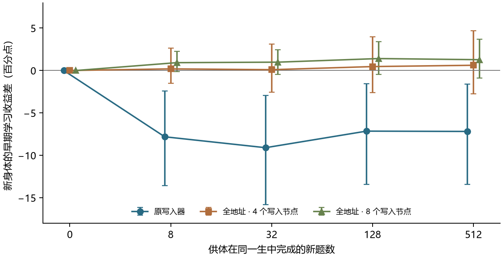

# 自改写的样本数、启蒙梯度和全部参数权限

本文使用项目的[参数术语](graph-parameter-terms.md)：参数包括全部偏置、接线和权重。活动、参数地址、执行器约束和参数数目分别计量。实验分别增加同一个体的自主生活长度、外部启蒙时独立历史的数量及启蒙所归因的时间范围。

## 一生中经历更多，能否积累更好的写法

同一个体连续遇到 512 道随机新题，每题四次接触，共 2,048 次。题间保留参数与节点活动，不运行外部优化器。在 0、8、32、128、512 题时，把写入节点的入边、对应权重与偏置移给相同的新身体。受体的气味和答案重新随机，两种生态及私有好坏配对评估。指标是 1、2、4 次真实反馈后的平均正确率相对零反馈起点的改善，再与使用出厂写入端的受体作配对差。

| 供体经历的新题数 | 0 | 8 | 32 | 128 | 512 |
|---|---:|---:|---:|---:|---:|
| 原写入器的可迁移学习收益差，百分点 | 0.00 | −7.81 | −9.10 | −7.15 | −7.18 |

512 题相对出厂写入端低 **7.18 点 [−13.44, −1.62]**，相对 8 题的变化为 **+0.63 点 [−3.21, 4.20]**。在 96 条开放供体生命里，末期 11,524 条活跃边有 11,511 条达到数值限幅，1,536 个偏置有 1,533 个达到限幅。饱和与失去学习能力同时出现，尚未在此对照中建立因果关系。19 个移植后失去强连通的样本仍计入结果，只看连通子集时差值为 −7.08 点。

使用扩展权限图、同一剂量和移植口径复测，4 和 8 个写入节点的 512 题收益差分别为 +0.62 [−2.74, 4.69]、+1.27 [−0.91, 3.67] 点。新环境中的初始短程能力本来就较弱，这两个区间不排除较小的效果。所有供体移植物改变了下次写入的行为路径，当前测量仍未显示更长生命带来可迁移的规则提升。[完整结果、区间与复现](evidence/self-edit-dose-2026-11-19/life/README.md)

图中每条曲线以它自己的出生写入端为零点，误差条为配对 95% 区间。可按出生、供体世界、受体世界、味觉生态与反馈次数复核每个单元。[三份配对评分数组](evidence/self-edit-dose-2026-11-19/life/paired-cells.zip)

## 匹配接触预算后，数据多样性和信用时间的效果

六个配对出生各跑四组，每组 69,120 次启蒙接触和 240 次 Adam。独立世界历史分别为 48 条重复和 5,760 条各一遍；两组的训练世界都只含两个简单稳定的气味对，测试才出现第三对、噪声与反转。短梯度仍看当前一次真正提交的连续写入，长梯度可沿最多 12 次真实提交传播。对相同参数，两个信用设置的活动、写入和动作在过去重放中逐项相同。

- 多样性增加后，初遇陌生带噪任务的前 12 次实际选择平均提高 **1.54 点 [0.16, 2.97]**。
- 长信用使稳定带噪环境的第 25–36 次选择提高 **5.18 点 [2.85, 7.55]**，但同一时间窗发生真实反转时下降 **3.83 点 [−6.21, −1.59]**。前者训练时有理由把已学规律保存得更稳，部署时遇到真变化却更难迅速改判。这里是逐项 95% 区间。
- 补充试验在全参数写入器上同时携带神经活动和完整图参数，保持六次连续写入的数值反传，另行改变离散命令获得下一次或全部剩余接触的信用。96 与 11,520 条独立历史、相同 69,120 接触和 360 更新的比较中，三类主要窗口的九个同时区间均包含零。[连续写入的两因素试验](evidence/self-edit-dose-2026-11-19/bootstrap/README.md) · [全权限、连续状态复核](evidence/self-edit-dose-2026-11-19/carried/README.md)

## 过去的梯度遗漏了什么

一次编辑会改变此后的行动，也会改变以后发出写命令的方式。若 S 是一次生边／退边的离散命令，p(S) 是当前图发出它的概率，L(S) 是提交它之后的未来损失，期望损失的导数有两项：每条已选路径上损失怎样变化，以及发出不同命令的概率怎样变化。旧引导对已接受的权重、偏置和新边首值求导；对离散动作、地址和生退决策按已抽到的结果处理，遗漏了第二项。六次重复版延长了第一项的时间范围，未补上第二项。在原模型上精确枚举每个样例的 58,081 个原始生退组合，确认遗漏项确实非零。[旧版独立枚举与有限差分](evidence/self-edit-dose-2026-11-19/gradient/README.md)

扩大后的写入器把地址和操作也作为随机动作。数值写入仍沿实际后续图可微传播，离散地址／操作则根据之后真正能尝到的味觉给予策略梯度。当一笔写入发生在本次味觉之后，本次味觉不能充当这笔命令的未来收益。新实现的两接触诊断把 4,224 和 6,560 条路径穷举，将真实采样估计器求期望后与直接求导比较，最大逐坐标误差低于 3×10⁻¹⁶。这个结果有明确边界：有限训练片段、固定出生接线与给定动作接口。片段外的长期效果未进入目标，真实训练仍是抽样估计。[新估计器精确核验](evidence/self-edit-dose-2026-11-19/carried/exact-two-contact-credit.json)

## 可写到哪里、增大容量是否有用

旧版允许写入节点自身的偏置和非对角连接，但排除自环，数值有界，破坏强连通的删除会被拒绝。新版把所有有序节点对和所有节点偏置提供给图选择。它先发地址，得到真实在位位、当前值、目标偏置的图内读回，再发调值、生边、退边或弃权。已存在的边能调权；不存在的边可以连入并写下首个权重。标准模式保留连通保护，可选择完全开放数值和连通修改。执行器的时钟、端口解释、节点总数以及解码程序属于固定设置。

4 个写入节点对应全图 16 个节点、272 个参数地址；8 个写入节点对应全图 20 个节点、420 个参数地址。在合法前态中逐一测试所有参数地址和适用操作，包含写入节点之间、双向边和自环。无保护实跑中，模型确实能把偏置写过 ±2.5，也能实际删除破坏强连通的桥。在核验过程中发现并修正了缺边位置可读到底层非零值的缺陷，此处使用修复后重训和重放的结果。

首次容量试验清空每次接触的瞬时活动，以隔离图参数承载的记忆。增加写入节点使三个配对种子的短稳定平均正确率从 62.57% 到 65.62%，单个种子的收益差异很大。另在六个新出生上保持活动连续，扩大后的长程带噪成绩也未出现可重复优势。更宽版本的出生时可训练数值从 144–154 增到 225–229 个，数值槽位和写入角色均有变化。**接口完整可写，不能推出图已经会在适当时刻使用每一项权限。** [容量、真实发令与权限清单](evidence/self-edit-dose-2026-11-19/permissions/README.md)

最后，对额外的 1,536 个配对时点只撤销当时的一笔写入，让两份个体在相同外界与随机数下继续生活。643 笔实际改动参数，617 笔令后续动作信号有可检测的数值变化，但只有 **39 笔**改变了随后八次接触中至少一次实际选择，19 笔提高后续正确数、17 笔降低。这个观察说明应记录有辨别力的编辑后果及其时延，同时保留长于八次才生效的可能性。[分叉原始结果](evidence/self-edit-dose-2026-11-19/carried/fork-results.json)
