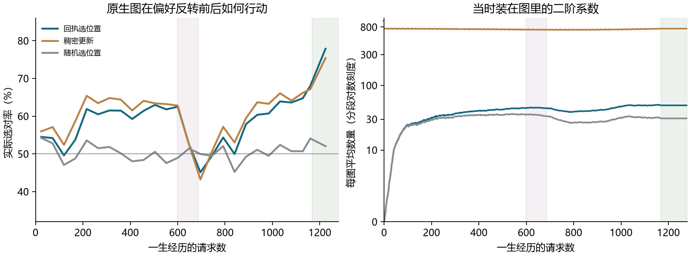

# 无端图从零生长二阶交互

上一轮把已经学好的二阶系数保留四分之一，仍可保持成绩。这一轮在同一种 16 节点强连通图上，从出生开始就不安装任何二阶系数。普通边照常生长、调权和退出。初始节点及其感觉、接触、味觉和动作端口都有原先的作用。需要在生命中形成的是：哪两条真实入边的上游活动，值得在同一接收节点相乘，以及这个乘积如何影响行动。

## 出生后用了多少交互，学到了什么

个体实际尝到食物后，抽取少量候选地址。一个地址要有两条真实入边支撑，本次行动的误差信号还要足够大，模型才安装这个系数并写入带符号的初值。随后每次实际回执都能调整已有系数。支撑边消失，或经历足够多回执后系数仍然弱，这项交互可以退出。候选筛选、96 次回执的观察期和两路输入相乘的形式由实验者提供。开发阶段选中每次抽 48 个候选，运行时没有预定总额或一进一出配额。[实验与代码](evidence/sparse-native-2026-11-19/main/README.md)

8 个未参与选型的出生与 12 个新世界交叉，每个条件共 96 个生命。每生连续经历 1,280 次物理请求。末 112 次用新食物、关闭味觉和探索电流。选到期望味觉更好的一侧得分，超时计错。

| 末段测量 | 稳定偏好 | 隐藏反转后 |
|---|---:|---:|
| 回执引导生长，实际选对率 | **77.27%** | **77.87%** |
| 同普通边学习规则的稠密图，实际选对率 | 73.20% | 75.42% |
| 同次数随机选位置，实际选对率 | 50.93% | 52.05% |
| 稀疏图，一生平均同时安装的二阶系数 | 41.75 | 39.47 |
| 稀疏图，生命末平均安装的二阶系数 | 52.44 | 49.14 |
| 稠密图，生命末平均安装的二阶系数 | 752.42 | 756.72 |

对所有出生、世界和时刻逐一比较，稀疏图的最高相对占用为 12.61% 和 14.22%，低于事先设定的四分之一目标。相对匹配稠密图，稳定成绩高 4.07 个百分点，区间 [2.05, 6.19]；反转高 2.46 点，区间 [−0.64, 5.73]。两者都通过事先设定的最多下降 3 点的界限。在又一批独立出生和世界里，将随机选择的数量进一步匹配到**每个接收节点、每次请求**，回执引导仍领先 15.83 和 16.02 点。两组的保有量在静默测验时完全匹配。[主要统计与原始数](evidence/sparse-native-2026-11-19/main/summary.json) · [逐接收节点数量对照](evidence/sparse-native-2026-11-19/main/stock-match-summary.json)

图中紫色阴影为各世界隐藏反转时刻的范围，绿色为无反馈的末段，左图按窗口平均实际行动。稀疏图可以在一生中试过许多组合：稳定情境平均累计生长约 374 项，末段仅保留约 52 项。程序没有给每个休眠位置保存长期分数。按实际分配的系数记录、索引和采样数组计，稀疏版本的批次存储峰值折算到每生命约 3 KB，稠密实现约 33 KB；包含世界、日志及运行时的整进程工作集均在约 70–72 MB，未观察到相应的整进程内存下降。[内存测量](evidence/sparse-native-2026-11-19/main/process-memory.json)

一种独立做法要求候选在两段不同回执里都获得同向证据再安装。稳定与反转准确率为 77.19% 和 78.42%，每个生命在每个时刻的已安装比例均低于 18.22%。若把临时考察中的地址也计入，峰值达到 34.36%。不同做法可以获得类似行为成绩，中间存储成本有差别。[重复证据对照](evidence/sparse-native-2026-11-19/alternative/README.md)

## 成熟时真正用到了哪里

在新的静默食物上，完整成熟图为 78.30% 和 77.13%。只保留“两名感官节点发送，同一运动节点接收”的二阶系数，成绩为 78.51% 和 77.27%；只去掉这一组则为 50.08% 和 50.19%。这些位置占存活系数的约 60%–61%，占绝对权重和的约 86%。保留同一接收节点上的全部地址，打乱其已学权重的对应关系，也足以使成绩回到约 50%。这次任务，成熟行为主要依赖感官活动到运动端口的局部组合。感官节点本身仍接收图内回传，普通边的活动与权重在这些干预中照常起作用。[位置与权重交换](evidence/sparse-native-2026-11-19/location/README.md) · [按端口定位的分叉](evidence/sparse-native-2026-11-19/location/roles.md)

## 改变需要组合的气味分量

另一组 8 个出生、8 个新世界中，A 的私有味觉由四个跨组化学乘积决定，B 改用原来未出现的两种组内乘积。两个同前史的个体在 B 的偏好相反，气味、身体和噪声相同。切换时模型收不到通知。B 教学前，两个个体的动作相同，按各自新偏好平均恰好是 50%。[协议](evidence/sparse-native-2026-11-19/switch/protocol.json)

| 到达 B 后的教学机会 | 0 | 80 | 240 | 640 |
|---|---:|---:|---:|---:|
| 全程按回执长交互 | 50.00% | 61.45% | 75.52% | **82.36%** |
| 仅在 B 暂停长新交互，照常调权、退出 | 50.00% | 60.28% | 69.74% | 73.48% |
| 稠密更新 | 50.00% | 63.63% | 73.27% | 75.37% |
| 两段回执印证后才生长 | 50.00% | 63.54% | 74.54% | 80.78% |

在 640 次机会后，持续生长相对暂停高 8.89 个百分点，同时 95% 区间 [3.26, 15.23]。暂停组仍然会退掉系数，末期每图仅余 1.84 项，开放组是 52.41 项，因而该差额同时包含补充数量和选择位置的作用。恢复 A 并重新教学 640 次后，开放组为 75.22%，这里不能直接推断刚切回时就认得旧规则。[完整曲线与分叉](evidence/sparse-native-2026-11-19/switch/summary.json)

另一批世界分别比较三种方式。锁住 A 末存活地址，允许调权且只在失去支撑边时退出，B 末为 **70.42%**，每图仍有 47.72 项。允许在 A 一生曾经安装过的位置重新生长，并照常退掉弱项，则达到 **81.71%**，末期仅有 38.02 项。完全开放为 **81.04%**、54.75 项。历史地址复用相对完全开放的差为 +0.67 点，同时区间 [−1.47, 2.89]。即使保住了库存，固定的一组位置也会吃亏。在这个任务里，可以反复启用曾经探索过的位置。历史地址限制是专门构造的诊断条件，需要额外记住地址名单。[历史地址再利用与逐次核验](evidence/sparse-native-2026-11-19/switch/history.md)

## 旧任务回来时还有多少记忆

最后用 8 个新出生与 8 个新世界做等量前史对照。第一组早年学 A，第二组学同难度但偏好方向不同的 C，随后都在相同 B 中连续学习 640 次。切回 A 的同一批静默探针上，未经复习时分别为 **50.68% 和 50.92%**；复习 80 次为 61.84% 和 61.45%，240 次为 74.55% 和 74.02%。三个预设配对差的同时区间均包含零。640 次后两组都能学回 A，但本次无法从行为上检测到经历过 A 带来的即时保持或更快再学习。**能复用过去长过的连接位置，与保留过去的正确答案，是两项不同的能力。** [等量前史与回访证据](evidence/sparse-native-2026-11-19/switch/reacquire.md)
